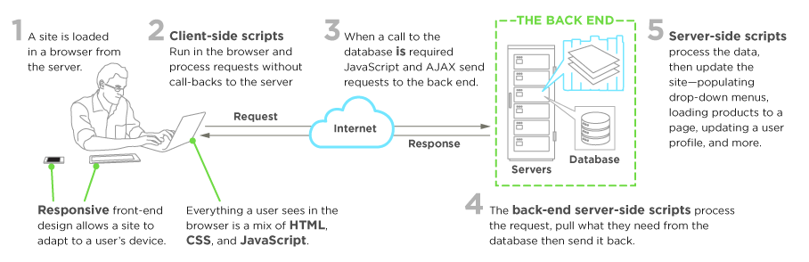
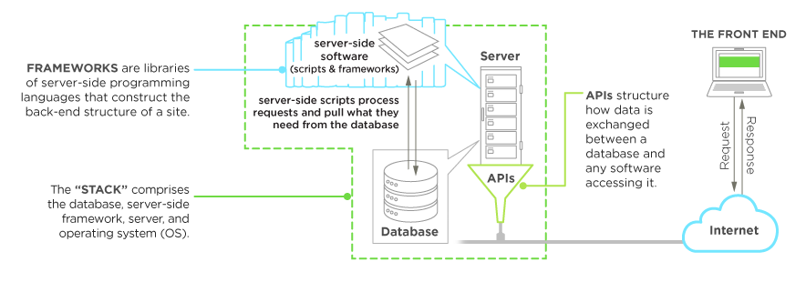
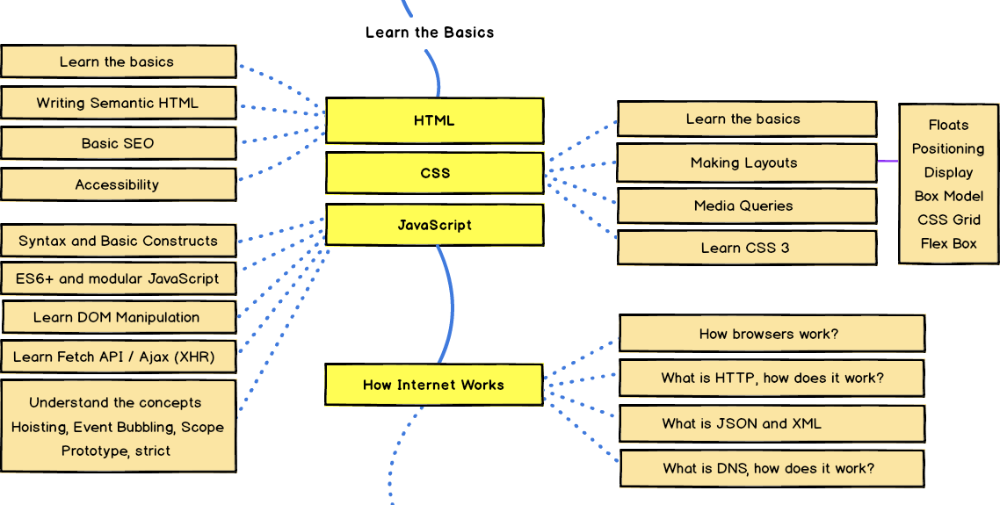
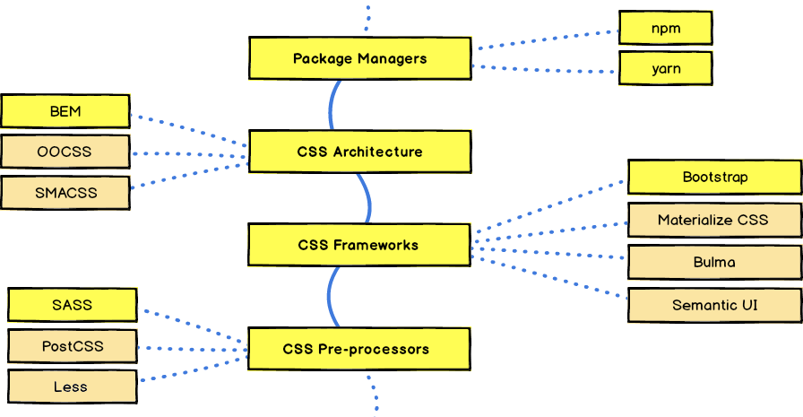
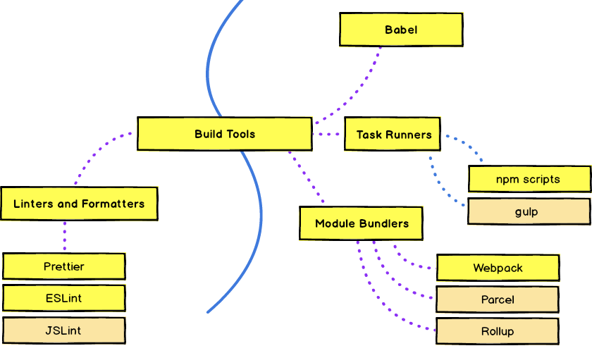
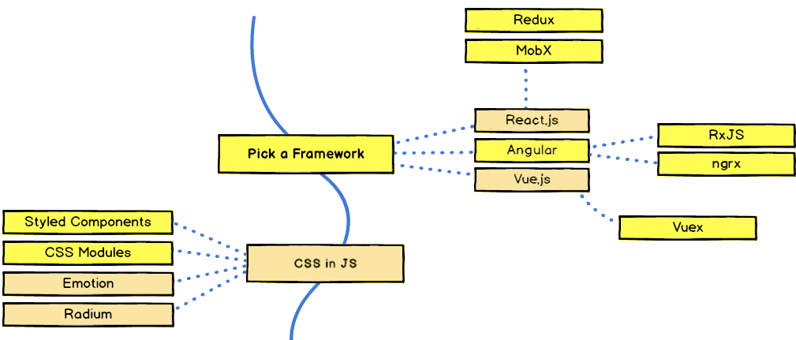
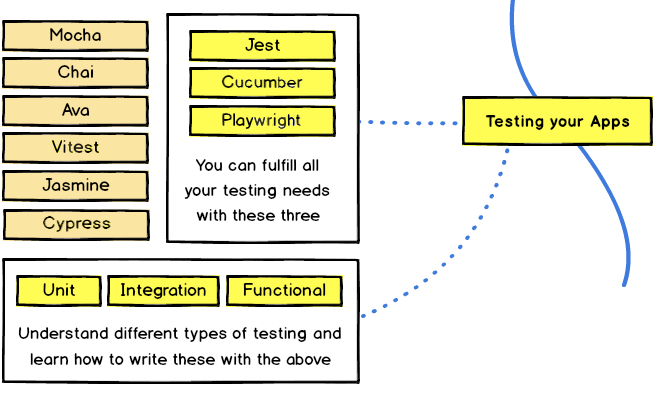
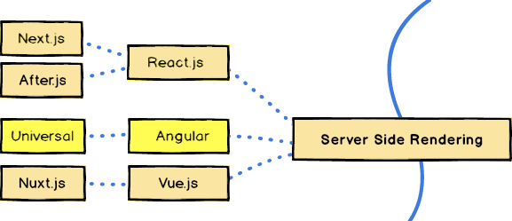

# Web Development with Angular

## Overview

Web development with [Angular](https://angular.dev/) starts with strong foundations in HTML, CSS, and JavaScript, then evolves into building scalable single-page applications with a modern toolchain and disciplined engineering practices. When selecting a framework, teams typically evaluate functionality, scalability, performance, documentation quality, community strength, and long-term viability. Angular performs well across these dimensions, while still producing the same browser runtime artifacts: HTML, CSS, and JavaScript.

Since the Angular ecosystem is broad, it helps to prioritize fundamentals first. The most important building blocks are TypeScript and RxJS. TypeScript adds static typing, interfaces, decorators, and tooling that improve maintainability in large codebases. RxJS introduces [functional reactive programming](https://gist.github.com/staltz/868e7e9bc2a7b8c1f754), providing a stream-based model for asynchronous data and events. Angular's class-oriented structure and RxJS's functional style are complementary and commonly used together.

Strong HTML and CSS knowledge remains essential. For styling at scale, a [preprocessor](https://developer.mozilla.org/docs/Glossary/CSS_preprocessor) such as [Sass](https://sass-lang.com/) improves readability and reuse through variables, nesting, functions, and mixins. Beyond language fundamentals, Angular developers also need practical proficiency in testing, linting, formatting, and source control practices.

This chapter provides a practical roadmap to modern web development with Angular, covering frontend and backend context, core web technologies (HTML, TypeScript, and CSS), Browser APIs, web components, dependency and version control practices, code quality automation, user experience fundamentals, and responsible AI-assisted development.

## Web Development

[Frontend web development](https://en.wikipedia.org/wiki/Front-end_web_development) is the practice of converting data to a graphical interface, using HTML, CSS, and JavaScript, so that users can view and interact with that data. This traditional definition doesn’t reflect the real complexity or dimension of the ecosystem of tools that we need to know. Web development today is completely different from what it was years ago. There are lots of different things that can easily baffle anyone entering web development.

To understand the frontend, we also must know the backend. The frontend, also called “client-side” programming, is what happens in the browser. It’s everything the user sees and interacts with. The backend, also called “server-side” programming, happens on the server and the database. It’s the machinery that works behind the scenes to power those fancy features users interact with on the client-side. Below are a couple of visuals to give us an idea of how frontend development flows.



Fig. 1: Frontend development

We can see how the server-side manages all those client requests that make interactive websites possible. Frontend scripts process those user requests then volley them over to the server side. This process often happens in a constant loop of requests and responses. The roles of frontend developers are to deal with the user interface, forming an essential bridge between the designer and the backend programmer. On the other side, we have the backend architecture. As we can see in the next visuals, the backend is a mix of the server, databases, APIs, and operating systems that power an app’s frontend.



Fig. 2: Backend development

Frontend development has changed significantly over the last 15 to 20 years. Back in the day, websites were simple, static text sites with a bit of formatting and maybe even some animation. That was all thanks to HTML and CSS. JavaScript has evolved the most among the existing programming languages. It turned away from writing simple logic on websites by using ugly, unstructured code and plugins, and evolved into building completely functional [Single Page Applications](https://en.wikipedia.org/wiki/Single-page_application) (SPA).

Web applications were using reloads every time a user interacted with UI. [AJAX](https://developer.mozilla.org/docs/Web/Guide/AJAX) was still something new and was used only for updating small elements on the pages. The key player was [jQuery](https://jquery.com/), its simplified [DOM](https://developer.mozilla.org/docs/Web/API/Document_Object_Model) data manipulations and added a nice wrapper for asynchronous code. Thousands of jQuery plugins were created which were responsible for specific UI interactions such as sliders, carousels, tabs and many more.

A few years later, between 2009-2010 a lot of things happened in the frontend world. Many new key players appeared on the scene. It’s worth mentioning [Backbone](https://backbonejs.org/), [RequireJS](https://requirejs.org/), [AngularJS](https://angularjs.org/), [Node](https://nodejs.org/en/), [PhoneGap](https://phonegap.com/), [Sass](https://sass-lang.com/) and [Less](http://lesscss.org/). Evolution sped up after 2010. In the following years, thousands of new libraries appeared. Finally, JavaScript had package managers for dependencies. Most users started with [Bower](https://bower.io/) and slowly turned into [npm](https://www.npmjs.com/) packages when Node.js started to be more mature.

In the “good old days” any attempts to make some automation like concatenating files, minification or images optimization needed to be done outside of the JavaScript world. New task runners started to appear. Most developers began to use [Grunt](https://gruntjs.com/) or [Gulp](https://gulpjs.com/) for simple automation. Both tools started to lose popularity for the benefit of [npm scripts](https://docs.npmjs.com/misc/scripts).

The biggest changes appeared in JavaScript applications. Developers were inspired by solutions put forward by [Backbone](https://backbonejs.org/) and [Angular](https://angular.dev/) teams and started to recreate and improve on similar solutions. It’s when [Ember](https://emberjs.com/), [Knockout](https://knockoutjs.com/), and [React](https://react.dev/) were gaining popularity. Another aspect of the development which changed slightly during this time was the modular approach to development. In “the good old days”, modules in JavaScript did not exist. Several approaches were developed until [webpack](https://webpack.js.org/) appeared, which became a standard for bundling and dealing with modules for client-side applications.

A big impact was also caused by UI Frameworks. [Bootstrap](https://getbootstrap.com/), [Foundation](https://get.foundation/index.html) and, later, [Angular Material](https://material.angular.dev/). Each one included a complete set of components, fonts, icons and utils such as the frequently used grid system. Each one sped up the development process and helped to achieve consistent UI without any additional styling. In the case of styling, for a few years, [Sass](https://sass-lang.com/) was unquestionably a leader. We have adopted nice architectural solutions for Sass such as [BEM](http://getbem.com/) or [SMACSS](http://smacss.com/). Then there was an idea that styles could be created directly in JavaScript tied up to the components with the proper scopes. Currently, there are large numbers of similar [CSS-in-JS](https://en.wikipedia.org/wiki/CSS-in-JS) solutions. In the case of SPA frameworks, the situation is clearer, there are 3 competitors, React, Angular and Vue.

The number of mobile application frameworks for JavaScript from which we can choose is also huge. There are [React Native](https://reactnative.dev/), [Ionic](https://ionicframework.com/), [NativeScript](https://www.nativescript.org/) and [Cordova](https://cordova.apache.org/). Server-side rendering is a “hot” concept nowadays as we are in the SPA era, where all content is rendered client-side.

Security is a core component of modern web applications and should be built into design, implementation, and operations from the start. Frontend code must reduce browser attack surface, backend APIs must enforce authorization and input validation, and delivery pipelines must continuously verify dependencies and configurations. A practical baseline is the [OWASP Top 10](https://owasp.org/Top10/), complemented by implementation guidance from the [OWASP Cheat Sheet Series](https://cheatsheetseries.owasp.org/).

Years ago, frontend developers could do everything their employer needed. It was not too difficult to be knowledgeable about CSS, vanilla JS, existing SPA frameworks. Nowadays it’s a bit more complicated, it’s hard to be a specialist in everything and it’s not possible to reach master level in everything related to frontend.

## Web Technologies

Web sites are made with HTML, CSS and some JavaScript. However, we are developing web applications with complex UX/UI and business that require advanced technical solutions. This section will break down and broadly describes the practice of frontend engineering starting with a roadmap proposed by [Frontend Developer Handbook 2024](https://frontendmasters.com/books/front-end-handbook/2024/) with adaptations for web developers. Other roadmaps for Frontend, Backend and DevOps are also available at [Developer Roadmaps](https://roadmap.sh/).



Fig. 3: Web development base

In yellow are defined what we need to learn and in orange are other options available. A person enters into the field of frontend development by learning to build a website or web application which relies on HTML, CSS, and JavaScript and commonly runs in a web browser but can also run in a headless browser, WebView, or as compilation input for a native runtime environment.

[Frontend Developer Handbook 2024](https://frontendmasters.com/books/front-end-handbook/2024/) recommends learning the actual underlying technologies before learning abstractions. “Don't learn jQuery, learn the DOM. Don't learn Sass, learn CSS. Don't learn JSX, learn HTML. Don't learn TypeScript, learn JavaScript. Don't learn Handlebars, learn JavaScript ES6 templates. Don't just use Bootstrap, learn UI patterns”. By learning the listed items, we should be able to work as web developers.

We can achieve these goals creating a single page application. Once we are done with this, we need to learn about version control systems, the basic usage of [Git](https://git-scm.com/) and create a profile on [GitHub](https://github.com/) or [Bitbucket](https://bitbucket.org/).


Fig. 4: Version control systems

Git is the most used version control system. Git tracks the changes we make to files, so we have a record of what has been done, and we can revert to specific versions should we ever need to. Git also makes collaboration easier, allowing changes by multiple people to all be merged into one source. Once we have covered the basics, the next step is about how to write maintainable CSS and use CSS frameworks. Here is how the roadmap should look:



Fig. 5: CSS frameworks

To complete this step, we should be able to add [Bootstrap](https://getbootstrap.com/) in the project using [npm](https://www.npmjs.com/) or [yarn](https://yarnpkg.com/). Write the CSS in [Sass](https://sass-lang.com/) and convert the project to use [BEM](http://getbem.com/) or other methodology. In general, we need to understand the importance of CSS in the code base. How the application looks is the first impression that users have. However, it can be hard to maintain a good appearance at all times with a poor code base. It's important to understand the good practices of CSS and the techniques available to write good CSS.

There are [three pillars of maintainable CSS](https://www.sitepoint.com/css-architecture-and-the-three-pillars-of-maintainable-css/) to consider when designing the CSS architecture of a software system. The first pillar defines the building blocks of the CSS architecture. These building blocks consist of a wide variety of solutions and tools, such as using Sass, writing efficient CSS selectors, the block-element-modifier (BEM) syntax, using classes instead of ID attributes, and using relative units where appropriate. Although this perspective gives us measurable improvements in CSS code quality, we need a higher level of organization to make our efforts systematic. Therefore, we need a second pillar that focuses on the orchestration of building blocks to establish solid, maintainable, hierarchical CSS. Unfortunately, neither the building blocks, nor a methodical usage of a framework or a CSS architecture give us the answer to writing rock solid, maintainable CSS. Code becomes solid through the application of software engineering principles. This is the third pillar of writing maintainable CSS.

Next steps are about modern frontend development. To become a frontend developer, we need to learn more about JavaScript and its ecosystem. We need to learn what [webpack](https://webpack.js.org/) is, understand the different concepts and why it was ever needed, understand what [Babel](https://babeljs.io/) is, why we use it and learn how to integrate it with webpack and lastly learn how to lint code using [ESLint](https://eslint.org/). All the items listed in this phase revolve around webpack.



Fig. 6: Project tools

As a frontend developer, we need to master a set of tools such as transpilers, module bundlers, task runners, CLI commands, linters and formatters. We should be able to create a npm package with scripts for serve, test, lint and build. Create a small application that runs in the browser, bundle it with webpack, use babel to transpile it, use [Biome](https://biomejs.dev/) or [ESLint](https://eslint.org/) for linting and [Prettier](https://prettier.io/) for formatting. It's important to apply Sass for the CSS, add Bootstrap for styles and apply BEM methodology. In the end, deploy the optimized production build in a web server. In general, we are working with [TypeScript](https://www.typescriptlang.org/) for Angular projects instead of [Vanilla JavaScript](http://vanilla-js.com/). That means, we have small differences when we are configuring these types of projects.

Next step is to learn about some frontend framework. There are multiple options but the ones most commonly being used these days are [Angular](https://angular.dev/), [React](https://react.dev/) and [Vue](https://vuejs.org/).



Fig. 7: JavaScript frameworks

Popular frameworks have a few core commonalities. Most frontend frameworks/libraries, from Vue to React, provide functionalities such as synchronization of state and view, routing, a template system, reusable components, browser extensions that help debugging things, they have a strong community and third-party components. However, these features aren't the main reason to use a JavaScript framework. The main reason why we need a framework is because these frameworks provide the ability to implement UIs that are guaranteed to be in sync with the internal state of the application. So, maintaining the UI in sync with the data without a framework involves writing a lot of tedious and fragile code.

Angular is the most popular framework to use with SOLID Principles for frontend projects. It has a large ecosystem, however, we don't need to know everything. It's fundamental to have knowledge in [TypeScript](https://www.typescriptlang.org/) and [RxJS](https://rxjs-dev.firebaseapp.com/) to work with Angular. Another important library to know is [NgRx](https://ngrx.io/). NgRx Store provides [reactive state management](https://blog.angular-university.io/angular-ngrx-store-and-effects-crash-course/) for Angular apps inspired by Redux. [State management](https://medium.com/@2muchcoffee/angular-state-management-a-must-have-for-large-scale-angular-apps-8b98e5a761c7) refers to the management of the state of one or more user interface controls such as text fields, buttons, radio buttons, etc., in a graphical user interface. For example, a state managed UI control such as a button will be in the enabled state when input fields have valid input values and the button will be in the disabled state when the input fields are empty or have invalid values.

[CSS-in-JS](https://en.wikipedia.org/wiki/CSS-in-JS) is a styling technique where JavaScript is used to style components. When this JavaScript is parsed, CSS is generated and attached into the DOM. It allows us to abstract CSS to the component level itself, using JavaScript to describe styles in a declarative and maintainable way. CSS-in-JS grew in popularity with React because it is a common approach in React projects. In Angular projects, it is more important to master in [Shadow DOM](https://blog.thoughtram.io/angular/2015/06/29/shadow-dom-strategies-in-angular2.html).

In the end, we should be able to use a frontend framework, build a [SPA](https://en.wikipedia.org/wiki/Single-page_application), know about [PWA](https://en.wikipedia.org/wiki/Progressive_web_application), service workers, measuring performance, using [Lighthouse](https://web.dev/lighthouse-pwa/) and different [Browser APIs](https://developer.mozilla.org/docs/Web/API). The most important APIs every frontend developer should be aware of are [Fetch API](https://developer.mozilla.org/docs/Web/API/Fetch_API), [DOM API](https://developer.mozilla.org/docs/Web/API/Document_Object_Model), [Web Storage](https://developer.mozilla.org/docs/Web/API/Web_Storage_API), [Web Workers](https://developer.mozilla.org/docs/Web/API/Web_Workers_API), [Service Workers](https://developer.mozilla.org/docs/Web/API/Service_Worker_API), [Intersection Observer](https://developer.mozilla.org/docs/Web/API/Intersection_Observer_API), [WebSocket](https://developer.mozilla.org/docs/Web/API/WebSocket_API), [Canvas](https://developer.mozilla.org/docs/Web/API/Canvas_API), [Notification API](https://developer.mozilla.org/docs/Web/API/Notifications_API), and [Payment Request API](https://developer.mozilla.org/docs/Web/API/Payment_Request_API).

Automated testing will save us a lot of headaches in the future. Manual software testing is performed by a human sitting in front of a computer carefully going through application screens, trying various usage and input combinations, comparing the results to the expected behavior and recording their observations. Manual tests are repeated often during development cycles for source code changes and other situations like multiple operating environments and hardware configurations. An automated testing tool can playback pre-recorded and predefined actions, compare the results to the expected behavior and report the success or failure of these manual tests to a test engineer. Once automated tests are created, they can easily be repeated, and they can be extended to perform tasks impossible with manual testing. Automated software testing has long been considered critical for big software development organizations but is often thought to be too expensive or difficult for smaller companies to implement.



Fig. 8: Automated testing

These test types are the most recommended and are mandatory for frontend projects. Other types of tests, such as visual testing, are optional. So, as a frontend developer, we should be able to write unit, integration and functional tests.

Angular recommends [Vitest testing framework](https://vitest.dev/) for unit and integration tests. For functional tests is recommended [Playwright](https://playwright.dev/). However, other tools with higher popularity are also available. [Cypress](https://www.cypress.io/) and [Jest](https://jestjs.io/) are the most popular testing solutions. [Cucumber](https://cucumber.io/) is a framework that runs automated acceptance tests written in a [BDD](https://en.wikipedia.org/wiki/Behavior-driven_development) style. Each solution is good, but we will get a better experience by combining Angular recommendations with the strongest tools. This means that the better combination to test Angular apps is Jest + Cucumber + Playwright. However, it is only a proposal and other combinations are valid. Another important concept about testing is [code coverage](https://en.wikipedia.org/wiki/Code_coverage).

Server rendered applications allow achieving better performance and improved SEO as compared to the client rendered applications. Although not a requirement it would help us in crafting better frontend applications. There are different options available, the most popular is [Next.js](https://nextcssjs.org/) for React. In the next image, we have the most important JavaScript solutions for server-side rendering. For Angular projects, [Angular Universal](https://blog.angular-university.io/angular-universal/) is recommended.



Fig. 9: Server-side rendering

As mentioned at the beginning, to become a frontend developer, we need to learn how the web platform works, make sure we know the "what" and "where" of HTML, CSS, DOM, JavaScript, Domains, DNS, URLs, HTTP, browsers, and servers/hosting. Learn about the fundamentals of user interface design (i.e. UI patterns, interaction design, user experience design, and usability), CLI/command line, the practice of software engineering (i.e., application design/architecture, templates, Git, testing, monitoring, automating, code quality, development methodologies), be opinionated and know how to customize the toolbox with whatever makes sense (e.g. Angular, NgRx, Vitest, and esbuild) and learn Node.js.

## HTML

HTML ([HyperText Markup Language](https://developer.mozilla.org/docs/Web/HTML)) is the standard language used to describe the structure and meaning of content on the web. It is not a programming language, instead, it is a markup language based on elements and attributes. Browsers parse HTML documents and build a tree representation of the page, which is then styled with CSS and made interactive with JavaScript.

An HTML document is composed of nested elements that represent content such as headings, paragraphs, links, lists, forms, images, and sections. The browser reads this structure from top to bottom and turns it into the Document Object Model ([DOM](https://developer.mozilla.org/docs/Web/API/Document_Object_Model)). Clean and predictable HTML structure improves maintainability, accessibility, and testability. [Semantic HTML](https://developer.mozilla.org/docs/Glossary/Semantics#semantics_in_html) means choosing elements based on meaning, not only visual appearance. Instead of using generic `<div>` and `<span>` for everything, we should use semantic elements such as `<header>`, `<main>`, `<section>`, `<article>`, `<nav>`, `<aside>`, `<footer>`, `<button>`, and `<form>`. Using Semantic HTML improves accessibility for assistive technologies, SEO because search engines better understand document structure, code readability and reduces maintenance cost.

In modern frontend engineering, strong HTML knowledge is fundamental because every framework, including Angular, eventually renders HTML in the browser. Understanding the platform first helps us make better framework decisions, write accessible interfaces, and avoid implementation problems that appear only in production.

## TypeScript

### Fundamentals

[TypeScript](https://www.typescriptlang.org/) isn’t a completely new language, it’s a superset of ES6. If we write ES6 code, it’s perfectly valid and compilable TypeScript code. Microsoft and Google are committed to moving the web forward and as developers we win because of it. TypeScript is heavily used in Angular, where types and decorators improve developer experience when working with Angular's dependency injection system.

There are five big improvements that TypeScript brings over ES5 such as types, classes, decorators, imports, and language utilities. TypeScript advantages that make people consider using it are:

- Code scalability with interface-oriented development and explicit contracts;
- Better collaboration in growing teams through predictable, typed module boundaries;
- Strong tooling and ecosystem support, especially in the editor and compiler pipeline;
- ES-next alignment, allowing modern JavaScript features with type safety;
- Better code quality and understandability through explicit types, interfaces, and generics;
- Safer and faster refactoring, because the compiler catches many issues before runtime;
- Types as living documentation for APIs and function signatures;
- Better testability through typed boundaries and easier mocking of dependencies;
- Better maintainability and predictability in large codebases;
- Easier application of architectural patterns such as SOLID principles;
- Reliable transpilation to JavaScript targets required by supported environments;
- IntelliSense and code navigation (completion, rename, go-to-definition, quick fixes) that improve productivity;
- Gradual adoption in existing JavaScript projects, allowing incremental migration.

TypeScript is unique in that it is a superset of JavaScript (ES2015+), but with optional types, interfaces, generics, and more. Unlike other compile-to-JavaScript languages, TypeScript does not try to change JavaScript into a new language. Instead, the TypeScript team takes extra care to align the language’s extra features as closely as possible with what’s available in JavaScript and its upcoming features. Because of this, TypeScript developers can take advantage of the latest features in the JavaScript language in addition to a power type system to write better-organized code while taking advantage of advanced tooling that using a statically typed language provides.

TypeScript supports object-oriented programming (OOP) with class-based inheritance. These features are great, but the truth is that they are also [dangerous](https://medium.com/@dan_abramov/how-to-use-classes-and-sleep-at-night-9af8de78ccb4) in modern JavaScript. We need a good object-oriented design ([SOLID](https://en.wikipedia.org/wiki/SOLID), [Composite Reuse](https://en.wikipedia.org/wiki/Composition_over_inheritance), etc.) to protect ourselves from these threats. As TypeScript developers, we need to know SOLID principles to write clean code. It's important to identify and apply [Design Patterns](https://refactoring.guru/design-patterns/typescript) to TypeScript projects. All patterns can be categorized by their intent, or purpose. They are creational patterns, structural patterns and behavioral patterns. It's important to understand the importance of dependency injection with [InversifyJS](https://www.npmjs.com/package/inversify) to create testable, maintainable, and extensible code. We have more examples of implementations of design patterns in TypeScript in [Márk Török](https://github.com/torokmark/design_patterns_in_typescript) repository. Also, [Patterns.dev](https://www.patterns.dev/) offers resources on design, rendering, and performance patterns for building powerful web apps with vanilla JavaScript or modern frameworks.

The real power in TypeScript comes from its tooling. Types are a means to bring world-class tooling to the JavaScript language, which allows for better structured projects that are easier to maintain. This is especially important as JavaScript projects grow (both lines of code and developers on the project). Having fast, accurate completion, refactoring capabilities, and immediate feedback makes TypeScript the ideal language for large-scale JavaScript. TypeScript also makes it simple to get started. Since JavaScript is effectively TypeScript without type annotations, all or portions of an existing project can be converted immediately and then slowly take advantage of all that TypeScript has to offer over time.

To learn more about TypeScript, we have available the [official documentation](https://www.typescriptlang.org/docs/), books, articles and guides such as [The Definitive TypeScript Guide](https://www.sitepen.com/blog/update-the-definitive-typescript-guide/).

### Project Configuration

It’s easy to work with TypeScript when using a starter project or a tool like the Angular CLI. First, we need TypeScript installed of course. We can decide to have it installed globally on the machine, or locally to the project.

```shell
npm i typescript -g
```

TypeScript comes with two binaries: *tsc* and *tsserver*. *tsc* is the TypeScript compiler and has a command line interface with plenty of available options. To initialize a TypeScript project, simply use the *--init* flag:

```shell
tsc --init
```

After running *tsc* with the *--init* flag, a *tsconfig.json* will be added to the project folder. The presence of a *tsconfig.json* file in a directory indicates that the directory is the root of a TypeScript project. The *tsconfig.json* file specifies the root files and the compiler options required to compile the project. A project is compiled in one of the following ways:

- By invoking *tsc* with no input files, in which case the compiler searches for the *tsconfig.json* file starting in the current directory and continuing up the parent directory chain.
- By invoking *tsc* with no input files and a *--project* (or just *-p*) command line option that specifies the path of a directory containing a *tsconfig.json* file, or a path to a valid *.json* file containing the configurations.

When input files are specified on the command line, *tsconfig.json* files are ignored. Below, we can see an example of *tsconfig.json* file.

```json
{
  "compilerOptions": {
    "module": "commonjs",
    "noImplicitAny": true,
    "removeComments": true,
    "preserveConstEnums": true,
    "sourceMap": true
  },
  "include": [
    "src/**/*"
  ],
  "exclude": [
    "node_modules",
    "**/*.spec.ts"
  ]
}
```

Running *tsc* locally will compile the closest project defined by a *tsconfig.json*. We can compile a set of TypeScript files by passing in a glob of files we want. The following command transpiles any .ts files in the folder src, with the default settings:

```shell
tsc src/*.ts
```

Instead of running the TypeScript compiler every time we make a change, the `tsc -w` command compiles in watch mode, recompiling whenever there are changes to the TypeScript files.

### Object-Oriented Programming

TypeScript objects are just syntax-sugar for JavaScript function-objects. There’s a lot of repetitive code when it comes to using function-objects as classes in JavaScript, that’s why class was implemented for ES6. TypeScript takes ES6 classes to a higher plane of reality by adding, not only types, but also object features such as public, private, abstract, etc.

Objects in TypeScript (like in all OO languages) are useful because they allow us to model a program based on real-world scenarios. Objects are instances (a variable with that object as its value type) of classes. Think of classes as just a group methods and variables. Classes are implemented using the class keyword, just like in ES6. To create an object, we call the class with the *new* keyword, which triggers the constructor and returns an instance-object just like in regular JavaScript.

TypeScript brings familiar OOP constructs to JavaScript. There are four main principles to Object Oriented Programming: Encapsulation, Inheritance, Abstraction, and Polymorphism. TypeScript can implement all four of them with its smaller and cleaner syntax. Using TypeScript doesn't mean we're off the hook of knowing JavaScript well. The better we know JavaScript, the better we’ll know TypeScript.

### Functional Programming

TypeScript is not a purely functional language but offers a lot of concepts which are in line with functional languages. Functional programming is a programming paradigm, a style of building the structure and elements of computer programs, that treats computation as the evaluation of mathematical functions and avoids changing-state and mutable data.

Using functional programming doesn’t mean it’s all or nothing, we can always use functional programming concepts to complement object-oriented concepts in TypeScript. The benefits of functional programming can be utilized whenever possible regardless of the paradigm or language we use.

Functional programming concepts, such as higher-order-functions, closures, currying, recursion, lazy evaluations or referential transparency, can be applied in TypeScript. TypeScript is a better option than JavaScript when it comes to functional programming. Adding type annotations can take a little bit of additional time, but the benefits will undoubtedly pay off. Our code will be less prone to errors, it will be self-documented, and the team members will be much more productive because they will spend less time trying to understand the pre-existing code.

### Style Guide

A style guide is a set of standards that outline how code should be written and organized. Good projects have clear consistent coding conventions, with automated enforcement. We need a style guide because everyone writes code differently. Style guides are created so new developers can get up to speed on a code base quickly and then write code that other developers can understand quickly and easily.

We can build our custom style guide, but we have good public options available. The most popular are [Airbnb JavaScript Style Guide](https://github.com/airbnb/javascript), [Google JavaScript Style Guide](https://google.github.io/styleguide/jsguide.html), [Idiomatic JavaScript Style Guide](https://github.com/rwaldron/idiomatic.js/) and [JavaScript Standard Style Guide](https://github.com/standard/standard). These rules are valid for TypeScript projects, but we can complete them with [Do's and Don'ts](https://www.typescriptlang.org/docs/handbook/declaration-files/do-s-and-don-ts.html) from official documentation and contributions from some authors such as [Google TypeScript Style Guide](https://google.github.io/styleguide/tsguide.html), [TypeScript StyleGuide and Coding Conventions](https://github.com/basarat/typescript-book/blob/master/docs/styleguide/styleguide.md), [TypeScript Style Guide](https://github.com/Platypi/style_typescript) and [Clean Code TypeScript](https://github.com/labs42io/clean-code-typescript). Guidelines from Airbnb are very popular and are recommended for TypeScript projects. We can complete them with rules just for TypeScript.

These guidelines are helpful, but to apply them to TypeScript projects, we need a linter, formatter and strong code review. Linting code is very helpful for preventing minor issues that can escape the eye during development. Formatting code is very helpful for readability. When working in teams, it is nice to be able to look at code that is in the same format across the entire application.

### Best Practices

The following best practices consolidate coding, design, and maintainability guidelines for writing clean, safe, and scalable TypeScript code:

- [ ] **Follow conventions**: Code conventions are base rules that allow the creation of a uniform code base across an organization. Following them increases uniformity and the quality of the code. To make it mandatory, we need a linter, formatter, and strong code review, and each team should define a dynamic convention for each project.

- [ ] **Cover the code with tests**: Testing is more important than shipping. If we have no tests or an inadequate amount, then every time we ship code, we will not be sure that we did not break anything. There is no excuse not to write tests, there are plenty of good JavaScript test frameworks with typing support for TypeScript, and we should always write tests for every new feature or module.

- [ ] **Use strict configuration**: The [strict configuration](https://itnext.io/why-typescripts-strict-true-isn-t-enough-missing-compiler-flags-for-production-code-a3877b81142c) should be mandatory and should be enabled by default because there is not much value in using Typescript without these few flags. Important options include `forceConsistentCasingInFileNames`, `noImplicitReturns`, `strict`, and `noUnusedLocals`, and we can progressively introduce `noImplicitAny`, `noImplicitThis`, `alwaysStrict`, `noPropertyAccessFromIndexSignature` and `strictNullChecks` in existing codebases.

- [ ] **Avoid any. Type everything**: Always declare variables or constants with a type other than `any`. Add return types to exported functions, public methods, and reusable helpers. Prefer `unknown` over `any` for external data. Without typing, TypeScript deduces a type from the assigned value, and this can cause unintended problems. Good typings make refactoring easier and safer.

- [ ] **Prefer unions over enums**: Literal unions are often simpler, easier to serialize, and more ergonomic than `enum` for closed sets of values.

- [ ] **Use interfaces and type aliases**: Prefer interfaces for object shapes and public contracts, and use type aliases for unions, intersections, and mapped types.

- [ ] **Use type guards and narrowing**: Prefer `typeof`, `instanceof`, `in`, and custom type guard functions (`value is T`) to narrow unions safely. This keeps runtime checks and compile-time guarantees aligned.

- [ ] **Avoid non-null assertions (`!`) as a default**: The non-null assertion operator bypasses null safety and can hide real runtime bugs. Prefer proper null checks, optional chaining, nullish coalescing, and narrowing before access.

- [ ] **Strings should be safe**: If we have a variable of type string that can have only a set of values, instead of declaring it as a string type we can declare a list of possible values as a union type. By declaring the type appropriately, we can avoid bugs during compile time rather than runtime.

- [ ] **Call things by their name**: Good variable and function names should be easy to understand and tell us what is going on, not more and not less. Avoid unreadable short names and avoid extremely long names. Also avoid marrying values and functionality in names. A function like `isLegalDrinkingAge()` communicates intent better than `isOverEighteen()`, and keeping to English is a good idea because programming languages are in English.

- [ ] **Use utility types**: TypeScript already has utility types such as `Partial<T>` and `Readonly<T>`, and they make code much easier to understand. Break interfaces or types into smaller nested interfaces only when it makes sense in the domain, because aggressively splitting types can hide structure and hurt readability, especially with code completion.

- [ ] **Use const and let**: JavaScript first searches local scope and then higher levels to global scope. `var` is function scope, while `let` and `const` are block scope. Using `let` and `const` makes declaration intention clearer and helps identify accidental reassignment to constants at compile time. Use a linter that checks and fixes this automatically.

- [ ] **Use `satisfies` and `as const` for safer literals**: `satisfies` verifies object shape without widening useful literal types, while `as const` preserves readonly literal values. Together they improve config objects and lookup tables without unsafe casting.

- [ ] **Use === instead of ==**: JavaScript has `=== | !==` and `== | !=`. It is best practice to use strict equality operators. If two operands are the same type and value, `===` behaves predictably. With `==` and `!=`, type coercion can create bugs when comparing different types.

- [ ] **Use shortcut notation sparingly**: Shortcut notation keeps code small but can hurt readability if overused. Prefer literal forms such as:
  - `{}` instead of `new Object()`
  - `""` instead of `new String()`
  - `0` instead of `new Number()`
  - `false` instead of `new Boolean()`
  - `[]` instead of `new Array()`
  - `/()/` instead of `new RegExp()`
  - `()=>{}` instead of `function () {}`

- [ ] **Avoid globals**: Global variables and function names are an incredibly bad idea because every JavaScript file on a page runs in the same scope. Scripts included later can overwrite variables and functions with the same names.

- [ ] **Avoid mixing with other technologies**: Although we can create everything in a document using JavaScript and DOM, it is not always the most effective way. Techniques such as CSS-in-JS are popular, but mixing JavaScript, HTML, and CSS in the same file can be dangerous. Good separation of concerns remains the best practice.

- [ ] **Avoid heavy nesting**: Nesting can explain logic and make code readable, but too much nesting makes code hard to follow. Readers should not have to scroll horizontally or fight wrapped lines. Deep nesting also creates messy iterator naming (`i`, `j`, `k`, `l`) and quickly becomes confusing.

- [ ] **Avoid long functions**: Long functions usually indicate they are doing too many things. Small functions are easier to read and faster to understand. If a function has more than 10 lines, ask if it should be split into smaller functions. Functions and methods around 5 to 10 lines are often easier to reason about and maintain.

- [ ] **Reduce function parameters**: Limiting function parameters makes testing easier. More than three parameters leads to a combinatorial explosion of test scenarios. One or two is ideal, three should be avoided when possible, and anything more should be consolidated, often into a higher-level object.

- [ ] **Do not use flags as function parameters**: Flags tell users a function does more than one thing. Functions should do one thing, so split functions when behavior changes based on a Boolean. Single-purpose functions are easier to compose, test, reason about, and refactor.

- [ ] **Comment as much as needed but not more**: Comments are messages to other developers, but if we are adding many comments, the code may not be self-explanatory. Good comments are informative and useful. Bad comments include commented-out code and noise comments that are not more informative than the code itself. Delete dead code instead of leaving it commented.

- [ ] **Use the fastest way to loop arrays**: There are many ways to iterate arrays (`for`, `for...of`, `forEach`, `map`, `filter`, `while`). The `for` loop is generally the fastest, and caching `length` can improve performance in some engines. `forEach` is slower for large arrays, but readability still matters unless performance is critical.

- [ ] **Prefer array methods**: A functional approach without intermediate variables is often shorter and more readable. While a base `for` loop can be more performant in some cases, benefits are noticeable mostly at very large scales. In most application code, favor clearer array methods and functional programming style over imperative style.

- [ ] **Do not use short-hand**: We can omit curly braces and semicolons and many browsers will still interpret code, but this approach is dangerous and not recommended. This is a terrible practice that should be avoided. Omitting braces is debated even for one-liners, so favor explicit syntax.

- [ ] **Use parameter defaults**: When a function is called without a parameter, the missing argument is `undefined`. ES6 default parameters let us define safe defaults directly in the function signature. It is a good habit to assign default values to arguments. See next example:

  ```typescript
  function logNumber(num = 25): void {}
  ```

- [ ] **Use spread and destructuring**: [Spread](https://developer.mozilla.org/docs/Web/JavaScript/Reference/Operators/Spread_syntax) syntax lets us expand arrays, strings, objects, maps, sets, typed arrays, and other iterables into arguments, elements, or key-value pairs. [Destructuring](https://developer.mozilla.org/docs/Web/JavaScript/Reference/Operators/Destructuring_assignment) syntax lets us unpack object and array values into individual properties, improving clarity and reducing boilerplate.

- [ ] **Use template literals**: Template literals make working with strings much easier than long concatenation. We use backticks instead of single or double quotes and produce readable, flexible strings.

- [ ] **End the switches with defaults**: Do not leave switch statements without a default case, because something can go wrong and we want to detect it. In some cases *default* can be combined with another case to avoid duplicate conditions. See next example:

  ```typescript
  function getEmoji(key: string): string {
    switch (key) {
      case 'dog':
        return '🐶';
      case 'cat':
        return '😺';
      // the rest of the emojis...
      default: case 'smile':
        return '🙂';
    }
  }
  ```

- [ ] **Enforce exhaustive checks in switches**: When switching over unions, ensure all cases are handled and use a `never` fallback to catch missing branches at compile time during refactors.

- [ ] **Use the prefix is and has for booleans**: Prefixes like `is` and `has` make it clear a variable is Boolean. Code is read more often than written, and correctly used names reduce the need for comments that can become outdated.

- [ ] **Put declarations on top**: Put variable declarations at the top of each script or function for cleaner code and a single place to inspect local variables. This helps avoid implied globals and unwanted redeclarations.

- [ ] **Initialize variables**: Initialize variables when declaring them to keep code cleaner, avoid undefined values, and keep initialization in one place.

- [ ] **Use iterators and generators**: [Iterators and generators](https://developer.mozilla.org/docs/Web/JavaScript/Guide/Iterators_and_Generators) are useful for stream-like collections. Benefits include decoupling calls from implementation, lazy execution on demand, built-in `for-of` iteration support, and optimized iterator patterns through iterables.

- [ ] **Prefer pure functions**: A pure function returns values determined only by inputs and has no observable side effects. Pure functions are easier to reason about, combine, test, debug, parallelize, memoize, and they support idempotence and referential transparency.

- [ ] **Prefer immutability**: Immutability helps differentiate objects and track changes. Mark configuration, DTOs, and class members as `readonly` when they should not change, and use immutable updates for state where practical. It increases predictability, change tracking, reactive UI implementation, testability, and single-source-of-truth design.

- [ ] **Avoid side effects**: Side effects are operations beyond input-output transformation, such as writing files or modifying global state. Programs need side effects sometimes, but they should be centralized to avoid shared mutable state and unstructured behavior.

- [ ] **Avoid magic numbers**: Magic numbers are unexplained values in source code that make code difficult to understand and maintain. Put special numbers into named constants to provide implicit documentation. Lint rules such as `no-magic-numbers` improve readability and refactoring.

- [ ] **Avoid many conditionals**: This sounds impossible, but in many cases polymorphism can replace `if` chains. The clean-code idea is that a function should do one thing. Functions with many conditionals often expose multiple responsibilities and become harder to maintain.

- [ ] **Handle JavaScript errors**: Thrown errors are useful because they identify runtime failures and provide stack traces. JavaScript and TypeScript allow throwing any object, and promises can reject with any reason, but it is advisable to throw `Error` types so catches in higher-level code are predictable.

- [ ] **Prefer promises over callbacks**: Promises are easy to use and callback APIs can be promisified. With promises and `async/await`, asynchronous code is cleaner and can improve throughput in JavaScript’s single-threaded model.

- [ ] **Do not use weird JavaScript features**: Avoid unusual and risky features such as mutating array `length`, using `with`, using `void`, updating native object prototypes, calling `eval()`, or passing strings to `setTimeout` and `setInterval`. Language support does not mean these are good practices.

- [ ] **Place scripts at the bottom of the page**: While a script loads, browser rendering cannot continue, so users wait longer before seeing progress. Scripts that mainly add functionality after interactions can be placed near the closing body tag to improve perceived load speed.

- [ ] **Raw JavaScript is faster**: Libraries such as jQuery can save development time, especially for AJAX operations, but they cannot be as fast as raw JavaScript. For example, jQuery `each` is useful, yet a native `for` loop is generally quicker.

- [ ] **Keep imports clean and readable**: Group third-party and application imports with a blank line between groups, and keep imports alphabetized where practical. Import hygiene reduces merge noise and improves scannability.

- [ ] **Use aliases for imports**: Deep relative imports are hard to read and maintain. TypeScript [path](https://www.typescriptlang.org/tsconfig/#paths) aliases provide a cleaner way to map imports to absolute paths through `compilerOptions` in `tsconfig.json`, making imports easier to read and refactor.

- [ ] **Prefer modularization**: Modularization is a general best practice. Functions that fulfill one job are easier to debug and change. This also applies to helper functions because if the same behavior appears across multiple places, extract it to a generic helper.

- [ ] **Use lazy-Loading**: Lazy or on-demand loading is a strong optimization practice. It keeps initial bundles smaller, decreases load times, and loads code only when users reach a related feature. Splitting code at logical breakpoints speeds initial load and can reduce overall application weight.

- [ ] **Remove unused code**: Unused or dead code is code that will never run, including files, conditions, loops, unused imports, variables, functions, and private members. Dead-code elimination reduces repository and bundle size, improves performance, and makes code easier to understand.

- [ ] **Compress source files**: Compress source code files and related static assets so payloads are smaller and delivery is faster. Compression improves loading performance and supports the same goal as lazy-loading.

- [ ] **Do not trust any data**: A key security point is not to trust input data. Make sure all data entering the system is clean and exactly what we need. This is especially important on the backend for URL parameters, but also on the client side for form inputs and DOM-derived values.

- [ ] **Validate runtime input at boundaries**: TypeScript types disappear at runtime, so validate external input at application boundaries. Schema validators such as [Zod](https://www.npmjs.com/package/zod), [Valibot](https://www.npmjs.com/package/valibot), or [io-ts](https://www.npmjs.com/package/io-ts) can align runtime validation with static types.

- [ ] **Enforce CI quality and performance gates**: Automate `typecheck`, lint, unit/integration tests, and bundle budget checks in CI to prevent regressions from reaching production.

## CSS

### CSS Evolution

Since the early days of the web, teams have needed ways to style pages consistently. CSS has been the foundation for that, but both the language and the way we organize styles have changed significantly over time.

In the 1990s, the focus was often on visual impact, and inline styles were common. As websites became more dynamic, styling at scale became difficult. Different developers used different conventions, and large stylesheets quickly became hard to maintain.

In 2006, [Sass](https://sass-lang.com/) was released. Sass introduced preprocessor capabilities such as variables, nesting, mixins, and reusable logic, helping teams structure styles more effectively. Other preprocessors like [Less](http://lesscss.org/) and [Stylus](https://stylus-lang.com/) followed similar goals. They introduced a compilation step that added features CSS did not yet provide natively. Today, CSS itself includes many of these ideas through custom properties, `calc()`, nesting, and other modern features, but [preprocessors are still widely used](https://2024.stateofcss.com/tools/#pre_post_processors).

Even with preprocessors and postprocessors, maintaining large CSS codebases remained challenging. This led to CSS methodologies: documented approaches for naming, structuring, and scaling styles. [BEM](https://en.bem.info/) (Block, Element, Modifier), introduced around 2010, was one of the most influential methodologies. It encouraged component-oriented naming and better reuse. Other relevant methodologies include [OOCSS](http://oocss.org/), [SMACSS](http://smacss.com/), [SUITCSS](https://suitcss.github.io/), and [Atomic CSS](https://acss.io/).

Still, Sass and naming methodologies do not provide true style encapsulation by themselves. They reduce risk through conventions, but collisions can still happen. [CSS Modules](https://www.javascriptstuff.com/what-are-css-modules/) addressed this by generating locally scoped class names at build time, reducing accidental overrides and visual regressions.

From 2014 onward, [CSS-in-JS](https://en.wikipedia.org/wiki/CSS-in-JS) grew as another approach, especially in React ecosystems, by defining styles at the component level with JavaScript. This challenged traditional separation-of-concerns practices, but also improved co-location for some teams. At the same time, native features such as custom properties and cascade layers reduced the need for heavier abstractions in many projects. In Angular projects, understanding style encapsulation strategies, including [Shadow DOM](https://blog.thoughtram.io/angular/2015/06/29/shadow-dom-strategies-in-angular2.html), is generally more relevant than adopting CSS-in-JS directly.

The practical takeaway is that no single approach is universally best. The right choice depends on team size, project complexity, framework conventions, and long-term maintainability goals.

### Sass or SCSS

[Sass](https://sass-lang.com/) is a CSS preprocessor that extends CSS with features such as variables, nesting, mixins, functions, and modules. In real projects, this helps keep styles more organized, reusable, and maintainable, especially as the codebase grows.

The terminology is often confusing, so it helps to separate two concepts:

- **Sass** is the preprocessor (the tool).
- **SCSS** is the most common Sass syntax, based on regular CSS syntax.
- **Indented Sass** (also called just "Sass syntax") is the older indentation-based syntax without braces and semicolons.

If a stylesheet is valid CSS, it is also valid SCSS. This makes SCSS easier to adopt incrementally and friendlier for teams already writing CSS.

For Angular projects, **SCSS is usually the best default** because it:

- Preserves familiar CSS syntax and reduces onboarding friction;
- Scales well with component-based styling and design tokens;
- Integrates naturally with modern tooling (for example, stylelint, PostCSS, and Autoprefixer).

When using Sass in modern projects, prefer the module system (`@use` and `@forward`) over legacy `@import`, and keep nesting shallow to avoid overly specific selectors.

### Best Practices

The following practices present a practical baseline for writing scalable, consistent, and maintainable CSS:

- [ ] **Follow conventions**: Code conventions are base rules that allow the creation of a uniform code base across an organization. To make conventions mandatory, use a linter, formatter, and strong code review, and keep rules dynamic and adaptable for each team and project. [Awesome Sass](https://github.com/Famolus/awesome-sass) is also a useful collection of frameworks, libraries, style guides, articles, and resources.

- [ ] **Follow a CSS methodology**: CSS methodologies ensure consistency and future proof styles. They reduce CSS footprint, organize cooperation among programmers, and help maintain large codebases. [BEM](http://getbem.com/) is a common methodology, and alternatives include [ITCSS](https://itcss.io/), [OOCSS](https://en.wikipedia.org/wiki/OOCSS), [SMACSS](http://smacss.com/), [SUITCSS](https://suitcss.github.io/) and [Atomic CSS](https://atomiccss.dev/).

- [ ] **Lint the CSS files**: Linting ensures we follow the rules we define for style and keep CSS consistent, well structured, and aligned with best practices. Use [stylelint](https://stylelint.io/) in CSS projects and integrate it with the IDE. Use [lint-staged](https://www.npmjs.com/package/lint-staged) to run linting commands on staged files so committed code has no linting or formatting errors.

- [ ] **Alphabetize CSS properties**: Organization rules vary by developer, so define team rules and enforce them with a linter. [stylelint](https://www.npmjs.com/package/stylelint) can organize CSS and enforce strict property order, syntax checks, and style consistency for everyone.

- [ ] **Cross-browser compatibility**: Browser prefixes exist so browser makers can support new features before full standard support. With [PostCSS](https://postcss.org/) and [Autoprefixer](https://github.com/postcss/autoprefixer), we can write normal CSS and let the postprocessor handle prefixes. Autoprefixer uses [Browserslist](https://github.com/browserslist/browserslist) to determine which browsers should be supported.

- [ ] **Prefer CSS over JavaScript**: If something can be done with CSS instead of JavaScript, prefer CSS. Even when JavaScript is needed, CSS should handle most style while JavaScript handles triggers and side effects. JavaScript is not fault tolerant and can be disastrous when misused. Applications are faster using CSS for styling behavior.

- [ ] **Comment the CSS**: Add comments for each group of CSS code when they provide value. Comments help explain blocks of code or temporary development changes. Keep comments clear and purposeful so maintenance is easier.

- [ ] **Avoid undoing styles**: CSS that unsets previous styles should ring alarm bells. Rulesets should inherit and add to previous ones, not undo them. See next bad example:

  ```css
  h2 {
    font-size: 2em;
    padding-bottom: 0.5em;
    border-bottom: 1px solid #ccc;
  }

  .no-border {
    padding-bottom: 0;
    border-bottom: none;
  }
  ```

  If we repeatedly remove styles later in the stylesheet, it often means styles were added too soon and should be moved to the correct class.

- [ ] **Avoid brute forcing**: Brute forcing CSS uses hard-coded magic numbers and hacks to force layouts, such as negative margins without structural reasoning. This usually indicates poor layout code or weak understanding of box model and computed styles. Well coded layouts should not need brute-force manipulation.

- [ ] **Avoid magic numbers**: A magic number is a value used because it just works. They become outdated, confuse developers, cannot be explained, and cannot be trusted. Never use numbers only because they seem to work right now. Lint's rules can detect this.

- [ ] **Avoid qualified selectors**: Qualified selectors like `ul.nav`, `a.button`, or `div.header` are needlessly prepended by an element. They inhibit reusability, increase specificity, and increase browser workload. Prefer simple selectors like `.nav`, `.button`, and `.header` for better portability and performance.

- [ ] **Avoid dangerous selectors**: Dangerous selectors have too broad a reach, such as styling every `div` with specific appearance. These styles leak into places they should not, and then require undoing styles later. Keep selectors scoped and intentional.

- [ ] **Avoid extra selectors**: Extra selectors clutter stylesheets and make CSS less simple and clean. Deep chains like `body #container .someclass ul li` often can be reduced to `.someclass li` with the same result.

- [ ] **Avoid reactive !important**: `!important` is an important tool, but it should be used proactively, not reactively. Proactive usage is for intentional guarantees (for example, error text always red). Reactive usage to escape specificity problems only treats symptoms of ill-formed CSS.

- [ ] **Avoid IDs**: IDs cannot be reused in a page and are far more specific than classes. Their traits can usually be abstracted into reusable classes. For maintainable CSS, avoid IDs as styling hooks.

- [ ] **Avoid loose class names**: Loose names like `.board` or `.user` are vague and easy to accidentally reuse or override. Use stricter class names that communicate purpose clearly. BEM helps create names that are specific and maintainable.

- [ ] **Avoid string concatenation for classes**: Sass `&` concatenation is DRY, but it can hide full class names from source search. If `.foo-bar` is only generated indirectly, searching the CSS codebase becomes harder and tracing style origin is more difficult. See next example:

  ```css
  .foo {
    color: red;
    &-bar {
      font-weight: bold;
    }
  }
  ```

- [ ] **Avoid duplicated key selectors**: The key selector is the selector being styled. Repeating the same key selector across multiple contexts creates mutation and removes a single source of truth. Keep shared classes defined consistently to avoid divergent outcomes.

- [ ] **Avoid using inline styles**: Inline styles mix content and presentation, hurt scalability, and reduce maintainability. They force repeated updates across many HTML files instead of one global stylesheet. As a rule of thumb, define styles in CSS files.

- [ ] **Avoid classes in wrong components**: Group styles by subject (the key selector) and place contextual styles where they logically belong. Keeping related component styles together reduces cognitive overhead, makes migration easier, and avoids chasing style fragments across many files.

- [ ] **Avoid shorthand syntax everywhere**: Shorthand syntax reduces keystrokes and bytes but can unset properties we did not intend to modify. Prefer longhand when accuracy matters. Write only as much as needed and avoid hidden side effects.

- [ ] **Avoid too many font files**: Too many fonts make websites chaotic and increase load/render delays. Font requests are often delayed until render tree construction, which can delay text rendering. Include only necessary fonts and optimize WebFont loading and rendering. It is recommended to [optimize WebFont loading and rendering](https://web.dev/optimize-webfont-loading).

- [ ] **Prefer class selectors**: Class selectors (`.my-class`) are faster than attribute selectors (`[data-type="value"]`), pseudo-selectors (`:nth-child()`), or element selectors (`div`).

- [ ] **Use multiple classes**: It is often beneficial to apply multiple classes to an element, for example combining a base class and a contextual class. This improves reuse and keeps styling composable. See next example:

  ```html
  <div class="box warning"></div>
  ```

- [ ] **Use nested declarations**: CSS preprocessors improve organization and support nesting so we can see relationships between selectors. Nesting is powerful but easy to overuse. Avoid going deeper than about three levels to limit specificity and keep code readable.

- [ ] **Use "Margin: 0 auto" to center layouts**: Block-level elements cannot be centered with `float: center;`. Use `margin: 0 auto;` so left and right margins are equal and the element centers within its container.

- [ ] **Use Hex Code instead of Name Color**: Prefer hex colors over named colors for consistency and practical performance habits. Use naming conventions for color variables so colors have human-understandable names (for example with a naming reference like [Veli's colorpedia](http://veli.ee/colorpedia/)).

- [ ] **Use a CSS reset**: Start with a reset stylesheet to standardize browser default differences and create a clean slate for app design. Include reset styles before other styles.

- [ ] **Use a CSS pre-processor**: CSS lacks some programming-language tools like variables and richer abstractions. Preprocessors such as Sass add variables, operators, interpolation, functions, and mixins, making style architecture more readable and easier to maintain.

- [ ] **Use a CSS post-processor**: If CSS load feels slow, compress and optimize CSS output. Minification and compression reduce file size by removing whitespace, line breaks, and redundant rules. Tools like [PostCSS](https://www.npmjs.com/package/postcss), [cssnano](https://www.npmjs.com/package/cssnano) and [clean-css](https://www.npmjs.com/package/clean-css) help automate this.

- [ ] **Use a CSS framework**: Frameworks such as [Angular Material](https://material.angular.dev/) collect common styles and implement many best practices by default. They can save time and improve consistency, but they are not perfect for every job and can have side effects if used incorrectly.

- [ ] **Use a design system**: A design system is a set of reusable components guided by clear standards. It helps define global rules, modularize decisions, and apply best practices consistently. It is future proof because global changes and fixes become easier.

- [ ] **Use relative units**: Prefer relative units such as `em`, `rem`, `%`, `vw`, `vh`, and `fr`. Fixed units like `px` and `pt` are sometimes needed but should not dominate fluid web layout decisions.

- [ ] **Use CSS variables**: CSS variables remain available in the browser and support flexible, reusable UI design. Unlike preprocessor variables, they do not always require a compile step and are useful for design systems and dynamic features.

- [ ] **Prefer design tokens**: Centralize colors, spacing, typography, radii, shadows, and z-index scales behind tokens or CSS custom properties. Tokens reduce visual drift, make theming possible, and keep component styles aligned with the broader system.

- [ ] **Prefer modern layout primitives**: Use Flexbox, Grid, and `gap` for layout before reaching for floats, absolute positioning, or negative-margin hacks. Modern layout primitives express intent more clearly and usually reduce CSS complexity.

- [ ] **Prefer logical properties**: Prefer properties such as `margin-inline`, `padding-block`, `inset-inline`, and `border-block` over left/right-specific rules when layout should adapt to different writing modes. This improves internationalization support and reduces duplicated directional overrides.

- [ ] **Write descriptive media queries**: Media queries are central to responsive development, but they become complex quickly. Improve maintainability by naming query rules (for example with Sass variables/interpolation) and keeping responsive intent clear.

- [ ] **Use container queries**: When a component should adapt to the space provided by its parent rather than the viewport, prefer container queries over global breakpoints for component-driven responsiveness. This fits component-based architectures well and reduces coupling between page layout and component styling.

- [ ] **Separate global vs local style**: Distinguish global styles from component-specific styles. Keep global rules in dedicated files and keep local component styles near components. This aligns with modern frontend frameworks and improves maintainability.

- [ ] **Respect accessibility preferences**: Preserve visible focus indicators, meet contrast requirements, and support user preferences such as [prefers-reduced-motion](https://web.dev/articles/prefers-reduced-motion) when adding animations. CSS should improve usability, not make interaction harder for keyboard users or motion-sensitive users.

- [ ] **Minimize expensive properties**: Complex painting properties (`box-shadow`, `filter`, frequent `width/height` changes, etc.) can trigger expensive recalculation and repainting. Use them carefully, and use `will-change` only as a last resort performance hint.

- [ ] **Animate compositor-friendly properties**: Prefer animating `transform` and `opacity` instead of layout-affecting properties such as `top`, `left`, `width`, or `height`. This usually produces smoother animations and avoids unnecessary layout and paint work.

- [ ] **Style to be responsive or at least adaptive**: People access apps on many devices and sizes. Responsive design improves user experience and is recommended by Google. If full responsiveness is not planned, keep layouts at least adaptive.

- [ ] **Let the content define the size**: Instead of fixed width and height, use padding and constraints like `max-width`/`max-height` unless strict size is required. This reduces layout bugs and improves component reusability.

- [ ] **Let the parent take care child position**: In content flow components, avoid embedding positioning and external spacing rules inside child styles. Let container context decide position and distance between elements for better reuse and layout control.

- [ ] **Create the HTML first**: Building the full HTML mockup first can save time because we know the complete structure before deciding CSS details. This supports more holistic, top-down styling decisions.

- [ ] **Combine elements with same styles**: When multiple elements share properties, group selectors rather than repeating declarations. Shared style blocks reduce duplication while allowing specific overrides later. See next example:

  ```css
  h1,
  h2,
  h3 {
    font-family: 'Times New Roman', Times, serif;
  }
  ```

- [ ] **Modularize the styles**: Do not bundle all CSS in one file if it is not needed immediately. Serve only page-relevant styles and consider splitting essential vs non-essential styles (for example hidden dialogs/notifications) to reduce initial load.

- [ ] **Lazy load stylesheets**: Lazy loading defers non-critical resources at page load time. Since CSS is render blocking by default, defer non-critical styles with bundlers, dynamic import, loaders, or link strategies to improve initial rendering. There are many ways to [lazy load the CSS](https://developer.mozilla.org/docs/Web/Performance/Lazy_loading#css) files and it is often easier when using bundlers like [webpack](https://webpack.js.org/) and playing around with dynamic import.

- [ ] **Remove unused CSS**: Unused CSS adds dead weight, slows performance, and makes maintenance harder. Keep styles clean and orderly by removing unused rules manually or with tools such as [PurgeCSS](https://www.npmjs.com/package/purgecss), [PurifyCSS](https://www.npmjs.com/package/purify-css), and [UnCSS](https://www.npmjs.com/package/uncss).

- [ ] **Minimize the CSS**: Minimize CSS before loading it in the browser. Smaller files load and process faster. Use post-processors or build steps with tools like [webpack CSS minimizer plugin](https://webpack.js.org/plugins/css-minimizer-webpack-plugin/) to optimize and minify output.

## Browser APIs

[Browser APIs](https://developer.mozilla.org/docs/Web/API) (often called Web APIs) are built-in interfaces provided by web browsers that let JavaScript interact with the browser, the device, the network, and the page itself. They extend the core JavaScript language with capabilities that JavaScript alone does not have. Modern frontend applications leverage many Browser APIs to build rich and performant experiences. Below is a comprehensive reference of Browser APIs grouped by purpose.

Document & DOM APIs:

- [DOM API](https://developer.mozilla.org/docs/Web/API/Document_Object_Model): Manipulate HTML structure. e.g. update the page after user actions without reloading;
- [History API](https://developer.mozilla.org/docs/Web/API/History_API): Control browser navigation (SPA routing). e.g. change routes with back/forward support in a single-page app;
- [URL API](https://developer.mozilla.org/docs/Web/API/URL_API): Parse and construct URLs easily. e.g. read and update query parameters for search and filters;
- [MutationObserver](https://developer.mozilla.org/docs/Web/API/MutationObserver): Watch DOM changes efficiently. e.g. react when third-party widgets insert or remove elements;
- [Shadow DOM API](https://developer.mozilla.org/docs/Web/API/Web_components/Using_shadow_DOM): Encapsulate component markup and styles. e.g. build reusable UI components without global CSS conflicts.

Storage & Data APIs:

- [LocalStorage](https://developer.mozilla.org/docs/Web/API/Window/localStorage) / [SessionStorage](https://developer.mozilla.org/docs/Web/API/Window/sessionStorage): Simple key-value storage. e.g. keep user theme preferences or short-lived form progress;
- [IndexedDB](https://developer.mozilla.org/docs/Web/API/IndexedDB_API): Powerful client-side database. e.g. store large offline datasets for a PWA;
- [Cache API](https://developer.mozilla.org/docs/Web/API/Cache): Store HTTP responses (used in service workers). e.g. serve app shell assets offline for faster repeat visits;
- [StorageManager API](https://developer.mozilla.org/docs/Web/API/StorageManager): Manage storage quotas. e.g. estimate remaining storage before caching large files;
- [File System Access API](https://developer.mozilla.org/docs/Web/API/File_System_API): Read/write local files. e.g. implement browser-based editors that open and save local project files;
- [Clipboard API](https://developer.mozilla.org/docs/Web/API/Clipboard_API): Read/write clipboard content. e.g. support one-click copy for code snippets or invite links.

Network & Communication APIs:

- [Fetch API](https://developer.mozilla.org/docs/Web/API/Fetch_API): Modern way to make HTTP requests. e.g. call a REST endpoint to load dashboard data;
- [AbortController API](https://developer.mozilla.org/docs/Web/API/AbortController): Cancel async operations such as fetches. e.g. cancel stale HTTP requests when users type quickly in an Angular search box;
- [WebSocket API](https://developer.mozilla.org/docs/Web/API/WebSocket_API): Real-time bidirectional communication. e.g. power live chat, trading feeds, or multiplayer updates;
- [Server-Sent Events](https://developer.mozilla.org/docs/Web/API/Server-sent_events): Server to client streaming. e.g. stream live notifications or status updates with simpler one-way messaging;
- [Beacon API](https://developer.mozilla.org/docs/Web/API/Beacon_API): Send analytics data reliably. e.g. flush usage metrics when users close or navigate away from a page;
- [Broadcast Channel API](https://developer.mozilla.org/docs/Web/API/Broadcast_Channel_API): Communicate across browser tabs/windows of the same origin. e.g. sync logout, theme, or cache refresh events between multiple open app tabs;
- [Channel Messaging API](https://developer.mozilla.org/docs/Web/API/Channel_Messaging_API): Create structured message channels between browsing contexts. e.g. coordinate secure communication between an app shell, iframe, and worker;
- [Network Information API](https://developer.mozilla.org/docs/Web/API/Network_Information_API): Detect connection type/speed. e.g. downgrade media quality on slow or metered networks.

Graphics & Media APIs:

- [Canvas API](https://developer.mozilla.org/docs/Web/API/Canvas_API): Draw 2D graphics dynamically. e.g. render charts, signatures, or custom image editors;
- [WebGL API](https://developer.mozilla.org/docs/Web/API/WebGL_API): Render 3D graphics in the browser. e.g. build interactive 3D product viewers;
- [WebGPU API](https://developer.mozilla.org/docs/Web/API/WebGPU_API): Next-generation GPU access (faster than WebGL). e.g. run high-performance visualizations or compute-heavy simulations in-browser;
- [SVG API](https://developer.mozilla.org/docs/Web/SVG): Manipulate vector graphics. e.g. animate scalable icons and diagrams;
- [MediaDevices API](https://developer.mozilla.org/docs/Web/API/MediaDevices_API): Access camera and microphone. e.g. capture webcam input for profile photos or meetings;
- [WebRTC API](https://developer.mozilla.org/docs/Web/API/WebRTC_API): Real-time video/audio communication. e.g. enable peer-to-peer video calls and screen sharing.

Performance & Background Processing APIs:

- [Web Workers API](https://developer.mozilla.org/docs/Web/API/Web_Workers_API): Run scripts in background threads. e.g. process large JSON or image transformations without blocking the UI;
- [Service Workers API](https://developer.mozilla.org/docs/Web/API/Service_Worker_API): Offline support, caching, and push notifications. e.g. make a PWA installable with resilient offline behavior;
- [Background Sync API](https://developer.mozilla.org/docs/Web/API/Background_Synchronization_API): Defer network work until connectivity is available. e.g. retry queued form submissions after a mobile device comes back online;
- [Periodic Background Sync API](https://developer.mozilla.org/docs/Web/API/Web_Periodic_Background_Synchronization_API): Refresh content in the background on supported platforms. e.g. update cached news or inbox data for a PWA before the user reopens it;
- [Performance API](https://developer.mozilla.org/docs/Web/API/Performance_API): Measure app performance. e.g. track page load milestones and custom timing metrics.

Device & Hardware APIs:

- [Geolocation API](https://developer.mozilla.org/docs/Web/API/Geolocation_API): Get user location. e.g. show nearby stores or delivery options based on current position;
- [Battery Status API](https://developer.mozilla.org/docs/Web/API/Battery_Status_API): Check battery level (limited support). e.g. reduce background sync when battery is low;
- [Device Orientation API](https://developer.mozilla.org/docs/Web/API/Device_orientation_events): Detect device rotation. e.g. control game interactions by tilting the device;
- [Vibration API](https://developer.mozilla.org/docs/Web/API/Vibration_API): Trigger vibration (mobile). e.g. provide haptic feedback after important actions;
- [Web Bluetooth API](https://developer.mozilla.org/docs/Web/API/Web_Bluetooth_API): Connect to Bluetooth devices. e.g. pair a web app with heart-rate sensors or IoT peripherals;
- [Web USB API](https://developer.mozilla.org/docs/Web/API/WebUSB_API): Interact with USB devices. e.g. communicate with specialized hardware from a browser admin tool.

Security & Identity APIs:

- [Web Crypto API](https://developer.mozilla.org/docs/Web/API/Web_Crypto_API): Encryption, hashing, and key generation. e.g. hash sensitive client data before sending it to the server;
- [Credential Management API](https://developer.mozilla.org/docs/Web/API/Credential_Management_API): Handle login credentials. e.g. simplify sign-in with saved credentials and reduced form friction;
- [WebAuthn API](https://developer.mozilla.org/docs/Web/API/Web_Authentication_API): Passwordless authentication (biometrics, security keys). e.g. implement phishing-resistant MFA in enterprise apps;
- [Federated Credential Management API](https://developer.mozilla.org/docs/Web/API/FedCM_API): Support privacy-preserving federated sign-in flows. e.g. integrate identity providers without relying on third-party cookies;
- [Permissions API](https://developer.mozilla.org/docs/Web/API/Permissions_API): Query permission status (camera, location, etc.). e.g. check permission state before showing camera or location prompts.

Payments & Engagement APIs:

- [Payment Request API](https://developer.mozilla.org/docs/Web/API/Payment_Request_API): Streamline browser-native checkout flows. e.g. collect shipping, payer details, and supported payment methods with fewer form fields and less checkout friction;
- [Payment Handler API](https://developer.mozilla.org/docs/Web/API/Payment_Handler_API): Integrate web-based payment apps with the browser payment flow. e.g. allow a wallet-style PWA to act as a payment method during checkout;
- [Notification API](https://developer.mozilla.org/docs/Web/API/Notifications_API): Display system notifications after permission is granted. e.g. notify users about order status changes or long-running job completion;
- [Push API](https://developer.mozilla.org/docs/Web/API/Push_API): Receive push messages through a service worker. e.g. send re-engagement or operational alerts even when the app tab is closed.

UI & Interaction APIs:

- [Intersection Observer API](https://developer.mozilla.org/docs/Web/API/Intersection_Observer_API): Detect element visibility. e.g. lazy load images when they enter the viewport;
- [Resize Observer API](https://developer.mozilla.org/docs/Web/API/Resize_Observer_API): Watch element size changes. e.g. recalculate chart layouts when containers resize;
- [Fullscreen API](https://developer.mozilla.org/docs/Web/API/Fullscreen_API): Toggle fullscreen mode. e.g. switch dashboards or media players into distraction-free view;
- [Pointer Events API](https://developer.mozilla.org/docs/Web/API/Pointer_events): Unified mouse/touch input. e.g. implement drawing canvases that work consistently across devices;
- [Drag and Drop API](https://developer.mozilla.org/docs/Web/API/HTML_Drag_and_Drop_API): Native drag-drop interactions. e.g. reorder Kanban cards or upload files by dropping them in a target area;
- [Idle Detection API](https://developer.mozilla.org/docs/Web/API/Idle_Detection_API): Detect user inactivity. e.g. auto-set status to away and pause heavy background tasks;
- [Screen Capture API](https://developer.mozilla.org/docs/Web/API/Screen_Capture_API): Capture screen content. e.g. share a browser tab during remote support or online meetings.

## Web Components

### Definition

[Web Components](https://developer.mozilla.org/docs/Web/API/Web_components) create reusable HTML elements using Custom Elements, Shadow DOM, and HTML Templates. Web Components are especially useful when we need UI pieces that can be reused across technology boundaries. Web Components are framework-agnostic and work in any modern browser. This makes them ideal for building design systems and shared component libraries that need to be consumed across different frameworks (Angular, React, Vue) or in plain HTML pages.

Web Components are based on three browser primitives:

- [Custom Elements](https://developer.mozilla.org/docs/Web/API/Web_components/Using_custom_elements): define new HTML tags such as `<customer-card>`;
- [Shadow DOM](https://developer.mozilla.org/docs/Web/API/Web_components/Using_shadow_DOM): encapsulate markup and styles to avoid global CSS leaks;
- [HTML Templates](https://developer.mozilla.org/docs/Web/HTML/Element/template): define inert markup chunks that can be cloned and rendered.

This model gives us strong isolation and interoperability. A component can expose a stable API via attributes, properties, methods, and custom events, while hiding implementation details.

To share web components between projects, package them as versioned artifacts with clear contracts, following these recommendations:

- Publish to a private npm registry or CDN bundle;
- Version with semantic versioning and keep backward-compatible APIs stable;
- Document inputs, outputs, events, accessibility behavior and theming tokens;
- Provide a changelog and migration notes for breaking changes;
- Add visual and contract tests to detect regressions across hosts.

In enterprise environments, a common pattern is to maintain a "Web Components library" repository alongside the design system. Angular apps can consume those components directly, while non-Angular apps use the same compiled bundle.

### Angular Elements

[Angular Elements](https://angular.dev/guide/elements) is an Angular package (`@angular/elements`) that allows Angular components to be packaged as custom elements (Web Components). Angular Elements wraps Angular components using the `createCustomElement()` API, which creates a bridge between Angular's component interface and the browser's Custom Elements API.

Use cases for Angular Elements:

- **Embedding Angular components in non-Angular applications**: Angular Elements can be used in CMS platforms, legacy applications, or applications built with other frameworks.
- **Micro-frontend integration**: Angular Elements can serve as the building blocks for micro-frontend architectures, where different parts of the page are built by different teams.
- **Dynamic content**: Content management systems can render Angular-powered interactive widgets alongside static content.
- **Shared component libraries**: Organizations can build a single component library in Angular and distribute it as Web Components for consumption across different technology stacks.

Considerations when using Angular Elements include bundle size (each element carries the Angular runtime unless shared), performance implications of multiple Angular zones, and the need for polyfills in older browsers.

### Lit

[Lit](https://lit.dev/) is a lightweight library for building Web Components using modern browser standards. Lit provides a small reactive layer on top of Custom Elements and Shadow DOM, helping teams create fast, maintainable, framework-agnostic components with less boilerplate than vanilla Web Components.

Use cases for Lit:

- **Building reusable design system components**: Lit is well suited for creating shared UI primitives (buttons, inputs, dialogs, tables) that can be consumed by Angular, React, Vue, or plain HTML applications.
- **Incremental modernization**: Lit components can be introduced into legacy or multi-framework environments without requiring a full frontend rewrite.
- **Micro-frontend interoperability**: In distributed frontend architectures, Lit provides a neutral component format that different teams can adopt regardless of their framework choices.
- **High-performance UI widgets**: Lit's efficient reactive updates make it a strong option for interactive widgets and component-heavy interfaces where render performance matters.

Considerations when using Lit include defining clear conventions for state and event contracts, ensuring accessibility and theming standards across component libraries, and planning integration patterns in Angular apps (for example, input/output bindings, custom event handling, and form control interoperability).

## Dependency Management

### Management Tasks

Dependency management is the set of practices used to choose, install, update, audit and govern third-party packages during the full software lifecycle. In Angular applications, dependency management affects build stability, delivery speed, security posture and long-term maintainability.

Typical dependency management tasks in frontend and Angular projects include:

- Selecting libraries and tools based on maturity, maintenance activity, license and ecosystem fit;
- Adding runtime dependencies (`dependencies`) and development-only dependencies (`devDependencies`) with clear purpose;
- Defining safe version ranges and maintaining lockfiles for deterministic builds;
- Updating dependencies with a regular cadence (planned upgrades instead of ad hoc upgrades);
- Validating upgrades through linting, tests and production builds before merge;
- Auditing known vulnerabilities and handling security advisories with risk-based prioritization;
- Removing unused dependencies to reduce attack surface and bundle size;
- Monitoring package deprecations and migration guides (especially Angular major versions);
- Generating inventory artifacts such as SBOMs (Software Bill of Materials) for governance and compliance.

This discipline becomes increasingly important as projects grow. A medium Angular application can easily include hundreds or thousands of transitive packages. Without governance, teams may face brittle builds, security drift and difficult framework upgrades. For Angular projects, dependency updates should follow [Angular update guidance](https://angular.dev/update-guide) and be validated through linting, tests and production build checks.

To apply these tasks consistently, teams need a [package manager](https://en.wikipedia.org/wiki/Package_manager) as the operational foundation. The package manager is the practical interface used every day to install dependencies, lock versions, run scripts and keep environments reproducible across local development and CI.

### Package Managers

#### npm

[npm](https://www.npmjs.com/) is the default package manager distributed with [Node.js](https://nodejs.org/). It is the most common baseline in enterprise projects and works out of the box with Angular CLI.

Key characteristics:

- Widely adopted and well documented;
- Uses `package-lock.json` for deterministic installs;
- Supports [workspaces](https://docs.npmjs.com/cli/v10/using-npm/workspaces) for monorepos;
- Integrates naturally with `npm run` scripts and CI pipelines.

Use `npm ci` in CI/CD environments because it installs strictly from the lockfile, improving reproducibility and speed.

#### Yarn

[Yarn](https://yarnpkg.com/) is an alternative package manager originally created to improve speed and reliability. Modern Yarn versions include advanced workspace and constraint features for larger repositories.

Key characteristics:

- Fast installs with efficient caching;
- Strong monorepo/workspace tooling;
- Supports `yarn.lock` for deterministic installs;
- Provides advanced controls (constraints, plugins, zero-install strategies).

For teams using Yarn in CI, `yarn install --immutable` helps fail fast when lockfile and manifest are out of sync.

#### pnpm

[pnpm](https://pnpm.io/) is a package manager focused on speed and disk efficiency. Instead of copying package contents for each project, pnpm uses a content-addressable store and links dependencies, which can significantly reduce disk usage in multi-project environments.

Key characteristics:

- Very fast installation in large codebases;
- Reduced disk usage via global content-addressable store;
- Strict dependency isolation that helps catch undeclared dependencies;
- Excellent workspace support for monorepos.

In CI, `pnpm install --frozen-lockfile` is the equivalent lockfile-strict workflow.

### Dependency Security

Keep dependencies updated with a regular cadence and avoid maintaining old or private versions of Angular or any third-party dependency. Package managers also play a central role in security maintenance:

- **Audit regularly**: Use `npm audit` or `yarn audit` to identify known vulnerabilities in dependencies.
- **Lock files**: Always commit `package-lock.json` or `yarn.lock` to ensure consistent, reproducible builds.
- **Minimal dependencies**: Follow the principle of least privilege for dependencies. Only install what is needed, and prefer well-maintained libraries with active security policies. It will reduce significant the attack surface.
- **Secure scripts**: Review `post-install` scripts and package provenance when introducing new dependencies.
- **Automated scanning**: Integrate tools like [Dependabot](https://github.com/dependabot), [Snyk](https://snyk.io/) or [Socket](https://socket.dev/) into CI/CD pipelines for continuous dependency monitoring.

Lockfiles are mandatory for reliable builds and predictable dependency trees. Commit exactly one lockfile to version control and avoid mixing package managers in the same project unless there is a strong and explicit reason.

### Dependency Governance

Dependency governance defines the organizational rules that keep package usage controlled, auditable and sustainable over time. While dependency management focuses on day-to-day package operations, governance defines who decides, which rules apply, and how compliance is verified.

An important governance artifact is the SBOM (Software Bill of Materials). SBOM provides a machine-readable inventory of project components and versions, which supports security response, compliance audits and incident analysis. The script below shows a simple way to generate the SBOM file:

```json
{
  "scripts": {
    "sbom": "cyclonedx-npm --mc-type application --output-file dist/sbom.json"
  }
}
```

[CycloneDX](https://cyclonedx.org/) is one of the most widely used SBOM standards for modern software supply chains. It defines a machine-readable format for describing application components, versions, dependencies, licenses and security-relevant metadata. In JavaScript and Angular projects, tools such as [cyclonedx-npm](https://github.com/CycloneDX/cyclonedx-node-npm) can generate a CycloneDX SBOM directly from `package.json` and the lockfile, while platforms such as [Dependency-Track](https://dependencytrack.org/) can ingest that SBOM to support vulnerability management, compliance checks and ongoing governance.

## Version Control

### Version Control Systems

A version control system (VCS) is the software that manages project changes, allowing developers to store versions, compare updates, and revert when necessary. There are four main types of version control systems: distributed, centralized, lock-based, and optimistic. Each offers different approaches to managing changes across teams.

A VCS tracks every alteration to a file or set of files, enabling developers to journey back to earlier versions and collaborate seamlessly. Centralized version control systems (CVCS) streamline this process by housing all file versions on a single server. Developers borrow a file to tweak, then return it with updates, all neatly stored and cataloged by the server. This method shines in its simplicity, offering a straightforward path for managing changes.

[Git](https://git-scm.com/) is the dominant tool, but it is not the only version control system. Other alternatives exist and can still be found in some organizations or legacy environments:

- [SVN](https://subversion.apache.org/), a centralized version control system that is simpler in some workflows but less flexible for distributed collaboration;
- [Mercurial](https://www.mercurial-scm.org/), another distributed version control system known for a simpler command model, though it has a much smaller ecosystem than Git today;
- [Perforce Helix Core](https://www.perforce.com/products/helix-core), often used in large enterprise, gaming or asset-heavy environments where centralized control and large binary handling are important;
- [Fossil](https://fossil-scm.org/), a distributed system that bundles version control, wiki and issue tracking into a single tool.

### Git

#### Fundamentals

[Git](https://git-scm.com/) is a distributed version control system used to track changes in source code, coordinate work between developers, and maintain a reliable history of how a project evolves over time. In a distributed model, every developer has a full copy of the repository and its history locally, which makes branching, inspecting history, and working offline fast and practical.

Git became the standard choice for modern software teams because it supports both individual productivity and team collaboration. It allows developers to experiment safely in branches, review changes before integration, and return to previous versions when a defect is introduced.

In day-to-day development, a team normally uses only a subset of Git commands regularly: `clone`, `status`, `add`, `commit`, `pull`, `push`, `branch`, `checkout` or `switch`, `merge`, `rebase`, `log` and `diff`. Mastering these commands is enough to work effectively in most projects. More advanced commands become relevant when resolving conflicts, cleaning up commit history, or recovering from mistakes.

Besides command-line tools, there are also graphical clients that sit on top of Git and can improve usability for some developers. Popular examples include [GitHub Desktop](https://desktop.github.com/), [Sourcetree](https://www.sourcetreeapp.com/), [GitKraken](https://www.gitkraken.com/) and built-in Git integrations in IDEs such as VS Code and IntelliJ. These tools do not replace Git itself, but they provide a visual interface over the same repository operations.

Git combined with a hosted platform such as [GitHub](https://github.com/), [Bitbucket](https://bitbucket.org/) or [GitLab](https://gitlab.com/) is the most practical default. It supports feature branches, pull requests, automated checks, release tagging and team collaboration patterns that fit well with continuous integration and continuous delivery.

#### Git Branching Strategies

Different teams adopt different branching strategies depending on release cadence, team size, and governance requirements. The most common strategies are:

- **Git Flow**: Uses long-lived `main` and `develop` branches, with short-lived `feature/*`, `release/*`, and `hotfix/*` branches. Release and hotfix merges keep `main` and `develop` aligned. It is structured and predictable, but can feel heavy for fast delivery cycles. Good for enterprise applications.

  ```text
  main:       o-------------------o------o
                                 /      ^
  release/*:                   o--o-----/
                               \
  develop:    o---o---o---o----o------o
               \       \              ^
  feature/*:    o--o    o--o          /
  hotfix/*:                          o--/
  ```

- **Trunk-Based Development**: Developers integrate frequently into a single trunk branch (usually `main`), using very short-lived branches or direct commits with feature flags. It optimizes for continuous integration and rapid feedback. Recommended for mature engineering teams.

  ```text
  main (trunk):  o---o---o---o---o---o
                  \ /     \ /     \ /
  short-lived:     o       o       o
  ```

- **Release Branching**: A dedicated `release/x.y` branch is cut from `main` to stabilize a version while ongoing development continues elsewhere. Selected fixes can then be forward-merged into the next development line. It is useful when multiple versions must be maintained. Good for enterprise support.

  ```text
  main:         o---o---o-----------o
                     \             /
  release/1.4:        o---o---o----/
                        \   \
  fix branches:           o   o--o
                           \
  next-dev:     o---o---o---o---o---o
  ```

- **Forking Workflow**: Common in open-source where each contributor works in a personal fork and opens pull requests to the upstream repository. It provides strong isolation and permission control for external contributions. Recommended for open-source projects.

  ```text
  upstream/main:   o---o---o---o---o
                       ^       ^
                       |       |
  alice fork/main: o---o---o---o
                         \
  alice feature:          o---o   -> PR to upstream/main
  ```

#### Git Rebase with Squash

[Rebasing and merging](https://www.atlassian.com/git/tutorials/merging-vs-rebasing) are both designed to integrate changes from one branch into another branch but in different ways. The merge will result as a combination of commits, whereas rebase will add all the changes in feature branch starting from the last commit of the master branch. So:

- When we do rebase a feature branch onto master, we move the base of the feature branch to master branch’s ending point.
- Merging takes the contents of the feature branch and integrates it with the master branch. As a result, only the master branch is changed. The feature branch history remains same.
- Merging adds a new commit to the branch history.

The major benefit of rebasing is that it gives us a much cleaner project history. First, it eliminates the unnecessary merge commits created by `git merge`. Second, rebasing results in a perfectly linear project history. Rebase presents conflicts one commit at a time, so it is recommended to squash commits before rebasing. This way, we get a linear and more comprehensive history. When we need to find a bug or revert a user story, reverting a single commit is much easier than reverting dozens. The worst-case scenario is having a long list of commits for a single user story, where we see every step of the developer’s iterative process. Squashing removes these unnecessary commits from the Git history, which is generally considered a best practice. Whether we use merge or rebase, the important thing is that, in the end, we squash the commits.

### Conventional Commits

The [Conventional Commits](https://www.conventionalcommits.org/) specification is a lightweight convention on top of commit messages. It provides an easy set of rules for creating an explicit commit history, which makes it easier to write automated tools on top of. The commit message should be structured as follows:

```shell
<type>([optional scope]): <description>
<BLANK LINE>
[optional body]
<BLANK LINE>
[optional footer]
```


Each commit message consists of a header, a body and a footer. The header has a special format that includes a type, a scope and a description. The header is mandatory, and the scope of the header is optional. Commit types allowed are: *build*, *ci*, *revert*, *fix*, *feat*, *chore*, *docs*, *style*, *refactor*, *perf* and *test*. By adding a git hook with [husky](https://www.npmjs.com/package/husky), we can run custom scripts on the commit before letting it through. Husky can prevent bad *git commit*, *git push* and more. Next configuration allows us to add git hooks directly into the *package.json* via the *husky.hooks* field.

```json
{
  "husky": {
    "hooks": {
      "commit-msg": "commitlint -E HUSKY_GIT_PARAMS"
    }
  }
}
```

It's recommended to enforce commit conventions by linting on CI servers with [commitlint](https://commitlint.js.org/). It's important to use conventional commits to:

- Automatically generating CHANGELOGs;
- Automatically determining a semantic version bump (based on the types of commits landed);
- Communicating the nature of changes to teammates, the public, and other stakeholders;
- Triggering build and publish processes;
- Making it easier for people to contribute to these projects, by allowing them to explore a more structured commit history.

### Changelog

Following the [Semantic Versioning](https://semver.org/) specification helps other developers who depend on the code to understand the extent of changes in a given version and adjust their code if necessary. [Conventional changelog](https://github.com/conventional-changelog/conventional-changelog) is a tool for generating a *CHANGELOG.md* from git metadata. Using npm scripts effectively, we have:

```json
{
  "scripts": {
    "version": "conventional-changelog -p angular -i CHANGELOG.md -s"
  }
}
```

This tool only works when we follow [Conventional Commits](https://www.conventionalcommits.org/) rules.

## Code Quality

### Linters

Linters are automated tools that analyze source code and report problems based on predefined rules. They help detect bugs, unsafe patterns, inconsistent style, and maintainability issues before code reaches production. In frontend projects, linters are commonly used for TypeScript, HTML, CSS, JSON, and Markdown, and they are often integrated with editors, pre-commit hooks, and CI pipelines.

In the next table, we can see some of these tools and suggested npm scripts:

| Language | Libraries | Recommended scripts |
| --- | --- | --- |
| TypeScript | [ESLint](https://www.npmjs.com/package/eslint), [typescript-eslint](https://www.npmjs.com/package/typescript-eslint), [Prettier](https://www.npmjs.com/package/prettier) | `"lint:ts": "eslint \"src/**/*.ts\""`, `"lint:ts:fix": "eslint \"src/**/*.ts\" --fix"` |
| HTML | [HTMLHint](https://www.npmjs.com/package/htmlhint), [Prettier](https://www.npmjs.com/package/prettier) | `"lint:html": "htmlhint \"src/**/*.html\""`, `"lint:html:fix": "prettier --write \"src/**/*.html\""` |
| CSS | [Stylelint](https://www.npmjs.com/package/stylelint), [stylelint-config-standard](https://www.npmjs.com/package/stylelint-config-standard), [Prettier](https://www.npmjs.com/package/prettier) | `"lint:css": "stylelint \"src/**/*.css\""`, `"lint:css:fix": "stylelint \"src/**/*.css\" --fix"` |
| Gherkin | [gherkin-lint](https://www.npmjs.com/package/gherkin-lint), [prettier-plugin-gherkin](https://www.npmjs.com/package/prettier-plugin-gherkin) | `"lint:gherkin": "gherkin-lint \"**/*.feature\""`, `"lint:gherkin:fix": "prettier --write \"**/*.feature\""` |
| JSON | [eslint-plugin-jsonc](https://www.npmjs.com/package/eslint-plugin-jsonc), [Prettier](https://www.npmjs.com/package/prettier) | `"lint:json": "eslint \"**/*.json\""`, `"lint:json:fix": "eslint \"**/*.json\" --fix"` |
| Markdown | [markdownlint-cli2](https://www.npmjs.com/package/markdownlint-cli2), [Prettier](https://www.npmjs.com/package/prettier) | `"lint:md": "markdownlint-cli2 \"**/*.md\""`, `"lint:md:fix": "prettier --write \"**/*.md\""` |

These tools are recommended for use in frontend projects because:

- They keep everybody on the same page, following the same rules;
- They save time in code reviews, because we can safely ignore all style issues, and focus on things that matter, like the structure and semantics of the code;
- They catch errors. Prettier, not so much, but ESLint catches a lot of syntax errors and simple forms of type errors, such as undefined variables;
- Setting these things up is a one-time cost, but the time-saving benefits compound over time.

For Angular projects, we can supplement the previous list with [angular-eslint](https://www.npmjs.com/package/angular-eslint) and [eslint-plugin-rxjs](https://www.npmjs.com/package/eslint-plugin-rxjs-x) plugins. Additionally, for testing frameworks such as Jest and Playwright, we can use [eslint-plugin-jest](https://www.npmjs.com/package/eslint-plugin-jest) and [eslint-plugin-playwright](https://www.npmjs.com/package/eslint-plugin-playwright) plugins.

### ESLint + Prettier

[ESLint](https://eslint.org/) and [Prettier](https://prettier.io/) help us maintain code quality. All code in any codebase should look like a single person typed it, no matter how many people contributed. Besides checking style, linters are also excellent tools for finding certain classes of bugs, such as those related to variable scope. The code formatting is ensured by Prettier.

First, ensure the terminal is in the project root directory and then use [npm](https://www.npmjs.com/) to add Prettier and ESLint packages.

```shell
npm i -D prettier eslint @eslint/js typescript-eslint eslint-config-prettier eslint-plugin-prettier
```

On the root of the project, create a file called *.prettierrc.json* with these prettier options:

```json
{
  "endOfLine": "lf",
  "printWidth": 120,
  "singleQuote": true,
  "trailingComma": "all"
}
```
Then, create a file called *eslint.config.ts* with this structure:

```typescript
export default defineConfig([
  {
    files: ['**/*.ts'],
    extends: [
      eslint.configs.recommended,
      tseslint.configs.recommendedTypeChecked,
      tseslint.configs.stylistic,
      prettier,
    ],
    plugins: {
      prettier: prettierPlugin,
    },
    rules: {
      'prettier/prettier': 'error',
    },
  },
]);
```

Finally, we just need to add a "lint" script to *package.json* as described in the table above. Prettier takes care of formatting, while ESLint handles code quality and style consistency.

### IDE Integration

Depending on the code editor, we may want to add an extension to lint and format the code while we type or on-save. It's recommended to setup the editor to automatically run ESLint fix command (e.g., `eslint --fix`) and Prettier whenever a file is saved.

When adding an existent project, we will most likely see some errors. We can fix some of these errors by simply re-running the same command with the *--fix* option. It's recommended not to use the fix option until we have had a chance to look at the code that is causing the errors. That will give us a better understanding of why we are seeing the errors. Also, we may need to adjust some of the rules based on team preferences.

Alternatively, [EditorConfig](https://editorconfig.org/) helps maintain consistent coding styles for multiple developers working on the same project across various editors and IDEs. The EditorConfig project consists of a file format for defining coding styles and a collection of text editor plugins that enable editors to read the file format and adhere to defined styles. EditorConfig files are easily readable and they work nicely with version control systems. However, with ESLint and Prettier, we no longer need to configure EditorConfig.

### Git Hooks and CI

To ensure all files committed to git don't have any TypeScript, linting, or formatting errors, there is a tool called [lint-staged](https://www.npmjs.com/package/lint-staged) that can be used. lint-staged allows to run linting commands on files that are staged to be committed. When lint-staged is used in combination with [husky](https://www.npmjs.com/package/husky), the linting commands specified with lint-staged can be executed to staged files on pre-commit.

To configure lint-staged and husky, add the following configuration to the *package.json* file:

```json
{
  "husky": {
    "hooks": {
      "pre-commit": "lint-staged"
    }
  },
  "lint-staged": {
    "*.ts": ["eslint --fix", "prettier --write", "git add"],
    "*.html": ["prettier --write", "git add"],
    "*.css": ["stylelint --fix", "prettier --write", "git add"]
  }
}
```

The above configuration will run lint-staged when a user tries to commit. lint-staged will then run ESLint on any staged files with *.ts* extension. Any errors that can be fixed automatically will be fixed and added to the current commit. However, if there are any linting errors that cannot be fixed automatically, the commit will fail and the errors will need to be manually fixed before trying to commit the code again.

Unfortunately, it is not enough to only rely on lint-staged and husky to prevent linting errors because the git hooks can be by-passed if a user commits with the *--no-verify* flag. Therefore, it is also recommended to run a command on a Continuous Integration (CI) server that will verify that there are no linting errors.

### SonarQube

[SonarQube](https://www.sonarsource.com/products/sonarqube/) is a platform for continuous inspection of code quality. It analyzes source code and reports issues such as bugs, vulnerabilities, security hotspots, code smells, duplicated code and test coverage trends. In frontend and Angular projects, SonarQube complements tools like ESLint, Stylelint and unit tests by adding a broader quality view and enforcing quality gates in CI/CD. This helps teams detect maintainability and reliability problems early, prevent low-quality code from being merged and keep code quality visible over time. To integrate SonarQube into a JavaScript or Angular project, we can use the [sonarqube-scanner](https://www.npmjs.com/package/sonarqube-scanner) package and expose it through an npm script.

The command below shows how to run the npm script in CI, pass the branch name to SonarQube server, authenticate with a repository secret and wait for the quality gate result.

```shell
npm run sonar -- -Dsonar.branch.name=<branch> -Dsonar.login=<sonar-token> -Dsonar.qualitygate.wait=true
```

IDE plugins improve this workflow by surfacing quality issues before code reaches CI. [SonarQube for IDE](https://www.sonarsource.com/products/sonarlint/) for VS Code, IntelliJ-based IDEs and other editors can highlight bugs and code smells directly in the editor. When connected to the SonarQube server, these plugins synchronize quality profiles and server-side rules, which helps developers fix problems locally before opening a pull request.

## User Experience

### Fundamentals

User Experience (UX) is the discipline of [designing products](https://en.wikipedia.org/wiki/User_experience_design) that are useful, usable, accessible and pleasant to interact with. In web applications, UX is not limited to visual appearance. It includes how quickly users understand the interface, how efficiently they can complete tasks, how the application behaves in edge cases, how errors are communicated, how [usable](https://en.wikipedia.org/wiki/Usability) the experience is, and how confident users feel while using the product.

A [user-centered design](https://en.wikipedia.org/wiki/User-centered_design) approach starts from real user goals, context, and constraints instead of internal technical preferences. Teams can align design and implementation by using [personas](https://en.wikipedia.org/wiki/Persona_(user_experience)), [user journeys](https://en.wikipedia.org/wiki/Customer_journey_mapping), and task flows to define navigation, content hierarchy, and interaction priorities before coding. These assumptions should then be validated continuously through usability sessions, analytics, A/B testing, support feedback, and behavioral data.

Modern UX must adapt to different screens, input modes, performance budgets, and user contexts. [Responsive design](https://developer.mozilla.org/docs/Learn_web_development/Core/CSS_layout/Responsive_Design) is not just resizing layouts. It also includes adapting navigation patterns, information density, and interaction models for touch, keyboard, and hybrid usage, often with a mobile-first mindset. Inclusive experiences further require support for multiple languages, localization, right-to-left layouts, readable formatting, and tolerance for low-end devices or unstable connections.

UX quality should be measured continuously with both qualitative and quantitative evidence. Qualitative methods include [usability testing](https://en.wikipedia.org/wiki/Usability_testing), moderated interviews, [heuristic evaluation](https://en.wikipedia.org/wiki/Heuristic_evaluation) and accessibility audits. Quantitative methods include funnel analysis, task success rate, error rate, bounce rate, retention, conversion, [Core Web Vitals](https://web.dev/vitals/) and support ticket trends.

Users perceive performance through responsiveness, stability, and smoothness, not only through technical benchmarks. Interfaces that block input, shift layout unexpectedly, or delay feedback feel unreliable even when requests eventually succeed, so UX teams should monitor quality with [Core Web Vitals](https://web.dev/vitals/), [Lighthouse](https://developer.chrome.com/docs/lighthouse/overview/), and the [RAIL](https://web.dev/rail/) model. Practical priorities include fast initial rendering, quick interaction feedback, stable layout, progressive loading, and resilience on poor networks.

### Design Systems

A [design system](https://en.wikipedia.org/wiki/Design_system) is a shared language of reusable components, patterns, [design tokens](https://www.designtokens.org/), principles and documentation that ensures consistency across products and teams. It usually includes typography scales, color palettes, spacing rules, iconography, accessibility rules, interaction patterns and coded UI components. In modern frontend development, design systems are a strategic asset because they reduce duplication, improve coherence and accelerate delivery.

A comprehensive design system typically includes:

- **Design tokens**: Abstract values for colors, spacing, typography, shadows, and other visual properties, stored in a platform-agnostic format that can be consumed by CSS, JavaScript, and design tools.
- **Component library**: A set of reusable UI components (buttons, inputs, modals, tables, etc.) implemented in code with well-defined APIs, accessibility support, and documentation.
- **Style guide**: Guidelines for visual design, branding, tone of voice, and iconography.
- **Pattern library**: Documented UI patterns for common scenarios such as forms, navigation, data display, error handling, and empty states.

In the Angular ecosystem, [Angular Material](https://material.angular.dev/) is the most widely used component library, implementing Google's [Material Design](https://material.io/) specification. The [Angular CDK](https://material.angular.dev/cdk/categories) (Component Dev Kit) provides behavior primitives (overlay, drag-and-drop, virtual scrolling, accessibility utilities) that can be used to build custom design systems without adopting Material Design aesthetics.

### Design Tools

Design tools are essential to transform product requirements into clear, testable and implementable user interfaces. In frontend projects, these tools are not only for visual design. They also support prototyping, collaboration, handoff to engineering, design system governance and user validation.

Core UI/UX design tools:

- [Figma](https://www.figma.com/): The most used collaborative interface design tool. It supports wireframing, high-fidelity UI design, interactive prototyping, design systems, developer handoff and team collaboration in the browser.
- [Sketch](https://www.sketch.com/): A mature macOS-first UI design tool widely used in product teams. Strong for component-based design libraries, symbols and plugin-based workflows.
- [Adobe XD](https://helpx.adobe.com/xd/get-started.html): UI/UX design and prototyping tool from Adobe with support for flows, transitions and design specs.
- [Penpot](https://penpot.app/): Open-source collaborative design and prototyping tool, useful for teams that prefer open standards and self-hosting options.

Before high-fidelity screens, teams usually align on flows and concepts using whiteboarding tools:

- [FigJam](https://www.figma.com/figjam/): Collaborative workshops, user flows, affinity maps and product discovery artifacts;
- [Miro](https://miro.com/): Remote whiteboards for journey mapping, service blueprints and cross-team ideation.

These tools are useful to align product, UX and engineering before moving into implementation details. A good design workflow provides reusable components, interaction details, accessibility guidance and responsive behavior definitions that can be mapped directly to Angular components, routes and states.

### Best Practices

The following practices summarize how to design web user interfaces that are consistent, accessible, and resilient across real usage conditions:

- [ ] **Start with user goals:** Before implementing a feature, define the primary user goal, critical tasks, expected context of use, and main risks so teams do not optimize for internal complexity instead of user value. Before building something like a vehicle configuration screen, clarify what the user must accomplish, expected task duration, and what happens if a session is lost midway, because those answers drive route structure, form persistence, guard logic, and error recovery decisions that are hard to retrofit later.

- [ ] **Build with consistency**: Use a design system, shared components, and documented interaction patterns so users learn interface rules once and apply them everywhere, reducing cognitive load. If the primary action is always the rightmost button in dialogs, users focus on the task instead of searching. Inconsistent validation timing, icon meanings, or destructive action placement increases errors and support requests.

- [ ] **Design all states**: Do not design only the happy path. Components that load data, accept input, or perform actions must deliberately handle loading, empty, error, offline, partial, disabled, and permission-denied states. A data table should show a skeleton while fetching, an empty state with call to action when no records exist, and a friendly retryable error on failure. In Angular, `@defer` with `@loading`, `@error`, and `@placeholder` provides structure for these states.

- [ ] **Prefer accessibility by default:** Start with semantic HTML, test keyboard navigation, ensure visible focus, verify contrast, label controls correctly, and treat WCAG compliance as a baseline requirement. In Angular, the [CDK a11y module](https://material.angular.dev/cdk/a11y/overview) offers `FocusTrap`, `LiveAnnouncer`, and `FocusMonitor` for complex focus management in dialogs and drawers. Running [Lighthouse](https://developer.chrome.com/docs/lighthouse/overview/) and [axe](https://www.deque.com/axe/) in CI helps detect accessibility regressions before production.

- [ ] **Reduce cognitive load**: Keep interfaces focused, group related information, use [progressive disclosure](https://en.wikipedia.org/wiki/Progressive_disclosure), avoid unnecessary choices, and write clear microcopy. Cognitive load rises when users face too many options, vague labels, distant related controls, or unclear next steps. A complex vehicle order form should be split into steps so only controls relevant to the current step are visible.

- [ ] **Make feedback immediate**: Users should always understand whether the system is working, waiting, successful, or blocked because delayed or ambiguous feedback damages trust. If a button shows no visible response for two seconds, users may click again and create duplicate submissions. Show loading indicators within 100ms, confirm meaningful success outcomes, and provide errors that explain what went wrong and what to do next. [Angular Material snack bars](https://material.angular.dev/components/snack-bar/overview) and the `HttpInterceptor` pattern are common tools for global feedback.

- [ ] **Optimize for real conditions**: Test on mobile devices, slower networks, large datasets, zoomed interfaces, and assistive technologies because UX quality depends on real usage conditions, not ideal environments. A feature usable on a fast desktop can fail on a mobile phone with 3G. Large tables need virtual scrolling like [Angular CDK virtual scroll](https://material.angular.dev/cdk/scrolling/overview). Use [Chrome DevTools network throttling](https://developer.chrome.com/docs/devtools/network/reference/#throttling), [Angular SSR and hydration](https://angular.dev/guide/ssr), and browser zoom at 200% to surface issues early.

- [ ] **Measure and iterate**: Observe user behavior, collect evidence, validate assumptions, and refine continuously since UX maturity comes from repeated improvement, not one-time design decisions. If analytics show users abandon a multi-step form at the same step, investigate complexity, unclear labels, or weak validation messaging. Combine [Core Web Vitals](https://web.dev/vitals/), funnel drop-off, and error logs with usability sessions and interviews. Treat changes as hypotheses: implement, measure impact, then keep, refine, or revert.

## Artificial Intelligence

AI can accelerate Angular development when used as an assistant for ideation, implementation, debugging, testing and documentation. Angular now provides dedicated guidance in [Build with AI](https://angular.dev/ai), which should be treated as the baseline reference for AI-assisted workflows. The key is to keep engineers in control where AI proposes and then developers validate. In practice, this means asking AI to generate a first draft and then reviewing architecture, security, accessibility, performance and coding standards before merging.

Where AI helps most in Angular projects:

- **Scaffolding and boilerplate**: Generate initial standalone components, services and route definitions aligned with [Angular CLI](https://angular.dev/tools/cli), [Angular Router](https://angular.dev/guide/routing) and [Standalone APIs](https://angular.dev/guide/standalone-components);
- **Refactoring**: Convert imperative code into more declarative patterns using [Signals](https://angular.dev/guide/signals), [RxJS](https://rxjs.dev/) and modern template control flow;
- **Testing**: Create initial unit, integration and end-to-end test cases using Angular testing guidance and recommended tools like [Jest](https://jestjs.io/) and [Playwright](https://playwright.dev/);
- **Debugging**: Analyze stack traces and runtime errors, then propose likely root causes in change detection, routing, dependency injection or reactive state;
- **Documentation**: Produce README sections, migration notes and code comments that reference [Angular style guide](https://angular.dev/style-guide) conventions.

Angular AI workflows are most effective when connected to real project context through tools, not only free-form prompts:

- **MCP (Model Context Protocol)**: MCP servers can expose project-aware capabilities to AI agents, such as reading local Angular source code, running searches, invoking build/test commands and checking outputs. In an Angular project, this allows an agent to inspect route trees, component templates, form logic and test results before suggesting fixes;
- **Agent skills**: Skills are reusable instruction bundles for recurring tasks (for example: create a standalone feature, migrate from observable-heavy component state to Signals, or generate tests for reactive forms). They improve consistency and reduce prompt duplication across teams;
- **IDE agents**: In editors like VS Code, an agent can combine chat reasoning with concrete actions (file edits, CLI execution, test runs and diagnostics), which is especially useful for Angular migrations, refactors and bug-fix loops.

These capabilities should complement Angular official guidance, especially [Build with AI](https://angular.dev/ai) and [CLI](https://angular.dev/tools/cli) documentation. To reduce risk, treat AI output as draft code and enforce normal engineering standards (code review, static analysis, tests and architectural review).

## Final Remarks

In this chapter, we covered a practical overview of modern web development with Angular, grounded in [Frontend Developer Handbook 2024](https://frontendmasters.com/books/front-end-handbook/2024/) and [Developer Roadmaps](https://roadmap.sh/). The path starts with strong foundations in HTML, CSS, JavaScript, browser and server concepts, then evolves into Angular-focused development with TypeScript, RxJS, state management, testing, performance, and modern Browser APIs.

We also connected engineering fundamentals with delivery practices such as maintainable CSS and TypeScript patterns, web components, dependency management, linting and formatting, version control conventions, and automation through scripts, hooks, and CI checks. Finally, we emphasized that high-quality Angular applications are not built with code alone, but also with security, UX, accessibility, design systems, and responsible AI-assisted workflows. The objective is to build applications that are scalable, testable, maintainable, secure, and valuable to users.
