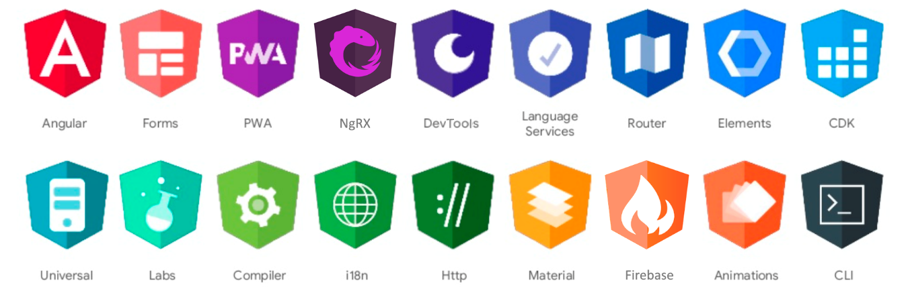
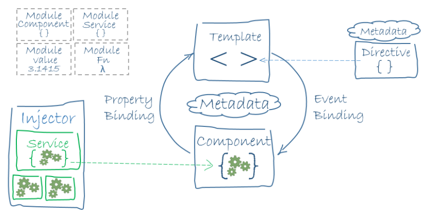

# Angular Framework, Style Guide and Best Practices

## Overview

[Angular](https://angular.dev/) is an open-source, TypeScript-based frontend web framework led by Google. It is used to build scalable, enterprise-grade single-page and dynamic web applications.

Angular is a mature ecosystem well suited for building scalable applications, offering strong tooling, robust testing capabilities, and long-term maintainability. [TypeScript](https://www.typescriptlang.org/) remains central to the Angular developer experience, enabling strict typing and safer refactoring at scale. In modern projects, teams commonly combine Angular with [Sass](https://sass-lang.com/) for styling, [RxJS](https://rxjs-dev.firebaseapp.com/), [NgRx](https://ngrx.io/) for state management depending on application complexity, [Jest](https://jestjs.io/) for unit and integration testing, [Playwright](https://playwright.dev/) for end-to-end testing, [ESLint](https://eslint.org/) and [Prettier](https://prettier.io/) for code quality, and [Storybook](https://storybook.js.org/) for UI component development and documentation.

This chapter consolidates practical guidance for building modern Angular applications in a consistent, scalable, and maintainable way. The content covers Angular fundamentals, RxJS and Signals usage, style guide recommendations, and implementation practices that improve code quality, performance, testability, and long-term maintainability, based primarily on the official Angular documentation.

## Angular Framework

### Ecosystem

Angular is a development platform focused on productivity, performance, and testability. It is a TypeScript-first framework led by the [Angular Team](https://angular.dev/reference/releases) at Google and supported by an active open-source community. Applications built with Angular can target the web first and be adapted for mobile and desktop distribution when needed.

Angular may have a steeper initial learning curve than [React](https://react.dev/) and [Vue](https://vuejs.org/), but it provides an integrated platform for routing, forms, HTTP, server-side rendering, hydration, and robust tooling. This integrated approach is valuable for teams building long-lived enterprise applications with clear conventions and predictable upgrades. Like other modern frameworks, Angular uses a [Component-Based Architecture](https://medium.com/@dan.shapiro1210/understanding-component-based-architecture-3ff48ec0c238) where the UI is modeled as reusable and composable building blocks. Angular includes first-class support for reactive programming with RxJS and complements it with Signals for fine-grained local reactivity. The same architecture can serve web, mobile, and desktop strategies depending on product requirements.

Angular does a lot of things, but maybe the next picture can give us a better idea:



Fig. 1: Angular Ecosystem

As we can see, Angular provides a full-fledged platform with built-in features and conventions that help address non-functional requirements such as maintainability, testability, and cross-browser compatibility. With the [Angular CLI](https://angular.dev/tools/cli), teams can scaffold projects, generate code, run tests, and produce optimized builds.

### Features & Benefits

Cross Platform:

- **Web-first architecture**: Build responsive, installable web applications with PWA capabilities (offline support, caching strategies, background sync, and home-screen installation);
- **Mobile strategies**: Use Angular with [Ionic](https://ionicframework.com/docs/angular/overview) and [Capacitor](https://capacitorjs.com/) to package web applications for iOS and Android while sharing most business and UI logic;
- **Desktop strategies**: Reuse Angular applications in desktop shells such as [Electron](https://www.electronjs.org/) or [Tauri](https://tauri.app/) when native distribution is required.

Modern Performance:

- **Standalone-first architecture**: Build features with standalone components, directives, and pipes to reduce module boilerplate and improve lazy-loading boundaries;
- **Rendering flexibility**: Choose CSR, SSR, or prerendering per route and combine with hydration to improve Core Web Vitals and SEO for public pages;
- **Reactive UI updates**: Use [Signals](https://angular.dev/guide/signals) for fine-grained state updates and predictable synchronous derivations;
- **Smarter loading**: Route-level lazy loading, deferred views, and modern build tooling reduce initial bundle size and speed up first load.

Developer Productivity:

- **Strong TypeScript integration**: Strict typing in components, templates, forms, and API contracts improves refactoring safety and long-term maintainability;
- **Modern template syntax**: Cleaner control flow and template primitives improve readability and reduce template complexity;
- **Tooling and DX**: Angular CLI and ecosystem tooling provide fast local feedback, code generation, linting, testing, and production-ready builds;
- **IDE support**: Excellent language service support enables autocompletion, diagnostics, symbol navigation, and template-aware type checking.

Complete Engineering Story:

- **Testing**: Combine unit and integration testing using [Jest](https://jestjs.io/) with end-to-end testing using [Playwright](https://playwright.dev/) for reliable quality gates;
- **Accessibility and UX quality**: Build inclusive interfaces with semantic HTML, ARIA where needed, keyboard support, and automated accessibility checks;
- **Security and maintainability**: Leverage Angular defaults and patterns for sanitization, DI boundaries, route guards, HTTP interceptors, and consistent architecture at scale;
- **Long-term support**: Angular's regular release cadence, migration tooling, and official documentation make enterprise upgrades and maintenance more predictable.

### Architecture

To build an Angular application, we define a set of components for each UI element, screen, and route. An application always has a root component that contains all other components. In other words, every Angular application has a component tree.

A component is a small unit that makes up part of the user interface:

- Components define views, which are sets of screen elements that Angular can render and update according to program logic and data;
- Components use services, which provide specific functionality not directly related to views. Service providers can be injected into components as dependencies, making code modular, reusable, and efficient.

Both [components](https://angular.dev/guide/components) and [services](https://angular.dev/guide/di/creating-and-using-services) are classes with decorators that mark their type and provide metadata that tells Angular how to use them:

- The metadata for a component class associates it with a template that defines a view. A template combines standard HTML with Angular directives and binding markup that allow Angular to update the HTML before rendering it;
- The metadata for a service class provides the information Angular needs to make it available to components through dependency injection (DI).

The following diagram shows how these basic pieces are related.



Fig. 2: Angular Architecture

A typical app defines many views arranged hierarchically. Angular provides the [Router](https://angular.dev/api/router/Router) service to help us define navigation paths between views. The router provides sophisticated in-browser navigation capabilities. In modern Angular, [Standalone APIs](https://angular.love/4855) are the default recommendation and can be used without using [NgModules](https://angular.dev/guide/ngmodules/overview). Both approaches are valid, and many enterprise applications use a hybrid model while migrating.

### OOP vs FP style

Angular started with a very strong object-oriented style. Components, services, guards and modules were modeled as classes, with dependency injection as a central architectural pattern. This approach made Angular familiar to teams coming from Java or C#, and it helped structure large applications with clear responsibilities.

Over time, the Angular ecosystem moved to a more functional mindset for day-to-day implementation. While classes still exist and remain important, modern Angular encourages developers to write predictable logic using pure functions, immutable updates, and reactive composition.

In practice, this means:

- Keep components thin and declarative, delegating transformation logic to pure functions;
- Prefer composing streams with RxJS operators instead of imperative nested subscriptions;
- Model local state with Signals and computed values, avoiding mutable shared state;
- Derive UI state from inputs and streams, instead of manually synchronizing many class fields;
- Favor deterministic, testable functions over side-effect-heavy methods.

Angular today is not "OOP versus FP" as a strict choice. The framework still uses object-oriented building blocks (classes, DI, decorators), but the recommended coding style inside those blocks is increasingly functional and reactive. A practical rule is: use OOP for structure and boundaries, and use FP for behavior, state derivation and data flow. This hybrid approach improves readability, testability and performance, especially in large applications where predictable state transitions and explicit data flow are essential.

### Dependency Injection

[Dependency Injection](https://angular.dev/guide/di) (DI) is a design pattern we use to organize and share code across an application by supplying dependencies to a class instead of creating them inside it. In Angular, a class requests a dependency through the `constructor` or `inject()`, and Angular resolves it from the nearest injector. This makes dependencies explicit, keeps classes loosely coupled, and lets us control scope and lifetime.

When we want consumers to depend on an abstraction instead of a concrete implementation, we can use an abstract class as the DI token. Unlike interfaces, abstract classes exist at runtime, so Angular can resolve them directly. This keeps consumers decoupled while allowing the provider configuration to choose the concrete implementation. See next example:

```typescript
export abstract class Logger {
  abstract log(message: string): void;
}

@Injectable()
export class ConsoleLoggerService extends Logger {
  log(message: string): void {
    console.log(message);
  }
}

@NgModule({
  providers: [{
    provide: Logger, useClass: ConsoleLoggerService
  }]
})
export class AppModule { }
```

A consumer can then inject `Logger` through its constructor, and Angular will provide the class mapped to that token, wick is `ConsoleLoggerService`. The main advantages of this technique are cleaner constructor syntax, lower coupling between consumers and concrete services, easier test doubles in unit tests, and simpler implementation swaps per module or environment without changing component code. A provider registered at the root is usually shared across the whole application, while providers declared at route, feature, or component level create narrower instances for those boundaries.

## Angular Core Concepts

### Components

A [Component](https://angular.dev/guide/components) is a reusable piece of a web application's UI that combines layout, behavior, and styling into one unit. Every Angular application has at least one component, the root component that connects a component hierarchy with the Document Object Model (DOM). Each component defines a class that contains application data and logic and is associated with an HTML template that defines a view to be displayed in a target environment. The *@Component()* decorator identifies the class immediately below it as a component and provides the template and related component-specific metadata.

A well-structured component should focus on rendering and user interaction. Business rules, data access, and orchestration should usually be delegated to services. See next example:

```typescript
@Component({
  selector: 'hello',
  template: `
    @if (showGreeting) {
      <div>Hello</div>
    }
  `,
})
export class HelloComponent {
  showGreeting = true;
}
```

Templates are where Angular binds component state to the DOM. Data binding keeps the UI declarative and predictable by defining how values flow between class and template. The most common binding modes are:

- **Interpolation**: `{{ value }}` for text output;
- **Property binding**: `[disabled]="isSaving"` for DOM/component properties;
- **Event binding**: `(click)="save()"` for user interactions;
- **Two-way binding**: `[(ngModel)]="model.name"` for editable fields (template-driven forms).

For performance-sensitive views, prefer [OnPush](https://angular.dev/api/core/ChangeDetectionStrategy) change detection and immutable state updates. Also, prefer keeping complex presentation logic in computed values, signals, or pure pipes instead of embedding heavy expressions in templates.

### Services

A [Service](https://angular.dev/guide/di/creating-and-using-services) is a reusable class that handles shared logic, data, or functionality across multiple components. A service class definition is immediately preceded by the `@Injectable()` decorator. The decorator provides the metadata that allows other providers to be injected as dependencies into the class. Services let us keep component classes lean and efficient.

Service example using `HttpClient` with explicit typing:

```typescript
@Injectable({ providedIn: 'root' })
export class UsersService {
  constructor(private readonly http: HttpClient) {}

  getUsers(): Observable<User[]> {
    return this.http
      .get<UserDto[]>('/api/users')
      .pipe(map(users => users.map(u => ({ id: u.id, fullName: `${u.first_name} ${u.last_name}` }))));
  }
}
```

Services can be scoped depending on lifecycle and sharing needs:

- **`providedIn: 'root'`**: Singleton for the whole application;
- **Component `providers`**: One instance per component subtree;
- **Route providers**: Scoped to a lazy route boundary.

We can also create a service by adding the `@Service()` decorator to a TypeScript class. This tells Angular that we can use the class as an injectable dependency. However, `@Service()` is not a complete replacement for `@Injectable()` because it is designed around the newer `inject()` API.

### Directives

[Directives](https://angular.dev/guide/directives) are classes that attach behavior to existing DOM elements. They are ideal when we want to reuse UI behavior without creating a full component. Directives keep templates clean while centralizing repeatable behavior in a single testable unit.

The next example shows the signature of a directive for highlighting:

```typescript
@Directive({
  selector: '[highlightOnFocus]',
})
export class HighlightOnFocusDirective { }
```

In practice, Angular directives are commonly used in two forms:

- **Attribute directives**: Change appearance or behavior of an existing element (for example, highlighting, permission-based disablement, input masking);
- **Structural directives**: Add, remove, or reshape DOM layout (for example, `@if`, `@for`, and related control-flow syntax).

As a rule of thumb, keep directives focused, side-effect free when possible, and centered on one behavior.

### Pipes

[Pipes](https://angular.dev/guide/templates/pipes) transform values for display in templates while keeping components focused on state and interaction. They are ideal for formatting concerns such as dates, currency, labels, percentages, and small presentation-specific mappings. 

Next example shows a pipe to transform the input into a full user name:

```typescript
@Pipe({
  name: 'fullName',
})
export class FullNamePipe implements PipeTransform {
  transform(user: { firstName: string; lastName: string; active: boolean }): string {
    const fullName = `${user.firstName} ${user.lastName}`;

    return user.active ? `${fullName} (active)` : `${fullName} (inactive)`;
  }
}
```

When creating and using pipes, keep these practical guidelines in mind:

- Prefer pure pipes for deterministic transformations because they are memoized by Angular based on input references and are cheaper during change detection;
- Use impure pipes only when strictly necessary, since they execute on every change detection cycle;
- Keep pipes side-effect free and avoid putting business rules or API calls within them.

Angular provides built-in pipes (for example, *date*, *currency*, *percent*, *json*, and *async*) for common uses.

### Forms

[Forms](https://angular.dev/guide/forms) are used to collect, validate, and process user input in web applications. They provide a structured way to build things like login forms, registration forms, search boxes, checkout pages, and data-entry screens.

See next example of a reactive typed form example:

```typescript
@Component({
  selector: 'app-profile-form',
  template: `
    <form [formGroup]="form" (ngSubmit)="submit()">
      <input formControlName="name" placeholder="Name" />
      <input formControlName="email" placeholder="Email" />
      <button type="submit" [disabled]="form.invalid || form.pending">Save</button>
    </form>
  `,
})
export class ProfileFormComponent {
  readonly form = new FormGroup({
    name: new FormControl('', [Validators.required, Validators.minLength(2)]),
    email: new FormControl('', [Validators.required, Validators.email]),
  });

  submit(): void {}
}
```

In modern Angular, there are three types of forms:

- **Template-driven Forms**: Defined in the HTML template using directives such as `ngModel`. Suited for simple forms where validation logic is minimal and the form structure does not change dynamically;
- **Reactive Forms**: Defined programmatically in the component class using `FormGroup` and `FormControl`. Preferred for complex, dynamic, or highly validated forms because they offer explicit state management, stronger typing, and easier unit testing;
- **Signal Forms**: An emerging approach built on Angular Signals that models form state as reactive, synchronous signals. Reduces boilerplate and aligns form state management with the rest of the signal-based component model.

When native HTML controls are not enough, we can create custom form controls and integrate them with Angular forms through [ControlValueAccessor](https://angular.dev/api/forms/ControlValueAccessor). In practice, *ControlValueAccessor* is the contract that connects Angular form APIs (`formControl`, `formControlName`, and `ngModel`) to a custom component.

### Guards & Interceptors

[Guards](https://angular.dev/guide/routing/route-guards#creating-a-route-guard) control route access and navigation flow. [Interceptors](https://angular.dev/guide/http/interceptors) centralize HTTP cross-cutting concerns such as auth headers, retries, logging, and error normalization.

The next guard shows a simple approach for user control access:

```typescript
@Injectable()
export class AuthGuard implements CanActivate {
  constructor(private readonly authService: AuthService) {}

  canActivate(): Observable<boolean> {
    return this.authService.isAuthenticated();
  }
}
```

Guidelines for Guards and Interceptors:

- Guards should answer access/navigation questions (authentication, authorization, feature flags);
- Interceptors should enrich or transform HTTP requests and responses consistently across the app;
- Keep both focused and composable, avoiding heavy business logic.

In modern Angular, prefer functional guards and interceptors for simple, stateless policies because they reduce boilerplate and align well with Standalone APIs and `inject()`, while class-based implementations still make sense when richer encapsulation, shared behavior, or more complex dependencies improve clarity.

### Routing

[Routing](https://angular.dev/guide/routing) defines navigation, feature boundaries, and lazy-loading strategy. A typical route configuration defines paths that map to components, protects sensitive routes with guards, and provides fallback navigation.

The following example shows a typical route configuration:

```typescript
export const routes: Routes = [
  { path: 'admin', loadChildren: () => import('./admin/admin.module').then(m => m.AdminModule), canActivate: [AdminGuard] },
  { path: 'dashboard', component: HelloComponent, canActivate: [AuthGuard] },
  { path: '**', redirectTo: 'dashboard' },
];
```

This example demonstrates several key patterns:

- For feature modules and routes that are not needed on initial load, it is used `loadChildren` to lazy load route configurations.
- Each route specifies a `path` and the `component` to render at that path.
- The `canActivate` guard protects routes by preventing navigation if the guard rejects it (commonly used for authentication checks).
- The wildcard route (`**`) catches unmatched paths and redirects to a default route for graceful handling of invalid URLs.

To add routing to an Angular application, first define a route configuration array and then register it with the Angular router during application bootstrap or module setup. Angular will then match URLs to the appropriate views and display the correct screen as users navigate through the application.

### Modules

[NgModules](https://angular.dev/guide/ngmodules/overview) declare a compilation context for a set of components that is dedicated to an application domain, a workflow, or a closely related set of capabilities. An NgModule can associate its components with related code, such as services, to form functional units.

Every Angular application has a root module, conventionally named `AppModule`, which provides the bootstrap mechanism that launches the application. An application typically contains many functional modules. Like JavaScript modules, NgModules can import functionality from other NgModules, and allow their own functionality to be exported and used by other NgModules.

Even in standalone-first applications, NgModules are still common in existing codebases and third-party integrations. For architecture decisions, the key point is to keep boundaries by feature (for example, *customers*, *billing*, *admin*) and lazy load those boundaries.

## RxJS

### Why RxJS?

[Reactive programming](https://en.wikipedia.org/wiki/Reactive_programming) is a declarative programming paradigm concerned with data streams and the propagation of change. [RxJS](https://rxjs-dev.firebaseapp.com/) (Reactive Extensions for JavaScript) is a library for reactive programming using observables that makes it easier to compose asynchronous or callback-based code. The library also provides utility functions for creating and working with observables.

RxJS utility functions can be used for:

- Converting existing code for async operations into observables;
- Iterating through the values in a stream;
- Mapping values to different types;
- Filtering data streams;
- Composing multiple streams.

In Angular, observables provide support for passing messages between parts of the application. They are used frequently for event handling, asynchronous programming, and handling multiple values.

### Fundamentals

[Functional programming](https://en.wikipedia.org/wiki/Functional_programming) emphasizes pure functions, immutability, and composition. [Reactive programming](https://en.wikipedia.org/wiki/Reactive_programming) focuses on modeling values that change over time as streams and reacting to those changes declaratively.

[Functional reactive programming](https://en.wikipedia.org/wiki/Functional_reactive_programming) combines these ideas. It represents time-varying values and events as streams, then transform and compose them with predictable and side-effect-minimized functions. RxJS follows this style in practice through observable pipelines and operators (`map`, `filter`, `switchMap`, etc.), even though not every use of RxJS is strictly FRP in the academic sense. This mindset helps keep asynchronous UI flows explicit, testable, and easier to reason about.

The observer pattern is a software design pattern in which an object, called the *subject*, maintains a list of its dependents, called *observers*, and notifies them automatically of state changes. In RxJS, a `Subject` is a practical implementation of this idea because it is both an observer (it can receive values) and an observable (it can broadcast values to subscribers).

The following example models a search input stream:

```typescript
const inputValue = new Subject<string>();
```

This keeps asynchronous UI behavior declarative, because one stream represents user intent, then operators define transformation rules, and each subscriber handles a focused responsibility.

### Promises vs Observables

A [Promise](https://developer.mozilla.org/docs/Web/JavaScript/Reference/Global_Objects/Promise) represents the eventual result of one asynchronous operation. It resolves once (or rejects once) and then completes. An [Observable](https://rxjs-dev.firebaseapp.com/guide/observable) represents a stream that can emit zero, one, or many values over time, then complete or error.

The following table summarizes the same capabilities for promises and observables:

| Capability | Promise | Observable |
| --- | --- | --- |
| Main goal | Represent the result of one asynchronous operation | Model asynchronous streams and event composition |
| Value model | Settles once with one value or error | May emit zero, one, or many values over time |
| Consumption | Read with `await` or handle with `then()` | Read with `subscribe()` or the `async` pipe |
| Operators | Chain with `then()`, `catch()`, and `finally()` | Compose with operators such as `map`, `filter`, and `switchMap` |
| Best use | Single asynchronous results, such as one request | HTTP streams, events, websockets, and multi-step async workflows |

Both abstractions are useful for async code, but they model different kinds of workflows.

### Best Practices

The following practices focus on building RxJS streams that are readable, predictable, and safe to maintain in Angular applications:

- [ ] **Use pipeable operators**: Use pipeable operators with RxJS. A pipeable operator returns a function with the signature `<T, R>(source: Observable<T>) => Observable<R>`. Pipeable operators are tree-shakable, so only the code we need is included, and it becomes easier to identify unused operators.

- [ ] **Use appropriate operators**: RxJS operators are the essential pieces that let operations be composed declaratively. There are operators for  `creation`, `transformation`, `filtering`, `joining`, `multicasting`, `error handling`, `utility`, and more.

- [ ] **Use pure functions**: RxJS follows functional reactive programming concepts, so we should use pure functions to create reactive flow. Side effects may seem pragmatic at first, but they often mean we are not fully thinking reactively. Avoid side effects as much as possible.

- [ ] **Avoid manual subscribes**: If a component needs values from different streams, manually subscribing and mapping them to properties increases complexity. The `async` pipe unsubscribes automatically, triggers change detection, reduces the risk of forgetting to unsubscribe, and cleans up the code significantly.

- [ ] **Do not expose subjects**: A common pattern is to keep a private subject and expose only the observable via `asObservable()` method. This ensures that data can be changed only through the service interface and protects the write side of the stream. See next example:

  ```typescript
  export class DataService {
    private data: BehaviorSubject<number> = new BehaviorSubject<number>(0);

    readonly data$: Observable<number> = this.data.asObservable();

    increment(): void {
      this.data.next(this.data.getValue() + 1);
    }
  }
  ```

- [ ] **Use subjects for state management**: A subject is both a hot observable and an observer, which lets us push values into the stream. Only use them when really needed because subjects tend to be overused by developers.

- [ ] **Share subscriptions**: Since most streams are cold by default, every subscription triggers the producer, and multiple subscriptions to `http.get()` can cause multiple HTTP calls. Angular template patterns like `async as else` can reduce the need to share streams broadly. See next example using `share` operator:

  ```typescript
  const users$ = this.http.get(...).pipe(share());
  ```

- [ ] **Handle RxJS errors**: Error handling is essential in RxJS. By default, when something goes wrong with an observable, it dies. [RxJS Error Handling - Complete Practical Guide](https://blog.angular-university.io/rxjs-error-handling/) provides the most common error handling strategies.

- [ ] **Follow clean-code practices**: Consistent indentation and formatting improve readability of complex streams. Align operators below each other, extract into different streams when code becomes unreadable, move complex functionality into private methods, and avoid unnecessary brackets for readability.

- [ ] **Use marble diagrams**: [Marble Diagrams](https://rxmarbles.com/) provide a visual way to represent the behavior of an observable. They help us assert that an observable behaves as expected and create hot and cold observables as mocks. Marble testing is effectively a domain specific language for modeling observable interactions in tests.

## Signals

### Why Signals?

[Signals](https://angular.dev/guide/signals) are Angular's built-in reactive primitive for fine-grained state management. A signal stores a value and notifies Angular exactly where that value is read. This allows Angular to update only the affected parts of the UI instead of re-checking everything. Signals are synchronous and deterministic, which makes component state easier to model and reason about.

The most common use cases of Signals are:

- Local UI state in components (open/closed panels, selected tab, filters, counters);
- Derived state computed from other values (totals, flags, view models);
- Replacing simple Subjects/BehaviorSubjects used only for local state.

Angular Signals are strongly influenced by the observer pattern, reactive programming and fine-grained reactivity patterns. The code reading the signal is the consumer, and the signal being read is the producer.

### Fundamentals

Signals have an easy-to-understand API for reporting data changes to the framework, allowing the framework to optimize change detection and re-rendering in a way that so far was just not possible. With Signals, Angular is able to determine exactly what parts of the page need to be updated and update only those and nothing more.

Angular provides three core APIs for signals:

- **signal()**: It creates writable state and acts as the single source of truth for a value;
- **computed()**: It derives read-only values from one or more signals, recalculating only when one of its tracked dependencies changes;
- **effect()**: It reacts to signal changes and is intended for side effects such as logging, analytics, persistence, or integration with non-signal APIs.

The following example shows these APIs in practice:

```typescript
@Component({
  selector: 'cart-component',
  template: `
    <p>Items: {{ itemCount() }}</p>
    <p>Total: {{ total() | currency }}</p>
    <button (click)="addItem(25)">Add item</button>
  `,
})
export class CartComponent {
  readonly prices = signal<number[]>([]);
  readonly itemCount = computed(() => this.prices().length);
  readonly total = computed(() => this.prices().reduce((sum, p) => sum + p, 0));

  constructor() {
    effect(() => {
      console.log(`Cart changed. Items: ${this.itemCount()}, total: ${this.total()}`);
    });
  }

  addItem(price: number): void {
    this.prices.update(items => [...items, price]);
  }
}
```

In templates, reading a signal is done by calling it like a function: *total()*. This read tracking is what enables granular updates.

### Signals vs Observables

Signals and Observables are complementary. Signals cannot fully replace Observables, but they can replace them in many UI state management scenarios.

The following table summarizes the same capabilities for signals and observables:

| Capability | Signal | Observable |
| --- | --- | --- |
| Main goal | Synchronous state and derived values | Asynchronous streams and event composition |
| Value model | Always has a current value | May emit zero, one, or many values over time |
| Consumption | Read by calling `mySignal()` | Read by `subscribe()` or `async` pipe |
| Operators | `computed()`, `effect()` | Rich operator ecosystem (`map`, `switchMap`, `mergeMap`, etc.) |
| Best use | Component/local state, view model state | HTTP, websockets, routing events, complex async workflows |

As a rule of thumb, use signals for local state and synchronous derivations, use RxJS for asynchronous workflows and stream composition, and bridge both approaches when needed.

### Best Practices

The following practices outline how to use Angular Signals effectively for local state, derived state, and controlled side effects:

- [ ] **Use signals for local state**: Use signals primarily for component and feature-local state. Keep long-lived asynchronous flows (HTTP polling, websocket streams, orchestration) in RxJS.

- [ ] **Prefer computed over imperative updates**: If a value can be derived from other state, use *computed()* instead of manually synchronizing variables. This avoids duplication and inconsistent state.

- [ ] **Keep effects side-effect oriented**: Use *effect()* for side effects (logging, persistence, analytics, integration points). Avoid using effects to propagate state that can be modeled with *computed()*.

- [ ] **Keep signal state immutable**: When storing arrays and objects in signals, prefer immutable updates using *set()* or *update()* with copied values instead of mutating in place. See the next example:

  ```typescript
  export class UsersComponent {
    readonly users = signal<Array<{ id: number; name: string }>>([]);

    addUser(user: { id: number; name: string }): void {
      this.users.update(current => [...current, user]);
    }
  }
  ```

- [ ] **Keep computed values pure and cheap**: Use *computed()* for deterministic derivations only. Avoid side effects and avoid heavy processing inside computed signals. If a computation is expensive, break it into smaller computed values or move the expensive part to a dedicated service.

- [ ] **Minimize and scope effects carefully**: Effects are powerful but easy to overuse. Prefer a small number of focused effects close to the feature that needs them. This keeps dependencies explicit, reduces accidental reactivity chains, and improves maintainability.

- [ ] **Bridge signals and observables intentionally**: Use [*toSignal()*](https://angular.dev/ecosystem/rxjs-interop/) when an observable result needs to be consumed as synchronous UI state, and [*toObservable()*](https://angular.dev/ecosystem/rxjs-interop/) when signal state needs to participate in RxJS pipelines. Keep conversion boundaries explicit so architecture remains clear.

- [ ] **Prefer signal inputs**: For modern Angular codebases, signal-based component APIs can simplify change tracking and reduce boilerplate around input propagation. Keep public component APIs explicit and strongly typed to improve readability and refactoring safety.

- **Prefer signal forms**: An emerging approach built on Angular Signals that models form state as reactive, synchronous signals. It reduces boilerplate and aligns form state management with the rest of the signal-based component model.

- [ ] **Test signals as state transitions**: Unit tests for signal-based components should verify state transitions and derived values, not implementation details. Assert that changing writable signals updates computed state and expected side effects in a predictable way.

  ```typescript
  it('updates total when quantity changes', () => {
    const cmp = new CartComponent();

    cmp.addItem(25);

    expect(cmp.total()).toBe(25);
  });
  ```

## Angular Advanced Concepts

### CDK

The [Angular Component Dev Kit](https://material.angular.dev/cdk/categories) (CDK) is a set of behavior-focused primitives for building robust UI components without imposing a visual style. While [Angular Material](https://material.angular.dev/) provides fully styled components, the CDK provides low-level building blocks.

Some popular CDK categories are:

- **Accessibility**: Accessibility primitives for focus management, keyboard interaction, ARIA helpers, and screen-reader announcements;
- **Overlay**: Infrastructure for floating layers (dialogs, popovers, tooltips, context menus) with positioning, backdrop, and scroll strategies;
- **Portal**: APIs to dynamically render a component or template into a different host container;
- **Scrolling**: Scroll utilities and [virtual scrolling](https://material.angular.dev/cdk/scrolling/overview) to efficiently render very large lists;
- **Drag and Drop**: Declarative drag-and-drop behavior for sortable lists, transfer between containers, and constrained drag areas;
- **Table**: Unstyled table foundation (data source, row/column definitions, rendering pipeline) for custom data grids;
- **Tree**: Primitives for rendering hierarchical data with expandable/collapsible nodes and nested or flat tree structures;
- **Menu**: Headless menu behavior with keyboard navigation, focus handling, nested submenus, and accessibility semantics;
- **Bidirectionality**: The `bidi` package provides support for RTL/LTR layouts and direction-aware component behavior;
- **Observers**: Wrappers for browser observer APIs (for example resize and mutation) to react to DOM changes safely in Angular;
- **Layout**: Responsive layout helpers and media-query observation to adapt UI behavior across breakpoints;
- **Testing**: [Component harness](https://angular.dev/guide/testing/component-harnesses-overview) utilities for stable implementation-agnostic UI tests.

In short, Angular CDK is a toolkit of low-level building blocks that help us create sophisticated interfaces while keeping full control over the interface and styling.

### Animations

[Animations](https://angular.dev/guide/animations) help communicate state changes, provide continuity between views, and improve perceived responsiveness. In Angular applications, animations should support UX goals, not decorate every interaction. Good motion clarifies what changed (for example entering, leaving, expanding, collapsing, and reordering) and guides user attention without slowing task completion.

In practice, teams usually combine two approaches:

- **Native CSS/Web Animations for simple transitions**: Great for hover/focus effects, opacity fades, and small transforms with minimal code;
- **Angular Animation API for stateful UI transitions**: Useful when animation behavior depends on component state, structural changes, route transitions, or coordinated enter/leave sequences.

For larger applications, route-level animations can be introduced gradually by defining transition data on routes and applying animations at the layout shell level. This keeps motion centralized, consistent, and easier to maintain.

### User Access Control

User access control is the set of rules that determines who can access the application (authentication) and what each authenticated user can do (authorization). In Angular, this is typically implemented with route guards to block navigation for users without the required role or permission, and with UI-level checks to hide or disable actions that the user is not allowed to perform.

Authentication in Angular SPAs typically follows one of these patterns:

- **Token-based (JWT)**: The most common approach. After login, the server issues a [JSON Web Token](https://jwt.io/) that the client stores and sends with each request. The token is typically stored in `localStorage` and attached to requests via an HTTP interceptor.
- **Session-based with cookies**: The server manages sessions and sets `HttpOnly` cookies. This approach benefits from browser-managed cookie handling and CSRF protection but requires the API and SPA to share the same domain or use proper CORS configuration.
- **OAuth 2.0 / OpenID Connect (OIDC)**: For enterprise or third-party authentication, Angular applications integrate with identity providers ([Auth0](https://auth0.com/), [Keycloak](https://www.keycloak.org/), and others) using OIDC flows. Libraries like [angular-oauth2-oidc](https://www.npmjs.com/package/angular-oauth2-oidc) simplify the integration.

Authorization determines what authenticated users can access. In Angular, authorization is enforced at multiple levels:

- **Route guards**: Protect entire routes based on authentication status, user roles, or permissions via `canActivate`, `canMatch`, or `canActivateChild` guards.
- **UI-level**: Show or hide UI elements (buttons, menu items, form fields) based on the user's permissions using structural directives or pipes. Libraries like [ngx-permissions](https://www.npmjs.com/package/ngx-permissions) can help centralize role/permission checks in templates and routes.
- **API-level**: The backend enforces authorization independently because the frontend authorization is a UX convenience, not a security boundary.

Authentication and authorization in Angular require a combination of services, route guards, and interceptors to secure an application.

### Error Handling

Angular provides a built-in [ErrorHandler](https://angular.dev/api/core/ErrorHandler) class that catches all unhandled exceptions in the application. Replacing the default handler with a custom implementation allows centralized error logging, user notification, and integration with monitoring services.

HTTP errors should be handled at multiple levels:

- **Interceptor level**: Catches common HTTP errors (401, 403, 500, network errors) and applies global handling such as token refresh, redirect to login, or retry.
- **Service level**: Catches domain-specific errors and transforms them into meaningful error types using RxJS `catchError`.
- **Component level**: Handles presentation-specific errors, displaying inline error messages or fallback UI.

A well-designed error handling architecture distinguishes between:

- **Expected errors**: Validation failures, business rule violations, and not-found responses. These should be handled gracefully with user-friendly messages.
- **Unexpected errors**: Server errors, network failures, and unhandled exceptions. These should be logged to an error tracking service and display a generic error message to the user.

Error tracking services like [Sentry](https://sentry.io/), [Datadog](https://www.datadoghq.com/), or [Application Insights](https://learn.microsoft.com/azure/azure-monitor/app/javascript) provide real-time visibility into production errors. These services capture stack traces, source maps, user context, and breadcrumbs, enabling teams to diagnose and fix issues quickly. Angular's error handler and HTTP interceptors serve as the integration points for these services.

### Internationalization

[Internationalization](https://angular.dev/guide/i18n) (i18n) is the process of designing an application so it can be adapted to different languages and regions without engineering changes. Localization (l10n) is the process of adapting the internationalized application to a specific locale.

We have two primary approaches to internationalization:

- **[Built-in i18n](https://angular.dev/guide/i18n)**: Angular's compile-time i18n uses `i18n` attributes in templates, the [@angular/localize](https://www.npmjs.com/package/@angular/localize) package, and the Angular CLI extraction tool (`ng extract-i18n`) to produce translation files. Each locale generates a separate application build, optimized for that language with no runtime overhead. This approach is best for applications where the locale is determined at deployment time.
- **[ngx-translate](https://ngx-translate.org/)**: A runtime i18n library that loads translation files dynamically and allows switching languages without reloading the application. This approach is more flexible but adds bundle size and a small runtime cost.

Choose the approach based on product requirements. Prefer built-in Angular i18n for static, deployment-time locale builds and use `ngx-translate` when runtime language switching is a core user requirement. Use [ICU message syntax](https://unicode-org.github.io/icu/userguide/format_parse/messages/) for pluralization, gender, and complex conditional messages.

### Accessibility

Accessibility (a11y) is a core part of UX, not an extra feature. A [web application is accessible](https://en.wikipedia.org/wiki/Web_accessibility) when people with different abilities can use it well. They should be able to perceive, understand, navigate, and interact with it. This includes people who use screen readers, keyboard navigation, voice input, captions, zoom, high contrast settings, or reduced motion. It also includes people with temporary or situational limits, such as a broken mouse, poor lighting, low bandwidth, or a noisy environment.

The [Web Content Accessibility Guidelines](https://www.w3.org/WAI/standards-guidelines/wcag/) (WCAG) are the main reference for accessible web experiences. In practice, frontend teams should focus on semantic HTML, proper labels, enough color contrast, visible focus states, keyboard support, accessible forms, meaningful link text, alternative text for images, correct heading structure, and proper [WAI-ARIA](https://www.w3.org/WAI/standards-guidelines/aria/) usage when native semantics are not enough. [Angular Aria](https://angular.dev/guide/aria/overview) is a set of headless, accessible directives that implement common [WAI-ARIA patterns](https://www.w3.org/WAI/ARIA/apg/patterns/). These directives handle keyboard interactions, ARIA attributes, focus management, and screen reader support.

Accessibility also improves quality for all users. Captions help in noisy places, larger click targets help on mobile devices, better contrast helps in bright environments, and clearer labels reduce mistakes for everyone. Accessible design often leads to clearer, more robust, and more resilient interfaces. In this sense, accessibility is both an ethical responsibility and a strong engineering practice. Angular applications should also treat [prefers-reduced-motion](https://developer.mozilla.org/docs/Web/CSS/@media/prefers-reduced-motion), keyboard-only navigation, and screen-reader announcements as normal parts of implementation work.

### Analytics

[Web analytics](https://en.wikipedia.org/wiki/Web_analytics) is the practice of collecting, measuring, and interpreting user behavior data. It helps teams understand how people use an application and make better product decisions. Analytics often tracks page views, feature usage, conversion funnels, performance timings, and errors.

Popular tools include [Google Analytics](https://analytics.google.com/), [Google Tag Manager](https://tagmanager.google.com/), [Adobe Analytics](https://business.adobe.com/products/analytics/adobe-analytics.html), [Mixpanel](https://mixpanel.com/), and [Amplitude](https://amplitude.com/). Product observability platforms such as [Datadog RUM](https://www.datadoghq.com/product/real-user-monitoring/) and [Sentry](https://sentry.io/) also provide error and session insights.

In Angular, a Redux-like approach or [NgRx Effects](https://ngrx.io/guide/effects) works well because we can observe actions, combine them with the latest state when needed, map them to an analytics payload, and send that payload to the analytics API. Only selected actions should be tracked to avoid noisy or duplicated telemetry. This keeps components focused on UI concerns and makes analytics behavior easier to change over time.

### SEO

[Search Engine Optimization](https://developers.google.com/search/docs/fundamentals/seo-starter-guide) (SEO) is the practice of making a site easier to discover, understand, and rank in organic search. Angular SPAs can create SEO risk when important content, metadata, or navigation depends on late client-side rendering. Modern search engines can run some JavaScript, but relying only on that is less predictable than serving meaningful HTML up front.

Angular provides several practical strategies to improve SEO:

- **[Server-side and hybrid rendering](https://angular.dev/guide/ssr)**: Angular supports route-level rendering strategies, so teams can choose CSR, SSR, or prerendering for each route. Use SSR for public, request-specific pages where crawlers and users should receive fully rendered HTML in the first response.
- **[Hydration](https://angular.dev/guide/hydration)**: Hydration reuses the server-rendered DOM on the client instead of tearing it down and rendering it again. This reduces flicker and helps preserve strong Core Web Vitals such as [Largest Contentful Paint (LCP)](https://web.dev/lcp/) and [Cumulative Layout Shift (CLS)](https://web.dev/cls/), which indirectly support SEO.
- **[Build-time prerendering)](https://angular.dev/guide/ssr#build-time-prerendering)**: Static Site Generation (SSG) creates HTML at build time for routes whose content is known in advance. This is a strong fit for landing pages, marketing sites, blogs, and documentation because the pages are immediately cacheable and indexable.
- **Meta tags and titles**: Angular's [Meta](https://angular.dev/api/platform-browser/Meta) and [Title](https://angular.dev/api/platform-browser/Title) services let teams set route-specific titles, descriptions, robots directives, and social preview tags.
- **Structured data**: Adding [JSON-LD](https://json-ld.org/) structured data helps search engines understand entities such as articles, products, FAQs, and breadcrumbs, which improves eligibility for rich results.
- **Canonical URLs**: Adding `<link rel="canonical">` tags helps prevent duplicate-content issues when the same page can be reached through multiple URLs, query strings, or campaign parameters.
- **Sitemaps and crawl controls**: A `sitemap.xml` file helps search engines discover public routes, while a correctly configured `robots.txt` file tells them which routes should or should not be crawled.

In short, good SEO in Angular depends on serving meaningful HTML early and keeping each public route clear, stable, and easy for search engines to understand.

### PWA

A [Progressive Web Application](https://web.dev/progressive-web-apps/) (PWA) is a web application that uses modern browser capabilities to deliver an installable, app-like experience. PWAs are reliable (load quickly and can work offline), fast (respond quickly to user interactions), and engaging (feel close to native on supported devices). Key technologies behind PWAs include the [Service Worker API](https://developer.mozilla.org/docs/Web/API/Service_Worker_API), [Web Application Manifest](https://developer.mozilla.org/docs/Web/Manifest), and [Cache API](https://developer.mozilla.org/docs/Web/API/Cache).

Angular provides first-class support for building PWAs through the [@angular/pwa](https://www.npmjs.com/package/@angular/pwa) package. Angular CLI configures the Angular Service Worker, generates a `manifest.webmanifest`, adds icons, and sets up the `ngsw-config.json` file for caching and update strategies.

PWAs are particularly valuable for applications that must tolerate unreliable network connectivity or provide an app-store-like installation experience without the overhead of native application development and distribution.

### WebMCP

[WebMCP](https://github.com/webmachinelearning/webmcp/) is an emerging web standard that enables web applications to expose structured tools directly to AI agents running natively in the browser. Rather than requiring an agent to navigate complex UI flows through DOM interactions, WebMCP tools let agents call application logic directly, for example, submitting a user-registration form by invoking a tool instead of filling in individual fields.

[Angular WebMCP](https://angular.dev/ai/webmcp) provides a framework-supported way to connect those agent interactions to application features. At a high level, this makes it easier to enable AI-assisted workflows in Angular applications.

Some best practices for WebMCP integrations include keeping tool names globally unique (duplicate registrations throw at runtime), preferring application-level or root-service providers over component constructors to avoid accidental multi-registration, and always validating tool inputs explicitly inside `execute` callback.

## Development Workspace

### Project Structure

A well-organized file structure is essential for maintaining a scalable Angular application. The [Angular Style Guide](https://angular.dev/style-guide) recommends organizing files by feature rather than by type. The LIFT principle (Locate, Identify, Flattest structure, Try to be DRY) should guide the folder organization.

A recommended folder structure for a large Angular application:

```
src/
├── app/
│   ├── core/              # Singleton services, guards, interceptors, models
│   │   ├── services/
│   │   ├── guards/
│   │   ├── interceptors/
│   │   └── core.module.ts
│   ├── shared/            # Shared components, directives, pipes
│   │   ├── components/
│   │   ├── directives/
│   │   ├── pipes/
│   │   └── shared.module.ts
│   ├── features/          # Feature modules (lazy-loaded)
│   │   ├── feature-a/
│   │   │   ├── components/
│   │   │   ├── models/
│   │   │   ├── services/
│   │   │   └── feature-a.module.ts
│   │   └── feature-b/
│   ├── app.component.ts
│   ├── app.module.ts
│   └── app-routing.module.ts
├── assets/
├── environments/
├── index.html
├── main.ts
└── styles.scss
```

Key guidelines for structure the project:

- **Core module**: Contains application-wide singleton services, HTTP interceptors, authentication guards, and global error handling. This module is imported only once in the `AppModule`.
- **Shared module**: Contains reusable components, directives, and pipes that are shared across multiple feature modules. Exports all declarations so consuming modules can use them.
- **Feature modules**: Each feature or domain area of the application is encapsulated in its own module. Feature modules should be [lazy-loaded](https://angular.io/guide/lazy-loading-ngmodules) whenever possible to reduce the initial bundle size.

With [standalone components](https://angular.io/guide/standalone-components), `NgModules` become optional. Standalone components can import their dependencies directly, simplifying the module structure and enabling more granular lazy loading.

### Project Documentation

Project documentation is critical for onboarding, maintenance, and long-term sustainability of an Angular project. It shortens onboarding, preserves architectural decisions, reduces maintenance and refactoring risk, improves debugging and incident response, and aligns developers, QA, and DevOps teams around shared standards. In practice, clear documentation prevents knowledge silos, reduces rework, and protects long-term project sustainability as the codebase and team evolve.

Essential project documentation artifacts include:

- **README.md**: The entry point for any project. It should contain a project description, prerequisites, setup instructions, available scripts (`ng serve`, `ng build`, `ng test`), and links to further documentation.
- **CHANGELOG.md**: Maintained automatically using tools like [semantic-release](https://semantic-release.org/) following [Conventional Commits](https://www.conventionalcommits.org/) to generate meaningful changelogs.
- **CONTRIBUTING.md**: Guidelines for contributing to the project, including branch naming conventions, commit message format, code review process, and testing requirements.
- **API documentation**: Documentation for source code and essential for shared libraries. Use [Compodoc](https://compodoc.app/) to generate Angular-specific documentation from code comments, decorators, and module declarations.
- **Component catalog**: Documentation for UI components. Tools like [Storybook](https://storybook.js.org/) serve as living documentation for UI components, allowing developers and designers to browse and interact with components in isolation.

In delivery pipelines, teams often publish the generated documentation as a build artifact or a static site using [GitHub Pages](https://docs.github.com/en/pages) or a similar platform. This creates a single, searchable reference for developers, QA, and architects without requiring manual documentation assembly.

### Build Environments

Angular CLI supports multiple named build configurations such as `development`, `staging`, and `production`. Each configuration can override any builder option (source maps, optimization, API URLs, feature flags) allowing the same codebase to target different environments without code changes.

The `src/environments/` folder holds per-environment TypeScript files. The environments structure folder looks like this:

```
src/environments/
├── environment.ts
└── environment.prod.ts
```

Angular CLI replaces `environment.ts` with the matching file at build time. This is configured automatically in `angular.json` under `fileReplacements`:

```json
{
  "configurations": {
    "production": {
      "fileReplacements": [
        {
          "replace": "src/environments/environment.ts",
          "with": "src/environments/environment.prod.ts"
        }
      ]
    }
  }
}
```

The `environment.ts` file is bundled into the client-side application and visible to anyone who loads the page. Never store secrets such as API keys here. Use a server-side proxy or a secrets manager instead.

### Build Configuration

The Angular CLI `ng build` command compiles Angular templates and TypeScript, then bundles and optimizes the application for the target environment. The builder used by default for new projects is `@angular/build:application`, which is powered by [esbuild](https://esbuild.github.io/) and produces a `dist/` output directory.

Angular provides two compilation strategies for turning component templates and TypeScript code into JavaScript:

| Compiler | Description |
| --- | --- |
| **Just-in-Time (JIT)** | Compiles the application in the browser at runtime. Was the default before Angular 9. Slower initial load, easier to debug in some cases. |
| **Ahead-of-Time (AOT)** | Compiles templates and TypeScript at build time, before the browser downloads any code. Default since Angular 9. |

The CLI supports named configurations defined in `angular.json`. The two standard configurations are `production` (the default for `ng build`) and `development` (the default for `ng serve`).

A typical production build enables several performance-focused optimizations, namely, it precompiles templates with AOT, switches Angular to production mode to remove development-only checks, bundles files into fewer assets, minifies and mangles code to reduce size, eliminates unused code, and add inlines critical CSS to improve initial render speed.

During local development, `ng serve` skips these optimizations intentionally to enable faster rebuilds, detailed error messages, and Angular DevTools support.

### Proxy Configuration

During local development it is common to call a backend API running on a different port or host. Browsers block cross-origin requests unless the server explicitly allows them. The Angular CLI Dev Server supports a [proxy configuration](https://angular.dev/tools/cli/serve#proxying-to-a-backend-server) that forwards matching requests to a backend server, avoiding CORS issues without changing production code.

To set up a proxy, create `config/proxy.conf.json` file with:

```json
{
  "/api/**": {
    "target": "http://localhost:3000",
    "secure": false,
    "logLevel": "info"
  }
}
```

Then, register the proxy file in `angular.json` under the `serve` target. Restart `ng serve` after editing the files for changes to take effect. Then, all requests to `/api/**` are forwarded to `http://localhost:3000`. For advanced use cases such as attaching a bearer token to every proxied request, a JavaScript proxy configuration file provides more flexibility.

### Template Type Checking

Angular performs static type checking of template expressions and bindings at compile time. Just as TypeScript catches type errors in source code, Angular checks expressions and bindings within application templates and reports any type errors it finds. The depth of this checking is controlled by compiler options in `tsconfig.json`.

Angular provides three progressive levels of [template type checking](https://angular.dev/tools/cli/template-typecheck):

- **Basic mode**: Validates only top-level expressions. Embedded views such as `@if` and `@for` are not checked, and many types default to `any`;
- **Full mode**: Checks embedded views, pipe return types, and directive references;
- **Strict mode**: Verifies binding assignability, respects `strictNullChecks`, infers generic types, and correctly types `$event` in event bindings and local template references.

Strict mode is the recommended setting and can be fine-tuned with individual flags such as `strictNullInputTypes`, `strictInputTypes`, `strictDomLocalRefTypes`, `strictOutputEventTypes`, and others. When a template expression cannot be typed correctly (for example, due to incomplete library typings) use the `$any()` pseudo-function to opt out of type checking for that expression. `$any()` is equivalent to a TypeScript `as any` cast.

### Source Maps

Source maps map compiled JavaScript back to original TypeScript and templates. They are essential for local debugging because breakpoints, stack traces, and browser DevTools can point to the real source instead of transformed output. In Angular projects, source maps are typically enabled in development and disabled in production to avoid exposing source code and to reduce bundle size.

Source maps are also useful for bundle analysis. [esbuild-visualizer](https://www.npmjs.com/package/esbuild-visualizer) visualizes which packages occupy the most space and helps identify oversized dependencies, duplicated libraries, or missed lazy-loading boundaries. For more details, see the script bellow:

```json
{
  "scripts": {
    "analyze": "ng build --stats-json && esbuild-visualizer --metadata dist/my-app/stats.json --filename dist/stats.html --open"
  }
}
```

This opens an interactive treemap in the browser showing the size contribution of each module. Run the command regularly in performance reviews to catch regressions early and keep JavaScript payloads under control. Also, use [Bundlephobia](https://bundlephobia.com/) to identify large dependencies and optimization opportunities.

### Schematics

[Schematics](https://angular.dev/tools/cli/schematics) are template-based code generators that the Angular CLI uses to scaffold and transform projects. Every `ng generate` sub-command (`component`, `service`, `pipe`, `directive`, `guard`, and so on) is backed by a schematic from the [@schematics/angular](https://www.npmjs.com/package/@schematics/angular) package.

Developers can create custom schematics to:

- **Enforce project conventions**: Generate components, services, and modules with a predefined structure, naming conventions, and boilerplate that matches team standards.
- **Automate repetitive tasks**: Create schematics for common patterns such as CRUD features, state management boilerplate, or page scaffolding.
- **Library setup**: When building Angular libraries, schematics can be packaged alongside the library to help consumers configure and integrate it (via `ng add`).
- **Migration scripts**: Schematics can automate breaking changes during library or framework upgrades, similar to how Angular itself uses schematics for major version migrations.

Popular third-party libraries such as [NgRx](https://ngrx.io/guide/schematics), [Angular Material](https://material.angular.io/guide/schematics), and [Nx](https://nx.dev/) provide their own schematics to streamline development workflows.

### Debugging

Debugging is a core skill for any programmer. The first step is always to understand what is happening and determine where the problem originates. The simplest approach, in terms of tooling, is to read the code carefully. If that reveals nothing, the next step is to add a few diagnostic lines. In JavaScript, developers commonly use *alert()* and *console.log()* for this purpose. The output of *console.log()* appears in the browser's JavaScript console, which is available in all major browsers.

Modern browsers ship with built-in developer tools, commonly known as DevTools. These tools help inspect and analyze HTML, CSS, and JavaScript, examine HTTP headers, and evaluate page accessibility. In the debugger panel, breakpoints can be set in JavaScript code. When a breakpoint is reached, execution pauses and the program state becomes inspectable. Variable values can be checked and execution can be resumed one line at a time. Another option is to open the file in the Sources panel and click a line number to add a breakpoint there. The *debugger* keyword in code has the same effect because it pauses execution when developer tools are open.

For IDE-based debugging, [Visual Studio Code](https://code.visualstudio.com/), [WebStorm](https://www.jetbrains.com/webstorm/), and [IntelliJ IDEA](https://www.jetbrains.com/idea/) are the recommended options. Each supports debugging client-side Angular code with breakpoints, variable inspection, and call stack navigation, either natively or through plugins. For further details, see [Using Angular in Visual Studio Code](https://code.visualstudio.com/docs/nodejs/angular-tutorial), [Running and debugging an Angular application](https://www.jetbrains.com/help/webstorm/angular.html#angular_running_and_debugging) with WebStorm, and [Running and debugging an Angular application](https://www.jetbrains.com/help/idea/angular.html#angular_running_and_debugging) with IntelliJ IDEA.

Finally, [Angular DevTools](https://angular.dev/tools/devtools) is the official browser extension for Angular, developed by the Angular team and available for Google Chrome and Mozilla Firefox. It provides debugging and profiling capabilities including component tree visualization, component state inspection, change detection tracking, and performance analysis.

## Style Guide

This section is based on the official [Angular Style Guide](https://angular.dev/style-guide), with some adaptations. Keep these rules as defaults, but when in doubt, prefer consistency within each file and feature.

### Naming

Use the naming rules below to standardize files, symbols, selectors, and tests:

- **General Naming Guidelines**: Do use consistent names for all symbols. Do follow a pattern that describes the symbol's feature then its type. The recommended pattern is *feature.type.ts*. The naming conventions should simply help find desired code faster and make it easier to understand. Names of folders and files should clearly convey their intent. For example, *app/heroes/hero-list.component.ts* may contain a component that manages a list of heroes.
- **Separate filenames with dots and dashes**: Do use dashes to separate words in the descriptive name and dots to separate the descriptive name from the type. Do use conventional type names including .*service*, .*component*, .*pipe*, .*module*, and .*directive*. Type names provide a consistent way to quickly identify what is in the file, make it easy to find and provide pattern matching for any automated tasks.
- **Symbols and file names**: Do use upper camel case for class names. Do match the name of the symbol to the name of the file. Do give the filename the conventional suffix (such as .*component.ts*, .*directive.ts*, .*module.ts*, .*pipe.ts*, or .*service.ts*) for a file of that type.
- **Bootstrapping**: Do put bootstrapping and platform logic for the app in a file named *main.ts*. Do include error handling in the bootstrapping logic.
- **Pipe names**: The pipe class name should use *UpperCamelCase* (the general convention for class names), and the corresponding name string should use *lowerCamelCase*. The name string cannot use hyphens ("dash-case" or "kebab-case").
- **Unit test file names**: Do name test specification files the same as the component they test. Do name test specification files with a suffix of .*spec*.
- **E2E test file names**: Do name end-to-end test specification files after the feature they test with a suffix of .*spec*.
- **Module names**: When using NgModules, do append the symbol name with the suffix *Module* and use .*module.ts* files. Do suffix a *RoutingModule* class name with *RoutingModule* and end the filename with *-routing.module.ts*.

### Coding Conventions

Apply the following coding conventions to keep Angular TypeScript code consistent and reviewable:

- **Classes**: Do use upper camel case, also known as *PascalCase*, when naming classes.
- **Constants**: Do declare variables with *const* if their values should not change during the application lifetime. Lower camel case variable names (*heroRoutes*) are easier to read and understand than the traditional UPPER_SNAKE_CASE names (*HERO_ROUTES*).
- **Interfaces**: Do name an interface using upper camel case. Consider naming an interface without an *I* prefix. Consider using a class instead of an interface for services and declarables (components, directives, and pipes). Consider using an interface for data models.
- **Properties and methods**: Do use lower camel case to name properties and methods. Avoid prefixing private properties and methods with an underscore.
- **Imports**: Consider leaving one empty line between third-party imports and application imports. Consider listing import lines alphabetized by the module.
- **Comments**: Prefer self-explanatory code. Use comments only when they add context that code cannot express (for example, non-obvious constraints, trade-offs, or links to specifications).

### Application Structure 

Use the following structure rules to organize source files by feature and clear boundaries:

- **LIFT**: Do structure the app such that we can Locate code quickly, Identify the code immediately, keep the Flattest structure we can, and Try to be DRY. Do define the structure following these four basic guidelines, listed in order of importance:
  - **Locate**: Do make locating code intuitive, simple, and fast.
  - **Identify**: Keep each file focused on a single primary concept (typically one component, directive, pipe, service, or class). This improves discoverability, reduces merge conflicts, and makes refactoring and testing easier.
  - **Flat**: Do keep a flat folder structure if possible. Consider creating sub-folders when a folder reaches seven or more files.
  - **T-DRY**: Do be DRY (Don’t Repeat Yourself). Ensure the same code is not copied into different places in the codebase. Extract repeating code and use it in place of repeated code.
- **Overall structural guidelines**: Do start small but keep in mind where the app is heading down the road. Do have a near-term view of implementation and a long-term vision. Consider creating a folder for a component when it has multiple accompanying files (.*ts*, .*html*, .*css* and .*spec*).
- **Application entry**: Do bootstrap the application in *src/main.ts*. In standalone-first applications, central app setup is typically done with `bootstrapApplication` and app-level providers/config.
- **Folders-by-feature structure**: Do create folders named for the feature area they represent. Avoid top-level folders such as *components*, *directives*, and *services* for unrelated code.
- **Feature boundaries**: Keep each feature independently understandable and route-oriented. Use lazy loading (or deferred loading) whenever it improves startup performance.
- **Shared code**: Keep reusable UI pieces and utilities in a shared area by feature/theme. In NgModule-based projects, a *SharedModule* is still valid. In standalone projects, prefer direct imports and shared entry points.
- **Lazy loaded folders**: A distinct application feature or workflow may be lazy loaded or loaded on demand rather than when the application starts. A typical lazy loaded folder contains a routing component, its child components, and their related assets and modules.

### Components

Follow the component rules below for selectors, public APIs, member organization, and template logic:

- **Component names**: Do suffix a service class name with Component. For example, something that gets *product* or *heroes* should be called a *ProductComponent* or a *HeroComponent*.
- **Selector conventions**: Do use dashed-case or kebab-case for naming the element selectors of components. Do use a hyphenated, lowercase element selector value, for example, *admin-users.* Do use a prefix that identifies the feature area or the app itself.
- **Templates and styles to their own files**: Prefer to extract templates and styles into a separate file. Do name the template file *[component-name].component.html* and style file *[component-name].component.css*, where *[component-name]* is the component name. However, inline templates and styles are very popular.
- **Inputs and outputs**: Do use the *@Input()* and *@Output()* class decorators. Alternatively, use function-based APIs such as `input()` and `output()` when appropriate.
- **Member sequence**: Do place Angular-specific members near the top (injected dependencies, inputs, outputs, queries), then other properties, and then methods. Placing members in a consistent sequence makes classes easier to scan.
- **Delegate complex component logic to services**: Do limit logic in a component to only that required for rendering. All other logic should be delegated to services.
- **Don’t prefix output properties**: Do name events without the prefix *on*. Prefer handler names that describe intent (for example, *saveProfile*), not generic trigger names.
- **Name event handlers for what they do**: Prefer naming event handlers for the action they perform rather than for the triggering event. For example, use `(click)="saveUserData()"` for event handler. 
- **Avoid overly complex logic in templates**: Keep template expressions simple and readable. Complex derivations should move to the class (for example through computed values, signals, or pure helper methods).
- **Use `protected` for template-only members**: Members used only by a component template should generally be `protected` instead of `public`, keeping the component public API minimal.
- **Use `readonly` for Angular-managed properties**: Prefer `readonly` for outputs, queries, and function-based input/model/output declarations that should not be reassigned.
- **Prefer class/style bindings**: Prefer `[class]`, `[class.foo]`, `[style]`, and `[style.prop]` over `ngClass` and `ngStyle` in most cases for clearer syntax and lower overhead.
- **Keep lifecycle hooks simple**: Keep lifecycle hooks short and delegate behavior to well-named methods.

### Directives

Use the following directive rules for selector naming and host interaction patterns:

- **Selector conventions**: Keep directive selectors camelCase and prefixed consistently with your application namespace.
- **Use directives to enhance an element**: Use attribute directives when we have presentation logic without a template.
- **HostListener/HostBinding decorators versus host metadata**: Consider preferring the *@HostListener* and *@HostBinding* to the host property of the *@Directive* and *@Component* decorators.

### Services

Follow the service rules below for scope, provider configuration, and separation of concerns:

- **Service names**: Do suffix a service class name with Service. For example, something that gets *data* or *heroes* should be called a *DataService* or a *HeroService*.
- **Services are scoped by injector**: Use root-scoped services for cross-application shared behavior and feature or component-scoped services when isolation is required.
- **Single responsibility**: Do create services with a single responsibility that is encapsulated by its context. Do create a new service once the service begins to exceed that singular purpose.
- **Talk to the server through a service**: Do make data services responsible for XHR calls, local storage, stashing in memory, or any other data operations. The component's responsibility is for the presentation and gathering of information for the view.
- **Use abstraction tokens when needed**: For swappable implementations, use abstract classes or `InjectionToken`s as provider tokens.

## Best Practices

The following recommendations summarize the Angular engineering practices that most improve consistency, maintainability, and delivery quality:

- [ ] **Follow conventions**: Following conventions increases uniformity and code quality, improves cross-team collaboration, and enables new developers to integrate quickly. We should follow the [Angular Style Guide](https://angular.dev/style-guide) to get the most out of the Angular Framework.

- [ ] **Follow separation of concerns**: Angular is built around separation of concerns, which makes code easier to maintain, extend, reuse, and test. It helps us limit component logic to what the template needs and nothing more. This is central to writing clean Angular code and is reinforced by the [Angular Style Guide](https://angular.dev/style-guide).

- [ ] **Follow LIFT Principle**: The LIFT Principle helps us locate code quickly, identify code immediately, keep the structure flat, and try to be DRY. Apply the 5-seconds rule: if we cannot understand it in 5 seconds, it probably needs refactoring.

- [ ] **Type everything**: Always declare variables or constants with a type other than `any`. Without typing, TypeScript deduces types from assigned values, which can cause unintended problems. Good typings make refactoring easier and safer, and in most cases there is a better alternative than `any`. Set `strict: true` in `tsconfig.json` file.

- [ ] **Make use of lint rules**: Lint rules provide immediate feedback when we do something we shouldn't be doing. The combination of [typescript-eslint](https://www.npmjs.com/package/typescript-eslint) and [angular-eslint](https://www.npmjs.com/package/angular-eslint) rules reinforces consistency, improves readability, and helps find errors, such as variable-scope issues.

- [ ] **Keep imports clean and readable**: Group third-party and application imports with a blank line between groups, and keep imports alphabetized where practical. Import hygiene reduces merge noise and improves scannability.

- [ ] **Use aliases for imports**: Deep relative imports are hard to read and maintain. TypeScript path aliases provide a cleaner way to map imports to absolute paths through `compilerOptions` in `tsconfig.json`, making imports easier to read and refactor.

- [ ] **Avoid long functions**: Long functions usually indicate they are doing too many things. Small functions are easier to read and faster to understand. If a function is more than 10 lines, ask whether it should be split into smaller functions. Use the [Single Responsibility Principle](https://en.wikipedia.org/wiki/Single-responsibility_principle) and watch for cyclomatic or cognitive complexity.

- [ ] **Avoid useless code comments**: If we need a comment, the code may not be self-explanatory enough. Good comments provide useful information such as legal notes, warnings, or realistic TODOs. Bad comments include commented-out code, noise comments, and redundant comments that merely restate the obvious.

- [ ] **Remove unused code**: Unused or dead code is code that will never run, including files, conditions, loops, unused imports, variables, functions, and private members. Dead-code elimination reduces repository and bundle size, improves performance, and makes code easier to understand.

- [ ] **Prefer signal-first reactivity**: Use Signals (`signal`, `computed`, `effect`) as the preferred foundation for application state and reactivity, and document recommended patterns for interoperating with RxJS through `toSignal` and `toObservable`.

- [ ] **Prefer Observables over Promises**: Use Observables for streams, cancellation, composition, and multi-value sources (for example `HttpClient` pipelines, router data, and UI events). Use Promises for one-off async operations where stream semantics are unnecessary. Keep boundaries explicit and avoid mixing patterns without clear reason.

- [ ] **Subscribe in component template**: Avoid subscribing to observables in component classes and instead subscribe from the template using the [async pipe](https://angular.dev/api/common/AsyncPipe). The `async` pipe subscribes and unsubscribes automatically. Manual `subscribe()` also creates the need to unsubscribe at the end of the component's lifecycle. See next example with a partial class:

  ```typescript
  @Component({
    selector: 'my-component',
    template: `<child-component [data]="data$ | async"></child-component>`
  })
  export class MyComponent {
    data$: Observable<object>;
  }
  ```

- [ ] **Avoid memory leaks**: When subscribing to observables, always unsubscribe appropriately with operators like `take`, `takeUntil`, or `unsubscribe()`. A subscription stays alive until the stream completes or we unsubscribe manually. Failing to unsubscribe can cause memory leaks after a component is destroyed or a user navigates away. This risk can also be reduced with [eslint-plugin-rxjs](https://www.npmjs.com/package/eslint-plugin-rxjs) that detect unsubscribed observables.

- [ ] **Use framework-assisted teardown**: Prefer `async` pipe in templates, `OnDestroy` and `takeUntilDestroyed()`/`DestroyRef` in classes for deterministic cleanup. This reduces boilerplate and prevents lifecycle-related leaks.

- [ ] **Avoid nested subscriptions**: Nested subscriptions make code unreadable and complex, introduce side effects, and push us away from reactive thinking. Prefer flattening operators and reactive composition over `subscribe`. See next example of a bad implementation:

  ```typescript
  ngOnInit(): void {
    this.route.params
      .pipe(map(param => param.id))
      .subscribe(id => this.userService.fetchById(id)
        .subscribe(user => (this.user = user)));
  }
  ```

- [ ] **Keep child component contracts simple**: Prefer passing plain values or signal inputs to child components. Do not pass streams to components directly, instead, handle the subscription in the parent component, ideally with the `async` pipe.

- [ ] **Use minimal component API surface**: Prefer `protected` for members used only by templates and `readonly` for Angular-managed properties that should not be reassigned. This keeps public APIs intentional and reduces accidental mutations.

- [ ] **Keep lifecycle hooks thin**: Keep lifecycle hooks short and delegate non-trivial behavior to clearly named private methods or services. This improves readability and testability.

- [ ] **Avoid changing the DOM directly**: Angular uses Lifecycle Hooks that determine how and when components will be rendered and updated. Direct DOM access or manipulation can corrupt these lifecycle hooks, leading to unexpected behavior of the whole app. Use Angular templating and data binding instead.

- [ ] **Avoid computing values in the template**: Binding methods in templates is convenient but expensive because Angular may call those methods on every change detection cycle. This can create serious performance issues. Prefer pure pipes or precomputed values set through lifecycle hooks.

- [ ] **Avoid complex logic in templates**: Template logic, even a simple `&&`, should usually be extracted into the component. Logic in templates is harder to test in isolation and spreads presentation logic across two places. Keeping logic in the component class improves testability, maintainability, and reusability.

- [ ] **Prefer direct class/style bindings**: Prefer `[class]`, `[class.foo]`, `[style]`, and `[style.prop]` over `ngClass` and `ngStyle` in most cases for clearer templates and lower runtime overhead.

- [ ] **Components should only deal with display logic**: Components should be as simple as possible and focus on presentation. Business logic should be extracted into services when appropriate. This separation makes components easier to reason about, easier to test, and easier to reuse.

- [ ] **Create small reusable components**: A single component should ideally render one specific part of the page or handle one behavior. Keep components small and as dumb as possible, driven by inputs and outputs.

- [ ] **Use smart and dumb components**: A common Angular pattern is separating [smart and dummy components](https://blog.angular-university.io/angular-2-smart-components-vs-presentation-components-whats-the-difference-when-to-use-each-and-why/). Dummy components are presentation-only and do not know where data came from. Smart components provide or orchestrate data and behavior. This separation makes components simpler and less likely to contain bugs.

- [ ] **Use base component classes**: A base component class can help when many components share the same behavior, such as forms or CRUD pages. Instead of duplicating common logic everywhere, extract shared data and methods into a base class so changes happen in one place.

- [ ] **Do not remove view encapsulation**: Angular component styles are encapsulated by default so they do not affect the rest of the application. Disabling encapsulation with `ViewEncapsulation.None` makes styles global and can create unintended side effects. If we use it, we need extra discipline such as nested CSS or naming conventions like BEM.

- [ ] **Avoid poorly structured CSS**: Common mistakes include deep selectors and inline styles. Inline styles are bad practice because of poor scalability and maintainability, so styles should live in CSS files. Overusing `::ng-deep` is also problematic because it pierces component style isolation and encourages poor styling practices, even though it still exists as a temporary solution.

- [ ] **Use mandatory inputs**: We can make required inputs explicit by using the component selector to require a specific attribute or using signal inputs. This produces an error at startup or compile time if the attribute is missing and improves readability and integration for other developers without needing extra validation code.

- [ ] **Provide private services**: Many providers are designed for global scope, but not all services need to be provided globally. If a service is used only by one component and directly tied to it, provide it inside that component. This improves tree-shaking and reduces dead code risk.

- [ ] **Use OnPush by default**: `ChangeDetectionStrategy.OnPush` limits checks to input reference changes, component-originated events, observable emissions consumed with `async`, or manual change detection, which substantially improves performance.

- [ ] **Defer non-critical code**: Deferrable views, also known as `@defer` blocks, reduce the initial bundle size of the application by deferring the loading of code that is not strictly necessary for the initial rendering of a page.

- [ ] **Use pure pipes**: Pure pipes run only when Angular detects a pure input change (primitive value change or object/array reference change), instead of on every change detection cycle. This reduces repeated template computation, lowers CPU usage, and keeps rendering predictable in large component trees.

- [ ] **Use virtual scrolling**: Virtual scrolling reduces DOM rendering and calculation costs by rendering only the visible window plus a small buffer. This improves performance for large lists. Angular CDK provides support for  [virtual scrolling](https://material.angular.dev/cdk/scrolling/overview#virtual-scrolling).

- [ ] **Use lazy loading**: Lazy loading, combined with code splitting, decreases the initial JavaScript payload by partitioning the application into logical chunks that are fetched only when the corresponding features are accessed.

- [ ] **Use SSR/prerender/hydration when beneficial**: For content-heavy, SEO-sensitive, or slow-network scenarios, prefer Angular rendering strategies (SSR, prerendering, hydration) to improve perceived performance and discoverability.

- [ ] **Develop in a modular, standalone-first way**: Organize by feature boundaries and route ownership. In modern Angular, prefer standalone APIs and feature-level provider scoping, while using NgModules only when they add clear value.

- [ ] **Use reactive typed forms**: Reactive forms provide a model-driven approach to inputs whose values change over time. They move validation logic out of templates, keep templates cleaner, and use an explicit, immutable approach to form state so every change returns a new consistent state. Also, they are strictly typed by default.

- [ ] **Use functional features**: Using standalone components, functional guards, and signals make code more concise, easier to reason about, and less tied to heavy patterns. They reduce boilerplate and improve performance by aligning better with modern reactive programming practices.

- [ ] **Use a state management library**: In large and complex apps, or where state is shared across many components, we should consider a state management library. A Store keeps state logic in one place, reduces communication between components, improves predictability, and can improve performance through memoization and Angular change detection integration.

- [ ] **Add caching mechanisms**: Some API responses do not change often, so caching them can avoid repeated requests. This avoids unnecessary network calls, improves speed, and prevents downloading the same information repeatedly.

- [ ] **Provide a global error handling**: Centralize cross-cutting error handling (global error handler, HTTP interceptors, route-level guards/resolvers), enforce sensible timeout/retry policies only where idempotent, and expose user-friendly fallback states.

- [ ] **Instrument production behavior**: Add logging, tracing, and UX/performance telemetry (for example Web Vitals and API latency) so regressions are visible before users report them.

- [ ] **Do not yield to web browser whims**: Browser-specific code quickly becomes hard to maintain and outdated. Scripts that depend on a single browser can fail with new versions or different engines. Build on agreed standards so code works for everyone and requires fewer maintenance fixes.

- [ ] **Add meaningful unit tests**: Angular CLI generates `*.spec.ts` files, but they should not be left empty or reduced to component initialization without real tests. Empty or trivial specs give a false sense of security. We should test the most fragile parts, not just what is easiest to test.

- [ ] **Treat security as a default concern**: Avoid bypassing Angular sanitization (`bypassSecurityTrust*`) unless strictly required and reviewed, never trust client input, and validate/encode data at every boundary.

- [ ] **Use Angular CLI**: Use [Angular CLI](https://angular.dev/tools/cli) because it standardizes the workflow, speeds up development, and simplifies testing, builds, and maintenance.

## Final Remarks

This chapter brought together the foundations and day-to-day practices required to build modern Angular applications with consistency, scalability, and long-term maintainability. We reviewed Angular's ecosystem, architecture, and core concepts, then connected those fundamentals to modern reactive patterns with RxJS and Signals, showing how Angular combines class-based structure with a more functional and declarative implementation style.

We also covered the broader engineering concerns such as authentication and authorization, error handling, accessibility, internationalization, SEO, analytics, debugging, and development workspace organization. Finally, the style guide and best-practice sections emphasized the importance of keeping the code predictable, small, testable, and easy to evolve.
