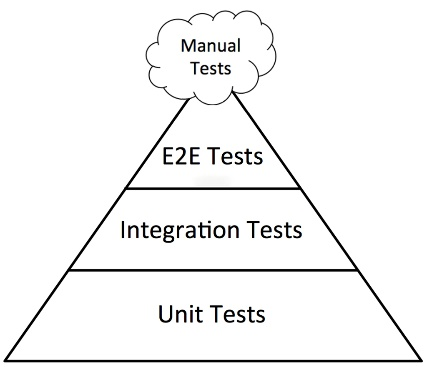
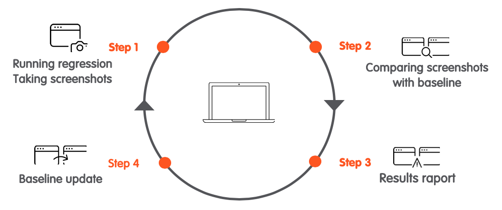

# Testing Angular Applications

## Overview

As applications grow in size and complexity, manual validation alone is no longer enough to catch regressions and ensure release confidence. Software testing establishes whether the system behavior matches expectations across functional, integration, and user-level scenarios.

Delivering high-quality software applications requires proper testing. Effective testing improves the quality of the support and services provided to customers. In addition, a well-tested product results in lower maintenance costs and delivers more accurate, consistent, and reliable outcomes. The cost of fixing a bug in production is significantly higher than the cost of detecting it through an automated test suite. When defects are identified early in the development process, developers can resolve them more efficiently and with less effort.

Modern web applications also run across diverse browsers, devices, operating systems, and network conditions. That variability makes systematic testing essential for compatibility, accessibility, and consistent user experience between development and production environments. Black Box Testing and White Box Testing are complementary software testing approaches that validate a system's functionality from the user's perspective and verify its internal code logic and structure, respectively.

This chapter covers the core testing layers for Angular applications, practical test strategy tradeoffs, and implementation patterns that help teams build fast feedback loops while maintaining high product quality over time. On the tooling side, it discusses [Vitest](https://vitest.dev/) and [Jest](https://jestjs.io/) for unit and integration tests, [Playwright](https://playwright.dev/) for functional and visual tests, and [Cucumber](https://cucumber.io/) for Behaviour-Driven Development.

## Software Development Process

### Software Development Life Cycle

[Software Development Process](https://en.wikipedia.org/wiki/Software_development_process) is the practice of organizing software work into defined phases to improve planning, delivery, and quality. It is often described as a [Software Development Life Cycle](https://en.wikipedia.org/wiki/Systems_development_life_cycle) (SDLC), which provides a structured path from idea to production operation.

The primary goal of SDLC is to deliver high-quality software that meets user needs within expected time and budget constraints. Typical SDLC activities include:

- **Planning**: Define goals, constraints, scope, and acceptance criteria;
- **Design**: Define system architecture, data flow, interfaces, and technical decisions;
- **Implementation**: Build the solution according to the approved design and requirements;
- **Testing**: Validate behavior, quality, and reliability, and detect defects early;
- **Documentation**: Maintain technical and functional documentation throughout the lifecycle;
- **Deployment**: Release the software to target environments in a controlled way;
- **Maintenance**: Monitor production behavior, fix defects, and implement iterative improvements.

Common software delivery approaches include [Waterfall](https://en.wikipedia.org/wiki/Waterfall_model) and [Agile](https://en.wikipedia.org/wiki/Agile_software_development). Within Agile, [Scrum](https://en.wikipedia.org/wiki/Scrum_(software_development)) and [Kanban](https://en.wikipedia.org/wiki/Kanban_(development)) are among the most widely used frameworks.

### Behavior-Driven Development

[Behavior-Driven Development](https://en.wikipedia.org/wiki/Behavior-driven_development) (BDD) is a methodology for developing software through continuous example-based communication between developers, QAs and POs. It describes a cycle of interactions with well-defined outputs, resulting in the delivery of working, tested software that matters.

The process looks something like this:

1. Product Owner (PO) and business analyst define features in Gherkin;
2. PO and business analyst together with the team enrich features with scenarios;
3. Team agrees on a user story by its feature definition;
4. Feature definition is run against a tool parsing and executing the Gherkin and will fail;
5. The features are built and test steps implemented so that the feature passes.

The goal of BDD is a business-readable and domain-specific language that allows teams to describe a system’s behavior without explaining how that behavior is implemented. Tests are written in the form of plain-text feature descriptions with scenarios typically written before anything else and verified by non-technical stakeholders. No development skills are required to create tests, as they are written in a universal language. Business Analysts can actively participate in the automated test case review process and give their feedback to enhance it.

### Domain-Driven Design

[Domain-Driven Design](https://en.wikipedia.org/wiki/Domain-driven_design) (DDD) is a software design approach that places the business domain at the center of the model. Instead of organizing code around technical layers alone, DDD encourages teams to express the system using the language of the problem space. This makes the code easier to understand, easier to change, and easier to test because the domain concepts remain explicit and consistent.

The core concepts in DDD can be summarized as:

- **Ubiquitous Language**: Use the same terminology in code, tests, and conversations that the business uses to describe the domain;
- **Bounded Contexts**: Separate large systems into explicit boundaries where terms, models, and rules are consistent within each context;
- **Entities**: Represent domain concepts that have identity and continuity over time;
- **Value Objects**: Represent descriptive concepts without identity, usually immutable and compared by value;
- **Aggregates**: Group related entities and value objects under a consistency boundary, with external access through the aggregate root;
- **Domain Services**: Capture important domain behavior that does not naturally belong to a single entity or value object;
- **Domain Events**: Represent meaningful business events that occurred in the domain and can trigger reactions across contexts.

DDD helps us focus on business behavior instead of implementation detail. Domain rules can be tested directly through entities, services, and value objects, while integration tests verify that boundaries between contexts and infrastructure behave correctly.

### Spec-Driven Development

[Spec-Driven Development](https://en.wikipedia.org/wiki/Specification-driven_development) (SDD) is an approach where the specification becomes the primary source of truth for implementation. The goal is to describe expected behavior clearly before the code is written, then use that specification to guide development and verification. This reduces ambiguity, aligns stakeholders, and makes it easier to keep requirements and tests in sync.

The process typically looks like this:

1. **Idea**: Identify the problem, user need, or opportunity that should be addressed;
2. **Spec**: Write a clear specification with examples, edge cases, and acceptance criteria;
3. **Review**: Align the specification with stakeholders, developers, and QAs before implementation;
4. **Tests**: Turn the approved specification into executable tests or reviewable test cases;
5. **Code**: Implement the smallest amount of code needed to satisfy the specification;
6. **Validation**: Run the test suite and confirm the implementation behaves as specified.
 
In testing terms, spec-driven development is useful because it gives the team a concrete contract to validate against. It works especially well when paired with BDD, acceptance criteria, and automated tests that verify behavior from the user’s perspective.

### Test-Driven Development

[Test-Driven Development](https://en.wikipedia.org/wiki/Test-driven_development) (TDD) is a testing methodology or a programming practice implemented from the developer’s perspective. The test is developed which specifies and validates what the code will do. In simple terms, test cases are created before code is written. The purpose of TDD is to make the code clearer, simple and bug-free. The simple concept of TDD is to write and correct the failed tests before writing new code. This helps to avoid duplication of code as we write a small amount of code at a time in order to pass tests.

Following steps define how to perform TDD:

1. Add a test.
2. Run all tests and see if any new test fails.
3. Write some code.
4. Run tests and see all pass.
5. Refactor code.
6. Repeat.

### Acceptance Test-Driven Development

In [Acceptance Test-Driven Development](https://en.wikipedia.org/wiki/Acceptance_test%E2%80%93driven_development) (ATDD) technique, a single acceptance test is written from the user’s perspective. It mainly focuses on satisfying the functional behavior of the system. This technique attempts to answer the question: *Is the code working as expected?* ATDD is very similar to BDD. However, a key difference between them is that BDD focuses more on the behavior of the feature, whereas ATDD focuses on capturing the accurate requirements.

This technique enhances collaboration among developers, users, and QAs with a common focus on defining the acceptance criteria. The following are some of the key practices in ATDD:

1. Analyzing and discussing the real-world scenarios;
2. Deciding the acceptance criteria for those scenarios;
3. Automating the acceptance test cases;
4. Focusing on the development of those requirement cases.

There are [key differences between TDD, BDD and ATDD](https://www.browserstack.com/guide/tdd-vs-bdd-vs-atdd). Understanding how these methods work can help developers and other individuals involved in software development figure out which strategy works best to achieve their goals.

## Testing Types

Software Testing Type is a classification of different testing activities into categories, each having, a defined test objective, test strategy, and test deliverables. We can define more than [100 types of Software Testing Types](https://www.guru99.com/types-of-software-testing.html). However, all testing types are not used in all types of projects.

Tests can be manual or automated. Both approaches are widely used and are paramount for the creation of a highly functional and robust application. By definition:

- *Manual testing* presupposes that developers/testers manually check the software, comparing the expected and actual results and detecting issues. Testers use the application simulating the real end users’ behavior, watching how it is working from their side.
- *Automated testing* is performed by the automated program algorithms that repeat preset actions. In this way, the program compares expected and actual outcomes and gives signals of possible defects.

In general, the most important automated test types for web applications are:

- **Unit Tests**: Testing of individual functions or classes by supplying input and making sure the output is as expected;
- **Integration Tests**: Verifying that multiple components, services, or modules work together correctly, including their interactions and side effects;
- **Functional Tests**: Testing scenarios on the product itself, by controlling the browser or the website, regardless of the internal structure to ensure expected behavior;
- **Visual Tests**: Detecting and reviewing visual changes to ensure the websites and applications always look exactly as intended.

Each type of test has an important part to play. Unit tests for fast developer feedback, integration tests to cover all the corner cases of component integrations, and functional tests to make sure everything works right for the end users.

## Testing Pyramid

[Testing Pyramid](https://martinfowler.com/articles/practical-test-pyramid.html) is a metaphor that groups software tests into layers of different granularity. It also provides guidance on how many tests we should have in each layer. Essentially, the testing pyramid, also referred to as the [Test Automation Pyramid](https://www.browserstack.com/guide/testing-pyramid-for-test-automation), lays out the types of tests that should be included in an automated test suite. It also outlines the sequence and frequency of these tests. The goal is to provide immediate feedback and ensure that code changes do not disrupt existing features.



Fig. 1: Testing Pyramid

Unit tests form the base of the testing pyramid. They test individual components or functions to validate that they work as expected in isolation. It is important to cover several scenarios in unit tests, for example, happy paths and error handling. Since this is the largest subset, the unit test suite should run as quickly as possible. Integration tests are the second layer of the testing pyramid. Fundamentally, they verify how a feature communicates with external dependencies. They run more slowly than unit tests. At the top of the pyramid are end-to-end tests. These ensure that the entire application functions as required. End-to-end tests sit at the top of the pyramid because they usually take the longest to run. They can also be fragile because they must cover a wide variety of user scenarios.

As we move up the Testing Pyramid, tests become more expensive because they are harder to create and maintain, and they are often more flaky because they rely on fragile interfaces. At the very top are manual tests, which still have their place, even in the modern age of automation and DevOps, because validating a new feature for the first time requires a human to decide whether it meets the [acceptance criteria](https://www.altexsoft.com/blog/business/acceptance-criteria-purposes-formats-and-best-practices/) (typically validated during User Acceptance Testing, UAT).

The testing pyramid helps address the problem of over-reliance on long-running UI tests. However, there are two known anti-patterns. These test suites look like [an “ice cream cone” and an “hourglass”](https://medium.com/@timothy.cochran/test-pyramid-the-key-to-good-automated-test-strategy-9f3d7e3c02d5). An ice cream cone has very few unit tests, some UI tests, lots of QA tests, and many manual tests. An hourglass has many unit and UI tests but few integration tests. Both patterns are problematic because heavy UI coverage makes the regression suite slow. This affects the productivity of the whole team.

In an Angular context, there are several types of tests: isolated and shallow unit tests, integration tests between components, and e2e tests, which can be split into functional and visual tests. Based on [Complete Guide to Angular Testing](https://christianlydemann.com/complete-guide-to-angular-testing/), a common recommendation is that 80% of tests should be unit tests, 15% integration tests, and 5% UI tests. These percentages may vary, but the ratio is usually similar. However, other opinions recommend thinking in [scales instead of pyramids](https://testguild.com/testing-pyramid/). Rather than prescribing fixed amounts of each test type, we should ask, “What risks exist in my system? How can my system break?” and then build the coverage needed in each area to address those risks.

## Testing Tools

Choosing the right testing tools depends on the type of feedback we need, the level of confidence we want to achieve, and how quickly the test suite must run. In Angular applications, the tooling typically spans unit and integration testing, test-data and dependency mocking, and full end-to-end browser automation. Angular recommends [Vitest testing framework](https://vitest.dev/) for unit and integration tests. For e2e tests, [Playwright](https://playwright.dev/) is recommended. However, we also have other available tools with higher popularity.

In the next table we have a combination of Angular recommendations and the strongest tools:

| Type of Tests | Type of Solutions | Tools |
| --- | --- | --- |
| Unit and Integration Tests | Recommended | [jest](https://www.npmjs.com/package/jest)<br>[rxjs-marbles](https://www.npmjs.com/package/rxjs-marbles) |
|  | Alternative | [vitest](https://www.npmjs.com/package/vitest) |
|  | Boilerplate code | [ng-mocks](https://www.npmjs.com/package/ng-mocks)<br>[@ngneat/spectator](https://www.npmjs.com/package/@ngneat/spectator)<br>[ts-mockery](https://www.npmjs.com/package/ts-mockery) |
|  | API mocking | [angular-in-memory-web-api](https://www.npmjs.com/package/angular-in-memory-web-api) |
|  | Reports | [istanbul-reports](https://www.npmjs.com/package/istanbul-reports)<br>[jest-html-reporters](https://www.npmjs.com/package/jest-html-reporters) |
| Functional and Visual Tests | Recommended | [playwright](https://www.npmjs.com/package/playwright)<br>[cucumber](https://www.npmjs.com/package/@cucumber/cucumber) |
|  | Alternative | [cypress](https://www.npmjs.com/package/cypress)<br>[puppeteer](https://www.npmjs.com/package/puppeteer)<br>[jest-image-snapshot](https://www.npmjs.com/package/jest-image-snapshot) |
|  | API mocking | [ng-apimock](https://www.npmjs.com/package/ng-apimock) |
|  | Reports | [allure-playwright](https://www.npmjs.com/package/allure-playwright)<br>[playwright-html-reporter](https://www.npmjs.com/package/playwright-html-reporter) |

In unit and integration tests, we can choose [Jest](https://www.npmjs.com/package/jest) or [Vitest testing framework](https://vitest.dev/). Both solutions are good choices, but we have other JavaScript test frameworks. Testing with [Mocha](https://www.npmjs.com/package/mocha) and [Chai](https://www.npmjs.com/package/chai) is an excellent alternative. Another solution that has been growing is [Testing Library](https://testing-library.com/). The library provides special tools for different frameworks like [React](https://www.npmjs.com/package/react), [Preact](https://www.npmjs.com/package/preact), [React Native](https://www.npmjs.com/package/react-native), [Angular](https://www.npmjs.com/package/@angular/core), [Vue](https://www.npmjs.com/package/vue), and others. It also helps with e2e testing tools like [Cypress](https://www.npmjs.com/package/cypress), [Puppeteer](https://www.npmjs.com/package/puppeteer), [WebdriverIO](https://www.npmjs.com/package/webdriverio), and others. For testing observables, [marble diagrams](https://rxmarbles.com/) are recommended.

To test Angular components, it is important to reduce boilerplate code. [ngMocks](https://www.npmjs.com/package/ng-mocks) is indispensable in Angular projects for creating mocks for tests. [Spectator](https://www.npmjs.com/package/@ngneat/spectator) is another library to simplify the Angular tests. This library is recommended only for testing templates. It happens that in many cases we test the same thing with functional tests. To avoid duplicate effort, HTML is most often tested with functional tests.

[Cypress](https://www.cypress.io/) or [Jest](https://jestjs.io/) with [Puppeteer](https://www.npmjs.com/package/puppeteer) are very popular testing solutions for e2e tests. [Cucumber](https://cucumber.io/) is a framework that runs automated acceptance tests written in a BDD style. Cypress is quite different technology for different tasks from Playwright. It works well for testing components of a web application, but it cannot replace Playwright. This means that a better combination is Jest + Cucumber + Playwright. Popular solutions for API mocking are [ng-apimock](https://www.npmjs.com/package/ng-apimock), [json-server](https://www.npmjs.com/package/json-server) and [mockserver](https://www.npmjs.com/package/mockserver).

The previous table includes both recommended and alternative solutions. Libraries from both proposals can be combined, but equivalent libraries should not be mixed within the same project. For example, if Jest is selected for unit testing, it should also be used for integration testing. Avoid using Jest for one test suite and, for example, Vitest for another when they fulfill the same role.

## Unit Tests

### Fundamentals

[Unit Testing](https://en.wikipedia.org/wiki/Unit_testing) is a software testing method in which individual units or components of a software application (such as functions, methods, or classes) are tested in isolation to verify that they work correctly as expected.

In the testing pyramid, unit tests are the base layer and should provide the fastest feedback loop for developers. In practical Angular work, a unit can be a method in a service, a pipe transform, a validator, or a focused behavior in a component class. The main goal is to verify one behavior at a time with deterministic inputs and outputs. To keep this feedback fast and deterministic, unit tests should isolate the code under test from external dependencies. A component under test does not need real services, HTTP calls, timers, or browser integrations. Instead, we use simplified objects that mimic production behavior only where needed. This reduces complexity, avoids flaky tests, and makes failures easier to diagnose. A [Test Double](http://xunitpatterns.com/Test%20Double.html) is the generic term for these simplified objects. Although test doubles come in many flavors, teams often use the term "mock" informally to refer to most of them.

There are five types of doubles:

- **Dummy Object**: Dummy objects are passed around but never actually used. Usually they are just used to fill parameter lists.
- **Fake Object**: Fakes are objects that have working implementations, but not the same as the production implementation. Usually they take some shortcut and have simplified version of production code.
- **Test Stub**: Stubs provide canned answers to calls made during the test, usually not responding at all to anything outside what's programmed in for the test.
- **Test Spy**: Spies are stubs that also record some information based on how they were called. One form of this might be an email service that records how many messages it was sent.
- **Mock Object**: Mocks are pre-programmed with expectations which form a specification of the calls they are expected to receive. They can throw an exception if they receive a call they don't expect and are checked during verification to ensure they got all the calls they were expecting.

[Vitest](https://vitest.dev/) has test double functions called spies. A spy can stub any function and track calls to it and all arguments. A spy only exists in the `describe` or `it` block in which it is defined and will be removed after each test. There are special matchers for interacting with spies. Jest and Vitest provide similar resources for mocking. In both frameworks, [mocks](https://vitest.dev/api/vi.html#vi-mockobject-3-2-0) are used to stub out functionality with mock data.

Angular has been designed with testability as a primary goal. In practice, unit testing in Angular combines framework helpers with general testing capabilities from Jest or Vitest. This foundation leads directly into the next sections, where we cover isolated tests, shallow tests, asynchronous behavior, and other patterns used in day-to-day Angular projects.

To learn more about Angular unit tests, [Angular Testing](https://angular.dev/guide/testing), [Testing Angular Applications](https://www.manning.com/books/testing-angular-applications) and [Angular Test-Driven Development](https://www.packtpub.com/en-pt/product/mastering-angular-test-driven-development-9781805127932) books, [Testing Angular](https://testing-angular.com/) online book, and articles such as [The Complete Guide to Angular Testing](https://christianlydemann.com/complete-guide-to-angular-testing/), [Angular Testing Recipes](https://github.com/juristr/angular-testing-recipes), and [Three Ways to Test Angular Components](https://vsavkin.com/three-ways-to-test-angular-2-components-dcea8e90bd8d) are good references.

### Isolated Tests

Isolated tests are used to test a unit in isolation. The unit might contain some business logic that needs to be tested in isolation. When writing isolated unit tests all external dependencies should be mocked. The most common examples of isolated tests are tests of functions and class methods. In Angular applications, we should prefer isolated tests to test Services and Pipes.

We can use isolated tests or shallow tests to test Angular components, whichever makes the most sense. With isolated tests, we only will test the class of the component. It is often useful to test complex components without rendering them. To see how it can be done, see the following component:

```typescript
@Component({
  selector: 'cmn-view-header',
  template: `
    <h1>My Component</h1>
    <cmn-button type="primary-button" (clicked)="onClick()"></cmn-button>
  `,
})
export class ViewHeaderComponent {
  constructor(private readonly sharedService: SharedService) {}

  onClick(): void {
    this.sharedService.copyToClipBoard();
  }
}
```

In the example, we have a component that calls a service when we click on the button. An example of an isolated test:

```typescript
describe('ViewHeaderComponent', () => {
  let component: ViewHeaderComponent;
  let sharedService: SharedService;

  beforeEach(() => {
    sharedService = { copyToClipBoard: jest.fn() } as unknown as SharedService;
    component = new ViewHeaderComponent(sharedService);
  });

  it('#onClick should call #copyToClipBoard', () => {
    component.onClick();

    expect(sharedService.copyToClipBoard).toHaveBeenCalled();
  });
});
```

As we can see, testing Angular components in isolation is no different from testing any other JavaScript object. This approach is preferable when other types of tests are used to interact with the DOM.

### Shallow Tests

Testing component classes without rendering their templates works in certain scenarios, but not in all of them. Sometimes, we can only write a meaningful test if we render a component's template. However, we want to keep the test isolated. In this case, we only need to render the template without rendering the child components. This is what is colloquially known as shallow test.

An example of a shallow test:

```typescript
describe('ViewHeaderComponent', () => {
  let button: ButtonComponent;
  let component: ViewHeaderComponent;
  let fixture: ComponentFixture<ViewHeaderComponent>;
  let sharedService: SharedService;

  beforeEach(() => {
    TestBed.configureTestingModule({
      declarations: [ViewHeaderComponent, MockComponent(ButtonComponent)],
      providers: [
        { provide: SharedService, useValue: { copyToClipBoard: jest.fn() } }
      ],
    }).compileComponents();

    sharedService = TestBed.inject(CommonSharedService);
    fixture = TestBed.createComponent(ViewHeaderComponent);
    component = fixture.componentInstance;
  });

  it('should have <h1> with "My Component"', () => {
    const h1 = fixture.nativeElement.querySelector('h1');

    expect(h1.textContent).toEqual('My Component');
  });

  it('#onClick should call #copyToClipBoard', () => {
    button = fixture.debugElement.query(By.directive(ButtonComponent)).componentInstance;
    button.clicked.emit();

    expect(sharedService.copyToClipBoard).toHaveBeenCalled();
  });
});
```

In this example, all external dependencies are mocked (services and components). To mock components, we can use the [ng-mocks](https://www.npmjs.com/package/ng-mocks) library. Unlike [NO_ERRORS_SCHEMA](https://angular.dev/api/core/NO_ERRORS_SCHEMA), which can hide certain issues and does not help with configuring inputs and outputs, [ng-mocks](https://www.npmjs.com/package/ng-mocks) automatically mocks component inputs, outputs, and other bindings for us. The NO_ERRORS_SCHEMA tells the Angular compiler to ignore unrecognized elements and attributes. The NO_ERRORS_SCHEMA also prevents the compiler from telling us about the missing components and attributes that we omitted inadvertently or misspelled. We could waste hours chasing phantom bugs that the compiler would have caught in an instant.

The most common issue in shallow testing comes from the amount of boilerplate code. We can create helpers and factory functions to reduce the boilerplate code. Alternatively, we can use [Spectator](https://www.npmjs.com/package/@ngneat/spectator) to simplify Angular tests.

### Snapshot Tests

Snapshot tests are a valuable way to ensure that a UI does not change unexpectedly. In a typical snapshot test for a web application, a UI component is rendered, a snapshot is captured, and the result is compared against a reference snapshot stored alongside the test. The test fails if the snapshots differ, indicating either an unintended change to the UI or that the reference snapshot should be updated to reflect the component's new expected state.

Snapshot testing are the best alternative to the [DOM testing](https://angular.dev/guide/testing/components-basics#component-dom-testing). Rather than asserting values obtained from specific `HTMLElement` instances, we can validate the entire component fixture against a snapshot. This approach requires updating our tests to validate components against snapshots rather than relying on traditional DOM assertions.

An example of a snapshot test:

```typescript
describe("ViewHeaderComponent", () => {
  let component: ViewHeaderComponent;
  let fixture: ComponentFixture<ViewHeaderComponent>;

  beforeEach(() => {
    TestBed.configureTestingModule({
      declarations: [ViewHeaderComponent, MockComponent(ButtonComponent)],
      providers: [{ provide: SharedService, useValue: {} }],
    }).compileComponents();

    fixture = TestBed.createComponent(ViewHeaderComponent);
    component = fixture.componentInstance;
    fixture.detectChanges();
  });

  it('should render <h1> with "My Component"', () => {
    expect(fixture).toMatchSnapshot();
  });
});
```

Note that in the initial run (when there aren’t any snapshots to test against), Jest or Vitest will treat the first output as the main reference and will save the output in a *__snapshots__* directory in the same directory as the test file. Next example shows the *.snap* file generated by Jest:

```html
exports[`ViewHeaderComponent should render <h1> with "My Component" 1`] = `
<cmn-view-header>
  <h1>
    My Component
  </h1><cmn-button
    type="primary-button"
  />
</cmn-view-header>
`;
```

Snapshot testing is not limited to HTML templates. It can also be used to validate JavaScript objects, function outputs, JSON data, configuration files, and many other types of content.

Snapshot tests once promised a revolution, but today [they are often criticized](https://medium.com/@tomgold_48918/why-i-stopped-using-snapshot-testing-with-jest-3279fe41ffb2) for being fragile, creating a false sense of safety, and losing value over time. Even small code changes can cause snapshot failures. At first, teams review those failures carefully and update snapshots when needed. Over time, however, people may start updating snapshots automatically without reviewing them, assuming everything is fine. When that happens, snapshots stop providing meaningful protection, and real regressions can slip into production. Snapshot testing is not inherently bad, but it often provides limited value for template-level UI verification. It is usually more useful for stable outputs such as JSON payloads, configuration files, and large JavaScript objects.

### Marble Tests

We can test asynchronous [RxJS](https://rxjs-dev.firebaseapp.com/) code synchronously and deterministically by virtualizing time with the [TestScheduler](https://rxjs-dev.firebaseapp.com/api/testing/TestScheduler). When we need to test Observables, there are [two main patterns](https://medium.com/angular-in-depth/how-to-test-observables-a00038c7faad): the *subscribe and assert pattern* and the *marble testing pattern* based on diagrams. A marble diagram is a domain-specific language in RxJS that helps us model the interactions and values of one or more observables in a test. It is a visual representation, like a schema, that describes what is happening in an observable stream.

We have helper methods that have been added to make creating marble tests easier:

- `hot(marbles: string, values?: object, error?: any)` creates a "hot" observable (a subject) that will behave as though it's already "running" when the test begins. An interesting difference is that *hot* marbles allow a *^* character to signal where the "zero frame" is. That is the point at which the subscription to observables being tested begins.
- `cold(marbles: string, values?: object, error?: any)` creates a "cold" observable whose subscription starts when the test begins.
- `expectObservable(actual: Observable<T>).toBe(marbles: string, values?: object, error?: any)` schedules an assertion for when the *TestScheduler* flushes. The *TestScheduler* will automatically flush at the end of *it* block.
- `expectSubscriptions(actual: SubscriptionLog[]).toBe(marbles: string)` like `expectObservable` schedules an assertion for when the *testScheduler* flushes. Both `cold()` and `hot()` return an observable with a property `subscriptions` of type `SubscriptionLog[]`. Give subscriptions as parameter to `expectSubscriptions` to assert whether it matches the subscriptions marbles diagram given in `toBe()`. Subscription marble diagrams are slightly different than Observable marble diagrams.

To write a test with marble diagrams we will need to stick to a convention of characters that will help visualize the observable stream:

- ' ' the whitespace is a unique character that will not be interpreted;
- '-' represents a frame of virtual time passing;
- '|' this sign illustrates the completion of an observable;
- '#' signifies an error;
- [a-z] an alphanumeric character represents a value which is emitted by the Observable;
- '()' used to group events in the same frame. This can be used to group values, errors, and completion;
- '^' this sign illustrates the subscription point and is used when we are dealing with hot observables;
- '!' this sign indicates the end of a subscription point.

Most [marble testing](https://rxjs-dev.firebaseapp.com/guide/testing/marble-testing) documentation is available in the official RxJS docs. There are also different libraries that help us write marble tests. For Jest-based projects, the most common choices are “[jest-marbles](https://www.npmjs.com/package/jest-marbles)” and “[rxjs-marbles](https://www.npmjs.com/package/rxjs-marbles)”. RxJS itself also provides testing utilities, and these libraries are convenience wrappers around them. This syntax gives us the power to create and manipulate observable streams.

For example, for the following observable:

```typescript
export const source: Observable<number> = of(1, 2, 3).pipe(map(x => x * 2));
```

The marble test can be written as follows:

```typescript
describe('Observable', () => {
  it('should multiply by "2" each value emitted', () => {
    const expected = cold('(abc|)', { a: 2, b: 4, c: 6 });

    expect(source).toBeObservable(expected);
  });
});
```

Notice the *source* and *expected* variable declarations. In marble testing, we use this pattern frequently. With this pattern, we can see when values (a, b, c) are emitted, when the stream completes (|), and compare the actual output directly with what is *expected*.

### Asynchronous Tests

JavaScript code frequently runs asynchronously. Whether we are fetching data, reading files, or waiting on timers, the framework needs to know when the code it is testing has completed before moving on to the next test. Here are the patterns we will use most often. Testing asynchronous code involves testing Observables, Promises and Timers.

The native timer functions (i.e., *setTimeout*, *setInterval*, *clearTimeout*, *clearInterval*) are less than ideal for a testing environment since they depend on real time to elapse. [Vitest timers](https://vitest.dev/guide/mocking/timers) and [Jest Timer Mocks](https://jestjs.io/docs/timer-mocks) can swap out timers with functions that allow us to control the passage of time.

To see how it can be done, see the following class:

```typescript
export class TimerService {
  started = false;

  startTimer(): void {
    setTimeout(() => { this.started = true; }, 100);
  }
}
```

The unit test can be written as follows:

```typescript
describe('TimerService', () => {
  let service: TimerService;

  beforeEach(() => {
    service = new TimerService();
    jest.useFakeTimers();
  });

  afterEach(() => {
    jest.useRealTimers();
  });

  it('should update #started after timeout', () => {
    service.startTimer();
    jest.advanceTimersByTime(100);

    expect(service.started).toBe(true);
  });
});
```

Alternatively, Angular provides helper functions [*fakeAsync*](https://angular.dev/api/core/testing/fakeAsync) and [*tick*](https://angular.dev/api/core/testing/tick) to handle asynchronous tests, which essentially gives us an easy way to run asynchronous code before the assertions. When a test is running within a [*fakeAsync*](https://angular.dev/api/core/testing/fakeAsync) zone, we can use two functions called [*flushMicrotasks*](https://angular.dev/api/core/testing/flushMicrotasks) and [*tick*](https://angular.dev/api/core/testing/tick). The *tick* function will advance time by a specified number of milliseconds, so *tick(100)* would execute any asynchronous tasks that would occur within 100ms. The *flushMicrotasks* function will clear any “microtasks” that are currently in the queue.

The *fakeAsync* utility function has a few limitations. It won't work if the test body makes an *XMLHttpRequest* (XHR) call. XHR calls within a test are rare so we can generally stick with *fakeAsync*. But if we ever do need to call *XMLHttpRequest*, we'll use the [*waitForAsync*](https://angular.dev/api/core/testing/waitForAsync) utility function.

When we need to test RxJS asynchronous code, marble testing can be an elegant way to test it. RxJS provides the [TestScheduler](https://rxjs.dev/api/testing/TestScheduler) which has a `run` callback. The *TestScheduler* class is part of the `rxjs/testing` module, and enables synchronous testing of asynchronous, or synchronous, Observables.

In the next example, we can see how *TestScheduler* works:

```typescript
export const source: Observable<number> = of(1, 2, 3).pipe(delay(100), map(x => x + 1));
```

The marble test can be written as follows:

```typescript
describe('TestScheduler', () => {
  let scheduler: TestScheduler;

  beforeEach(() => {
    scheduler = new TestScheduler((actual, expected) => {
      expect(actual).toEqual(expected);
    });
  });

  it('should wait 100ms before emitting values', () => {
    scheduler.run(({ expectObservable }) => {
      expectObservable(source).toBe('100ms (abc|)', { a: 2, b: 3, c: 4 });
    });
  });
});
```

In marble tests, time should be expressed using the *TestScheduler*, not real milliseconds.

### Code Coverage

Code coverage is a measurement of the percentage of source code executed during automated tests. Test coverage, on the other hand, measures the effectiveness of automated test cases in a qualitative manner.

We can configure minimum coverage thresholds. Thresholds specified as positive numbers represent the minimum required percentage. Anything below these thresholds will cause the test suite to fail with an exit code of 1. Thresholds specified as negative numbers represent the maximum number of allowed uncovered entities. Thresholds can be specified as “global” if we want them to be applied to every file in the project, or as a path or glob if we only want to apply them to certain files.

For example, the following configuration causes test failure if global coverage falls below 80% for statements, lines, branches, and functions:

```javascript
{
  thresholds: {
    global: {
      statements: 80,
      lines: 80,
      branches: 80,
      functions: 80
    }
  }
}
```

This configuration works with Vitest and Jest. For projects with Jest, more details are available in the [coverageThreshold](https://jestjs.io/docs/en/configuration#coveragethreshold-object) section. For Vitest, coverage configuration is available in the [Vitest coverage documentation](https://vitest.dev/guide/coverage.html).

While line and branch coverage indicate which code paths are exercised, they do not prove that tests actually detect incorrect behavior. [Mutation testing](https://en.wikipedia.org/wiki/Mutation_testing) addresses this gap by automatically introducing small changes, called mutants, into the production code and then verifying that at least one test fails for each change. A mutant that is not caught by any test is called a survivor and represents a gap in the test suite. The ratio of killed mutants to total mutants is the mutation score, which is a more meaningful quality indicator than line coverage alone.

[Stryker Mutator](https://stryker-mutator.io/) is the leading mutation testing tool for JavaScript and TypeScript projects, with dedicated support for Angular via [@stryker-mutator/vitest-runner](https://www.npmjs.com/package/@stryker-mutator/vitest-runner) and [@stryker-mutator/jest-runner](https://www.npmjs.com/package/@stryker-mutator/jest-runner). Running mutation tests on critical business logic and domain services helps identify weak assertions and untested edge cases that coverage metrics alone would not surface.

### Test Reporters

It’s very useful to know which parts of the code are not covered by unit tests. In Angular projects, coverage data can be captured and reported by passing the *--code-coverage* flag. Vitest and Jest rely on [Istanbul](https://istanbul.js.org) to generate code coverage reports. By default, these tools report in multiple formats (*json*, *lcov*, *text*, *clover*), but we can configure them to use any valid Istanbul reporter. Running coverage with an *html* report creates a visual overview of coverage in HTML format. We can view results for the entire app broken down per file and examine individual files to see how often each line was executed. Using the *lcov* report as part of the CI pipeline enables us to track coverage trends across builds.

### Debugging

Relying only on *console.log* is rarely enough when a test fails intermittently or only in CI. A stronger approach is to debug tests with breakpoints, source maps, and deterministic test execution.

For Angular tests running in a browser-like environment, the first step is usually to run a single spec in watch mode and attach debugger tools. This allows us to inspect component state, dependency injections, async queues, and DOM updates frame by frame. The Angular docs provide a practical baseline in [Debugging Tests](https://angular.dev/guide/testing/debugging).

A common workflow is to debug one test file in a single worker, then attach Node DevTools. The following npm script shows the default script for Jest:

```json
{
  "scripts": {
    "test:debug": "node --inspect-brk node_modules/jest/bin/jest.js --runInBand"
  }
}
```

An equivalent npm script can be used for Vitest. In both frameworks, `debugger` statements inside tests or production code under test pause execution when the inspector is attached.

In day-to-day development, it is usually better to prefer IDE test plugins over raw terminal commands for run/debug loops. In VS Code, extensions such as [Vitest Extension](https://marketplace.visualstudio.com/items?itemName=vitest.explorer) and [Jest Extension](https://marketplace.visualstudio.com/items?itemName=Orta.vscode-jest) integrate with the Testing panel, where we can run a single test, debug directly from `it`/`describe` blocks, inspect stack traces, re-run failed tests, and navigate quickly between failures and source code. This shortens feedback cycles and reduces context switching.

### Best Practices

The following practices summarize how to design unit tests that are deterministic, readable, and cost-effective to maintain:

- [ ] **Follow conventions**: A style guide is a set of standards for how code should be written and organized. Good projects have clear, consistent coding conventions with automated enforcement. Conventions must be dynamic and adaptable for each team and project, and each team defines its convention. Some guides such as [A guide to unit testing in JavaScript](https://github.com/mawrkus/js-unit-testing-guide) and [Node.js & JavaScript Testing Best Practices](https://github.com/goldbergyoni/javascript-testing-best-practices), and [Frontend testing standards and style guidelines](https://docs.gitlab.com/ee/development/testing_guide/frontend_testing.html) can be used as a reference.

- [ ] **Follow Design Principles**: The key to good unit testing is writing testable code. Use good naming and comments, avoid duplication, follow single responsibility, keep one behaviour in one test, ensure test order does not affect other tests, minimize dependencies, use design patterns, and avoid global mutable state.

- [ ] **Follow the Arrange-Act-Assert pattern**: The Arrange-Act-Assert (AAA) pattern separates test setup, test action, and test assertion. Arrange creates objects and mocks and sets expectations, Act invokes the method, and Assert verifies outcomes. AAA is well known and recommended, and explicit comments for each section are usually unnecessary. See next example in Jasmine style:

  ```javascript
  describe('Array', () => {
    describe('.push(x)', () => {
      let initialArray;

      beforeEach(() => {
        initialArray = [1]; // Arrange
        initialArray.push(2); // Act
      });

      it('appends x to the end of the Array', () => {
        expect(initialArray).toEqual([1, 2]); // Assert
      });
    });
  });
  ```

- [ ] **Follow Test-Driven Development**: [Test-Driven Development](https://en.wikipedia.org/wiki/Test-driven_development) is a robust way to design units so behaviour is specified through tests. Consider writing tests first in `red-green-refactor` style. Test-first improves testable design, keeps code minimal, supports safe refactoring, gives fast feedback, and increases confidence to add features, fix bugs, and explore design changes.

- [ ] **Follow the FIRST Principles**: [FIRST](https://howtodoinjava.com/best-practices/first-principles-for-good-tests/) means tests should be Fast, Isolated, Repeatable, Self-validating, and Timely. Fast tests avoid slowing development/deployment, isolated tests avoid dependence on each other, repeatable tests produce consistent results, self-validating tests require no manual interpretation, and timely tests can be written early and often.

- [ ] **Use lint rules**: Linters catch severe issues and enforce consistency/readability. Beyond base ESLint style rules, include specialized plugins such as promise/security/jest/jasmine plugins for missing resolves, risky regex, missing assertions, and skipped tests.

- [ ] **Describe expectations in a human language**: Name `describe` and `it` blocks so intention is clear in human language. The full test name is the `it` title plus parent `describe` titles, so wording matters. Prefer assertive verbs and avoid vague terms like “should.” This makes test suites useful documentation and produces meaningful failure messages.

- [ ] **Name the tests properly**: Test names should be concise, explicit, descriptive, and written in correct English. Read the spec runner output and ensure it is understandable for others. Test names can become live documentation for the codebase.

- [ ] **Structure the tests properly**: Nest suites when needed to structure tests logically into subsets. This helps tests build from least to most specific, makes extension/refactor easier, reduces repetition in branch testing, and encapsulates tests by common denominator. See next example:

  ```javascript
  describe('A set of functionalities', () => {
    describe('A subset of functionalities', () => {
      it('does something great', () => {});

      it('does something awesome', () => {});
    });

    describe('Another subset of functionalities', () => {
      it('also do something great', () => {});
    });
  });
  ```

- [ ] **Categorize tests under at least 2 levels**: Structure suites with at least two `describe` levels: one for the unit under test and one for scenario/category. This improves report readability and navigation in larger suites.

- [ ] **Create new tests for every defect**: Add regression tests for bug fixes so defects do not recur. Start by creating a test that reproduces the issue before changing code, then apply TDD to fix it. This improves quality assurance and reduces post-release glitches.

- [ ] **Mock Dates and Timers**: When production code uses `new Date()` or `Date.now()`, mock time for deterministic tests. Also, Timers (`setTimeout`, `setInterval`, etc.) run normally if we don't mock them.

- [ ] **Mock out all external services and state**: Unit tests should be stateless and should not modify external resources. Otherwise shared external state can make tests influence each other. Mocking external services also makes tests run much faster than using real-time dependencies.

- [ ] **Do not test external libraries**: Do not test library internals, but rely on library test coverage. Testing thin wrappers that only call library functions usually adds little value. Prefer testing behaviour from the user interaction perspective.

- [ ] **Do not mock everything**: Unit tests should mock external side effects, but not every dependency must be mocked. Real objects are acceptable when setup stays simple, no shared state appears, no AJAX/API/reload side effects happen, and execution speed remains within limits.

- [ ] **Do not test multiple concerns**: If a method has multiple end results, test each result separately. Tests combining concerns (for example with “AND” or “OR” in names) are a smell. Single-concern tests improve failure diagnosis. See next bad example:

  ```javascript
  it('sends the profile to the server and updates the profile view', () => {
    // expect(...).to(...);
    // expect(...).to(...);
  });
  ```

  Where is better changing to:

  ```javascript
  it('sends the profile to the server', () => {
    // expect(...).to(...);
  });

  it('updates the profile view', () => {
    // expect(...).to(...);
  });
  ```

- [ ] **Do not skip unit tests**: Do not comment tests out because they are slow, complex, or flaky. Make tests fast, simple, and trustworthy, otherwise remove them. Avoid `xdescribe`/`xit` and enforce `no-disabled-tests` and `no-focused-tests` lint rules.

- [ ] **Do not test configuration settings**: Configuration values are not usually a unit of business logic. Keep only one or two tests for configuration loading itself instead of many copy-paste tests for each setting. Snapshot testing can verify full configuration content efficiently.

- [ ] **Do not overuse variables**: Extracting too many values into variables can bloat tests and make failures harder to trace. In short tests, repeated literals may be clearer than excessive indirection.

- [ ] **Do not use static access**: Static access is an anti-pattern because it hides dependencies and side effects and harms testability. Prefer non-static methods, instantiate classes, and inject dependencies via constructor so tests can swap mocks or have alternative implementations.

- [ ] **Do not reuse production code**: Tests should verify production code, not reuse it heavily. Reusing production helpers in tests can hide bugs in those helpers. Prefer clear input-output assertions with hard-coded expected values.

- [ ] **Do not catch errors but expect them**: Avoid verbose try-catch assertions for expected failures. Prefer dedicated one-line error assertions like `toThrow`. Also validate useful error properties or types so failure handling is actionable. See next example:

  ```javascript
  it('adds a user in memory', () => {
    expect(userManager.addUser()).toThrow(new Error());
  });
  ```

- [ ] **Do not test complex user interactions**: Some scenarios are too broad for unit tests, such as multi-step drag-and-drop flows or gallery navigation across loaded data. Test these at higher levels (functional/integration). Keep unit tests focused on simple user actions and event-to-method behaviour.

- [ ] **Do not Repeat Yourself**: Use `before/after` hooks to DRY repeated setup, teardown, and actions. This keeps suites concise/readable and centralizes change points.

- [ ] **Avoid toBeTruthy or toBeFalsy**: Avoid broad truthy/falsy matchers because they can create weak or false-positive tests (`null` vs `false`, etc.). Prefer specific assertions for exact values and types.

- [ ] **Prefer toBe over toEqual for primitive values**: `toBe` uses `Object.is` and is generally faster and more precise for primitives. Use `toEqual` when deep comparison of objects/arrays is required.

- [ ] **Avoid the All's**: Prefer `beforeEach/afterEach` over `beforeAll/afterAll`. `All` hooks are not reset between tests and can leak state. `Each` hooks enforce independence and make execution flow clearer.

- [ ] **Avoid mocks in favor spies**: Stub dependencies that create side effects (network, external IO) and use spies to verify interactions. This keeps tests isolated and focused while avoiding unnecessary heavy mocking.

- [ ] **Avoid global test data**: Create data per test and clean up after each test to guarantee a clean environment. This prevents inter-test dependencies. If setup cost is high, simplify test data rather than sharing mutable fixtures.

- [ ] **Avoid logic in the tests**: Tests should avoid loops, switches, and conditionals because logic inside tests creates additional bug paths and weakens one-concern clarity.

- [ ] **Cover the general case and the edge cases**: Strange behaviour often appears at edges. Tests should cover common flows and edge cases, and coverage/test-coverage metrics should be used to evaluate effectiveness of exercised paths.

- [ ] **Test only public methods**: Testing internals creates large maintenance overhead with little payoff. Verifying public behaviour implicitly tests private implementation and keeps tests resilient unless outputs are wrong.

- [ ] **Test the behaviour and not the implementation**: Assert outcomes of operations, not internal state details. This allows internal refactoring without forcing test rewrites and preserves behavioural confidence.

- [ ] **Test many input combinations**: Real systems receive many permutations of input. Avoid only happy-path samples and use random or property-based combinations (for example [fast-check](https://www.npmjs.com/package/fast-check) or [jsverify](https://www.npmjs.com/package/jsverify)) to expose hidden failures.

- [ ] **Use realistic input data**: Unrealistic test inputs miss production-like bugs. Use realistic and varied data to increase defect detection. Libraries like [Faker](https://www.npmjs.com/package/faker) can generate pseudo-real data similar to production forms and distributions.

- [ ] **Use factory functions**: Factory functions simplify object creation in tests, reduce setup duplication, and improve readability by expressing setup as a single call. They also provide flexible instance initialization and clean dependency injection patterns.

- [ ] **Use the prefixes "actual" and "expected"**: When using variables in equality assertions, prefix them with `actual` and `expected`. This improves readability, clarifies intent, and reduces accidental mix-ups in assertions.

- [ ] **Design for lean testing**: Test code is different from production code. Keep it simple, short, flat, and easy to read. Keep only as much testing abstraction as needed and prioritize agility and clarity.

- [ ] **Shorten the feedback loop**: Testing effectiveness depends on quick iterative loops: try, get feedback, refactor. Faster feedback enables more improvement cycles. Running CI-like checks locally can accelerate this loop significantly.

- [ ] **Tag the tests**: Different scenarios require different subsets of tests (smoke, IO-less, commit-time, PR-time full E2E). Tag tests with keywords so tooling can grep and run only relevant subsets, avoiding slow full runs for small changes.

- [ ] **Focus on test coverage**: Coverage indicates how many lines/branches/statements are reached by tests. Very low coverage is risky, but 100% can be costly and may overemphasize edge corners over critical paths. A common rule of thumb is to set a limit of around [80%](https://martinfowler.com/bliki/TestCoverage.html).

- [ ] **Analyse the test coverage report**: Coverage reports help reveal under-tested code areas where surprising behaviour can hide. If we do not know what is untested, we do not know where issues may originate.

- [ ] **Avoid duplicate coverage**: Do not duplicate feature coverage across test layers unnecessarily. If functionality is well-covered in unit tests, avoid repeating it in expensive UI tests. Keep UI tests for big-picture user stories spanning components/views.

- [ ] **Measure logical coverage**: Traditional line coverage can mislead by showing visited code without proving behaviour correctness. Use [mutation testing](https://en.wikipedia.org/wiki/Mutation_testing) to validate whether tests actually detect logical changes, not just execute lines.

- [ ] **Parallelize test execution**: Run multiple tests simultaneously to shorten total feedback time. Parallelism reduces waiting and helps teams resolve issues faster than strictly serial runs.

- [ ] **Know the testing framework API**: Strong knowledge of the testing framework API reduces test size and complexity and improves readability. Using built-in helpers (for example concise spy APIs) often produces clearer tests than verbose low-level assertions.

## Integration Tests

[Integration testing](https://en.wikipedia.org/wiki/Integration_testing) is when we test two or more components together. This makes sense for parts of the applications where the integration between components is important to test, such as a container/smart component with container/dumb components. With integration testing, we simply import the implementation of the dependencies of the unit under test even though we still should mock out [HTTPClient](https://angular.dev/api/common/http/HttpClient).

An example of integration testing is:

```typescript
describe('ViewHeaderComponent', () => {
  let buttonElement: HTMLElement;
  let fixture: ComponentFixture<ViewHeaderComponent>;
  let sharedService: SharedService;

  beforeEach(() => {
    TestBed.configureTestingModule({
      declarations: [ViewHeaderComponent, ButtonComponent],
      providers: [
        { provide: SharedService, useValue: { copyToClipBoard: jest.fn() } }
      ],
    }).compileComponents();

    sharedService = TestBed.inject(SharedService);
    fixture = TestBed.createComponent(ViewHeaderComponent);
    buttonElement = fixture.nativeElement.querySelector('button');
  });

  it('should call #copyToClipBoard when the button is clicked', () => {
    buttonElement.click();

    expect(sharedService.copyToClipBoard).toHaveBeenCalled();
  });
});
```

In this example, when a user clicks the button component, an event is emitted to the parent component. We cannot mock the *ButtonComponent* because its event listeners are defined within it. In shallow tests, all child components are mocked and events are emitted by calling *@Output()* directly. In this example, the event originates from the *ButtonComponent*.

Although both shallow and integration tests render components, they differ significantly in nature. In the shallow test, we mocked every dependency of the component. In the integration test, we mocked only the *SharedService*. Shallow tests are isolated and, as a result, can be used to drive component design. Integration tests serve to verify correctness.

As discussed, integration tests verify that groups of components and services work together. Other common scenarios for integration tests include testing integrations with [Angular Router](https://angular.dev/guide/routing), [NgRx Effects](https://ngrx.io/guide/effects), or [Redux Beacon](https://rangle.gitbook.io/redux-beacon/). However, it is recommended to avoid testing complex behaviors using only unit and integration tests. Complex user interactions should be tested with functional tests.

## Functional Tests

### Fundamentals

[Functional testing](https://en.wikipedia.org/wiki/Functional_testing), also known as end-to-end (e2e) testing in the Angular ecosystem, verifies the behavior of the application as a whole from the user’s perspective. Unlike unit and integration tests, which validate isolated pieces of logic or component interactions, functional tests drive a real browser through real user scenarios, interacting with the application as a human would. They sit at the top of the Testing Pyramid and are the most expensive to write and maintain, but they provide the highest level of confidence that the product works correctly in a production-like environment.

[Playwright](https://playwright.dev/) is an open-source framework developed by Microsoft for automating web browsers to test web applications. It simulates user interactions such as clicking, filling out forms, navigating between routes, and validating rendered state. Its features include headless execution, cross-browser support (Chromium, Firefox, and WebKit), mobile emulation, network interception, and advanced debugging tools, making it ideal for web applications.

The next example shows a purchase-order-style scenario where we validate the total number of promotions in the first section and the name of the first promotion.

```typescript
describe('Promotional Sections', () => {
  beforeEach(async ({ page }) => {
    await page.goto('/promotions');
  });

  it('should display promotions in the first section', async ({ promotionalSectionPO }) => {
    const firstSection = promotionalSectionPO.getAllSections().first();
    const promotions = promotionalSectionPO.getAllPromotions(firstSection);

    await expect(promotions).toHaveCount(2);
    await expect(promotionalSectionPO.getPromotionName(promotions.first())).toHaveText('Summer Sale');
  });
});
```

In Angular, functional tests are typically run against the compiled application served in a browser, covering flows that span multiple components, routes, services, and network calls. They are the right tool to validate critical user journeys such as login, checkout, or multi-step submissions.

### Browser Interaction

Functional tests automate real browser interactions, namely, navigating to URLs, clicking elements, filling in forms, selecting options, scrolling, hovering, pressing keyboard shortcuts, and verifying visible content or application state. The test framework controls the browser through browser automation protocols. Playwright does not use the [WebDriver](https://www.w3.org/TR/webdriver/) standard for its core automation model, but it uses the [Chrome DevTools Protocol](https://chromedevtools.github.io/devtools-protocol/) for Chromium and Playwright's own browser-specific transport layers for Firefox and WebKit.

Playwright controls browser navigation using methods like `page.goto(url)`. To interact with elements in the browser, tests must first locate them. Playwright offers different locator strategies:

- **CSS selectors**: Select elements using standard CSS syntax, e.g. `.btn-primary` or `input[name="email"]`. Fast and widely supported.
- **Text locators**: Select elements by their visible text content. Playwright provides `page.getByText()` for human-readable text queries.
- **Test IDs**: Select elements by a dedicated `data-testid` attribute, e.g. `page.getByTestId('submit-btn')`. This decouples tests from markup structure and styling.
- **ARIA roles**: Select elements by their semantic role and accessible name, e.g. `page.getByRole('button', { name: 'Submit' })`. This approach promotes accessibility-first development.
- **XPath**: A powerful but fragile and verbose querying language. Its use is strongly discouraged because it is tightly coupled to DOM structure and is hard to maintain.

The recommended approach is to prefer accessible locators (role, label, text) and `data-testid` attributes over structural selectors that leak implementation details.

### Auto-Waiting

One of the most common sources of flakiness in functional tests is poor synchronization between the test and the application state. In practice, the default strategy should be [auto-waiting](https://playwright.dev/docs/actionability). Actions such as `click`, `fill`, and `press`, and Playwright assertions such as `expect(locator).toBeVisible()`, already wait for element readiness and stable conditions. This is why fixed delays such as `waitForTimeout()` are a bad default because they slow down the suite, hide real timing problems, and still fail under variable load.

Explicit waiting is still necessary in specific scenarios, but it should be used intentionally and with clear responsibility. In other words, when auto-waiting is not enough, the test author is responsible for choosing a concrete and meaningful synchronization signal. Typical examples include waiting for navigation (`waitForURL`), waiting for a specific network response (`waitForResponse`), waiting for a loading indicator to disappear, or waiting for an asynchronous backend process to finish.

A practical rule is to use auto-waiting by default and add explicit waits only for domain-specific events that the framework cannot infer on its own. This keeps tests faster, clearer, and more reliable.

### Mocking APIs

Functional tests can intercept and mock network requests to control the data the application receives without depending on a live backend. In [Playwright's API Mocking](https://playwright.dev/docs/mock), `page.route()` can block a request completely and return fixture data with `route.fulfill()`, which is useful when the scenario needs full control over backend responses. For more details, see next example:

```typescript
describe('Promotions', () => {
  beforeEach(async ({ page }) => {
    await page.route('*/**/api/v1/promotions', async route => {
      const json = [{ name: 'Summer Sale', id: 21 }];

      await route.fulfill({ json });
    });
  });
});
```

When the test should keep most of the real response but adjust only a small part of it, `route.fetch()` can retrieve the original payload and `route.fulfill()` can return a patched version.

Alternatives such as [ng-apimock](https://www.npmjs.com/package/@ng-apimock/core) integrate the same idea into the Angular testing workflow and are often preferable in Angular-heavy projects because they centralize mocks outside the Playwright specs. This keeps functional tests focused on user behavior instead of polluting test code with inline API-mocking setup. API mocking still makes tests faster and more reliable, avoids polluting real databases with test data, and lets the team validate edge cases that may be difficult to reproduce on demand.

When the behavior under test depends not on HTTP but on browser-provided capabilities, Playwright also supports [mocking browser APIs](https://playwright.dev/docs/mock-browser-apis), typically by installing the mock before page load with `page.addInitScript()`.

### Mocking Clock

Time-dependent features such as inactivity logout, countdowns, throttling windows, and scheduled refreshes should use a mocked clock so tests stay deterministic and fast.

Playwright provides a dedicated [Clock API](https://playwright.dev/docs/clock). Utilizing `Clock` functionality allows developers to manipulate and control time within tests. The recommended approach is to use `setFixedTime` to set the time to a specific value. If that doesn't work for our use case, we can use `install` which allows us to pause time later on, fast forward it, tick it, etc. `setSystemTime` is only recommended for advanced use cases.

To avoid polluting test cases with repeated time setup, keep clock configuration in fixtures or `beforeEach` blocks and let the test body focus on user behavior and expected outcomes.

### Page Objects

[Page Objects](https://playwright.dev/docs/pom), also called the Page Object Model (POM), use an object-oriented structure to represent the UI. In this model, each page or major UI component has a corresponding class that centralizes locators and exposes reusable interaction methods. This model is especially useful in medium and large automation suites where many tests depend on the same screens and page states.

The main characteristics are:

- **Structure**: Object-oriented classes, usually one page object class per file;
- **Focus**: UI representation (elements, states, and page-specific actions);
- **Pros**: Centralizes locators, reduces duplication, and improves readability and maintainability;
- **Cons**: Can become bloated or over-engineered in small projects or in UIs that change very quickly.

The pattern usually follows some practical rules:

- Provide an interface that is easy to use from tests;
- Encapsulate locator and interaction details inside the page object;
- Model meaningful pages/components instead of creating classes for every tiny fragment;
- Return another page object when a method navigates to a different page;
- Keep assertions in test files, not in page object classes;
- Keep one page object class per file.

Since elements are encapsulated in these objects, UI changes are generally fixed in one place rather than across many tests.

In the example below, we can see a page object for promotional sections:

```typescript
export class PromotionalSectionPO {
  constructor(private readonly page: Page) { }

  getAllSections(): Locator {
    return this.page.locator('section');
  }

  getAllPromotions(section: Locator): Locator {
    return section.locator('promotion');
  }

  getPromotionName(promotion: Locator): Locator {
    return promotion.locator('.title');
  }
}
```

Each section contains a list of promotions. Each promotion contains its own details. When we need to execute some assertions for a specific promotion, instead of creating a new method, we can reuse a generic method that receives a promotion element.

### Helper Functions

Helper functions use a functional structure and focus on behavior and workflows rather than on page structure. They are useful for multi-step operations such as `loginUser`, `checkoutItem`, data setup, API preparation, and repeated domain actions.

The main characteristics are:

- **Structure**: Functional modules and composable functions;
- **Focus**: Reusable workflows and behavior-oriented operations;
- **Pros**: Fast to write for simple scenarios, reusable across suites, and no class hierarchy overhead;
- **Cons**: If helpers also own locators, UI changes may force updates in many functions unless locator definitions are centralized.

Unlike a Page Object, a Helper should not model a specific screen. Its responsibility is to orchestrate reusable operations that may span pages, API calls, fixtures, and test data.

### Flaky Tests

As the test suite grows, a small amount of instability can quickly turn the regression signal into noise. A flaky test is one that passes and fails without a code change, usually because it depends on timing, shared state, brittle selectors, an unstable environment, browser automation limits, or test-order coupling. Flaky tests are worse than no tests because they reduce trust in the suite and make it harder to tell whether a failure represents a real regression or only a temporary failure in the test itself.

The right response is to make the test deterministic, isolate the dependency that is introducing nondeterminism, or remove the unstable scenario from the lower-level suite until it can be stabilized. Temporarily disabling a flaky test can be a pragmatic short-term step, but it should be treated as technical debt rather than a permanent solution.

When a test still needs a safety net, retries can help separate transient failures from stable regressions. By default a test is not retried, but when retries are enabled, a test that passes on retry is marked as flaky rather than healthy, which makes the issue visible in the [HTML reporter](https://playwright.dev/docs/test-reporters#html-reporter). In practice, retries should help us gather evidence and reduce noise while we fix the root cause, not hide instability behind a passing build.

### Test Reporters

Test reporters for [Playwright Test](https://playwright.dev/docs/test-reporters) are responsible for turning raw execution results into feedback that different audiences can consume. In practice, teams combine lightweight console reporters such as [list](https://playwright.dev/docs/test-reporters#list-reporter), [line](https://playwright.dev/docs/test-reporters#line-reporter), and [dot](https://playwright.dev/docs/test-reporters#dot-reporter) for quick local runs with structured outputs such as [json](https://playwright.dev/docs/test-reporters#json-reporter), [junit](https://playwright.dev/docs/test-reporters#junit-reporter), and [blob](https://playwright.dev/docs/test-reporters#blob-reporter) for CI ingestion, trend analysis, and cross-shard merge workflows.

For human-readable diagnostics, the built-in [HTML reporter](https://playwright.dev/docs/test-reporters#html-reporter) is usually the central artifact because it links test status to retries, errors, traces, screenshots, videos, and timing in one place, which makes triage significantly faster in larger suites. Many teams extend this baseline with ecosystem reporters such as [allure-playwright](https://www.npmjs.com/package/allure-playwright) for richer historical dashboards and test metadata, or [playwright-html-reporter](https://www.npmjs.com/package/playwright-html-reporter) for alternative presentation and distribution needs, while keeping reporting strategy focused on signal quality, failure diagnosis speed, and long-term visibility of stability and flakiness trends.

### Debugging

End-to-end tests can be difficult to debug because they depend on an entire system, may depend on prior actions (such as log-in), and may change the state of the application they're testing.

For daily debugging, prefer IDE integrations over command-line-only workflows. In VS Code, the [Playwright Test for VSCode](https://marketplace.visualstudio.com/items?itemName=ms-playwright.playwright) extension and the Testing panel make it easier to run a single scenario, debug with breakpoints, inspect traces, and re-run only failed tests. This reduces context switching and speeds up investigation loops.

For deeper diagnosis, combine Playwright Inspector with browser developer tools to inspect network calls, console errors, DOM state, and timing behavior during each test step. In the [Debugging](https://playwright.dev/docs/debug) section of Playwright documentation, we have procedures to debug functional tests.

### Best Practices

The following practices focus on writing functional tests that are stable, maintainable, and aligned with real user behavior:

- [ ] **Have simple project structure**: A good project structure helps everyone catch up quickly, even on large-scale codebases. Keep an `e2e/` folder at the top level for end-to-end tests and test-specific configuration files. In multi-project workspaces, keep app-specific end-to-end tests in `projects/project-name/e2e/`.

- [ ] **Follow the Given-When-Then pattern**: The [Given-When-Then](https://martinfowler.com/bliki/GivenWhenThen.html) formula is a template intended to guide the writing of functional tests.

- [ ] **Make use of lint rules**: Linters can catch severe issues like incorrectly handled errors and lost information. Use plugins designed for test code patterns, such as [eslint-plugin-playwright](https://www.npmjs.com/package/eslint-plugin-playwright) for waiting and locator reliability.

- [ ] **Do not duplicate test coverage**: Do not create functional tests for areas already covered well by lower-level tests. If a UI component can be covered by a unit test, prefer that approach. Unit tests are easier to maintain, less flaky, and cheaper in CI, while functional tests should focus on big-picture user stories across many components and views.

- [ ] **Do not test everything**: Maximize coverage with fewer tests and avoid excessive granularity that creates maintenance burden. It is recommended to verify functional outcomes rather than internal implementation details.

- [ ] **Do not ignore flaky tests**: Tests depend on external systems and can fail randomly due to network conditions, system load, and other non-deterministic factors. Each flaky test needs targeted stabilization (better waits, setup fixes, etc.) or to be removed. Metrics such as execution time and failure/success trends can help identify root causes.

- [ ] **Do not add logic to the tests**: Avoid `if` statements and `loops` in test bodies. Extra logic can let tests pass without asserting real behavior and can slow execution. Tests should stay one-concern and straightforward.

- [ ] **Do not use XPath locator**: XPath is often the slowest and most brittle locator strategy, and it tends to break when markup changes. Expressions are hard to read and debug, and maintenance cost is high. Prefer alternative locator strategies whenever possible.

- [ ] **Do not use IDs**: IDs are often assumed stable but can change, and frameworks may generate or rely on them internally. Avoid adding IDs only for testing. Prefer user-facing locators and dedicated testing attributes like `data-testid`, and use IDs only when no better option exists.

- [ ] **Prefer user-facing and test-id locators**: In Playwright, use resilient locators such as `getByRole`, `getByLabel`, `getByPlaceholder`, and `getByTestId`. Avoid brittle selectors tied to implementation details, like deep CSS chains and dynamic class names. Use `getByText` only when text is intentional and stable.

- [ ] **Use page objects**: Page Object is a key design pattern for cleaner tests. It encapsulates page element knowledge, supports reuse across tests, and centralizes updates when UI templates change. This significantly improves maintainability for automation teams.

- [ ] **Test case only call page object's methods**: For reusability and maintainability, test cases should call page object methods instead of interacting with controls directly. Even simple clicks should be wrapped so requirement and UI changes require refactoring in one place only.

- [ ] **One file, one-page object class**: Define one page object class per file and use user-friendly names for files and classes. This structure improves project recognizability and makes page objects easier to locate in both small and large projects.

- [ ] **Do not place assertions inside page objects**: Keep page objects focused on interaction abstraction and avoid verification points inside them. Putting assertions in page object classes violates single responsibility and makes test scripts harder to understand and maintain.

- [ ] **Do not place assertions inside of try/catch blocks**: Assertions are meant to fail loudly and notify the test engine when expectations are not met. Wrapping assertions in try/catch can hide failures and reduce build feedback quality. Expect errors directly when an error is the intended outcome.

- [ ] **Make tests independent at the file level**: Playwright can run files in parallel across workers and browsers, and [Selenium Grid](https://www.selenium.dev/documentation/grid/) supports similar parallel cross-browser execution. File-level independence is critical because execution order is not guaranteed and isolated runs should remain reliable.

- [ ] **Navigate to the page under test before each test**: Start each test from a clean page state by navigating before execution. Also maintain route-navigation suites for major app paths to verify app connectivity, user navigation flow, and permission behaviors.

- [ ] **Use async & await**: Prefer `async` and `await` to avoid [Callback Hell](http://callbackhell.com/) and [Pyramid of Doom](https://en.wikipedia.org/wiki/Pyramid_of_doom_(programming)) style code. With Promise-based tools like Playwright and Puppeteer, async/await keeps test flows flatter, clearer, and easier to maintain.

- [ ] **Mock all API calls**: This is controversial, with different strategies across teams. Some prefer mocks for all tests to avoid network dependencies, but others prefer full-system realism. A practical compromise is maintaining smoke tests in production-like environments with real data.

- [ ] **Avoid hard waits**: Fixed delays like `waitForTimeout()` are fragile and create slow feedback loops. Increasing timeout values only adds latency and masks real synchronization issues. Prefer Playwright [auto-waiting](https://playwright.dev/docs/actionability) and [web-first assertions](https://playwright.dev/docs/api/class-playwrightassertions) like visibility and URL expectations.

## Visual Tests

### Fundamentals

[Visual testing](https://www.geeksforgeeks.org/software-testing/software-testing-visual-testing/) is necessary to make sure that style issues don’t pop up and the web application continues to look just as good as it works. Visual testing mostly focuses on visual aspects of the user interface. It allows us to pinpoint every pixel at the UI level so that HTML, CSS, and JavaScript differences don’t affect the user experience. Verification of visual aspects can be made manually or with the help of automation.

To make this practical, visual regression follows a simple cycle. First, it is important to create a baseline. It is the first screenshot capture of each step. Second, run another round of tests to check whether implemented changes break the application UI. When the test run is finished, we need to compare the latest test run with the baseline to verify whether any changes appeared. If so, we need to check whether the difference is something the development team intended to do. In other words, we need to check if changes appeared for the right reason. If it turns out that the development team did not intend to implement any of them, then they are called visual bugs. In the last phase, the baseline should be updated with new changes to validate new regression iterations properly. This cycle is represented in the next image.



Fig. 2: Visual regression

In practice, there are many tools and libraries that help testers and developers in building test scenarios, but all are focused on:

- Properly rendered and displayed graphics on the page;
- Components of a page displayed correctly, e.g. buttons with proper color and proper shape;
- Layout of a page e.g. each component is in right place on a page;
- Validation of component, if it does not overlay each other.

By comparison, in functional tests we take the following aspects of the application into consideration:

- Validation of input fields;
- Page navigation check;
- Business logic check, e.g. checking CRUD operation on a page;
- Check if hyperlinks are working.

Taken together, functional and visual tests provide the development team with a strong tool for verifying changes during the software development life cycle.

### Screenshot Tests

Tests are written to prevent mistakes from becoming user-facing issues. So far, we have focused only on testing application logic. However, the visual appearance of a web app is also important. One way to verify the app's appearance is to use a test that fails when a screenshot changes.

Automated tests that verify visual appearance can be hard to build. Still, we can create a simple screenshot test that fails when major, unintended visual changes appear. We can use [Playwright snapshots](https://playwright.dev/docs/test-snapshots) or [jest-image-snapshot](https://www.npmjs.com/package/jest-image-snapshot) to compare a browser screenshot against a reference image. However, comparing images is more complex than comparing text. Several factors can affect screenshot testing, such as the screen resolution on the machine running the tests. Fonts can also cause issues because they may render differently across machines and browsers.

Taking screenshots in Playwright is straightforward. Below, we have an example using Playwright for visual comparison. We can see that we are capturing a screenshot and comparing it to a baseline snapshot.

```typescript
describe('Promotional Sections', () => {
  beforeEach(async ({ page }) => {
    await page.goto('/promotions');
  });

  it('should compare successfully with a baseline', async ({ page }) => {
    await expect(page).toHaveScreenshot('example-page.png');
  });
});
```

In short, this test quickly tells us if the page starts looking different by mistake.

### Best Practices

Most best practices for functional testing also apply to visual testing. The following practices focus on creating visual tests that are stable, reviewable, and scalable over time:

- [ ] **Name the screenshots properly**: Initially, screenshots are given default names that are not too descriptive, so include a name so we know what we are actually looking at.

- [ ] **Do not try to test everything**: Try to maximize coverage with fewer tests. This is difficult because we want to know everything that is going on, but the more granular our tests are, the easier it is to track down the actual bugs causing the problem.

- [ ] **Avoid full-page screenshots**: Keep the tests modular or it will get annoying. Also, bigger screenshots mean longer processing time.

- [ ] **Freeze dynamic content**: Mock or control clocks, time zones, and locale-sensitive formatting so date/time labels do not change between runs. This prevents false positives caused by environment-dependent rendering.

- [ ] **Control viewport and browser settings**: Standardize viewport size, device scale factor, browser version, and color scheme in the visual test configuration. Snapshot consistency depends on a predictable rendering environment.

- [ ] **Stabilize fonts and assets**: Use packaged fonts and wait for font loading before taking screenshots. Missing fonts or late-loading assets can shift layout and cause misleading visual diffs.

- [ ] **Mask volatile UI areas**: Exclude or mask unstable UI areas such as advertisements, animated banners, rotating carousels, and user-specific avatars. Focus the comparison on areas that represent product quality.

- [ ] **Disable animations and transitions**: Turn off CSS animations and transitions during snapshot capture. Motion between frames can make deterministic comparison impossible even when the UI is correct.

- [ ] **Use component-level and page-level coverage**: Combine targeted component snapshots with a smaller set of page snapshots. This balances fast diagnosis with confidence in integrated layouts.

- [ ] **Define explicit diff thresholds and policy**: Set clear per-suite tolerance rules and review criteria for acceptable pixel differences. Teams should agree when to accept, reject, or rebaseline a change.

- [ ] **Review snapshots in pull requests**: Make visual diffs part of code review with clear ownership. Human approval of changed baselines helps prevent accidental acceptance of regressions.

- [ ] **Version and document baseline updates**: Record why baseline images changed and link them to intended UI changes. This creates traceability and reduces confusion during future regressions.

- [ ] **Plan for scaling visual testing**: If we are using git to store the baseline images and the project becomes increasingly larger, check out git storage tools like [Git Annex](https://git-annex.branchable.com/) or [Git Media](https://github.com/alebedev/git-media) to prevent the repo from growing out of control.

- [ ] **Use the pattern library**: If the team has a component library, map tests to individual components and their states. This makes it easier to localize failures and identify bugs by validating one component state at a time.

- [ ] **Run the tests frequently**: Build a continuous testing pipeline where the suite runs frequently, such as every day or on each repository change. The earlier issues are found, the lower the cost to fix them.

## Other Tests

### Accessibility Testing

Accessibility Testing is a type of testing which determines the usability of a product to the people having disabilities (deaf, blind, mentally disabled etc.). People with disabilities use assistive technology which helps them in operating a software product. Automated tools can quickly detect common issues such as missing labels, low color contrast, incorrect heading hierarchy, and invalid ARIA attributes.

### Cross Browser Testing

This testing ensures that software applications perform well on different hardware, operating systems, and network environments. The goal is to verify consistent behavior, not pixel-perfect similarity. Core user journeys should be executed in all supported browsers, while full regression can run in one primary browser plus a smaller compatibility suite in the others. Special attention is needed for CSS layout differences, date/time input behavior, file uploads, font rendering, and browser-specific security restrictions.

### Smoke Testing

Smoke testing is a lightweight verification step that checks whether the most critical parts of an application work after a new build or deployment. A smoke test usually confirms that the app starts correctly, the main routes load, essential APIs respond, and a few business-critical flows such as login or navigation are available. The goal is not to validate every detail, but to detect major failures quickly so that obviously broken builds do not move further in the delivery pipeline.

### Monkey Testing

Monkey testing is performed by a tester in a random manner, assuming that if the monkey uses the application, then how a monkey enters random values without any knowledge or understanding of the application. The most valuable outcome is not pass/fail status, but identifying unexpected crashes, frozen UI states, and unhandled exceptions that should be converted into deterministic regression tests. There are no special test cases written for monkey testing.

### Performance Testing

Performance testing evaluates the application's performance and ensures that it meets expected benchmark requirements. Performance must be measured, monitored, and refined continuously. In addition, the growing complexity of the web creates new challenges for tracking metrics, since results can vary significantly depending on device, browser, protocol, network type, and latency.

### Security Testing

Security testing for web applications should cover authentication, authorization, data protection, and dependency risks. Typical checks include role-based access control validation, token handling and expiration behavior, secure cookie settings, protection against common attacks such as XSS and CSRF, and safe handling of secrets in configuration files and logs. Automated dependency and container scans can complement security testing by identifying known vulnerabilities early in the delivery cycle.

## Gherkin

### Fundamentals

[Gherkin](https://cucumber.io/docs/gherkin/) is a domain-specific language, just like SQL and HTML. Each line is called a step, starts with a keyword, and ends with terminal punctuation. Tabs or spaces are used for indentation, and a comment can be added anywhere, but it should start with a # sign.

```gherkin
Feature: Guess the word

  # This scenario has three steps
  Scenario: Breaker joins a game
    Given the Maker has started a game with the word "silky"
    When the Breaker joins the Maker's game
    Then the Breaker must guess a word with 5 characters

```

Each non-blank line must start with a Gherkin keyword, followed by free-form text. The only exceptions are the feature and scenario descriptions.

Based on [Gherkin Reference](https://cucumber.io/docs/gherkin/reference/), the primary keywords are:

- **Feature**: The purpose of the *Feature* keyword is to provide a high-level description of a software feature, and to group related scenarios. The first primary keyword in a Gherkin document must always be *Feature*, followed by a “:” and a short text that describes the feature.
- **Rule**: The purpose of the Rule keyword is to represent one business rule that should be implemented. It provides additional information for a feature. A Rule is used to group together several scenarios that belong to this business rule.
- **Scenario (or Example)**: This is a concrete example that illustrates a business rule. It consists of a list of steps. Scenarios follow the pattern [Given-When-Then](https://martinfowler.com/bliki/GivenWhenThen.html).
- **Given, When, Then, And, But (steps)**: Steps are executed one at a time, in the sequence we’ve written them in. *Given* steps are used to describe the initial context of the system. *When* steps are used to describe an event, or an action. *Then* steps are used to describe an expected outcome, or result. *And* and *But* are used to avoid successive *Given’s*, *When’s*, or *Then’s*.
- **Background**: Occasionally we are repeating the same *Given* steps in all the scenarios in a *Feature*. A *Background* allows us to add some context to the scenarios that follow it. It can contain one or more *Given* steps, which are run before each scenario, but after any [*Before* hooks](https://cucumber.io/docs/cucumber/api/#hooks).
- **Scenario Outline (or Scenario Template)**: The *Scenario Outline* keyword can be used to run the same *Scenario* multiple times, with different combinations of values.
- **Examples**: A Scenario Outline must contain an *Examples* (or *Scenarios*) section(s). Its steps are interpreted as a template which is never directly run. Instead, the *Scenario Outline* is run once for each row in the *Examples* section beneath it (not counting the first header row).

There are a few secondary keywords as well:

```
  """ (Doc Strings)
  | (Data Tables)
  @ (Tags)
  # (Comments)
```

Functional tests can be written in Gherkin and executed with Cucumber + Playwright. Gherkin provides a business-readable format, Cucumber maps scenarios to test steps, and Playwright runs them in real browsers. Scenarios can include steps that sound very similar or even identical. It is recommended to look for opportunities to generalize steps and reuse them. The goal is to build a reusable library of steps so that adding new features requires less effort over time. Reusing steps is recommended whenever possible.

### Jira + Xray

[Jira](https://www.atlassian.com/software/jira) is widely used to manage user stories and delivery workflows, while [Xray](https://www.getxray.app/) extends Jira with full test management and traceability capabilities. Together, they can keep user stories, BDD scenarios, and execution evidence connected in one flow.

A practical approach to integrate Jira and Xray is:

1. Write or refine acceptance criteria in the Jira user story using business language;
2. Create an Xray Test issue (or use Xray's Cucumber/BDD Test type) linked to that story;
3. Add the Gherkin scenario directly in the Xray test so product owners, QAs, and developers can review it collaboratively;
4. Tag scenarios with issue keys (for example `@TEST-1234`) to preserve traceability between automated tests and Jira artifacts;
5. Execute the automated suite in [CI workflow](https://docs.getxray.app/space/XRAYCLOUD/44565056/Taking+advantage+of+Jira+Cloud+built-in+automation+capabilities) and import Cucumber JSON results back to Xray so test status, history, and evidence are visible in Jira dashboards and test plans.

This workflow improves requirement clarity, keeps BDD tests as living documentation, and provides end-to-end traceability from user story to automated execution.

### Cucumber + Playwright

[Cucumber](https://cucumber.io/) combined with Playwright (via [playwright-bdd](https://www.npmjs.com/package/playwright-bdd)) is a powerful combination for functional testing that bridges the gap between technical and non-technical team members. Cucumber allows test scenarios to be written in Gherkin, a plain-language format that non-technical stakeholders, business analysts, and product owners can read, understand, and validate. Playwright serves as the browser automation engine underneath, providing fast, reliable, and cross-browser testing capabilities.

Below is a practical example of how to configure and use Cucumber with Playwright:

**Step 1: Create a configuration file** (`playwright.config.js`):

```javascript
const testDir = defineBddConfig({
  features: 'features/**/*.feature',
  steps: 'steps/**/*.js',
});

export default defineConfig({
  testDir,
  reporter: 'html',
});
```

**Step 2: Create a feature file** (`features/login.feature`):

```gherkin
Feature: User Authentication

  Scenario: User can login with valid credentials
    Given I am on the login page
    When I enter email "user@example.com"
    And I enter password "password123"
    And I click the login button
    Then I should see the dashboard
    And URL should contain "dashboard"
```

**Step 3: Implement step definitions** (`steps/auth.js`):

```javascript
Given('I am on the login page', async ({ page }) => {
  await page.goto('https://app.example.com/login');
});

When('I enter email {string}', async ({ page }, email) => {
  await page.fill('input[type="email"]', email);
});

And('I enter password {string}', async ({ page }, password) => {
  await page.fill('input[type="password"]', password);
});

And('I click the login button', async ({ page }) => {
  await page.click('button:has-text("Login")');
});

Then('I should see the dashboard', async ({ page }) => {
  await expect(page).toHaveTitle(/Dashboard/);
});

And('URL should contain {string}', ({ page }, urlPart) => {
  expect(page.url()).toContain(urlPart);
});
```

**Step 4: Run the tests**:

To execute the functional tests, use the following npm script:

```json
{
  "scripts": {
    "e2e": "bddgen -c playwright.config.ts && playwright test -c playwright.config.ts"
  }
}
```

This setup provides several benefits, namely, feature files serve as living documentation, non-technical team members can contribute to test scenarios, Playwright's debugging and reporting tools are fully available, and the test results are automatically generated and can be viewed in the HTML report.

### AI + BDD

In the AI era, teams can accelerate Behavior-Driven Development without sacrificing quality by treating Gherkin as the shared language for both acceptance criteria and executable tests. A practical approach is to capture user-story acceptance criteria directly in Gherkin from day one, then evolve those same scenarios into automated tests with [Cucumber](https://cucumber.io/) and [Playwright](https://playwright.dev/). This keeps requirements, implementation, and validation aligned in a single artifact.

A practical flow is:

1. **Capture acceptance criteria in Gherkin**: Write acceptance criteria as executable Gherkin scenarios, so they become living documentation that product owners, QAs, and developers can review and understand together.
2. **Apply Gherkin-first TDD**: Write the scenario first (or reuse the acceptance criteria), let it fail, implement only what is needed to make it pass, then refactor without breaking it.
3. **Automate with Cucumber + Playwright**: Map approved scenarios to reusable step definitions, then run them in real browsers with Playwright. Keep steps declarative and reuse existing definitions whenever possible to avoid duplication.

This approach keeps feature files readable, improves cross-functional collaboration, and avoids unnecessary growth of duplicated test code. AI can further improve testing quality by drafting scenarios from requirements, suggesting edge and negative cases, highlighting ambiguity in acceptance criteria, generating realistic test data variations, and identifying opportunities to consolidate repetitive steps.

When using AI assistance in automation, [Playwright MCP](https://playwright.dev/docs/getting-started-mcp) can accelerate browser-test development by combining language-guided generation with real browser execution through Playwright. In practice, this improves selector quality, synchronization decisions, flaky-test triage, and debugging loops.

### Best Practices

The following best practices help teams create Gherkin scenarios that remain clear, maintainable, and reusable over time:

- [ ] **Define the actor of the system**: Be explicit about who the user is instead of mixing first-person and third-person language. Clear actor naming makes multi-user behaviour much easier to understand.

- [ ] **Use native language to write scenarios**: Gherkin supports multiple languages, so choose the one that best matches the team and product context. Readability matters more than forcing English when another language is clearer.

- [ ] **Write declarative scenarios**: Focus on behaviour and business value, not on clicks, keystrokes, or other implementation details. Avoid situations where each step is a precise instruction. Declarative steps make scenarios easier to read and less brittle when the UI or flow changes.

- [ ] **Use meaningful scenario names**: Give scenarios names that summarize the main idea in one line. Clear titles make reports easier to scan and failures easier to understand. Try to summarize the gist of a scenario in a single line.

- [ ] **Add good scenario descriptions**: Use descriptions when the title is not enough to explain the context or intent. A short explanation below the feature or scenario helps future readers understand why the scenario exists.

- [ ] **Write the scenario before writing the code**: Drafting scenarios first encourages product, QA, and development to align on behaviour before implementation starts. This reduces ambiguity and surfaces disagreements earlier.

- [ ] **Do not write scenarios in isolation**: Include the whole team when creating scenarios so the result stays automatable and reflects the real domain. Collaboration helps remove unnecessary detail and improves clarity.

- [ ] **Make scenarios independent and deterministic**: Each scenario should run the same way every time, regardless of execution order. Avoid hidden state, shared setup, or data that leaks across scenarios.

- [ ] **Remove unneeded scenarios**: Remove trivial scenarios once the behaviour is already covered by more valuable tests. Keeping them around often adds noise without helping the team understand the product.

- [ ] **Use backgrounds to reduce the number of steps**: Move repeated setup into a `Background` when several scenarios start the same way. This keeps the scenarios shorter and makes the common precondition obvious.

- [ ] **Avoid overuse of scenario outline**: `Scenario Outline` are useful for data-driven cases, but they can quickly multiply test count and execution time. Use them carefully, especially for slow UI-driven flows.

- [ ] **Limit the number of scenarios per feature**: Split large feature files when they start to feel crowded or hard to scan. Smaller files are easier to navigate and keep related cases grouped by purpose.

- [ ] **Limit the number of steps per scenario**: Keep scenarios focused and avoid long procedural chains. If a flow becomes too long, look for a more declarative step, a table, or a better feature split. Consider decreasing their number to some reasonable value, say, 2-3 "Ands" for one `Given`, `When`, or `Then` step.

- [ ] **Avoid using conjunctive steps**: Prefer one action per step when possible, because it keeps steps modular and reusable. Conjunctive steps can be acceptable, but they should be the exception rather than the default. The next bad example shows two actions connected with the keyword `and`:

  ```gherkin
  Given I am on the login page
  When I sign in with valid credentials
  Then I see the "Welcome User" message and the logout button
  ```

- [ ] **Use And and But keywords**: Use `And` and `But` to keep the structure of a scenario readable without repeating `Given`, `When`, or `Then`. This makes the flow easier to follow while preserving the intent. See the following example:

  ```gherkin
  Given I am on the login page
  When I sign in with valid credentials
  Then I see the "Welcome User" message
  And I see the logout button
  But I not see "You are not logged in" message
  ```

- [ ] **Refactor and reuse step definitions**: Scenarios can include steps that sound very similar or even the same. Reuse common step definitions when they express the same domain concept. A shared step library keeps the suite smaller and makes new scenarios cheaper to add.

- [ ] **Use tags to organize features and scenarios**: Tag scenarios by purpose, level, or execution frequency so they can be filtered and grouped cleanly. Tags make it easier to run smoke, integration, or other subsets on demand.

- [ ] **Use lint rules to check Gherkin syntax**: Linting helps keep scenario structure consistent across authors and catches style problems early. It is especially useful when multiple people contribute to the same suite. Use [Gherkin lint](https://www.npmjs.com/package/gherkin-lint) to force a consistent style.

- [ ] **Avoid testing through the UI**: Prefer business-facing scenarios over button-click scripts, because UI details are slower and more brittle. Gherkin should describe intent, not merely mirror the interface.

- [ ] **Features are not user stories**: A feature file may collect several related stories, so do not force a one-to-one mapping. Keep the file focused on the behaviour the team needs to understand, then add scenarios only when they add value.

## Testing Suites

Running unit tests should be fast to keep the feedback cycle short, especially in TDD-style development. In Angular projects, component template rendering is often the main execution bottleneck. For this reason, it's recommended to use the *.i.spec.ts* postfix for integration tests and keep *.spec.ts* for unit tests. For e2e tests, it's recommended to split tests into functional and visual suites.

To make execution simple and consistent, expose each suite through npm scripts. This allows teams to run *npm run test*, *npm run test:unit*, *npm run test:integration*, *npm run e2e*, *npm run functional*, and *npm run visual*, with additional watch-mode variations. For more details, see next npm scripts:

```json
{
  "scripts": {
    "ng": "ng",
    "start": "ng serve",
    "test": "npm-run-all -s test:unit test:integration",
    "test:unit": "ng test -c unit --code-coverage",
    "test:unit:watch": "ng test -c unit --code-coverage --watch",
    "test:integration": "ng test -c integration --code-coverage",
    "test:integration:watch": "ng test -c integration --code-coverage --watch",
    "e2e": "playwright test -c e2e/playwright.config.ts",
    "functional": "playwright test -c e2e/playwright.config.ts --grep @functional",
    "functional:watch": "npm-run-all -p start playwright:watch",
    "visual": "playwright test -c e2e/playwright.config.ts --grep @visual",
    "visual:watch": "npm-run-all -p start playwright:watch",
    "playwright": "playwright test -c e2e/playwright.watch.config.ts",
    "playwright:watch": "watch \"npm run playwright\" e2e/test --wait=1"
  }
}
```

In Angular’s *angular.json*, we can define separate test configurations through the *test.configurations* property for all tests, unit tests, and integration tests, including watch-mode variations. We can follow the same structure for e2e tests, also with watch-mode variations. The *npm run e2e* script runs all suites, while *npm run functional* and *npm run visual* target functional and visual suites, respectively.

For interactive watch workflows, auxiliary scripts can call testing frameworks using [npm-run-all](https://www.npmjs.com/package/npm-run-all) and [watch](https://www.npmjs.com/package/watch).

## Final Remarks

In this chapter, we covered the main testing layers for Angular applications: isolated and shallow unit tests, integration tests, and end-to-end testing through functional and visual suites.

We looked at a pragmatic strategy that balances confidence, speed, and maintenance cost, with practical guidance on test design, tooling (Vitest/Jest, Playwright, and Cucumber), and when each test type adds the highest value. We also saw how to keep feedback loops fast by separating unit and integration suites with naming conventions, organizing npm scripts for targeted execution, and identifying slow tests that should be promoted to higher-level suites.
