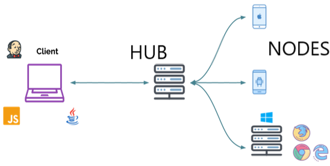
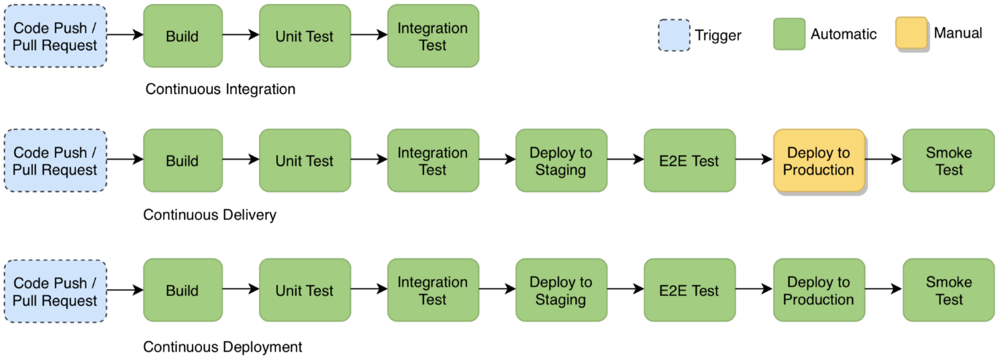
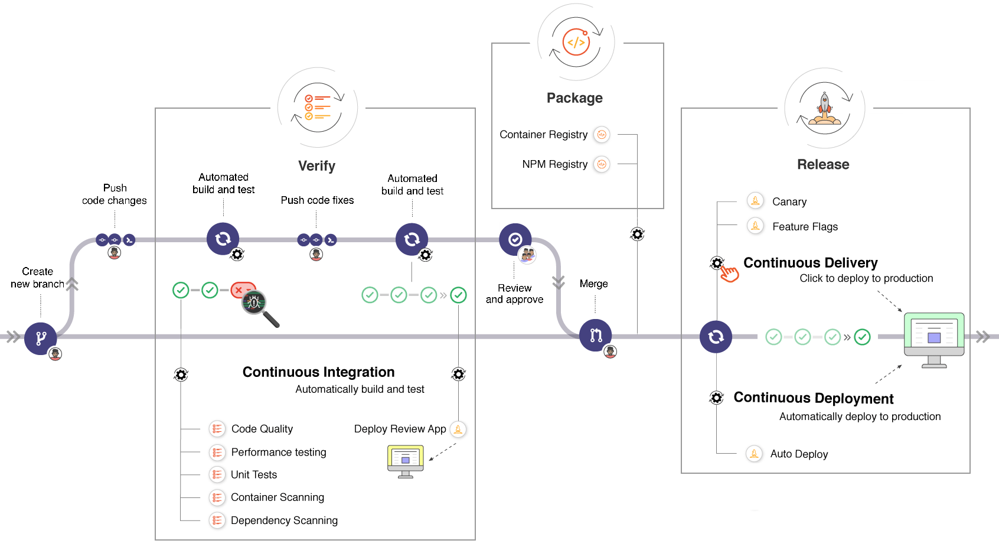

# Automating Software Delivery

## Overview

Modern software delivery moved from infrequent waterfall releases to continuous workflows shaped by [Agile](https://en.wikipedia.org/wiki/Agile_software_development) and DevOps practices. As release frequency increases, delivery quality depends on standardized pipelines that provide fast feedback and reliable automation.

In Angular projects, teams commonly use tools such as [GitHub Actions](https://github.com/features/actions) or [Jenkins](https://www.jenkins.io/) to implement [Continuous Integration](https://en.wikipedia.org/wiki/Continuous_integration) and [Continuous Delivery](https://en.wikipedia.org/wiki/Continuous_delivery). Automated testing is a critical part of this flow because it reduces repetitive manual effort and validates changes consistently across environments.

A practical delivery concern is the deployment architecture. Angular production builds generate static HTML, CSS, and JavaScript artifacts, so applications can be deployed through static hosting patterns rather than requiring a dedicated [Node.js](https://nodejs.org/) runtime for serving the application itself.

This chapter focuses on automation and delivery practices that help teams ship faster with confidence, including CI/CD workflows, testing automation, deployment patterns, and continuous automation strategies that scale across multiple projects.

## Continuous Testing

### Definition

[Continuous Testing](https://en.wikipedia.org/wiki/Continuous_testing) is the process of executing automated tests as part of the software delivery pipeline to obtain immediate feedback on the business risks associated with a software release candidate. It evolves and extends [Test Automation](https://en.wikipedia.org/wiki/Test_automation) to address the increased complexity and pace of development and delivery of modern applications.

Based on the [Tricentis](https://www.tricentis.com/products/what-is-continuous-testing/) definition, Continuous Testing has 14 key points:

1. Continuous Testing’s primary goal is assessing business risk coverage;
2. It provides instant insight into whether a release candidate is too risky to proceed through the delivery pipeline;
3. It establishes a safety net that helps teams protect the user experience in accelerated development processes and avoid software failure headlines;
4. It expects testing to be embedded within the development process, not tacked on at the end;
5. It is seamlessly integrated into the software delivery pipeline and DevOps toolchain;
6. It expects a stable test environment with valid test data to be available for each and every test run;
7. It embraces everything from “shift left” (unit and component coverage) to “shift right” (monitoring/APM, testing in production);
8. It involves executing the right set of tests at the right stage of the delivery pipeline, without creating a bottleneck;
9. It delivers actionable feedback appropriate for each stage of the delivery pipeline;
10. It evaluates each layer of a modern architecture at the appropriate stage of the delivery pipeline;
11. It includes end-to-end tests that realistically assess the end-user experience across all associated technologies (frontend and backend);
12. Tests must be broad enough to detect when an application change inadvertently impacts functionality that users rely on;
13. It reduces false positives by prioritizing robust, flexible modern test frameworks over brittle scripts;
14. It involves continuously reviewing and optimizing the test suite to eliminate redundancy and maximize business risk coverage.

### Test Automation

In a traditional development model, testing happens mainly at the end of the cycle. When [Test Automation](https://en.wikipedia.org/wiki/Test_automation) is integrated into day-to-day development, each incremental code change can be validated automatically. In practice, every time a developer commits code to version control, the CI server triggers an application build and executes the automated test suite.

To determine whether the run passed or failed, the [Continuous Integration](https://www.atlassian.com/continuous-delivery/continuous-integration) system checks the process exit code and, in some cases, the output logs (for example, text such as "TEST FAILED"). Typically, an exit code of `0` indicates success, while a non-zero code (commonly `1`) indicates failure. After each run, team members receive build notifications that include logs and test reports.

A well-designed test automation system is now essential for modern software delivery. Running tests early and frequently helps teams detect defects sooner and reduce rework, cost, and delivery risk. In mature setups, tests run in parallel across projects, environments, or devices to shorten feedback time. This also frees developers to focus on improving test coverage and participating more actively in code review. Common test types that are strong candidates for automation include [Unit Testing](https://en.wikipedia.org/wiki/Unit_testing), [Integration Testing](https://en.wikipedia.org/wiki/Integration_testing), [Functional Testing](https://en.wikipedia.org/wiki/Functional_testing), [Non-functional Testing](https://en.wikipedia.org/wiki/Non-functional_testing), [Smoke Testing](https://en.wikipedia.org/wiki/Smoke_testing_(software)), [Security Testing](https://en.wikipedia.org/wiki/Security_testing), and [Performance Testing](https://en.wikipedia.org/wiki/Software_performance_testing).

To be effective, test automation must be defined clearly and optimized from the start. Ambiguity about responsibilities, tooling, or scope usually slows delivery and weakens outcomes. Teams should explicitly decide what to automate, ensure the required skills and tools are available, improve visibility across the organization, and define measurable goals. With these foundations in place, automation can provide consistent and reliable value.

### Cross Browser Testing

[Cross Browser Testing](https://en.wikipedia.org/wiki/Cross-browser_testing) involves comparing and analyzing the behavior of a web app in different browser environments. It helps ensure that the web app delivers an optimal user experience, independent of the browser used to access it. We need to test in different browsers because, for example, font size can appear differently from browser to browser, JavaScript behavior can differ across web browsers, CSS and HTML may behave differently, image orientation may not be proper, or there may be browser incompatibility with the OS. Also, when we need to support older browsers, Cross Browser Testing is very important.

Cross Browser Testing is a type of non-functional testing that lets us check whether the web app works as intended when accessed through:

- **Different Browser-OS**: i.e., on popular browsers like [Firefox](https://www.mozilla.org/firefox/), [Chrome](https://www.google.com/chrome/), [Edge](https://www.microsoft.com/edge), and [Safari](https://www.apple.com/safari/) on any of the popular operating systems like [Windows](https://www.microsoft.com/windows), [macOS](https://www.apple.com/macos/), [iOS](https://www.apple.com/ios/) and [Android](https://www.android.com/).
- **Different devices**: i.e., users can view and interact with the web app on popular devices such as smartphones, tablets, desktops and laptops.
- **Assistive Tools**: i.e., the web app is compatible with assistive technologies like screen readers for people with disabilities.

The sheer number of browsers, devices, and operating systems out there make it impossible to build for and test on every browser-OS combination that may exist. A more realistic goal is to focus testing efforts on maximizing the reach of the web app within the target market. The decision of which browsers and platforms to test on is usually in the hands of Business and Marketing teams (or the client).

[Playwright](https://playwright.dev/) is an end-to-end test framework for modern web applications, including Angular apps. It uses browser automation engines directly (Chromium, Firefox and WebKit), which means we can run tests across browsers. To run tests on [multiple browsers](https://playwright.dev/docs/browsers#run-tests-on-different-browsers), Playwright uses *projects* defined as an array of objects. For more details, see next partial example of *playwright.config.ts* file:

```json
{
  "projects": [
    { "name": "chromium", "use": { "browserName": "chromium" } },
    { "name": "firefox", "use": { "browserName": "firefox" } },
    { "name": "webkit", "use": { "browserName": "webkit" } }
  ]
}
```

Playwright can run tests in parallel across workers and projects. We can also define browser-specific options in each project's *use* block. When designing automation test suites, the ability to run tests in parallel is a key feature for decreasing execution time and increasing test efficiency. With Playwright, this is configured in *playwright.config.ts* using *workers* for parallelism and *fullyParallel* when file-level parallel execution is safe.

```json
{
  "workers": 4,
  "fullyParallel": true
}
```

Isolating tests is very important to prevent the propagation of faults, facilitate the debugging of errors or flakiness, and eliminate the need to worry about the order of parallel execution.

### Mobile Testing

Users expect the application to run smoothly on mobile devices, regardless of operating system, screen size, permissions, or network conditions. [Mobile application testing](https://en.wikipedia.org/wiki/Mobile_application_testing) validates that software built for handheld devices behaves correctly, is usable, and remains consistent across environments. In practice, mobile apps are usually grouped into three categories, namely, Mobile Web Apps, Native Apps, and Hybrid Apps.

[Playwright](https://playwright.dev/) is the recommended testing tool for mobile Angular applications. It ships with a catalogue of built-in device emulation profiles that replicate the viewport, user-agent, and pixel ratio of real handsets, so no physical device or additional infrastructure is required for browser-level tests. It is excellent for mobile web, PWAs, and hybrid apps, but cannot natively automate fully native mobile apps.

The following example configures two mobile emulation projects, namely, one for a Pixel 10 (Android/Chrome) and other for an iPhone 17 (iOS/Safari):

```typescript
export default defineConfig({
  use: {
    baseURL: 'http://localhost:4200'
  },
  projects: [
    {
      name: 'Mobile Chrome',
      use: { ...devices['Pixel 10'] }
    },
    {
      name: 'Mobile Safari',
      use: { ...devices['iPhone 17'] }
    }
  ]
});
```

To simplify the execution across mobile emulation projects, we can define the following scripts.

```json
"scripts": {
  "functional": "npm-run-all -s -c android:test ios:test",
  "android:test": "playwright test --project='Mobile Chrome'",
  "ios:test": "playwright test --project='Mobile Safari'"
}
```

[Appium](https://appium.io/) is an open-source automation framework for testing native, hybrid, and mobile web applications on [Android](https://www.android.com/) and [iOS](https://www.apple.com/ios/), and it can also be used to automate desktop applications through platform-specific drivers. In practice, Appium works by implementing the WebDriver protocol—the same standard used by Selenium. This means tests can be written using familiar Selenium WebDriver APIs.

A typical Selenium + Appium flow for native mobile testing is:

1. Start an Appium server (locally, in CI, or via cloud device providers);
2. Define desired capabilities (or Appium options), such as platform name, platform version, device name, and app/bundle identifier;
3. Create a WebDriver session that targets Android or iOS;
4. Execute element interactions and assertions using the same WebDriver concepts used in browser automation;
5. Run tests in parallel across devices/emulators to reduce feedback time.

The following example shows the idea using [Selenium](https://www.selenium.dev/) with [Appium](https://appium.io/) for Android:

```typescript
const driver: WebDriver = await new Builder()
  .usingServer('http://127.0.0.1:4723/')
  .withCapabilities({
    platformName: 'Android',
    'appium:automationName': 'UiAutomator2',
    'appium:deviceName': 'Android Emulator',
    'appium:appPackage': 'com.example.app',
    'appium:appActivity': '.MainActivity'
  })
  .build();
```

For iOS, replace the capabilities with XCUITest-based values (`platformName: 'iOS'`, `appium:automationName: 'XCUITest'`) and the corresponding app bundle identifier (`appium:bundleId`). The rest of the session lifecycle (element interactions, assertions, and teardown) is identical across platforms.

Testing native applications is outside the scope of this chapter. For that, [Espresso](https://developer.android.com/training/testing/espresso), [UI Automator](https://developer.android.com/training/testing/ui-automator), or [XCTest](https://developer.apple.com/documentation/xctest) can be used.

### Selenium Grid

#### What is Selenium Grid?

[Selenium Grid](https://www.selenium.dev/documentation/en/grid/) is a testing tool that allows us to run test cases in different machines across different platforms. Selenium Grid is a smart proxy server that makes it easy to run tests in parallel on multiple machines. This is done by routing commands to remote instances of web browsers, where a server acts as a hub, routing test commands to multiple registered Grid nodes.



Fig. 1: Components of Selenium Grid

The two major components of Selenium Grid are:

- Hub is a server that accepts requests from the WebDriver client, routing commands to remote browser drivers on nodes. It takes instructions from the client and executes them remotely on multiple nodes in parallel.
- Node is a remote device that consists of a native OS and a remote WebDriver. It receives requests from the hub in the form of JSON test commands and executes them using WebDriver.

In Selenium, Grid uses a modern distributed architecture internally (Router, Distributor, Session Queue, Session Map, and Nodes). In daily usage, we still commonly run it in standalone mode or in hub-and-nodes mode. The main reasons why we might want to use Selenium Grid are the possibility of running tests against multiple browsers, multiple browser versions, and browsers running on different operating systems, while reducing the time it takes for the test suite to complete. To use Selenium Grid, we need to maintain our own infrastructure from within, and since this can be a cumbersome and time-intensive effort, many organizations use IaaS providers or Docker-based setups.

Playwright can connect to [Selenium Grid Hub](https://www.selenium.dev/documentation/grid/) that runs Selenium to launch Google Chrome or Microsoft Edge browser, instead of running the browser on the local machine. In practice, we usually choose between two deployment models, namely, standalone mode for simple local or CI usage, and hub-and-nodes mode for distributed execution across multiple machines.

#### Standalone mode

Standalone mode is the simplest way to run Selenium Grid. In this model, the Grid router and the browser node run inside the same Selenium container or process. In other words, there is only one endpoint to start, monitor, and connect to. This is a good fit for local development, small CI jobs, proof-of-concept setups, and teams that only need one browser host at a time.

The following command starts Selenium in standalone mode with Chromium support:

```shell
docker run -d -p 4444:4444 --shm-size="2g" -e SE_NODE_GRID_URL="http://localhost:4444" selenium/standalone-chromium:latest
```

Then run functional tests with Playwright by pointing `SELENIUM_REMOTE_URL` to that single endpoint:

```shell
SELENIUM_REMOTE_URL=http://localhost:4444 npm run functional
```

If this setup is sufficient for the team, there is no need to use hub-and-nodes mode.

#### Hub and nodes mode

Hub-and-nodes mode is the distributed version of Selenium Grid. In this model, the hub is the central entry point that receives session requests, while one or more nodes register themselves with the hub and advertise the browsers they can run. This is the right choice when we need to scale test execution across multiple machines, isolate browser workloads, or mix different operating systems and browser versions.

Next example shows how to run a Selenium hub and a single Selenium node, and connecting Playwright to the hub. First start the hub container and one or more node containers:

```shell
docker run -d -p 4442-4444:4442-4444 selenium/hub:latest
docker run -d -p 5555:5555 --shm-size="2g" \
  -e SE_EVENT_BUS_HOST=<selenium-hub-ip> \
  -e SE_EVENT_BUS_PUBLISH_PORT=4442 \
  -e SE_EVENT_BUS_SUBSCRIBE_PORT=4443 \
  -e SE_NODE_GRID_URL="http://<selenium-hub-ip>:4444" \
  selenium/node-chromium:latest
```

Note that the hub and node have different IPs, so we pass `SE_NODE_GRID_URL` pointing to the hub when starting the node container. Then run functional tests with Playwright against the hub URL. For troubleshooting, enable detailed Playwright connection logs:

```shell
DEBUG=pw:browser* SELENIUM_REMOTE_URL=http://<selenium-hub-ip>:4444 npm run functional
```

Full details are available in the official [Selenium Grid documentation](https://www.selenium.dev/documentation/grid/) and [Playwright Selenium Grid guide](https://playwright.dev/docs/selenium-grid).

### Testcontainers

[Testcontainers](https://testcontainers.com/?language=nodejs) is an open-source library for providing throwaway, lightweight instances of databases, message brokers, web browsers, or just about anything that can run in a Docker container. Instead of mocking HTTP calls or maintaining a shared staging environment, Testcontainers spins up real Docker containers before test execution and tears them down afterwards. This provides high confidence that the frontend integrates correctly with the real backend stack in an isolated and reproducible environment.

Angular e2e tests commonly stub or mock backend API calls. While that is fast, it gives limited assurance that the real API contract is honoured. A common alternative is to point tests at a shared staging server, which introduces flakiness due to shared state and network dependency. Testcontainers offers a middle ground, because a real, local, ephemeral backend stack that exists only while the tests are running.

Typical use cases for Testcontainers include:

- Starting a real REST API container (e.g. a [Quarkus](https://quarkus.io/) or [Node.js](https://nodejs.org/) service) for [Playwright](https://playwright.dev/) e2e tests to call;
- Seeding a containerised database (PostgreSQL, MongoDB, etc.) with known data so test assertions are deterministic;
- Running the [Angular dev server](https://angular.dev/tools/cli/serve) or a built [Nginx](https://nginx.org/) container alongside the API container and exercising the full stack;
- Replacing mock servers or MSW stubs for contract-level tests.

A backend service that is already containerised can be started directly from its Docker image. The following example starts a custom REST API, waits until the health endpoint responds, and exposes the mapped port to the test process:

```typescript
let apiContainer: StartedTestContainer;
let apiBaseUrl: string;

beforeAll(async () => {
  apiContainer = await new GenericContainer('my-org/my-api:latest')
    .withExposedPorts(8080)
    .withWaitStrategy(Wait.forHttp('/health', 8080))
    .start();

  apiBaseUrl = `http://localhost:${apiContainer.getMappedPort(8080)}`;
});

afterAll(async () => {
  await apiContainer.stop();
});
```

The `withWaitStrategy` call prevents tests from running until the container is truly ready. `Wait.forHttp` polls the given HTTP path and waits for a `2xx` response. Other strategies include `Wait.forLogMessage` (wait for a log line) and `Wait.forHealthCheck` (use the Docker health check).

By default, each container runs on the Docker bridge network. When both the Angular dev server and the API container run on the same host they can communicate through `localhost` with the mapped port. If services need to communicate with each other inside Docker (e.g. the API container connecting to the database container by hostname), use a [Testcontainers network](https://node.testcontainers.org/features/networking/).

### Best Practices

The following practices describe how to operationalize continuous testing with reliable feedback loops and scalable automation:

- [ ] **Identify tests that can be automated**: Not every test should be automated. Prioritize high-frequency and high-value scenarios, while preserving manual checks where they are more effective. Revisit this prioritization regularly as product risk, architecture, and user behavior evolve.

- [ ] **Prioritize coverage by business risk**: Use test effort to protect the workflows, integrations, and failure modes that matter most to users and the business. Risk-based prioritization prevents teams from spending too much time on low-impact checks while critical paths remain under-tested.

- [ ] **Embed testing into daily development**: Run automated checks continuously as part of local development, pull requests, and CI instead of leaving validation until the end. Earlier feedback reduces defect escape and shortens the cost of fixing issues.

- [ ] **Run the fastest tests early**: Execute unit and other quick checks before long-running suites to fail fast and avoid wasting pipeline resources. Early failures also shorten feedback loops for developers and reduce overall queue time in shared CI runners.

- [ ] **Use a balanced test strategy across layers**: Place most checks in fast unit/component tests, complement with focused integration tests, and keep end-to-end tests targeted to critical business journeys. This balance preserves broad risk coverage without making the pipeline slow or brittle.

- [ ] **Keep test environments stable and production-like**: Provide consistent environments, valid configuration, and representative dependencies so test results remain trustworthy. Match key runtime characteristics closely enough that release decisions made from test outcomes remain meaningful.

- [ ] **Keep test data deterministic and resettable**: Use seeded datasets, isolated fixtures, and repeatable setup/teardown so tests start from known state every run. Deterministic test data improves trust in failures and reduces random pipeline instability.

- [ ] **Isolate tests from each other**: Ensure tests can run independently and in any order without shared mutable state leaking between them. Good isolation reduces flakiness, simplifies debugging, and makes parallel execution safer.

- [ ] **Run tests in parallel**: Use parallel workers and distributed infrastructure to reduce feedback time, while monitoring resource contention on shared runners. Group tests by stability and runtime profile so parallelism improves throughput without increasing flakiness.

- [ ] **Run tests locally before pushing**: Developers should execute the same test commands locally that CI executes, reducing broken builds and integration noise. A single, consistent command for local and CI execution helps avoid "works on my machine" drift.

- [ ] **Avoid false negatives and false positives**: Stabilize test environments and data, eliminate flaky scripts, and continuously harden assertions to keep tests reliable. Reliable tests are essential for release decisions, especially when deployments are frequent.

- [ ] **Treat flaky tests as defects**: Track intermittent failures explicitly, quarantine them when necessary, and assign ownership for fixing them. A flaky suite erodes confidence in automation and encourages unsafe reruns or ignored failures.

- [ ] **Validate realistic end-user journeys across the full stack**: Keep a focused set of end-to-end tests that exercise the frontend together with real backend behavior or close substitutes. These tests should confirm that the user experience still works across the actual architecture, not just isolated units.

- [ ] **Cover target browsers, devices, and accessibility paths deliberately**: Base browser, mobile, and assistive-technology coverage on the application audience instead of testing every possible combination. Targeted coverage gives better confidence than broad but shallow execution.

- [ ] **Treat test code as production code**: Apply the same review standards, refactoring discipline, and coding conventions to test suites as to application code. Well-structured test code lowers maintenance cost and keeps feedback reliable as the product evolves.

- [ ] **Deliver actionable feedback from every test stage**: Test output should make failures easy to diagnose with clear logs, reports, screenshots, traces, and ownership. Fast feedback is only useful when teams can understand and act on it quickly.

- [ ] **Check test reports deeply**: Analyze root causes instead of only pass/fail counts, and manually validate suspicious failures so real defects are not masked. Trend analysis across builds helps identify recurring instability, hidden regressions, and fragile test areas.

- [ ] **Use selective execution plus scheduled full runs**: Run impacted tests quickly on each commit or pull request, and execute full regression suites on a regular schedule (for example nightly). This keeps feedback fast while still detecting cross-feature regressions that selective runs may miss.

- [ ] **Continuously review and trim the test suite**: Remove redundant, obsolete, or low-value tests and strengthen coverage where risks have increased. A smaller, sharper suite usually provides better feedback than a large suite full of overlap.

- [ ] **Publish build and test results**: Make the latest pipeline status visible via dashboards, reports, and notifications so failures are acted on quickly. Transparent outcomes strengthen team ownership and reduce time-to-recovery after failed runs.

- [ ] **Stop the pipeline when a stage fails**: Enforce fail-fast behavior so broken changes do not progress to downstream stages. This prevents cascading errors and keeps debugging focused on the first meaningful failure.

- [ ] **Keep test pipelines fast**: Continuously optimize test suites, remove low-value or unstable checks, and scale infrastructure to protect delivery velocity. Fast pipelines encourage frequent commits and reduce the chance that developers bypass quality gates.

- [ ] **Monitor test pipelines continuously**: Track failure trends, flaky tests, queue times, and agent health to prevent persistent delivery bottlenecks. Define clear service-level targets for pipeline duration and stability so deterioration is detected early.

- [ ] **Use smoke-test deployments**: Run fast, high-value end-to-end checks immediately after deployment to confirm critical user flows. Keep smoke suites shallow but broad so they quickly detect outages without delaying the pipeline.

- [ ] **Use production monitoring to improve tests**: Feed incidents, customer-reported defects, and observability data back into the automated test strategy. Production feedback helps teams add missing checks for the failures that actually matter in real usage.

- [ ] **Choose the right automation tools**: Select server and test tools based on team maturity, budget, scalability needs, and ecosystem fit. Standardize tool usage patterns across projects to reduce maintenance overhead and training time.

- [ ] **Involve relevant stakeholders**: Include developers, QA, and operations in automation decisions so test coverage, environments, and tooling reflect real delivery risks. Shared ownership improves prioritization and prevents critical quality concerns from being overlooked.

## Continuous Integration

### Definition

[Continuous Integration](https://www.atlassian.com/continuous-delivery/continuous-integration) (CI) is the practice of merging code changes from multiple contributors into a shared project and automatically verifying each change before it is accepted. In practice, CI usually runs build, test, and quality checks as soon as code is pushed to version control. This reduces integration problems, keeps the main branch stable, and helps teams move faster with less rework. The term “Continuous Integration” originated with Kent Beck's [Extreme Programming](https://martinfowler.com/bliki/ExtremeProgramming.html) development process, as one of its original twelve practices.

Based on [Martin Fowler](https://martinfowler.com/articles/continuousIntegration.html), CI relies on the following practices:

- Put everything in a version controlled mainline
- Automate the build
- Make the build self-testing
- Everyone pushes commits to the mainline every day
- Every push to mainline should trigger a build
- Fix broken builds immediately
- Keep the build fast
- Hide work-in-progress
- Test in a clone of the production environment
- Everyone can see what's happening
- Automate deployment

CI depends on a [version control system](https://en.wikipedia.org/wiki/Version_control) (VCS). Common VCS options include [Git](https://git-scm.com/), [Mercurial](https://www.mercurial-scm.org/), and [Subversion](https://subversion.apache.org/). Popular hosting platforms include [Bitbucket](https://bitbucket.org/), [Github](https://github.com/), and [Gitlab](https://about.gitlab.com/). Once version control is in place, teams usually add merge checks such as automated tests, syntax checkers, code formatters, or dependency vulnerability scans. Automated tests are the most valuable of these checks, because they catch problems before changes reach the main branch.

CI is now a standard part of modern software delivery. Its benefits extend beyond engineering because it improves visibility, coordination, and release confidence across the whole team. Common tools include [GitHub Workflows](https://docs.github.com/en/actions/using-workflows), [Bitbucket Pipelines](https://bitbucket.org/product/features/pipelines), [Jenkins](https://www.jenkins.io/), [Bamboo](https://www.atlassian.com/software/bamboo), [TeamCity](https://www.jetbrains.com/teamcity/), and [CircleCI](https://circleci.com/).

### GitHub Workflows

#### What is GitHub Actions?

[GitHub Actions](https://github.com/features/actions) is a continuous integration and continuous delivery (CI/CD) platform that allows us to automate build, test, and deployment pipelines. We can create workflows that build and test every pull request of the repository, or deploy merged pull requests to production. GitHub Actions are integrated directly into the GitHub repository, making it easy to set up and maintain without requiring additional infrastructure or third-party tools.

GitHub Actions uses [Workflows](https://docs.github.com/en/actions/using-workflows), which are automated processes defined in YAML format and stored in the *.github/workflows* directory of the repository. Workflows are triggered by specific events, such as a push to a branch, creation of a pull request, or on a schedule. Each workflow consists of one or more [jobs](https://docs.github.com/en/actions/using-workflows/workflow-syntax-for-github-actions#jobs), and each job contains a series of [steps](https://docs.github.com/en/actions/using-workflows/workflow-syntax-for-github-actions#jobsjob_idsteps) that execute commands or actions.

Creating a workflow file and committing it to the repository provides several benefits:

- Workflows are version controlled and tracked in the same repository as the source code;
- Workflows can be reviewed as part of pull request reviews, ensuring transparency and team consensus;
- Workflows are easily accessible and editable by all team members with repository access;
- GitHub provides a visual interface to view workflow runs, logs, and artifacts;
- Built-in notifications and status checks integrate seamlessly with GitHub pull requests and issues.

#### Workflow Syntax and Structure

A GitHub Actions Workflow is a YAML file that defines the automation process. The basic structure includes triggers, jobs, and steps. The following example shows a simple workflow triggered on every push to the repository:

```yaml
name: Pipeline

on:
  push:
    branches: [main]
  pull_request:
    branches: [main]
  workflow_dispatch:

jobs:
  build:
    runs-on: ubuntu-latest

    steps:
      - uses: actions/checkout@v6

      - uses: actions/setup-node@v6
        with:
          node-version: 22
  
      - name: Install Dependencies
        run: npm ci
```

The `on` keyword specifies the events that trigger the workflow. Common events include `push`, `pull_request`, `schedule`, and `workflow_dispatch` (manual trigger). The `jobs` section defines one or more jobs that run in parallel by default. The `runs-on` keyword specifies the type of machine to run the job on, with `ubuntu-latest` being a common choice for Node.js projects. Each `step` either runs a shell command with the `run` keyword or uses a pre-built action from the [GitHub Marketplace](https://github.com/marketplace?type=actions) with the `uses` keyword.

#### Declarative GitHub Actions Workflow

Angular CLI require [Node.js](https://nodejs.org/en/) for build applications, [npm](https://www.npmjs.com/) for dependency management, and a web browser for testing. GitHub provides hosted runners with Node.js pre-installed, eliminating the need to configure a dedicated machine. However, for more complex scenarios or custom environments, we can use Docker containers within the workflow.

The following partial workflow for an Angular project performs all the necessary steps to build, test, and release an application:

```yaml
jobs:
  Pipeline:
    runs-on: ubuntu-latest

    steps:
      - uses: actions/checkout@v6
      - uses: actions/setup-node@v6
        with:
          node-version: 22

      - name: Install Dependencies
        run: npm ci

      - name: Lint
        run: npm run lint

      - name: Unit Tests
        run: npm run test

      - name: E2E Tests
        run: npm run e2e

      - name: Code Quality
        run: npm run sonar

      - name: Audit
        run: npm audit --production

      - name: Build and Push Docker Image
        run: |
          npm run build
          docker build -t app .
          docker push app
```

The first step, after the initial runner setup, uses *npm* to pull all the required Node.js package dependencies. `npm ci` (clean install) is used instead of `npm install` for faster, more reliable, and consistent dependency installations in automated environments, Docker builds, and production. It strictly adheres to the `package-lock.json` file, skips user-oriented features, and ensures every environment installs the exact same dependencies, avoiding "it works on my machine" issues. The next step is to check TypeScript code using a linter. Notice the `npm run lint` command doesn't pass the *--fix* option to ESLint since we want the command fail if there are any sort of errors. We do not want CI automatically fix lint errors. The next steps are unit tests and e2e tests. We need *test* and *e2e* defined as lifecycle scripts in *package.json*. For both, we can publish HTML reports. These scripts were purposely omitted. [SonarQube](https://www.sonarqube.org/) is a code quality and security tool for detecting bugs and vulnerabilities in applications with thousands of automated static code analysis rules. It supports several programming languages and is recommended for Angular projects. The Audit step is used for auditing package dependencies for security vulnerabilities. Running *npm audit* will produce a report of security vulnerabilities. We can create a custom script to export an HTML report with [npm-audit-html](https://www.npmjs.com/package/npm-audit-html). At last, we are at the actual build step. In this step, the output is the *dist* or *build* directory containing the finished build output. Then, the Docker image is built from the *Dockerfile* recipe.

These steps are recommended for a Continuous Integration and Continuous Delivery process. We can always include other steps or remove some of them. Other steps include project documentation, publishing libraries and deployment. To avoid long runs, we can run some of these steps in parallel. Another improvement includes build the project once. By default, Angular CLI compiles and serves static files for e2e tests. Instead, we can build the project and the Docker image before e2e tests.

#### GitHub Workflows Features

GitHub Actions Workflows provide several powerful features that enhance automation capabilities:

- **Caching**: Dependencies can be cached between workflow runs to improve performance. For Node.js projects, caching *npm* dependencies significantly reduces installation time. The `key` is generated based on the operating system and package lock file hash, ensuring cache invalidation when dependencies change:

  ```yaml
  - uses: actions/cache@v4
    with:
      path: ~/.npm
      key: ${{ hashFiles('package-lock.json') }}
  ```

- **Artifacts**: Build outputs and test reports can be uploaded as artifacts for inspection or downstream jobs. Artifacts are retained for a configurable period and can be downloaded from the workflow run page:

  ```yaml
  - name: Upload Coverage Reports
    uses: actions/upload-artifact@v4
    with:
      name: coverage-reports
      path: coverage/
  ```

- **Matrix Strategy**: Running the same job across multiple configurations (browsers, Node.js versions, operating systems) in parallel improves test coverage efficiency:

  ```yaml
  strategy:
    matrix:
      node-version: [18, 20, 22]
      os: [ubuntu-latest, macos-latest, windows-latest]

  runs-on: ${{ matrix.os }}

  steps:
    - uses: actions/setup-node@v6
      with:
        node-version: ${{ matrix.node-version }}
  ```

- **Conditional Execution**: Steps and jobs can execute conditionally based on previous results or external conditions:

  ```yaml
  - name: Run Tests
    run: npm run test

  - name: Upload Coverage
    if: success()
    run: npm run coverage
  ```

- **Secrets and Environment Variables**: Sensitive data like API keys and credentials are stored as repository secrets and accessed securely within workflows:

  ```yaml
  env:
    NODE_ENV: production

  steps:
    - name: Deploy
      run: deploy.sh
      env:
        DEPLOY_TOKEN: ${{ secrets.DEPLOY_TOKEN }}
  ```

- **Context and Expressions**: Dynamic values can be accessed using GitHub's context system and expressions:

  ```yaml
  - name: Display Information
    run: |
      echo "Branch: ${{ github.ref }}"
      echo "Commit: ${{ github.sha }}"
      echo "Actor: ${{ github.actor }}"
  ```

- **Job Dependencies and Outputs**: Jobs can depend on other jobs and share outputs between them:

  ```yaml
  jobs:
    build:
      runs-on: ubuntu-latest
      outputs:
        version: ${{ steps.version.outputs.tag }}
      steps:
        - id: version
          run: echo "tag=v1.0.0" >> $GITHUB_OUTPUT

    deploy:
      needs: build
      runs-on: ubuntu-latest
      steps:
        - run: echo "Deploying ${{ needs.build.outputs.version }}"
  ```

- **Status Checks and Notifications**: Workflows automatically report their status to pull requests and can trigger notifications on failure, helping teams maintain code quality standards.

### Jenkins

#### What is Jenkins?

[Jenkins](https://www.jenkins.io/) is a free, open-source automation server that helps automate key stages of the software development lifecycle, including building, testing, and deploying applications. It supports Continuous Integration (CI) and Continuous Delivery (CD), enabling teams to deliver software more efficiently and reliably. Jenkins is a self-contained, Java-based application that can run out of the box on Windows, macOS, and other Unix-like operating systems. Builds can be triggered in several ways, such as through commits to a version control system, scheduled jobs using a cron-like mechanism, or requests to a specific build URL. Jenkins can also initiate builds automatically after dependent jobs have completed. One of Jenkins' greatest strengths is its extensibility. Jenkins offer a rich ecosystem of plugins allows it to integrate with a wide range of development, testing, and deployment tools.

The following command starts Jenkins from the official [Jenkins Docker image](https://github.com/jenkinsci/docker):

```shell
docker run -d -p 8080:8080 -p 50000:50000 -v jenkins_home:/var/jenkins_home jenkins/jenkins:lts
```

Inside the container, Jenkins stores its state in */var/jenkins_home*. The `-v jenkins_home:/var/jenkins_home` mapping persists that data in a Docker named volume, so jobs, plugins, and configuration survive container recreation.

After downloading, installing, and running Jenkins using the procedure above, the [post-installation setup wizard](https://www.jenkins.io/doc/book/installing/#setup-wizard) begins. This setup wizard takes us through a few quick "one-off" steps to unlock Jenkins, customize it with plugins, and create the first administrator user through which we can continue accessing Jenkins. It's recommended to follow [Jenkins Best Practices](https://www.jenkins.io/doc/book/using/best-practices/) to ensure a correct and reliable configuration.

#### Pipelines Syntax and Structure

[Jenkins Pipeline](https://www.jenkins.io/doc/book/pipeline/) is a suite of plugins that supports implementing and integrating continuous delivery pipelines into Jenkins. Jenkins Pipeline provides an extensible set of tools for modeling simple-to-complex delivery pipelines "as code" via the [Pipeline DSL](https://www.jenkins.io/doc/book/pipeline/syntax/). The definition of a Jenkins Pipeline is written into a text file (called a [*Jenkinsfile*](https://www.jenkins.io/doc/book/pipeline/jenkinsfile/)) which in turn can be committed to a project’s source control repository. This is the foundation of "Pipeline-as-Code", that is, treating the CI/CD pipeline a part of the project to be versioned and reviewed like any other code.

Creating a *Jenkinsfile* and committing it to source control provides several benefits:

- Automatically creates a pipeline build process for all branches and pull requests;
- Code review/iteration on the pipeline (along with the remaining source code);
- Audit trail for the pipeline;
- Single source of truth for the pipeline, which can be viewed and edited by multiple members of the project.

Jenkins Pipeline is designed to easily use Docker images as the execution environment for a single stage or the entire pipeline. This approach allows teams to use practically any tool that can be packaged in a Docker container:

```groovy
pipeline {
  agent {
    docker 'node:16-alpine'
  }
}
```

For projects which require a more customized execution environment, Jenkins Pipeline also supports building and running a container from a *Dockerfile* in the source repository. More details are available on the [Using Docker with Pipeline](https://www.jenkins.io/doc/book/pipeline/docker/) page. Also, we have a list of [Pipeline Best Practices](https://www.jenkins.io/doc/book/pipeline/pipeline-best-practices/) available in the official documentation.

#### Declarative Jenkins Docker Pipeline

A [Declarative Jenkins Pipeline using Docker](https://www.jenkins.io/doc/book/pipeline/docker/) is a structured, opinionated way to define a CI/CD pipeline in Jenkins using a human-readable syntax written in a `Jenkinsfile`. It follows a predefined syntax that organizes the pipeline into sections such as pipeline, agent, stages, and steps.

The next focused pipeline is a clean example for Angular projects, with steps to build, test, and release an application:

```groovy
pipeline {
  agent {
    docker 'circleci/node:16-stretch-browsers'
  }
  stages {
    stage('Install Dependencies') {
      steps {
        sh 'npm ci --no-cache'
      }
    }
    stage('Lint') {
      steps {
        sh 'npm run lint'
      }
    }
    stage('Unit Tests') {
      steps {
        sh 'npm run test'
      }
    }
    stage('E2E Tests') {
      steps {
        sh 'npm run e2e'
      }
    }
    stage('Sonar') {
      steps {
        sh 'npm run sonar'
      }
    }
    stage('Audit') {
      steps {
        sh 'npm audit --production'
      }
    }
    stage('Build and Push Docker Image') {
      steps {
        sh 'npm run build'
        sh 'docker build -t app .'
        sh 'docker push app'
      }
    }
  }
}
```

First, the agent for this pipeline is defined as a Docker image from [CircleCI](https://circleci.com/) with Node.js, *npm*, and web browsers. Jenkins will pull the image, launch a container on any slave that has available executors, bind the workspace, and then execute the step commands within that container. The remaining stages are exactly the same as those explained for GitHub Actions Workflow.

Jenkins traditionally uses a web UI for job configuration, which separates CI/CD logic from application code. With [Pipeline as Code](https://www.jenkins.io/doc/book/pipeline-as-code/), pipelines are defined in a *Jenkinsfile* stored in source control, enabling Jenkins to automatically discover and run branch-specific pipelines through multibranch pipelines.

#### Jenkins as Code

Setting up Jenkins can become complex because Jenkins core and plugins expose many settings through the web UI. Historically, teams relied on Groovy init scripts to customize Jenkins and enforce desired state. Those scripts are powerful because they call Jenkins APIs directly, but they also require deep Jenkins internals knowledge and careful security handling. The [Configuration as Code Plugin](https://github.com/jenkinsci/configuration-as-code-plugin) (JCasC) provides a more structured approach, letting teams define Jenkins controller configuration in human-readable YAML files that can be versioned and reviewed.

Many classic Jenkins jobs are stored internally as XML on the controller. Editing that XML directly is hard to maintain and error-prone. For modern Jenkins usage, the recommended baseline is using the controller configuration in JCasC and job logic in *Jenkinsfile* using [Pipeline as Code](https://www.jenkins.io/doc/book/pipeline-as-code/). For teams that still manage large numbers of classic freestyle jobs, [Jenkins Job Builder](https://opendev.org/jjb/jenkins-job-builder) can generate and update jobs from YAML definitions, which helps move job definitions into version control.

To install Jenkins Job Builder from [PyPI](https://pypi.org/project/pip/) use:

```shell
pip install --user jenkins-job-builder
```

Configure a `jenkins_jobs.ini` file to connect with the Jenkins instance:

```shell
[jenkins]
user=USERNAME
password=API_TOKEN
url=JENKINS_URL
```

Where *user* is the Jenkins username, *password* is typically a Jenkins API token, and *url* is the Jenkins URL. After writing YAML job definitions in a *jobs* folder, update Jenkins with:

```shell
jenkins-jobs --conf etc/jenkins_jobs.ini update jobs
```

Other common operations include testing a job definition, deleting jobs and providing plugins. More details are available in the official [Jenkins Job Builder documentation](https://jenkins-job-builder.readthedocs.io/).

When we have many Jenkins jobs crafted manually, [Jenkins Job Wrecker](https://github.com/ktdreyer/jenkins-job-wrecker) can help bootstrap migration to JJB by exporting existing jobs to YAML. We can install a released version from PyPI:

```shell
pip install jenkins-job-wrecker
```

Jenkins Job Wrecker supports querying a live Jenkins server dynamically. To translate every job on the server:

```shell
JJW_USERNAME=<user> JJW_PASSWORD=<password> jjwrecker -a -s <JENKINS_URL>
```

Jenkins Job Wrecker will iterate through all jobs and create *.yml* files in an *output* folder. If authentication is required, set credentials as environment variables. *JENKINS_URL* is the Jenkins instance URL. As with any generated migration output, review and clean up YAML definitions before applying them in production.

### Notifications

CI/CD notifications are essential to shorten feedback loops and keep delivery flow healthy. When a build, test, security scan, or deployment fails, the team should be alerted immediately in the channels they already use (for example, [Microsoft Teams](https://www.microsoft.com/microsoft-teams/), [Slack](https://slack.com/), or email). Fast visibility reduces mean time to detect (MTTD), helps teams fix broken pipelines quickly, and prevents unnoticed failures from blocking releases.

In GitHub Actions, notifications are commonly implemented as conditional steps using `if: failure()`, `if: success()`, or `if: always()`, combined with secrets for webhook URLs. The following example sends a message to Microsoft Teams only when the workflow fails:

```yaml
- name: Notify MS Teams
  if: failure()
  run: |
    curl -H "Content-Type: application/json" -d '{"text": "❌ Tests Failed."}' ${{ secrets.TEAMS_WEBHOOK_URL }}
```

If we also need success notifications (for example, production deployment completed), we can add a separate step with `if: success()` and a different message.

### Best Practices

The following practices summarize how to keep CI pipelines secure, fast, and dependable from commit to merge readiness:

- [ ] **Maintain a central source repository**: Keep all source code, pipeline definitions, and build-related configuration in version control as the single source of truth. A fresh checkout should build without hidden dependencies or manual setup. This improves traceability, reproducibility, and team alignment.

- [ ] **Keep builds reproducible and deterministic**: Pin runtime and toolchain versions (for example Node.js, package manager, Angular CLI), commit lockfiles, and prefer immutable container images for CI runners. Version pinning reduces supply-chain risk and prevents surprise breakages.

- [ ] **Use clean, ephemeral runner environments**: Prefer short-lived runners or containers that start from a known baseline for each run. Clean environments reduce hidden state, improve reproducibility, and make failures easier to diagnose.

- [ ] **Commit frequently and integrate daily**: Small, frequent commits reduce integration pain and surface conflicts earlier than large delayed merges. Encourage merging to the baseline at least daily when changes are ready. Avoid committing unfinished work to shared branches and never normalize broken builds.

- [ ] **Minimize long-lived branches**: Integrate to the main shared branch early and often to reduce late-stage merge complexity. Keep branch count and branch lifetime small to preserve CI feedback quality. Short-lived branches help the baseline stay close to production reality.

- [ ] **Every commit should trigger CI pipeline**: Configure CI to trigger automatically on every relevant push or pull request update. This ensures each change is validated in a clean, standardized environment. Consistent per-commit validation prevents defects from accumulating silently.

- [ ] **Follow pipeline as code**: Version pipeline definitions like application code, with reusable modules and automated validation. Review pipeline changes through pull requests using the same standards as application code.

- [ ] **Protect the default branch**: Require passing CI checks before merge, and block direct pushes to protected branches. Branch protection policies ensure integration standards are enforced consistently rather than optionally.

- [ ] **Make the build self-testing**: Build stages should execute automated checks such as linting, unit tests, integration tests, and required quality gates. A successful build should mean both compilation and essential validation passed. This turns CI into an objective quality signal, not just a packaging step.

- [ ] **Run the fastest tests early**: Detect failures quickly by running short tests first, then longer suites. A common order is unit tests, then integration tests, and finally end-to-end tests. Early failures shorten feedback loops and reduce wasted compute.

- [ ] **Run pipeline steps in parallel**: Use parallel jobs for independent tasks to shorten feedback loops and improve throughput. Group tasks by runtime profile and dependencies so parallelism remains stable. Monitor resource usage and queue pressure to verify real gains.

- [ ] **Use matrix builds deliberately**: Run the same pipeline across the supported Node.js versions, operating systems, or browser targets only where that coverage adds real value. A focused matrix improves compatibility confidence without multiplying CI time unnecessarily.

- [ ] **Cache dependencies and tool downloads**: Cache package-manager data, browser binaries, and other expensive downloads to reduce run time, but scope cache keys so stale artifacts do not hide problems. Cache strategy should optimize speed without weakening reproducibility.

- [ ] **Cancel superseded pipeline runs**: When a newer commit arrives on the same branch or pull request, cancel older in-flight runs automatically. This prevents wasted CI capacity and keeps feedback focused on the latest code state.

- [ ] **Set explicit timeouts and resource limits**: Define sensible job timeouts, retry policies, and resource boundaries so stuck or runaway jobs do not exhaust shared runners. Controlled limits keep feedback predictable and protect CI capacity.

- [ ] **Keep pipelines as fast as possible**: Slow pipelines reduce delivery velocity and discourage frequent integration. Improve speed by scaling CI resources, optimizing test design, and removing low-value or flaky checks. Track pipeline duration trends and treat regressions as operational incidents.

- [ ] **Stop the pipeline when a step fails**: Enforce fail-fast behavior so broken changes do not progress into downstream stages. This prevents cascading errors and noisy failures that hide root causes.

- [ ] **Fix broken builds immediately**: A failing baseline should be treated as top priority for the team. Delayed fixes block other work and reduce trust in CI feedback. Clear ownership and response expectations help restore pipeline health quickly.

- [ ] **Upload artifacts and diagnostics from relevant runs**: Preserve build outputs, coverage reports, screenshots, traces, and logs so teams can inspect failures without rerunning the pipeline immediately. Good artifacts shorten mean time to diagnose.

- [ ] **Notify the team with actionable failure context**: Send CI failures to the channels the team already uses, including enough context to identify the branch, stage, and failing check quickly. Alerts should accelerate recovery, not create extra investigation work.

- [ ] **Build once and promote the artifact**: Avoid recompiling the same application multiple times inside one pipeline when the same output can be passed to later test or packaging steps. This shortens runs and reduces inconsistencies between stages of the same CI execution.

- [ ] **Track artifact provenance and generate SBOMs**: Attach metadata (commit SHA, build ID, dependency manifest) to published artifacts and generate a Software Bill of Materials. Provenance and SBOM data improve incident response, compliance, and supply-chain transparency.

- [ ] **Do all substantive work within explicit stages**: Place meaningful pipeline activity inside named stages so responsibilities are clear and observable. A minimum structure is separate Build, Test, and Deploy stages.

- [ ] **Avoid complex scripts in pipelines**: Prefer short, focused scripts over large multi-purpose ones. Simpler scripts are easier to maintain, consume fewer resources, and fail in more diagnosable ways. If scripts grow, split them into reusable tools with tests.

- [ ] **Wrap manual inputs in timeouts**: Add timeouts to approval gates and any step waiting for human action. This prevents stuck pipelines and ensures predictable cleanup when no response arrives. Timeouts should be long enough for process needs but finite by default.

- [ ] **Shift security checks left in CI**: Include dependency vulnerability scanning, secret detection, and static analysis as first-class CI gates. Security checks should run on every relevant change so risky code is blocked before release stages.

- [ ] **Isolate and secure the CI/CD environment**: Treat CI/CD environment as critical infrastructure because it has access to source code and deployment credentials. Host it on protected internal networks and restrict access using VPNs, least-privilege policies, and strong identity controls. Security hardening should include regular credential rotation and audit logging.

- [ ] **Monitor pipelines continuously**: Observe pipeline reliability, flaky tests, queue times, and agent health as ongoing operational signals. Define service-level targets and response playbooks for recurring failures. Continuous monitoring prevents hidden bottlenecks from stalling delivery.

## Continuous Delivery

### Definition

[Continuous Delivery](https://continuousdelivery.com/) is a software development discipline that ensures software can be released to production at any time. In addition to automated testing, the release process itself is automated, so the application can be deployed whenever needed with a single action.

In practice, Continuous Delivery starts with continuous integration, where the team builds versioned executables and runs automated tests to catch problems early. Those executables are then promoted through increasingly production-like environments so the same artifact can be validated before it reaches production. This is what makes frequent deployments possible, even when the business chooses to release less often.

Continuous Delivery extends automation from source control through production and organizes that flow into a deployment pipeline. A Continuous Delivery Pipeline is the ordered set of build, test, approval, and deployment steps that code changes must pass through before they are released. Each stage uses software gates to automatically promote or reject versioned artifacts, and if the release protocol is not met the pipeline stops, alerts are raised, and the team is notified.

In [SAFe](https://www.scaledagileframework.com/), the Continuous Delivery Pipeline is described through four connected activities: continuous exploration, continuous integration, continuous deployment, and release on demand. Together, they show how organizations can evolve their delivery process incrementally while still focusing on faster feedback and reliable value delivery.

### GitHub Workflows

[GitHub Actions](https://github.com/features/actions) is a practical choice for release pipelines because the workflow lives next to the source code, uses the same pull request and branch model as the team, and can be versioned and reviewed like any other change. In a release context, a workflow usually runs after a merge to the default branch or when a version tag is created, then performs a predictable sequence: install dependencies, build artifacts, run quality checks, publish deliverables, and finally create or update release metadata.

The following partial workflow for an Angular project performs all the necessary steps to build, and release an Angular library:

```yaml
jobs:
  Pipeline:
    runs-on: ubuntu-latest

    steps:
      - uses: actions/checkout@v6
      - uses: actions/setup-node@v6
        with:
          node-version: 22

      - name: Install Dependencies
        run: npm ci

      - name: Build Library
        run: npm run build

      - name: Publish Library
        run: npm run publish

      - name: Add Git Tag
        run: |
          git tag "$(jq -r '.version' package.json)"
          git push origin --tags
```

The first step, after the initial runner setup, runs `npm ci` to install the packages from the lockfile. Once dependencies are ready, `npm run build` compiles the Angular library and produces the distributable artifacts, typically in an output directory such as `dist/`. Publishing and version traceability complete the flow. `npm run publish` sends the built package to the target registry, whether that is [npm registry](https://www.npmjs.com/), [GitHub Packages](https://docs.github.com/packages), or other artifact repository. After publishing, the job creates and pushes a Git tag based on the package version, which creates a clear link between the released artifact and the exact source revision that produced it.

### GoCD

[GoCD](https://www.gocd.org/) is an open-source build and release tool that helps teams automate Continuous Delivery. It supports plugin-based extensibility for integrations such as authentication providers, version control systems, build tools, cloud platforms, and notification channels. GoCD has two runtime components, namely, the **GoCD Server** and one or more **GoCD Agents**. The server hosts the UI, pipeline configuration, and scheduling logic, while agents execute build and deployment tasks. In practice, we need at least one connected agent to run any job.

The following example starts GoCD server with persistent storage and exposes both required ports:

```shell
docker run -d -p 8153:8153 -p 8154:8154 -v gocd-server-data:/godata gocd/gocd-server:v25.4.0
```

Port `8153` serves the web UI (HTTPS by default) and port `8154` is used for server-agent communication. Then, start an agent and point it to the server URL on port `8154`:

```shell
docker run -d -e GO_SERVER_URL=https://host.docker.internal:8154/go gocd/gocd-agent-alpine:v25.4.0
```

After startup, open `https://localhost:8153/go` to access the UI. On first run, retrieve the admin password from the server container logs. New agents must be enabled in the GoCD UI (or auto-registered with keys) before they can pick up jobs. Then, we can create delivery pipelines. More details are available in the [official documentation](https://docs.gocd.org/current/) and on the [GoCD blog](https://www.gocd.org/blog/).

### Delivery Artifacts

The delivery artifact is the packaged output we promote, publish, or deploy after the build is complete. The exact form depends on what we are shipping, for example, a reusable library, a browser application, a micro-frontend, a mobile or desktop wrapper, or an infrastructure-ready deployable for enterprise platforms. Choosing the right artifact format is important because it affects versioning, distribution, deployment automation, rollback strategy, and how other teams consume it.

The most common delivery possibilities for Angular are:

- **Angular library package**: A versioned package published to an artifact repository so other applications can consume it as a dependency. Examples include [npm registry](https://www.npmjs.com/), [GitHub Packages](https://docs.github.com/packages), [Nexus](https://www.sonatype.com/nexus-repository-oss) and others.
- **Static web assets**: A compiled browser application distributed as HTML, CSS, JavaScript, and media files. Examples include the contents of the `dist/` folder deployed to [GitHub Pages](https://pages.github.com/), [Firebase Hosting](https://firebase.google.com/docs/hosting), or a CDN-backed object store.
- **Container image**: A deployable image that packages the built Angular application together with a web server or runtime configuration. Examples include [Docker](https://www.docker.com/) images based on [Nginx](https://nginx.org/), or a hardened enterprise base image.
- **Micro-frontend artifact**: A frontend unit packaged to be composed into a larger platform at runtime or build time. Examples include a [Module Federation](https://webpack.js.org/concepts/module-federation/) remote entry, a [Web Components](https://developer.mozilla.org/docs/Web/API/Web_components) bundle, or a [single-spa](https://single-spa.js.org/) micro-frontend published to a CDN or artifact repository.
- **Progressive Web App package**: A browser application prepared for offline installation and distribution, using service workers and web application manifests. Examples include [Angular PWAs](https://angular.dev/ecosystem/service-workers/getting-started) distributed as static assets through a CDN or app-like deployments with runtime caching and offline support.
- **Mobile or desktop wrapper**: An Angular application packaged for native-like distribution through platform-specific wrappers. Examples include Android and iOS apps built with [Capacitor](https://capacitorjs.com/), [Ionic](https://ionicframework.com/), and desktop applications packaged with [Electron](https://www.electronjs.org/).
- **Compressed release bundle**: A portable archive generated for controlled handoff, manual deployment, or legacy enterprise environments. Examples include ZIP or TAR archives containing the built application, environment templates, deployment scripts, and release notes.
- **Kubernetes or platform deployment bundle**: A release package that combines the Angular artifact with the deployment descriptors required by the target platform. Examples include a [Helm](https://helm.sh/) chart referencing an Angular container image, [Kubernetes](https://kubernetes.io/) manifests, [OpenShift](https://www.redhat.com/en/technologies/cloud-computing/openshift) templates, or [GitOps](https://www.gitops.tech/)-ready deployment repositories.

Additional deployment guidance is available in the official [Angular deployment documentation](https://angular.dev/tools/cli/deployment).

### Artifact Repository

#### NPM Registry

[npm](https://www.npmjs.com/) is the default package manager for [Node.js](https://nodejs.org/en/) and the standard client used by Angular projects to consume and publish JavaScript packages. It is recommended to install Node.js through [nvm](https://github.com/nvm-sh/nvm) so that teams can standardize and switch Node versions easily.

In enterprise environments, *npm* is usually not pointed directly at the public registry. Instead, it is configured to use an internal artifact registry, which becomes the controlled entry point for downloading open-source packages and publishing private packages. Using *npm* together with an artifact registry gives teams a central place to proxy public dependencies, host internal packages, cache downloads, and apply access control. This improves reproducibility in local development and CI, reduces external network dependency, and lets teams treat frontend packages like any other governed build artifact. *npm* is configured to use [registry.npmjs.org](https://registry.npmjs.org/) by default. We can configure *npm* to use any compatible registry we like, and even run a private registry.

We can configure the registry used by *npm* in the *.npmrc* file or using next command:

```shell
npm config set registry <REPOSITORY_URL>
```

If the registry requires authentication, *npm* must also be configured with credentials or tokens appropriate for the artifact repository.

The same registry flow also supports publishing. When a team produces a shared Angular library or internal package, *npm* can publish it to the hosted *npm* repository using [*npm publish*](https://docs.npmjs.com/cli/publish.html). Versioning should follow [semantic versioning](https://semver.org/) so that downstream applications can adopt updates predictably.

Finally, *npm* remains useful for dependency governance when used with an artifact registry. [*npm outdated*](https://docs.npmjs.com/cli/outdated) helps identify newer package versions available through the configured registry, while [*npm audit*](https://docs.npmjs.com/cli/audit.html) helps detect vulnerable dependencies. Together, these commands support the artifact lifecycle from consumption and caching to publishing, versioning, and security review.

#### GitHub Packages

[GitHub Packages](https://docs.github.com/packages) can host *npm* packages directly in GitHub, making it a practical artifact registry when source code and CI/CD already live there. For enterprise projects, this is especially useful for publishing shared libraries, design systems, and internal UI components under the same access model used for repositories.

To publish and consume packages, use a scoped package name (for example, `@my-org/ui-library`) and configure *npm* to route that scope to GitHub Packages:

```
@my-org:registry=https://npm.pkg.github.com
//npm.pkg.github.com/:_authToken=${NPM_TOKEN}
always-auth=true
```

This configuration can live in a project-level *.npmrc* (recommended for consistency) or in the user-level *.npmrc*. For libraries, the *package.json* metadata should include a valid scoped name and, optionally, explicit publish settings:

```json
{
	"name": "@my-org/ui-library",
	"version": "1.0.0",
	"publishConfig": {
		"registry": "https://npm.pkg.github.com"
	}
}
```

After building the library output (for example with `ng build my-lib`), publish from the generated package folder using `npm publish`. To consume the package in another Angular project, keep the same scope mapping in *.npmrc* and install it normally with `npm i @my-org/ui-library`.

With this setup, GitHub Packages becomes the organization artifact registry for Angular packages, while *npm* remains the standard client for install, publish, versioning, and audit workflows.

#### Alternative tools

The two most popular [package managers](https://en.wikipedia.org/wiki/Package_manager) in the JavaScript ecosystem are [npm](https://www.npmjs.com/), which is an acronym for Node Package Manager, and [Yarn](https://yarnpkg.com/), an alternative created by [Facebook](https://www.facebook.com/). However, we have more alternatives such as [pnpm](https://pnpm.js.org/), a fast, disk-space-efficient package manager. For [artifact repositories](https://en.wikipedia.org/wiki/Software_repository), [GitHub Packages](https://docs.github.com/packages) is a good option for code repositories stored in GitHub. The best alternatives are [Nexus](https://www.sonatype.com/nexus-repository-oss) and [Artifactory](https://jfrog.com/artifactory/). Alternatively, for JavaScript projects, we can use [Verdaccio](https://verdaccio.org/), a lightweight open-source private *npm* proxy registry.

### Feature Flags

Feature Flags (also called [feature toggles](https://martinfowler.com/articles/feature-toggles.html)) allow teams to decouple deployment from release by shipping code to production in a disabled state and enabling it later for selected users, tenants, regions, or traffic percentages. This reduces rollout risk and supports progressive delivery practices such as canary releases and A/B testing. In Continuous Delivery, flags are especially useful when a large feature spans multiple pull requests but should only become visible when all parts are ready.

In Angular applications, teams usually implement flags through a shared service that reads runtime configuration (for example from `/assets/feature-flags.json` or an API), enabling route guards, UI toggles, and service-level switching without rebuilds. This model also supports targeting via commercial feature flags platforms. A simpler alternative is storing flags in `environment.ts` and `environment.prod.ts` files, but those values are fixed at build time, so any flag change requires a new build and deployment rather than an immediate runtime rollout or rollback.

Every flag should have a removal plan once fully rolled out, and automated checks should prevent stale flags from accumulating technical debt. It is also recommended to validate both states in tests. Additional guidance is available in the [Angular deployment documentation](https://angular.dev/tools/cli/deployment), Martin Fowler's [Feature Toggles](https://martinfowler.com/articles/feature-toggles.html), and the [OpenFeature specification](https://openfeature.dev/docs/reference/intro) for vendor-neutral flag evaluation patterns.

### Best Practices

The following practices summarize the key principles for safe, reliable, and scalable delivery pipelines:

- [ ] **Automate build and deployment steps**: Automate compilation, quality checks, packaging, and environment promotion wherever practical. Automation reduces manual variance and increases release repeatability. Teams can still use approval gates when business or compliance constraints require them.

- [ ] **Build once and promote the same artifact**: Compile/package code only once in a clean environment and reuse that exact artifact across all stages. Rebuilding in later environments can inject subtle differences from tooling, dependencies, or runtime context. Artifact promotion improves confidence that production receives what was already validated.

- [ ] **Decouple deployments from releases**: Deploying code and exposing features to users should be treated as separate decisions. Use mechanisms such as [feature toggles](https://martinfowler.com/articles/feature-toggles.html), [blue-green deployments](https://martinfowler.com/bliki/BlueGreenDeployment.html), [canary releases](https://martinfowler.com/bliki/CanaryRelease.html), and [A/B testing](https://en.wikipedia.org/wiki/A/B_testing) to control user impact. This approach enables safer, progressive rollout strategies.

- [ ] **Release early and release often**: Frequent releases create tighter feedback loops and reduce the blast radius of each change. Smaller releases are easier to test, diagnose, and roll back if needed. This cadence improves team learning and end-user value delivery.

- [ ] **Make the pipeline the only way to deploy**: Every change should go through the same tested and governed pipeline path. Bypassing the pipeline removes quality gates, traceability, and policy enforcement when risk is highest. Even urgent fixes should follow a controlled fast-track workflow.

- [ ] **Smoke-test every deployment**: Run a fast, high-value set of end-to-end checks immediately after deployment to confirm critical user journeys. Smoke tests should be broad enough to detect obvious outages but short enough to preserve delivery speed. Regular smoke execution can also detect runtime drift after initial rollout.

- [ ] **Deploy the same way to all environments**: Use one automated deployment mechanism for development, staging, and production environment to avoid procedural drift. Consistent deployment mechanics reduce surprises during promotion. Differences between environments should be intentional, documented, and minimal.

- [ ] **Validate in a production-like environment**: Use a pre-production environment that closely mirrors production topology, runtime versions, and key dependencies. This final validation step catches mismatches before customer impact. Production-like testing also improves confidence in performance and scalability behavior.

- [ ] **Monitor production post-deployment**: Treat deployment as the start of the monitoring phase, not the end of the delivery cycle. Emit and observe alerts for errors, latency spikes, and behavioral deviations after each release. Feed observability signals back into the delivery pipeline to improve coverage and risk assessment for future releases.

- [ ] **Use backward-compatible database changes**: Plan schema migrations so old and new application versions can run safely during rollout windows. Prefer [expand-and-contract migration patterns](https://martinfowler.com/bliki/ParallelChange.html), and separate destructive cleanup into later releases. This reduces outage risk during phased deployments and rollbacks.

- [ ] **Externalize environment configuration and secrets**: Keep environment-specific values outside the build artifact and inject them at deploy/runtime through managed configuration and secret stores. This avoids rebuilding artifacts per environment and improves security posture.

- [ ] **Enable instant propagation across stages**: Successful completion of one stage should trigger the next stage automatically, without unnecessary manual handoffs. This keeps feedback tight and prevents avoidable queue delays. Trigger rules must remain deterministic and observable.

- [ ] **Use progressive rollout guardrails with automated rollback**: Define objective health thresholds (error rate, latency, saturation, business KPIs) for canary or phased rollouts. If thresholds are breached, the pipeline should automatically pause or rollback. Automated guardrails limit blast radius and speed incident response.

- [ ] **Stop the pipeline on failure**: When a stage fails, halt promotion immediately to prevent cascading issues downstream. Investigate and fix the first meaningful failure before resuming. Fail-fast behavior protects production and preserves debugging clarity.

- [ ] **Prepare emergency deployments and rollbacks**: Define rollback and hotfix procedures in advance, and rehearse them periodically. Recovery plans should include who acts, what is reverted, and how validation happens after rollback. Fast, predictable recovery is a core delivery capability.

- [ ] **Use version control for rollbacks**: Rollbacks should be traceable and executable through versioned code, manifests, and artifacts. This avoids ad hoc recovery actions that are hard to audit or reproduce. Versioned rollback paths reduce downtime and release uncertainty.

- [ ] **Keep deployment actions idempotent and immutable**: Deployment steps should be safe to re-run without creating inconsistent state, and runtime artifacts should not be modified in place. Idempotent, immutable delivery behavior improves reliability in retries and recovery scenarios.

- [ ] **Support one-click or low-friction promotions**: Promote validated artifacts between environments with a single controlled action whenever possible. Reducing operational friction lowers manual error risk and shortens lead time. One-click promotion should still preserve approvals, logging, and auditability.

- [ ] **Publish artifacts to a governed repository**: Publish versioned build outputs (npm packages, container images, compiled assets) to a controlled artifact registry such as npm registry, GitHub Packages, Nexus, or Artifactory. A central registry improves traceability, access control, reproducibility, and dependency governance across teams.

- [ ] **Apply semantic versioning for releases**: Version packages and release artifacts following [semantic versioning](https://semver.org/) conventions so downstream consumers can adopt updates predictably. Link each release version to a Git tag and build metadata to create a clear and auditable chain between the artifact and the source revision that produced it.

- [ ] **Manage feature flag lifecycle**: Every feature flag should have a defined removal plan once it is fully rolled out, and both the enabled and disabled states should be validated in automated tests. Use runtime-configurable flags rather than build-time flags to allow immediate rollout or rollback without a new build.

- [ ] **Track delivery outcomes and improve continuously**: Measure lead time, deployment frequency, change failure rate, and mean time to recovery to identify pipeline bottlenecks and reliability gaps. Use these metrics to drive small, frequent improvements rather than periodic large rewrites.

## CI vs CD vs CD

### Overview

A pipeline is a sequence of processes such as procedures or commands that are executed in series, one after the other. Sometimes the output of one step serves as the input for the next. First, code changes made locally are committed and pushed to a central repository. Next, an automated system checks out the code and builds the project into artifacts that browsers can understand. Tests are then run to verify that recent changes have not broken anything. Finally, the build is deployed to its target environment, where end users can access it. These steps form the core of CI/CD and together make up the software delivery pipeline.

**Continuous Integration** is a practice where developers frequently merge code changes into a shared repository. Whenever we commit and push changes to the repository, the CI system rebuilds the branch and runs all related test cases to verify that the existing application has not been broken. **Continuous Delivery** is an extension of Continuous Integration that ensures new changes can be released to customers quickly and sustainably. This means that, in addition to automated build and test, the release process itself is automated, allowing the application to be deployed at any point in time by clicking a button. In theory, with Continuous Delivery, teams can choose to release daily, weekly, fortnightly, or on whatever cadence suits their business requirements. **Continuous Deployment** takes this a step further by building on top of Continuous Delivery. With this practice, every change that passes all stages of the production pipeline is automatically released to customers. There is no human intervention required. Only a failed test will prevent a new change from being deployed to production.

To visualize the whole process and the core differences between them, we can look at the following flow diagram.



Fig. 2: Continuous Integration vs Continuous Delivery vs Continuous Deployment

To put it simply, Continuous Integration is a part of both Continuous Delivery and Continuous Deployment. Continuous Deployment is like Continuous Delivery, except that releases to the customers happen automatically without manual approval.

### Continuous Workflow

Continuous software development methodologies are based on automating the execution of scripts to minimise the chance of introducing errors during development. They require little human intervention (or none at all) from the moment new code is written through to its deployment. This involves continuously building, testing, and deploying code changes in small iterations, reducing the risk of building on top of buggy or failed previous versions.

Consider a scenario where a code change has been discussed in an issue and implemented locally. Once commits are pushed to a feature branch in a remote repository, the CI/CD pipeline configured for the project is triggered. The pipeline then runs automated scripts (sequentially or in parallel) to build and test the application. Once the implementation has been reviewed and approved, the feature branch is merged into the default branch. The changes are then deployed to a production environment, either manually or automatically. If something goes wrong, the team can roll back the changes with ease. The following image illustrates this workflow.



Fig. 3: CI/CD standard workflow

Looking more closely at the workflow, we can identify each stage of the DevOps lifecycle. In the *Verify* stage, Continuous Integration is used to automatically build and test the application, analyse source code quality, run a series of tests, and, if necessary, deploy the changes in a preview environment. In the *Package* stage, Docker images and *npm* packages are stored in an artifact repository. Finally, in the *Release* stage, Continuous Delivery requires a manual trigger to deploy the application to production, whereas Continuous Deployment releases it automatically.

### Application Deployment

When we are ready to deploy an Angular application to a remote server, we have various options for deployment:

- **Angular CLI + static hosting:** Run *ng build* (or *ng build --configuration production*) and publish files from *dist/* to a static host such as [GitHub Pages](https://pages.github.com/) or [Firebase Hosting](https://firebase.google.com/docs/hosting). This is the fastest path for small apps.
- **Managed CLI deployment:** use *ng add [package]* to install a deployment builder and run *ng deploy*. This is useful when a platform provides an official or community Angular deploy integration and we want repeatable one-command releases.
- **CI/CD-driven deployment:** Build once in CI, store versioned artifacts, and promote the same build through dev/staging/production with environment-specific configuration and approval gates.
- **Advanced platform setups:** package the app in Docker, serve via HTTP server/CDN, and release with strategies such as rolling, blue-green, or canary. At larger scale, teams manage infrastructure as code (for example with [Ansible](https://www.ansible.com/) or [Terraform](https://developer.hashicorp.com/terraform)) and often adopt GitOps-based delivery.

Once the application is deployed to production, the monitoring phase begins. Alerts should be raised whenever deviations or errors are detected.

### Deployment Strategies

#### "Big Bang" Deployment

The [big bang deployment](https://dzone.com/articles/risks-big-bang-deployments-and) updates all or large parts of an application in a single release. This strategy dates back to the days when software was distributed on physical media and installed by the customer. Big bang deployments required extensive development and testing before release and were often associated with the "waterfall model" of large, sequential releases. Modern applications benefit from regular and often automated updates on both the client side and the server side. As a result, the big bang approach is slower and less agile for modern teams. It is generally a poor fit for modern applications because the risks are too high for public-facing or business-critical systems, where outages can result in major financial loss. Rollbacks are often costly, time-consuming, or even impossible.

#### Rolling Deployment

In a [rolling deployment](https://dev.to/mostlyjason/intro-to-deployment-strategies-blue-green-canary-and-more-3a3), a new application version gradually replaces the old one. In practice, this means slowly replacing the currently running instances with updated ones over a period of time. During that period, the old and new versions coexist without disrupting functionality or the user experience. This approach makes it easier to roll back components that prove incompatible with the rest of the system. An application suite upgrade is a typical example of a rolling deployment. If the original applications are deployed in containers, the upgrade can be performed one container at a time. Each container is updated to download the latest image from the vendor. If a compatibility issue appears in one of the applications, the container can be recreated from the older image. In this way, the old and new versions of the suite coexist until every application has been upgraded.

#### Blue-Green Deployment

A [blue‑green deployment](https://martinfowler.com/bliki/BlueGreenDeployment.html) requires running two production environments at the same time. The goal is to keep the environments as close to identical as possible, while ensuring that only one of them is live at any given moment. This allows us to switch traffic between environments safely. For the sake of this discussion, the live environment is blue and the staging environment is green. Once testing of the application updates in the green environment is successful, green becomes the live environment and blue becomes the new staging environment, ready for the next iteration of changes. If something goes wrong soon after green goes live, we can easily roll back to blue because we know it was production-ready before the switch.

#### Canary Deployment

[Canary deployment](https://martinfowler.com/bliki/CanaryRelease.html) is similar to blue-green deployment, but it is even more risk-averse. Instead of switching all traffic from blue to green in a single step, it uses a phased rollout. With canary deployment, new application code is first deployed to a small part of the production infrastructure. Once the release is approved, only a small percentage of users are routed to the new version, which minimizes potential impact. As confidence in the new version grows, it can be released to more servers and exposed to more users. If no errors are reported, the new version can gradually roll out across the rest of the infrastructure. One of the main advantages of a canary release is that it allows teams to perform capacity testing in a real production environment while retaining a safe rollback strategy if issues are found.

## Continuous Automation

### Definition

[Continuous Automation](https://www.chef.io/blog/understanding-continuous-automation) is the practice of automating the full application lifecycle so software and operational changes can be delivered quickly, consistently, and safely. It brings together infrastructure, application, security, and compliance automation, treating those elements as code so teams can version them, test them under different conditions, detect and correct issues earlier, and apply change reliably at scale. In practice, it extends automation beyond build and deployment into the ongoing operation and governance of software systems.

### GitOps

[GitOps](https://www.gitops.tech/) is an approach to implementing Continuous Deployment for cloud-native applications. It emphasizes a developer-centric way of operating infrastructure by using tools developers are already familiar with, including Git and Continuous Deployment platforms.

The core idea of GitOps is to maintain a Git repository that always contains declarative descriptions of the infrastructure desired in the production environment, together with an automated process that makes the actual production environment match that declared state. To deploy a new application or update an existing one, we only need to update the repository, and the automated process handles everything else.

GitOps organizes the deployment process around code repositories as the central source of truth. There are at least two repositories, namely, the application repository and the environment configuration repository. The application repository contains the application source code and the deployment manifests used to deploy it. The environment configuration repository contains all deployment manifests that describe the desired state of a given environment. It defines which applications and infrastructure services, such as a message broker, service mesh, or monitoring tool, should run there, along with their required configuration and versions.

There are two ways to implement GitOps deployment, namely, [Push-based Deployments](https://www.gitops.tech/#push-based-deployments) and [Pull-based Deployments](https://www.gitops.tech/#pull-based-deployments). The difference between them lies in how the deployment environment is kept aligned with the desired infrastructure state. When possible, the pull-based approach should be preferred, because it is generally considered the more secure and better practice for implementing GitOps.

### GitHub Workflows

[GitHub Actions](https://docs.github.com/en/actions) can implement GitOps using a push-based deployment model. In this approach, the CI/CD workflow runs outside the cluster, usually after a merge to the default branch or after a version tag is created. The workflow builds the Angular application, publishes the immutable delivery artifact (for example a Docker image), updates the Kubernetes manifests or [Helm](https://helm.sh/) values stored in a Git repository, and then pushes those manifest changes toward the target environment. In other words, Git still stores the desired state, but the actual deployment action is initiated by the pipeline runner rather than by an in-cluster controller.

This model works well when the team wants GitHub to orchestrate the full release flow and the infrastructure footprint is still modest. It becomes especially effective when combined with protected branches, required reviews, signed commits, environment-specific folders, and reusable workflows. Additional guidance is available in [GitHub Actions documentation](https://docs.github.com/en/actions), [GitOps principles](https://www.gitops.tech/), and in [OpenGitOps principles](https://opengitops.dev/) page.

### Argo CD

[Argo CD](https://argo-cd.readthedocs.io/) is the most common tool for pull-based deployments in Kubernetes. In the pull-based deployment model, the deployment agent runs inside or near the cluster, continuously watches the Git repository that describes the desired state, compares that desired state with the live cluster state, and reconciles any difference. Instead of a CI server pushing manifests into the cluster, the cluster pulls and applies the declared changes itself.

In practice, Argo CD improves security and operability because the reconciliation loop lives within the platform boundary. The CI system only needs permission to publish artifacts and update Git repositories, while Argo CD is the only component applying manifests to the cluster. This separation keeps Git as the auditable source of truth, makes configuration drift visible, and allows teams to push the same manifest change from the development environment to the staging environment and then to the production environment through common pull requests. Additional guidance is available in [Argo CD documentation](https://argo-cd.readthedocs.io/), [CNCF Argo project](https://www.cncf.io/projects/argo/), and in [OpenGitOps principles](https://opengitops.dev/) page.

### Best Practices

The following practices focus on safe, scalable automation across infrastructure and application delivery:

- [ ] **Implement GitOps approach**: [GitOps](https://www.gitops.tech/) uses Git as the source of truth for declarative application and infrastructure state. Delivery changes are promoted by pull requests, giving teams an auditable trail and reviewable rollout intent. This model reduces configuration drift across environments.

- [ ] **Prefer pull-based deployments**: When possible, use in-cluster controllers such as [Argo CD](https://argo-cd.readthedocs.io/) to continuously reconcile live state to Git. Pull-based reconciliation narrows the CI system blast radius and keeps deployment permissions closer to the platform boundary. This approach usually improves both security and operational reliability.

- [ ] **Always have backups for data**: Backups do not prevent failures, but they make recovery possible after data loss, corruption, or operator mistakes. Define backup frequency by business criticality and recovery objectives. Restoration drills are as important as backup creation.

- [ ] **Use version control for everything**: Source code, configuration, infrastructure definitions, scripts, and database changes should all be version controlled. This is the foundation of *X as code* practices, such as Infrastructure as Code and Pipeline as Code. If a change is not in version control, it is outside the automation system.

- [ ] **Protect repositories and branches**: Require pull requests, mandatory reviewers, status checks, and branch protection on repositories that define pipelines and environment manifests. Use signed commits where feasible for stronger provenance. Guardrails at the repository layer prevent unsafe or unreviewed production changes.

- [ ] **Use Infrastructure as Code**: [Infrastructure as Code](https://en.wikipedia.org/wiki/Infrastructure_as_code) provisions and manages environments through code and software engineering practices. IaC removes snowflake environments and improves repeatability across teams and stages. It also enables safer reviews, testing, and rollback of infrastructure changes.

- [ ] **Pin immutable artifacts and deployment inputs**: Deploy container images by digest and pin critical action/plugin versions in automated workflows. Immutable references improve reproducibility and reduce accidental drift from floating tags. This makes rollbacks and incident analysis far more deterministic.

- [ ] **Automate policy and compliance as code**: Encode security, compliance, and operational guardrails as machine-evaluated policies in the pipeline. Policy checks should gate changes before they reach sensitive environments. This keeps governance consistent and auditable at scale.

- [ ] **Test infrastructure code in non-production first**: Validate IaC changes in controlled environments (dev/test/staging) before production rollout. Use the same pipeline path so production behavior is predictable. Staged validation reduces downtime risk and catches configuration errors early.

- [ ] **Peer-review infrastructure and automation code**: Infrastructure code can be as critical as application code and deserves the same review rigor. Reviews should cover security, resilience, cost impact, and rollback feasibility. This practice reduces hidden risk in automation logic.

- [ ] **Take a security-first approach**: Treat CI/CD and automation platforms as high-value targets with strict access controls. Isolate systems, enforce least privilege, and require strong authentication and auditability. Security controls should be built into automation, not added only after incidents.

- [ ] **Automate secret lifecycle management**: Store secrets in dedicated secret managers, rotate them regularly, and avoid hard-coded credentials in repositories or pipeline definitions. Access should be short-lived, least-privilege, and fully audited. Automated rotation reduces long-term credential exposure.

- [ ] **Run automation from limited accounts**: Execute playbooks and scripts with low-privilege accounts by default, escalating only for specific operations that require it. This follows least-privilege principles and reduces catastrophic change risk. Privileged actions should be explicit, auditable, and time-bounded.

- [ ] **Use scoped, just-in-time privilege escalation**: When elevated access is required, grant only the minimum scope and duration needed for that task. Avoid standing administrative access and make all privileged actions explicitly approved and auditable. Time-bounded elevation reduces lateral movement and blast radius.

- [ ] **Roll out infrastructure changes in stages**: Avoid running the same high-impact change on all machines simultaneously. Progressive rollout helps detect issues under real load before full deployment. Stage-based automation enables safe pause, rollback, and verification points.

- [ ] **Require plan, drift detection, and controlled apply**: For infrastructure changes, generate and review execution plans before apply, detect drift continuously, and fail fast when live state diverges unexpectedly. Plan/apply discipline prevents accidental changes and improves operational predictability.

- [ ] **Separate build and deployment responsibilities**: CI systems should build, test, and publish artifacts, while deployment controllers reconcile environments from Git. This separation simplifies permissions and creates cleaner audit boundaries between software production and software release. It also reduces the chance of direct cluster mutation from ad-hoc pipelines.

- [ ] **Adopt Chaos Engineering principles**: [Chaos Engineering](https://principlesofchaos.org/) helps validate resilience by testing controlled failure scenarios. Start only after incident response, observability, and baseline stability are mature enough. Experiments should be scoped, reversible, and measurable.

- [ ] **Use temporary or ephemeral environments**: Create short-lived environments for automated verification and destroy them after use. Ephemeral environments reduce drift, improve reproducibility, and limit long-lived configuration debt. They are especially useful for pull request validation.

- [ ] **Implement continuous environment testing**: Continuously validate that provisioned environments remain healthy, secure, and policy-compliant over time. Environment testing should include connectivity, secrets handling, network policies, and service readiness. This turns environment quality into a continuously checked signal.

- [ ] **Design automation to be idempotent**: Idempotent is a property of certain operations or functions meaning they can be applied multiple times without changing the result beyond the initial application. Automation steps should be safe to rerun after partial failures without corrupting state or duplicating resources.

- [ ] **Gate promotions with health checks and automated rollback**: Promote changes between environments only after objective health checks pass (readiness, error rate, latency, dependency checks). Define automatic rollback criteria for failed rollouts. Promotion gates turn reliability signals into enforceable release policy.

- [ ] **Release often with small changes**: Frequent, smaller releases reduce blast radius and improve learning speed. They depend on strong automation, production-like validation, and reliable rollback. Smaller batches are easier to diagnose and recover when problems occur.

- [ ] **Practice redundancy for critical services**: Redundant components and failover paths increase availability when individual systems fail. Redundancy can include multiple instances, zones, regions, or data centers based on criticality. Automation should test failover behavior, not just nominal paths.

- [ ] **Implement application monitoring by default**: Monitoring should provide actionable visibility into service health, performance, and dependencies. Combine metrics, logs, and traces so incidents can be detected and diagnosed quickly. Instrumentation must evolve with system changes.

- [ ] **Review metrics regularly**: Alert thresholds and dashboards should be reviewed as traffic and architecture evolve. Too many false alerts create fatigue, while weak thresholds miss real incidents. Regular metric reviews keep observability aligned with operational reality.

- [ ] **Maintain an effective alerting system**: Alerts should route the right signal to the right responders with clear severity and escalation paths. Fast, accurate alerting reduces mean time to detect and recover. Alert rules should prioritize actionable events over noisy telemetry.

- [ ] **Secure automation scripts**: Standardize strict shell/script modes, input validation, and pre-flight checks for destructive operations. Require explicit safeguards for high-risk actions and fail fast on invalid state. Script-level guardrails prevent avoidable outages caused by operator or variable errors.

- [ ] **Have project documentation**: Keep automation code, naming conventions, and execution workflows well documented to support maintenance and onboarding. Good documentation reduces tribal knowledge and helps teams scale testing practices consistently.

## Final Remarks

Throughout this chapter, we explored how DevOps teams can move from isolated tasks to a complete automated delivery pipeline. We covered Continuous Testing, Continuous Integration, Continuous Delivery, Continuous Deployment, and Continuous Automation, always with the goal of making releases faster, safer, and more repeatable. We examined practical tooling and workflow choices for modern Angular projects, including GitHub Actions, Jenkins, and GoCD for pipeline orchestration, *npm* and GitHub Packages for artifact distribution, and infrastructure-oriented practices that support dependable delivery. We also reviewed notification patterns, production-like staging, build-once-and-promote approaches, and rollout models such as rolling, blue-green, and canary deployments.

The main takeaway is that delivery quality comes from consistency: automate routine checks, keep artifacts and environments predictable, and make each stage of the pipeline provide fast and actionable feedback. When teams combine strong testing discipline with reliable automation and a clear deployment strategy, they can release Angular applications with much greater confidence.
