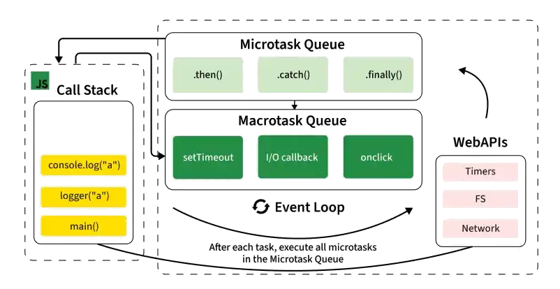
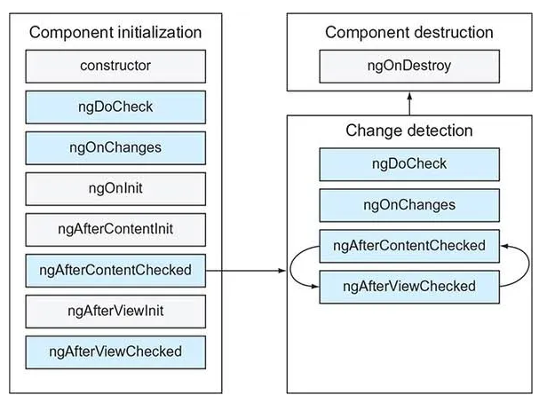

# Web Application Performance

## Overview

[Web performance](https://developer.mozilla.org/docs/Web/Performance) combines objective measurements with perceived user experience during load and runtime. Users perceive performance through waiting time, responsiveness, and visual smoothness, not through technical metrics alone. A web application that blocks the main thread, shifts layout unexpectedly, or delays feedback after a click feels unreliable even if it eventually completes the task. 

This user perception maps to practical time thresholds that shape whether an experience feels instant, continuous, or frustrating. The table below summarizes these perception windows and explains why frontend performance work must be tied to user-centered outcomes.

| Time window | User perception |
| --- | --- |
| 0 to 100 ms | Respond to user actions within this time window and users feel like the result is immediate. Any longer, and the connection between action and reaction is broken. |
| 100 to 1000 ms | Within this window, things feel part of a natural and continuous progression of tasks. For most users on the web, loading pages or changing views represents a task. |
| 1000 ms or more | Beyond 1000 milliseconds (1 second), users lose focus on the task they are performing. |
| 10000 ms or more | Beyond 10000 milliseconds (10 seconds), users are frustrated and are likely to abandon tasks. They may or may not come back later. |

To evaluate and improve user experience, teams rely on frameworks such as [Core Web Vitals](https://web.dev/vitals/), [Lighthouse](https://developer.chrome.com/docs/lighthouse/overview/), and [RAIL](https://web.dev/rail/) model.

This chapter introduces the concepts and techniques required to build high-performing Angular applications. The following sections connect browser fundamentals, Angular runtime mechanics, and architectural delivery choices to practical outcomes in responsiveness, stability, and Core Web Vitals.

## Fundamentals

### Core Web Vitals

[Core Web Vitals](https://web.dev/explore/learn-core-web-vitals) are Google's user-centric performance metrics for page load speed, interaction responsiveness, and visual stability. They are measured from real users in the field and should be treated as product quality signals, not just technical KPIs.

The three Core Web Vitals metrics are:

- **[Largest Contentful Paint (LCP)](https://web.dev/lcp/)**: Measures loading performance by tracking when the largest visible element in the viewport is rendered (often an image, heading, or large content block). A good target is **2.5 seconds or less** at the 75th percentile.
- **[Interaction to Next Paint (INP)](https://web.dev/inp/)**: Measures responsiveness by capturing how long it takes from a user interaction (click, tap, key press) to the next visual update. A good target is **200 ms or less** at the 75th percentile.
- **[Cumulative Layout Shift (CLS)](https://web.dev/cls/)**: Measures visual stability by quantifying unexpected layout movement during the page lifecycle. A good target is **0.1 or less** at the 75th percentile.

These metrics directly impact user satisfaction and can influence search visibility. Optimizing Core Web Vitals usually improves both perceived quality and business outcomes.

### Performance Metrics

#### Time to First Byte

[Time to First Byte (TTFB)](https://web.dev/articles/ttfb) measures how quickly the first byte of the server response reaches the browser after a request starts. It reflects server processing, edge/CDN behavior, and network latency before rendering can begin. High TTFB usually indicates backend, origin, or transport bottlenecks rather than frontend rendering issues.

#### First Contentful Paint

[First Contentful Paint (FCP)](https://web.dev/articles/fcp) measures when the browser first renders any content from the DOM (text, image, canvas, or SVG). It is a key signal that the page is no longer blank and loading is progressing. Improve FCP by reducing render-blocking resources and prioritizing critical rendering-path assets.

#### Largest Contentful Paint

[Largest Contentful Paint (LCP)](https://web.dev/articles/lcp) reports when the largest visible content element in the viewport is rendered. This is one of the most important user-centric load metrics and a Core Web Vital. Optimize LCP with fast server responses, efficient critical CSS, and prioritized delivery of media and primary content.

#### Interaction to Next Paint

[Interaction to Next Paint (INP)](https://web.dev/articles/inp) measures the latency between a user interaction (click, tap, key press) and the next visual update. INP captures responsiveness across the full page lifecycle, not just at load time. Lower INP by reducing main-thread contention, long tasks, and unnecessary change detection work.

#### Cumulative Layout Shift

[Cumulative Layout Shift (CLS)](https://web.dev/articles/cls) measures visual stability by quantifying unexpected layout movement during the page lifecycle. A high CLS creates poor UX through content jumps and accidental interactions. Prevent CLS by reserving space for images/embeds, avoiding late DOM insertions above visible content, and stabilizing font rendering.

#### Total Blocking Time

[Total Blocking Time (TBT)](https://web.dev/articles/tbt) is a metric that sums the portions of long tasks (over 50 ms) between FCP and Time to Interactive. It indicates how much time the main thread is blocked and unable to respond quickly to input. TBT is strongly correlated with interaction quality and is useful for diagnosing heavy JavaScript execution.

#### Time to Interactive

[Time to Interactive (TTI)](https://web.dev/articles/tti) estimates when a page becomes reliably interactive, meaning it has rendered useful content and can respond to user input without major delay. While less emphasized than Core Web Vitals today, TTI still helps evaluate bootstrapping and JavaScript execution cost. Improve TTI by reducing startup JavaScript and minimizing long tasks during initialization.

#### Speed Index

[Speed Index](https://developer.chrome.com/docs/lighthouse/performance/speed-index/) measures how quickly visible parts of the page are populated during load, based on visual progression over time. It complements milestone metrics like FCP and LCP by representing the overall rendering trajectory. A better Speed Index typically comes from progressive rendering and early delivery of above-the-fold content.

#### Page Weight

[Page Weight](https://www.debugbear.com/test/page-size-checker) represents the total transferred bytes required to load a page, including HTML, CSS, JavaScript, images, fonts, and third-party resources. Larger payloads increase download and parse/execute time, especially on mobile networks. Control page weight with compression, code splitting, image optimization, and dependency hygiene.

#### DOM Content Loaded

[DOM Content Loaded](https://developer.mozilla.org/en-US/docs/Web/API/Document/DOMContentLoaded_event) (DCL) is the time it takes for the full HTML code of a webpage to be loaded. The faster this happens, the faster users can see useful functionality. This time doesn’t include other resources such as CSS and images.

#### Request Count

[Request Count](https://developer.chrome.com/docs/devtools/network) is the total number of network requests required to load a route or page state. Excessive requests can create waterfall delays, connection contention, and higher protocol overhead. Reduce request count by bundling strategically, inlining truly critical assets, and eliminating unnecessary third-party calls.

#### Cache Hit Rate

[Cache Hit Rate](https://developer.mozilla.org/docs/Web/HTTP/Caching) measures the percentage of requests served from cache (browser, CDN, or edge) instead of the origin. Higher hit rates reduce latency, origin load, and bandwidth costs while improving repeat-visit experience. Improve this metric with content hashing, `Cache-Control` policies, and cacheable API/data strategies where freshness allows.

#### API Latency

[API latency](https://developer.mozilla.org/docs/Glossary/Latency) measures how long backend endpoints take to respond, typically tracked across percentiles such as p50, p75, p95, and p99. It directly impacts route activation time, loading states, and perceived responsiveness in Angular applications. Optimize by removing request waterfalls, improving query efficiency, and applying targeted caching.

#### Error Rate

[Error rate](https://sre.google/sre-book/service-level-objectives/) is the proportion of failed requests or failed user interactions over total attempts in a time window. Even moderate latency looks worse to users when reliability drops, retries increase, or partial failures accumulate. Track error rate alongside latency and Web Vitals to evaluate true end-to-end experience quality.

### Performance Insights

[Performance Insights](https://developer.chrome.com/docs/performance/insights) provide actionable insights on a website's performance and are available in both the DevTools [Performance panel](https://developer.chrome.com/docs/devtools/performance/) and [Lighthouse panel](https://developer.chrome.com/docs/lighthouse/overview/). It provides a guided analysis layer built on top of [Performance traces](https://developer.chrome.com/blog/devtools-tips-39). Instead of only showing raw timeline events, they highlight likely bottlenecks (for example LCP delays, render-blocking requests, layout shifts, long tasks, and expensive selector work) and explain why each one matters for user experience.

Performance Insights is most effective when combined with [Angular DevTools](https://angular.dev/tools/devtools). Use Insights to locate browser-level bottlenecks, then use Angular DevTools to verify component-level change detection and rendering behavior behind those bottlenecks.

### Performance Patterns

#### Optimize Loading Sequence

[Loading sequence optimization](https://www.patterns.dev/vanilla/loading-sequence/) is the practice of carefully selecting the order in which resources are requested and executed so that users see meaningful UI as quickly as possible. To achieve this, prioritize critical path assets such as HTML, critical CSS, route-critical JavaScript, and media so they are loaded first. Non-essential scripts, widgets, and below-the-fold assets should be delayed until after the initial render. Maintaining a shallow dependency graph helps avoid long request waterfalls that can delay interactivity.

#### Dynamic Import

[Dynamic import](https://www.patterns.dev/vanilla/dynamic-import/) enables loading JavaScript modules at runtime using `import()`, rather than shipping all code upfront. This pattern is especially effective for route-level features, admin-only functionality, heavy editors or charts, and locale packs. In Angular, dynamic imports work well in combination with lazy routes and `@defer` blocks to reduce the initial bundle size. Always handle loading and error states gracefully so that deferred chunks do not degrade the user experience, especially on slow networks.

#### Import On Visibility

[Import on visibility](https://www.patterns.dev/vanilla/import-on-visibility/) is a pattern where code is loaded only when a component or section is about to enter the viewport. This can be implemented using `IntersectionObserver` or Angular's `@defer (on viewport)` triggers for content that appears near the fold. Preloading just before visibility helps mask network latency from the user. However, avoid using this pattern for above-the-fold or immediately interactive UI, as it can delay essential content.

#### Import On Interaction

[Import on interaction](https://www.patterns.dev/vanilla/import-on-interaction/) defers code loading until the user initiates an action, such as clicking, focusing, or hovering. This approach is ideal for infrequently used features like advanced filters, help overlays, heavy modals, and analytics panes. Optionally, resources can be prewarmed on `mouseenter` or `focus` events to improve perceived responsiveness. Always provide fallback UI while the chunk is being fetched and initialized to maintain a smooth user experience.

#### Bundle Splitting

[Bundle splitting](https://www.patterns.dev/vanilla/bundle-splitting/) divides a large JavaScript payload into smaller, independently loadable chunks. Splitting bundles by route and by feature ensures that users only download what is necessary for their current journey. It is important to keep chunk boundaries meaningful to avoid code duplication across many small bundles. Regularly review chunk composition with analyzer tools to prevent regressions and maintain optimal performance.

#### PRPL Pattern

The [PRPL pattern](https://www.patterns.dev/vanilla/prpl/) (Push/Preload, Render, Pre-cache, Lazy-load) organizes resource loading to enable instant first interaction. Preload resources required for the initial route, render the shell and primary content as early as possible, and pre-cache assets for routes that are likely to be visited next. Everything not required for the first meaningful interaction should be lazy-loaded to optimize both speed and efficiency.

#### Tree Shaking

[Tree shaking](https://www.patterns.dev/vanilla/tree-shaking/) is the process of removing unused code during the build, ensuring that dead code is not shipped to production. To maximize the benefits of tree shaking, prefer ES modules and design libraries to be free of side effects. Import only required symbols (e.g., `import { fn }`) instead of using broad namespace imports. Always validate the results with bundle analysis tools, as incorrect package metadata can limit the effectiveness of tree shaking.

#### Preload

[Preload](https://www.patterns.dev/vanilla/preload/) is a high-priority resource hint for assets that will be needed very soon in the current navigation. Use preload for critical fonts, images, and route-critical JavaScript chunks. However, avoid overusing preload, as too many high-priority requests can starve other essential work. Always align preload usage with actual critical-path measurements rather than assumptions.

#### Prefetch

[Prefetch](https://www.patterns.dev/vanilla/prefetch/) is a low-priority hint that instructs the browser to fetch resources likely to be needed for future navigations. Prefetch is best used for probable next routes, non-critical modules, and upcoming media. Trigger prefetching when the browser is idle or when there is a strong indication of navigation intent. Be selective with prefetching to avoid wasting bandwidth on low-probability paths.

#### Optimize Loading Third-Parties

[Third-party optimization](https://www.patterns.dev/vanilla/third-party/) focuses on reducing the performance cost of analytics, ads, embeds, chat widgets, and tag managers. Load third-party scripts after core content unless they are strictly business-critical. Use the `async` or `defer` attributes, lazy mount embeds, and remove unused vendors to minimize their impact. Always monitor third-party scripts separately in performance traces, as they often dominate long tasks and can significantly affect user experience.

#### List Virtualization

[List virtualization](https://www.patterns.dev/vanilla/virtual-lists/) is a technique that renders only the visible rows and a small buffer, rather than the entire dataset. This is especially useful for long tables, feeds, and logs, as it reduces DOM size and paint/layout costs. Pair virtualization with stable item heights or efficient measurement to ensure smooth scrolling. For very large back-end datasets, combine virtualization with pagination or incremental data fetching.

#### Compressing JavaScript

[JavaScript compression](https://www.patterns.dev/vanilla/compression/) reduces the transfer size of assets by using Brotli or Gzip before they are sent over the network. Prefer Brotli for modern browsers, while keeping Gzip as a fallback for compatibility. Serve precompressed assets from the CDN or server and verify the `Content-Encoding` header in production. Remember, compression complements minification and tree shaking, but does not replace them.

### Event Loop

JavaScript is single-threaded, meaning it executes one piece of code at a time on a single call stack. However, browsers or Node.js handle network requests, timers, user interactions, and animations concurrently. The mechanism that makes this possible is the **[Event Loop](https://developer.mozilla.org/docs/Web/JavaScript/Event_loop)**. Understanding the Event Loop is foundational to web performance because user input, asynchronous callbacks, and visual updates all depend on how the web browser schedules work on the main thread.

At a high level, the Event Loop checks whether the call stack is clear and whether there are pending tasks in the task queue or microtask queue.



Fig. 1: Event Loop

The Event Loop continuously cycles through the following steps:

1. **Execute the current task** from the task queue (also called the macrotask queue). This includes script execution, `setTimeout`/`setInterval` callbacks, I/O callbacks, and UI event handlers.
2. **Drain the microtask queue** completely. After each task completes, the engine processes all pending microtasks before moving on. Microtasks include `Promise` callbacks (`.then`, `.catch`, `.finally`), `queueMicrotask()`, and `MutationObserver` callbacks.
3. **Render** (if needed). After the current task and all pending microtasks finish, the browser may take a rendering opportunity if a visual update is due. In that rendering phase, it can run `requestAnimationFrame` callbacks, recalculate styles, perform layout, paint, and composite.
4. **Pick the next task** and repeat.

The distinction between macrotasks and microtasks has direct performance implications:

- **Macrotasks** (`setTimeout`, `setInterval`, script execution, message events, I/O, UI event handlers) are picked one at a time from the queue. Between macrotasks, the browser may have an opportunity to render.
- **Microtasks** (`Promise.then`, `queueMicrotask`, `MutationObserver`) are drained completely before the browser can render or pick the next macrotask. A long chain of microtasks will block rendering just as effectively as a long synchronous function.

The Event Loop is the runtime scheduler that determines when the code runs, when the user sees updates, and when interactions feel responsive.

## Angular-Specific Performance Strategies

### Zone.js vs Zoneless

Angular’s change detection is triggered and scheduled in response to asynchronous events and application state changes, with rendering occurring as part of Angular’s synchronization process. [Zone.js](https://angular.dev/best-practices/zone-pollution) is a signaling mechanism that patches asynchronous APIs (`setTimeout`, `Promise`, event listeners) to notify Angular when async operations complete, triggering change detection.

The following options outline practical Angular strategies to improve web application performance:

- **Zoneless**: Angular relies on Signals and explicit scheduling, giving developers finer control over when change detection runs and reducing unnecessary re-renders.
- **`NgZone.runOutsideAngular()`**: Executes code without triggering change detection, which is useful for high-frequency events (mousemove, scroll, animation frames) that do not need to update Angular state on every invocation.

In large Angular applications with heavy interaction, zoneless change detection can reduce unnecessary global change detection cycles. Use zoneless mode when the team is comfortable with explicit reactive patterns. Prefer Signals, the `async` pipe, and explicit state transitions over imperative mutation.

### Component Lifecycle

Angular components go through a predictable [lifecycle](https://angular.dev/guide/components/lifecycle) from creation to destruction. Understanding each phase helps place logic in the right hook, avoid unnecessary work during change detection, and prevent memory leaks. Next image shows the lifecycle hooks.



Fig. 2: Lifecycle hooks

Lifecycle hook responsibilities:

- **`constructor`**: Dependency injection and lightweight initialization only. Avoid side effects and expensive logic here.
- **`ngOnChanges`**: React to `@Input()` changes, normalize input data, or trigger recalculations that depend on parent-provided values.
- **`ngOnInit`**: Initialize component state, start data streams, and perform setup that should run once.
- **`ngDoCheck`**: Advanced custom change detection only. Keep this hook extremely cheap because it runs frequently.
- **`ngAfterContentInit` / `ngAfterContentChecked`**: Work with content projected via `ng-content`.
- **`ngAfterViewInit` / `ngAfterViewChecked`**: Access `@ViewChild`/`@ViewChildren` references and run logic that needs the view to be fully initialized.
- **`ngOnDestroy`**: Cleanup phase. Unsubscribe, stop timers, disconnect observers, and release resources.

Performance guidance:

- Prefer `OnPush` and immutable input patterns so hook executions happen only when meaningful state changes.
- Avoid triggering synchronous heavy computations inside view-check hooks and precompute with Signals `computed()` or memoized RxJS streams.
- Use `ngOnChanges` whenever an `@Input()` changes to trigger recalculations that depend on values provided by the parent component.
- Use teardown patterns (`takeUntilDestroyed`, `DestroyRef`, or explicit cleanup in `ngOnDestroy`) to avoid leaks and long-term runtime degradation.
- Keep hot-path hooks (`ngDoCheck`, `ngAfterViewChecked`, `ngAfterContentChecked`) minimal and deterministic to avoid slow computations in these hooks.

### Change Detection Strategies

Angular's [change detection](https://angular.io/guide/change-detection) mechanism is responsible for keeping the DOM in sync with the component state. Understanding and optimizing change detection is one of the most impactful architectural decisions for application performance.

The following example shows how to configure the change detection in components:

```typescript
@Component({
  changeDetection: ChangeDetectionStrategy.OnPush,
})
export class UserCardComponent {
  @Input() user!: User;
}
```

Angular provides two change detection strategies:

- **Default (or Eager)**: Angular checks the entire component tree on every change detection cycle. Simple but can become expensive in large applications.
- **OnPush**: Angular only checks a component when its inputs change (by reference), or an event is emitted from the component or its children, or an observable subscribed to via `async` pipe emits, or manual detection is triggered. `OnPush` should be the default choice for all presentational components.

### Web Workers

[Web Workers](https://developer.mozilla.org/docs/Web/API/Web_Workers_API) move JavaScript execution to background threads so CPU-intensive work does not block rendering or input handling on the main thread. In Angular, they are a strong option when expensive computation degrades interaction responsiveness. Web Workers are usually not the right tool for trivial logic, DOM access (not available in workers), or work dominated by network latency. Use workers as a throughput tool, not as a default abstraction.

Angular provides first-class setup via the CLI using `ng generate web-worker <name>`. This scaffolds a worker file and updates project configuration, so the worker is bundled correctly.

Rules to implement the communication model in Angular:

- Use `postMessage` and `onmessage` with small, explicit message contracts (`type`, `payload`, `requestId`) so calls are traceable and debuggable.
- Messages are structured-cloned by default. For large binary data, use [Transferable Objects](https://developer.mozilla.org/docs/Web/API/Web_Workers_API/Transferable_objects) such as `ArrayBuffer` to avoid copy overhead.
- Encapsulate worker interaction in an Angular service and expose request/response streams via RxJS or Signals so components stay declarative.

Workers are ideal for large dataset filtering/sorting, encryption/hashing, media transformation, local indexing/search, and computationally expensive business rules. Rule of thumb: consider a worker when tasks frequently exceed the frame budget (about 16 ms) or create long tasks above 50 ms during user interactions. Validate impact with Chrome Performance traces and Angular DevTools before and after adoption.

### Service Workers

[Service Workers](https://developer.mozilla.org/docs/Web/API/Service_Worker_API) essentially act as proxy servers that sit between web applications, the browser, and the network (when available). In Angular, the built-in [Angular Service Worker](https://angular.dev/ecosystem/service-workers) is focused on production caching for app-shell assets and controlled data freshness, which improves repeat-load speed, resilience on unstable networks, and offline behavior.

Angular provides first-class setup via the CLI. Add it with [`ng add @angular/pwa`](https://angular.dev/ecosystem/service-workers/getting-started), which installs the package, enables service worker registration in production, creates/updates `ngsw-config.json`, and configures web app manifest assets.

For performance, treat service worker configuration as a cache policy design task:

- Cache critical static assets eagerly so repeat navigations and route transitions avoid network round trips.
- Cache non-critical assets lazily to avoid overfetching during first load.
- Use `dataGroups` with `performance` strategy for read-heavy, latency-sensitive APIs where slightly stale data is acceptable.
- Use `dataGroups` with `freshness` strategy for endpoints that must prioritize up-to-date responses.
- Define conservative `maxAge` and `maxSize` values so caches do not grow unbounded on long-lived clients.

When configured well, Angular service workers can reduce repeat-visit load times, smooth performance on high-latency networks, and improve perceived reliability without changing core UI code.

### Lazy Loading

[Lazy loading](https://angular.io/guide/lazy-loading-ngmodules) is a design pattern that delays the loading of modules until they are needed. Angular supports lazy loading through the router, where feature modules are loaded on demand when the user navigates to a specific route:

```typescript
const routes: Routes = [
  {
    path: 'feature-a',
    loadChildren: () => import('./features/feature-a/feature-a.module')
      .then(m => m.FeatureAModule)
  },
  {
    path: 'feature-b',
    loadComponent: () => import('./features/feature-b/feature-b.component')
      .then(c => c.FeatureBComponent)
  }
];
```

With standalone components, `loadComponent` allows lazy loading at the component level, providing even more granular control over bundle splitting. Additional strategies include:

- **Preloading strategies**: Angular provides [PreloadAllModules](https://angular.io/api/router/PreloadAllModules) and custom preloading strategies to load lazy modules in the background after the initial application has loaded.
- **Deferred loading**: Angular provides `@defer` blocks that enable template-level lazy loading, loading components and their dependencies only when specific conditions are met (viewport visibility, interaction, idle time, or custom triggers).

### Bundle Optimization

Minimizing the JavaScript bundle size directly impacts initial load time and [Core Web Vitals](https://web.dev/vitals/). Angular provides several built-in and configurable optimization techniques:

- **Tree shaking**: Angular's production build automatically removes unused code. Ensure libraries are tree-shakable and avoid side effects in module imports.
- **Code splitting**: The Angular CLI automatically splits the bundle at lazy-loaded route boundaries. `@defer` blocks provide sub-route code splitting at the template level.
- **Build optimizer**: Angular's build optimizer removes Angular-specific decorators and applies advanced dead-code elimination.
- **Budget policy**: Define and enforce size thresholds in `angular.json` using [Angular budgets](https://angular.dev/tools/cli/build#configuring-size-budgets) so builds fail fast on regressions.
- **Bundle analysis**: Use [webpack-bundle-analyzer](https://www.npmjs.com/package/webpack-bundle-analyzer), [source-map-explorer](https://www.npmjs.com/package/source-map-explorer) or [Bundlephobia](https://bundlephobia.com/) to identify large dependencies and optimization opportunities.

### Runtime Performance

Runtime performance affects the user experience during navigation and interaction. Angular recommends several techniques for [optimizing runtime performance](https://angular.dev/best-practices/runtime-performance):

- **[Virtual scrolling](https://material.angular.dev/cdk/scrolling/overview)**: The Angular CDK's `CdkVirtualScrollViewport` renders only the visible items in long lists, maintaining performance with thousands of items.
- **`@for track`**: When rendering lists, always provide a tracking function so Angular can efficiently update DOM elements instead of recreating them.
- **`@defer` blocks**: Angular deferred views load components lazily based on triggers (viewport, interaction, idle, timer), reducing the initial rendering workload.
- **Pure pipes**: Angular reevaluates a pure pipe only if it detects that its inputs have changed, compared to the previous time Angular called it.
- **Web Workers**: Offload computationally heavy tasks (data processing, encryption, complex calculations) to [Web Workers](https://developer.mozilla.org/docs/Web/API/Web_Workers_API) to keep the main thread responsive.
- **`NgOptimizedImage`**: Angular's [image directive](https://angular.dev/guide/image-optimization) provides automatic lazy loading, `srcset` generation, and preconnect hints for optimized image delivery.
- **Memoization**: Use `computed()` signals or RxJS `distinctUntilChanged` and `shareReplay` operators to avoid unnecessary recomputation and re-rendering.

### Rendering Strategies

Rendering strategy has first-order impact on performance. Angular applications can combine CSR, SSR, SSG, and hydration depending on route and business needs.

- **CSR (Client-Side Rendering)**: Good for highly interactive internal applications where SEO is not critical.
- **SSR (Server-Side Rendering)**: Improves perceived load speed and LCP for content-heavy routes by returning HTML from the server.
- **SSG (Static Site Generation)**: Ideal for mostly static routes (marketing, docs, legal pages) with very fast delivery through CDN caching.
- **Hydration**: Reuses server-rendered HTML and attaches client behavior, reducing expensive full re-rendering on startup.

In practice, use a hybrid strategy, namely, SSR/SSG for first-visit and SEO-sensitive routes, CSR for authenticated dashboards and heavy interaction areas, and `@defer` and lazy loading to progressively activate non-critical UI blocks.

### Signals with OnPush

Signals help Angular update only the reactive graph that actually changed. Combined with `OnPush`, they reduce unnecessary checks and improve interaction responsiveness.

```typescript
@Component({
  selector: 'app-cart-summary',
  template: `
    <p>Total: {{ total() | currency }}</p>
  `,
  changeDetection: ChangeDetectionStrategy.OnPush,
})
export class CartSummaryComponent {
  readonly items = signal<{ price: number; qty: number }[]>([]);

  readonly total = computed(() =>
    this.items().reduce((sum, item) => sum + item.price * item.qty, 0)
  );
}
```

As a rule of thumb, keep template expressions cheap and deterministic. Note that `OnPush` is the default in recent Angular versions.

### Caching Strategies

Client-side caching reduces network requests and improves responsiveness. Common caching strategies for Angular data layers include:

- **In-memory caching**: Store frequently accessed data inside an Angular service, but the cache disappears when the page is refreshed.
- **RxJS-based caching**: Using `shareReplay(1)` in RxJS to cache the latest value of an observable stream and share it among multiple subscribers.
- **Signal-based caching**: Using Angular signals and `resource()` to create reactive, automatically cached data sources.
- **Service Worker caching**: Using Angular's Service Worker with configurable data groups for API caching with performance or freshness strategies.
- **IndexedDB**: For large datasets that need to persist across sessions, [IndexedDB](https://developer.mozilla.org/docs/Web/API/IndexedDB_API) provides client-side storage with query capabilities.

### API Layer Performance

API performance directly shapes frontend outcomes. Poor API design commonly manifests as request waterfalls between dependent endpoints, duplicate calls from multiple components, oversized payloads, and frequent retry or timeout cycles. These issues increase route activation time, delay data-bound UI updates, and generate extra rendering work as components cycle repeatedly between loading, partial, and error states.

Because UI responsiveness depends heavily on API and state architecture, apply the following strategies:

- Aggregate related requests to eliminate serial waterfall latency.
- Cache idempotent GET responses with `shareReplay` and clear invalidation rules.
- Share observable streams across components to eliminate duplicate HTTP calls.
- Paginate large datasets and combine with virtual scrolling.
- Apply optimistic updates for low-risk user actions to improve perceived speed.

## Web Server Performance Strategies

### Performance Concerns

Regardless of how well the Angular application is optimized at the code level, the web server sitting between the build output and the browser has a decisive impact on what the user actually experiences. Misconfigured servers can negate bundle-size wins, add unnecessary round trips, or block the browser from caching and rendering efficiently.

In real-world environments, users often run on constrained mobile networks, high-latency links, and shared Wi-Fi where every extra request or handshake is amplified. For this reason, web server tuning should be treated as part of frontend performance engineering, not as a separate infrastructure concern.

The most common server-level concerns that affect frontend performance are response compression, HTTP caching headers, connection management, CORS preflight overhead, secure transport configuration, redirect behavior, and correct content types. Each of these is controlled outside the Angular codebase, typically in the web server ([Nginx](http://nginx.org/), [Apache](https://httpd.apache.org/), [IIS](https://www.iis.net/)), the CDN, or the cloud load balancer. Their effects show up in Core Web Vitals and user-perceived speed, especially during initial loading and navigation.

The following sections focus on the practical server strategies that most influence Angular delivery quality. Together, these optimizations reduce bandwidth consumption, improve repeat-load speed, and stabilize user experience across both fast and slow networks.

### Fallback Routes

Angular applications using client-side routing need the server to return `index.html` for all deep-link paths that do not map to a real static file. If the server returns a `404` instead, users who refresh or share a URL will see an error page.

Apply the following guidelines to configure fallback routes for Angular applications:

- In *Nginx*, use `try_files $uri $uri/ /index.html;` inside the location block.
- On CDNs and cloud hosting, configure a custom error document or a catch-all rewrite rule that serves the SPA shell.
- Define API proxy or backend locations before the generic fallback so API routes are not accidentally masked by the SPA entry point.
- Ensure missing static files still return proper `404` responses instead of incorrectly returning `index.html`.
- Return the correct `Content-Type` for every response and add `X-Content-Type-Options: nosniff` so browsers do not guess how to interpret an asset.

A correct fallback configuration is not just a correctness concern, it also affects perceived performance because a `404` or redirect chain before the app loads adds wasted round trips and delays *Time to First Byte*.

### Caching Headers

[HTTP caching headers](https://www.keycdn.com/blog/http-cache-headers) determine whether the browser can reuse a previously fetched resource or must make a new network request. Incorrect caching is one of the most common server misconfigurations that harms frontend performance.

Apply the following rules to balance repeated loads with safe and predictable caching behavior:

- Serve only content-hashed static assets (`main.abc123.js`, `styles.def456.css`) with long-lived `Cache-Control` values such as `public, max-age=31536000, immutable`.
- Serve `index.html` and other non-hashed entry points with short or zero cache lifetimes (for example `no-cache` or `max-age=0, must-revalidate`) so the browser always fetches the latest version that references the current hashed assets.
- Use `ETag` or `Last-Modified` headers as a validation mechanism for resources that cannot use content hashing, so the server can respond with `304 Not Modified` and save bandwidth.
- Keep service worker metadata (`ngsw.json`, `ngsw-worker.js`) fresh so clients detect updates promptly. Do not give these files the same year-long immutable policy as hashed application assets.

Next `Nginx` configuration block combines SPA fallback behavior with cache policies for HTML and static assets:

```nginx
server {
  etag on;

  location / {
    try_files $uri $uri/ /index.html;
    add_header Cache-Control "no-cache, must-revalidate";
  }

  location ~* \.(?:css|js|mjs|json|gif|jpeg|png|webp|avif|woff2|ttf|otf|svg|eot|ico)$ {
    add_header Cache-Control "public, max-age=31536000, immutable" always;
  }
}
```

What each part means:

- `try_files $uri $uri/ /index.html;` serves real files when they exist, otherwise falls back to `index.html` for Angular client-side routes.
- `Cache-Control "no-cache, must-revalidate"` on `location /` allows the HTML entry document to be stored but requires validation before reuse after a deployment.
- `Cache-Control "public, max-age=31536000"` on static assets allow long-lived browser and intermediary caching for files that rarely change in-place. Unhashed files need a separate, shorter-lived policy (e.g. `ngsw.json` and `ngsw-worker.js`).
- `etag on;` supports conditional validation for resources that are not content-hashed.

Misconfigured caching either forces the browser to re-download unchanged assets on every navigation (hindering performance on repeat visits) or serves stale bundles after a deployment (causing runtime errors when old code references missing chunks).

### CDN and Edge Caching

[Content Delivery Networks](https://developer.mozilla.org/docs/Glossary/CDN) (CDNs) are geographically distributed networks of servers that cache application content close to end users, significantly reducing latency and improving availability. Edge caching refers to caching policies and logic applied at CDN edge locations (the servers closest to users) rather than only at the origin server. This enables cached content to be served from geographically nearby infrastructure.

Apply the following guidelines to optimize CDN and edge caching for web applications:

- **Cache hashed assets**: Content-hashed filenames (`main.abc123.js`) can be cached with `public, max-age=31536000, immutable` because the URL changes whenever the content changes. The `immutable` directive tells clients not to revalidate the asset while it is fresh. A CDN may still evict it before the freshness period ends.
- **Revalidate entry points**: Use `no-cache` or `max-age=0, must-revalidate` for `index.html` so clients and shared caches validate it before reuse. Conditional requests such as `ETag` can save bandwidth when the file has not changed, provided the origin and CDN support them.
- **Set appropriate TTLs (Time-To-Live) per content type**: Cache hashed static images, stylesheets, and scripts for a year. Keep unhashed files and HTML short-lived, and cache dynamic data for seconds to minutes only when freshness, authorization, cookies, and privacy requirements allow it.
- **Implement cache invalidation strategies**: Use URL versioning (content hashing), cache keys with version parameters, or explicit purge APIs to invalidate stale content after deployments without waiting for TTL expiration.
- **Define cache keys deliberately**: Account for query strings, cookies, authorization, `Accept-Language`, and device or image-variant parameters. When the response varies by request origin, send `Vary: Origin` so the CDN does not reuse one CORS response for another origin.

For Angular applications, a CDN can serve as the primary distribution mechanism for HTML, JavaScript, CSS, static assets, and, where appropriate, API responses. Proper CDN configuration is one of the highest-impact performance optimizations because it compounds across millions of requests and can directly improve TTFB, LCP, and cache hit rates for a global audience. For SSR or authenticated applications, do not cache personalized HTML in a CDN.

### Server Compression

Minimizing JavaScript bundle size directly improves application performance. If the server, CDN, or reverse proxy is not configured to compress responses, even well-optimized Angular bundles will still travel over the network larger than necessary.

Apply the following guidelines to configure compression correctly across the delivery stack:

- Prefer **Brotli** for text-based responses such as HTML, CSS, JavaScript, JSON, and SVG when supported, or use **Gzip** as the broad-compatibility fallback.
- Do not waste CPU recompressing assets that are already compressed, such as JPEG, PNG, WebP, AVIF, MP4, ZIP, or PDF files.
- Terminate compression at the right layer. In many architectures, the CDN, ingress controller, or reverse proxy should own compression instead of each application instance.
- Avoid compressing the same response more than once.
- Verify the result in production by checking `Content-Encoding`, `Vary: Accept-Encoding`, and actual transferred size in browser DevTools.

Next `Nginx` configuration block enables Gzip response compression for text-based assets before they are sent to the browser:

```nginx
http {
  gzip on;
  gzip_vary on;
  gzip_min_length 1024;
  gzip_static on;

  gzip_types
    application/javascript
    application/json
    application/manifest+json
    font/eot
    font/otf
    font/ttf
    font/woff
    image/svg+xml
    text/css
    text/javascript
    text/plain
    text/xml;
}
```

What each part means:

- `gzip on;` activates Gzip compression globally in the `http` context.
- `gzip_vary on;` ensures the response includes `Vary: Accept-Encoding` so caches separate compressed variants correctly.
- `gzip_min_length 1024;` avoids spending CPU compressing very small payloads that gain little from compression.
- `gzip_static on;` allows serving precompressed files (`.gz`) when they exist, reducing runtime CPU cost.
- `gzip_types ...;` defines which MIME types should be compressed.

Operationally, compression is a tradeoff between CPU cost and transfer size. For most Angular applications, the bandwidth savings are substantial, but teams should still test on real infrastructure to ensure compression levels do not create unnecessary server latency under load. Alternatively, [Gzipper](https://www.npmjs.com/package/gzipper) can compress files using Deflate, Brotli, Gzip, Zopfli, or Zstandard and can be integrated with common CLI-based build workflows.

### HTTP/2, HTTP/3, and TLS Optimization

Transport and connection settings define how quickly bytes can move from server to browser after routing and caching are already correct. At this layer, major performance gains usually come from reducing handshake overhead, reusing connections effectively, and avoiding unnecessary protocol fallback. These choices are implemented in the CDN, load balancer, or reverse proxy, and primarily affect TTFB and loading metrics rather than interaction latency after the page is running.

The following `Nginx` configuration block enables HTTP/2, HTTP/3, TLS, and keep-alive tuning:

```nginx
server {
  listen 443 ssl;
  listen 443 quic reuseport;
  http2 on;
  http3 on;

  ssl_certificate /path/to/fullchain.pem;
  ssl_certificate_key /path/to/privatekey.pem;
  ssl_protocols TLSv1.2 TLSv1.3;
  ssl_session_cache shared:SSL:10m;
  ssl_session_timeout 1d;
  ssl_session_tickets off;

  ssl_stapling on;
  ssl_stapling_verify on;

  add_header Alt-Svc 'h3=":443"; ma=86400' always;

  keepalive_timeout 65;
  keepalive_requests 1000;
}
```

What each part means:

- `listen 443 ssl;` enables HTTPS on TCP, and `http2 on;` enables HTTP/2 for that server.
- `listen 443 quic reuseport;` enables QUIC transport, while `http3 on;` enables HTTP/3.
- `ssl_certificate` points to the server certificate and intermediate certificate chain, while `ssl_certificate_key` points to the matching private key.
- `ssl_protocols TLSv1.2 TLSv1.3;` allows modern TLS with broad client compatibility. HTTP/3 itself requires TLS 1.3.
- `ssl_session_cache` and `ssl_session_timeout` help handshake reuse for repeat connections.
- `ssl_stapling` reduces certificate validation round trips when OCSP infrastructure is healthy.
- `Alt-Svc` advertises HTTP/3 availability to compatible clients. `always` ensures the header is added to non-success responses as well.
- `keepalive_timeout` and `keepalive_requests` control connection reuse and resource pressure tradeoffs.

Performance optimization for HTTP/3 on NGINX focuses on minimizing latency and maximizing throughput. This can involve tuning the underlying UDP settings for QUIC, adjusting session reuse parameters, and optimizing TLS configuration to reduce handshake times. Monitoring and changing settings based on real-world usage patterns are crucial, as the optimal configuration can vary significantly depending on specific traffic loads, content types, and network conditions.

### CORS Optimization

[CORS](https://developer.mozilla.org/docs/Web/HTTP/CORS) (Cross-Origin Resource Sharing) is a browser security mechanism that controls whether JavaScript code from one origin can access resources hosted on a different origin. When a cross-origin request does not meet the requirements for a "simple" request, the browser sends a preflight `OPTIONS` request to the destination server to verify that the actual request is permitted. This verification happens before the actual request is sent.

A preflight request is triggered when any of the following conditions are true:

- The HTTP method is not `GET`, `HEAD`, or `POST`.
- Request headers are added that are not CORS-safelisted (for example `Authorization`, `X-Trace-Id`, or tenant-specific headers).
- The request's `Content-Type` is not `application/x-www-form-urlencoded`, `multipart/form-data`, or `text/plain`.

Each preflight adds an extra round trip before the actual request, which increases latency, especially on high-latency networks or mobile connections. Additionally, every tier in the request path (API gateway, proxy, load balancer, and origin application) must correctly route and respond to `OPTIONS` requests, making preflight failures a common source of production issues.

In practice, one of the most effective ways to reduce this overhead is to route API requests through the same origin as the Angular application. For example, a CDN or reverse proxy can forward requests from `/api/*` to the backend while the browser continues to communicate with a single origin. This removes the cross-origin boundary from the browser-to-edge request, avoiding CORS preflights on that leg while preserving the separation between the frontend and backend services. Where cross-origin requests are still necessary, allow browsers to cache successful preflight responses with `Access-Control-Max-Age`, use simple requests where appropriate, and define an explicit allowlist of trusted origins.

### Server-Side Rendering

[Server-Side Rendering](https://angular.dev/guide/ssr) is a rendering strategy in which the server generates the initial HTML for a route and sends it to the browser. This allows users to see meaningful content before client-side JavaScript finishes bootstrapping the application.

In Angular, server-side rendering can improve the initial user experience by delivering meaningful content sooner, especially on slower devices or networks. It can also improve how crawlers and link preview systems consume page content and metadata. However, server rendering adds work to the server and can increase TTFB when rendering blocks on slow APIs or expensive computation. Use route-appropriate caching or streaming where possible, and use hydration with transfer state to avoid repeating server-fetched data in the browser.

Angular integrates server-side rendering through the framework and CLI with [@angular/ssr](https://angular.dev/guide/ssr). Alternatively, [AnalogJS](https://analogjs.org/) is an Angular meta-framework inspired by the developer experience of frameworks such as [Next.js](https://nextjs.org/) and [Nuxt](https://nuxt.com/).

### Server Scaling

Server scaling distributes incoming requests across multiple application instances to handle growing traffic, reduce the impact of individual server failures, and maintain predictable response times. For Angular applications using [Server-Side Rendering](https://angular.dev/guide/ssr), scaling is especially important because server rendering can be CPU-intensive. A single instance can become a bottleneck quickly unless responses are cached or rendering work is otherwise reduced.

A typical scaling architecture employs several strategies:

- **Load balancing**: Route requests across multiple instances using algorithms such as round-robin, least connections, or weighted distribution. Health checks should remove unhealthy instances from the pool automatically.
- **Stateless design**: Store session state externally (for example, in a cache or database) rather than in process memory, so any instance can handle a request. Avoid relying on local files or other instance-specific state, and make instances replaceable.
- **Autoscaling**: Monitor CPU, memory, request latency, throughput, queue depth, and error rate to add or remove instances based on demand. Use percentile-based thresholds (p95/p99) and saturation signals rather than averages alone.
- **Appropriate sizing**: Choose instance sizes based on measured CPU, memory, concurrency, and SSR rendering requirements. Leave enough headroom for traffic spikes, and monitor per-instance metrics to detect imbalance or saturation.

For Angular applications, ensure the deployment pipeline supports rolling or blue-green updates so new code can be deployed with minimal disruption. Connection draining, which allows existing requests to complete before shutdown, prevents abrupt connection drops during instance replacement. Combined with external caching and durable data stores, these patterns support horizontal scaling while keeping application instances stateless and improving resilience during traffic spikes.

### API Latency Optimization

API latency is the time elapsed between when a frontend application sends a request and when it receives the complete response from the backend. High API latency can degrade frontend performance and user experience by extending loading states, delaying route activation, and keeping data-dependent UI unavailable for longer.

Apply the following strategies to mitigate API latency impact:

- **Optimize backend query performance**: Reduce database query time, eliminate N+1 queries, add appropriate indexes, and use query-result caching where it is safe. Profiling response times is the foundation of API optimization.
- **Aggregate or batch API calls**: Combine related requests when doing so reduces network round trips without creating oversized or slow responses. For example, fetch a user profile and settings in one call instead of two.
- **Cache API responses strategically**: Share request observables with RxJS `shareReplay` to prevent duplicate calls among active consumers, and cache idempotent `GET` responses only with clear freshness and invalidation rules.
- **Implement optimistic updates**: For low-risk operations, such as liking a post or toggling a preference, update the UI before the API responds and revert the change if the request fails. This improves perceived responsiveness but requires clear failure handling.
- **Paginate and limit payloads**: Fetch only the data needed for the current view rather than entire datasets. Return compact representations and combine pagination with virtual scrolling for large lists.
- **Use edge caching for read-heavy APIs**: Cache stable, public, read-only responses such as configuration, lists, or reference data at the CDN or service-worker layer when their freshness and privacy requirements allow it. Set an appropriate time to live (TTL).

For SSR applications, API latency can block server rendering when the route waits for API data before producing HTML. Slow APIs therefore increase TTFB and can delay LCP. Prioritize backend optimization, parallelize independent requests, and consider rendering a shell or loading non-critical data on the client when the framework and UX allow it.

## Performance Testing

### Frontend vs Backend

Performance testing should be automated, repeatable, and tied to clear, user-centered thresholds. In practice, this requires testing both **frontend performance** and **backend performance**, because users experience the combined result rather than either layer in isolation.

Frontend performance testing focuses on what the browser must download, execute, and render, as well as how quickly it responds during user interactions. Typical concerns include bundle size, render-blocking resources, long main-thread tasks, layout stability, interaction latency, and smooth route transitions. Backend performance testing focuses on the server and data layer under realistic load. Typical concerns include TTFB, API response times, tail latency (p95/p99), error rate, throughput, queue saturation, database contention, and cache hit ratio.

Although these test categories are different, they are tightly connected. Backend behavior directly influences frontend outcomes and Core Web Vitals:

- Slow SSR or delayed API responses increase TTFB and often delay LCP.
- High backend tail latency keeps the UI in loading states longer, degrading perceived responsiveness.
- Unstable endpoints (timeouts/retries) produce spinner flicker, partial renders, and interaction interruptions.
- Chatty or waterfall APIs force extra round trips, delaying route activation and interactive readiness.

For this reason, mature teams treat performance as an end-to-end quality gate. The goal is not only fast JavaScript or fast APIs, but also fast user journeys. With a combined strategy, teams can:

- Improve user experience by finding bottlenecks across network, server, and browser rendering.
- Prepare for unexpected demand by validating behavior beyond expected traffic and concurrency.
- Increase delivery confidence by reducing production risk with repeatable thresholds and regression gates.
- Optimize infrastructure cost by sizing capacity based on measured behavior, not assumptions.

### Testing Approaches

Testing approaches should reflect how users experience the system across the browser, network, and backend services. Instead of relying on a single tool, use a set of complementary tests, with each one answering a different question at the appropriate stage of delivery.

Use several test levels so that each test type does what it does best:

- **Pull request level**: Run fast Lighthouse and route-budget checks on critical user paths (such as login, checkout, or dashboards) to catch obvious frontend regressions without slowing development. Builds should fail only for meaningful regressions.
- **Nightly or pre-release level**: Run broader synthetic and end-to-end tests, including scripted user journeys, trace analysis, realistic network conditions, geographic variation, multi-region WebPageTest runs, backend load tests, API latency validation under concurrency, and cache-effectiveness checks.
- **Production level**: Continuously monitor real-user and service telemetry, with alerts for p75/p95 degradations in frontend and backend KPIs such as LCP, INP, CLS, API latency, and error rates. This verifies that improvements measured in other stages translate to real-world performance.

A practical CI policy should reflect real user contexts. Set separate thresholds for desktop and mobile profiles because mobile devices and networks typically have less CPU, memory, and connectivity stability. Effective performance tests also require realistic loads and data in production-like environments. Monitor response times and infrastructure metrics, define clear success criteria, account for third-party dependencies, and retest performance after code changes. A mature performance testing program combines realistic workload modeling, production-like environments, continuous monitoring, and automated regression detection.

### Lighthouse

[Lighthouse](https://developer.chrome.com/docs/lighthouse) is a tool that evaluates a page under controlled conditions and reports scores plus diagnostics for **Performance**, **Accessibility**, **Best Practices**, and **SEO**. Lighthouse is most useful as a regression gate in CI because it catches common failures early (render-blocking resources, excessive JavaScript, long main-thread tasks, inefficient image delivery) before they reach production.

Use Lighthouse as **controlled lab verification**, not as a replacement for real-user monitoring. Lighthouse helps compare builds consistently and block regressions quickly, while Core Web Vitals in production confirm whether users have actually experienced improvements.

Minimal package setup commonly used for this test style:

```bash
npm install -D lighthouse chrome-launcher testcontainers
```

See the next example using a containerized workflow:

```typescript
describe('Application', () => {
  let container: StartedTestContainer;
  let baseUrl: string;
  let report: RunnerResult;

  beforeAll(async () => {
    const config = { extends: 'lighthouse:default' };
    const chrome = await chromeLauncher.launch({ chromeFlags: ['--headless'] });
    const options = { logLevel: 'info', output: 'json', port: chrome.port };

    container = await new GenericContainer('my-org/my-app:latest')
      .withExposedPorts(4200)
      .start();

    baseUrl = `http://localhost:${container.getMappedPort(4200)}`;

    report = await lighthouse(baseUrl, options, config).finally(() => chrome.kill());
  });

  afterAll(async () => {
    await container.stop();
  });

  it('performance score should be >= 0.90', () => {
    expect(report.lhr.categories['performance'].score).toBeGreaterThanOrEqual(0.9);
  });

  it('accessibility score should be >= 0.90', () => {
    expect(report.lhr.categories['accessibility'].score).toBeGreaterThanOrEqual(0.9);
  });

  it('best-practices score should be >= 0.90', () => {
    expect(report.lhr.categories['best-practices'].score).toBeGreaterThanOrEqual(0.9);
  });

  it('seo score should be >= 0.90', () => {
    expect(report.lhr.categories['seo'].score).toBeGreaterThanOrEqual(0.9);
  });
});
```

How Lighthouse test works in practice:

1. It runs a production-like artifact in a Docker container (`my-org/my-app:latest`) to keep the execution environment stable.
2. It launches headless Chrome and executes Lighthouse programmatically against the mapped container URL.
3. It stores the `RunnerResult` and validates both category thresholds (`>= 0.9`) and concrete audit budgets (for example LCP and TBT).
4. It performs explicit cleanup (`chrome.kill()` and `container.stop()`) to keep test runs reliable in CI.

For reliable measurements, prefer **two execution environments**, with one machine hosting the application and another running the load/audit agent. Running both on the same host can distort metrics because CPU, memory, disk I/O, and network stack contention from one process affects the other.

### WebPageTest

[WebPageTest](https://www.webpagetest.org/) provides synthetic tests with realistic network shaping, geographic test locations, repeat-view behavior, and rich artifacts (waterfalls, filmstrips, request-level diagnostics). WebPageTest is a strong complement to Lighthouse when route-level analysis is needed under conditions that resemble real users more closely.

Use WebPageTest as **environment-realistic synthetic verification**, especially for nightly and pre-release checks. Lighthouse remains a fast pull-request gate, while WebPageTest adds deeper validation for caching behavior, regional latency, and third-party impact.

Minimal package setup commonly used for this test style:

```bash
npm install -D webpagetest
```

See the next example using [webpagetest](https://www.npmjs.com/package/webpagetest) client:

```typescript
describe('Application', () => {
  let report: any;

  beforeAll(async () => {
    const wpt = new WebPageTest('www.webpagetest.org', process.env['WPT_API_KEY']);
    const options = {
      location: 'Dulles:Chrome',
      connectivity: '4G',
      runs: 1,
      firstViewOnly: true,
      pollResults: 5,
      timeout: 120,
    };

    const testResults = await new Promise((resolve, reject) => {
      wpt.runTestAndWait(process.env['APP_BASE_URL'], options, (error, result) => error ? reject(error) : resolve(result));
    });

    report = testResults.data.average.firstView;
  });

  it('LCP should be <= 2500 ms', () => {
    expect(report.largestContentfulPaint).toBeLessThanOrEqual(2500);
  });

  it('TTFB should be <= 800 ms', () => {
    expect(report.timeToFirstByte).toBeLessThanOrEqual(800);
  });

  it('Speed Index should be <= 3000 ms', () => {
    expect(report.speedIndex).toBeLessThanOrEqual(3000);
  });
});
```

How WebPageTest works in practice:

1. It uses the official `webpagetest` client and a real WebPageTest endpoint (`www.webpagetest.org`) authenticated with `WPT_API_KEY`.
2. It runs a route test with explicit profile controls (`location`, `connectivity`, `runs`) so results are comparable over time.
3. It uses `runTestAndWait` to execute and wait for completion, then reads the `firstView` metrics.
4. It validates concrete budgets (for example LCP, TTFB, and Speed Index) instead of relying only on a single aggregate score.

Note that public WebPageTest agents cannot access `localhost` or private CI networks directly. Use a reachable preview/staging URL (`APP_BASE_URL`) or run private agents when testing non-public environments.

### k6

[k6](https://k6.io/) is an open-source performance testing tool and cloud service from Grafana Labs. For Angular SSR applications, k6 is particularly effective at verifying server-side load time characteristics using HTTP-level metrics.

Use k6 as **scriptable load time validation** for CI and pre-release pipelines. Server-side rendering pages are rendered on the server before being sent to the browser. Therefore, HTTP-level metrics such as request duration, Time to First Byte (TTFB), and response size are the primary indicators of server-side rendering performance.

k6 provides native packages for Linux, Mac, and Windows. See the [k6 installation guide](https://grafana.com/docs/k6/latest/set-up/install-k6/) for platform-specific instructions. Alternatively, we can pull the official k6 Docker image:

```shell
docker pull grafana/k6
```

Before running the test file, ensure that a runnable k6 HTTP script exists in `K6_SCRIPT_PATH` with a default function that issues `http.get` requests against critical SSR routes, and the target application is reachable through `APP_BASE_URL`. Then, use the following opinionated example to run the performance tests:

```typescript
describe('Application', () => {
  let summary: any;

  beforeAll(() => {
    execFileSync(
      'k6',
      [
        'run',
        '--summary-export', 'dist/perf-summary.json',
        '--summary-trend-stats', 'avg,min,max,p(75),p(90),p(95)',
        '--vus', '10',
        '--duration', '30s',
        process.env['K6_SCRIPT_PATH']!,
      ],
      {
        env: { ...process.env, APP_BASE_URL: process.env['APP_BASE_URL'] },
        stdio: 'inherit',
      }
    );

    summary = JSON.parse(readFileSync('dist/perf-summary.json', 'utf8'));
  });

  it('request duration p95 should be <= 1000 ms', () => {
    expect(summary.metrics.http_req_duration['p(95)']).toBeLessThanOrEqual(1000);
  });

  it('TTFB p95 should be <= 400 ms', () => {
    expect(summary.metrics.http_req_waiting['p(95)']).toBeLessThanOrEqual(400);
  });

  it('error rate should be < 1%', () => {
    expect(summary.metrics.http_req_failed.value).toBeLessThan(0.01);
  });
});
```

How k6 works in practice:

1. The k6 HTTP script issues `http.get` requests against SSR routes, verifying that the server returns fully rendered HTML for each critical page under load.
2. The `execFileSync` function keeps the load test inside the test lifecycle.
3. The run exports a JSON summary (`--summary-export`) and includes `p(95)` in trend stats to capture tail latency, not just averages.
4. JSON summary is used on each `it` assertion per metric: total request duration (p95), TTFB via `http_req_waiting` (p95), and error rate.

k6 is useful not only for load testing but also for browser-level performance verification through the [`k6/browser` API](https://grafana.com/docs/k6/latest/javascript-api/k6-browser/).

### Best Practices

The checklist below provides practical performance testing practices that help teams establish repeatable, production-relevant testing and prevent regressions over time:

- [ ] **Define clear performance objectives**: Establish measurable targets for response times, throughput, concurrent users, error rates, and resource utilization before testing begins.

- [ ] **Automate performance testing**: Integrate performance tests into CI/CD pipelines to detect regressions early and ensure consistent testing practices.

- [ ] **Test realistic user behavior**: Simulate actual user journeys and workflows, including logins, searches, transactions, and form submissions, rather than isolated requests.

- [ ] **Use production-like environments**: Conduct tests in environments that closely match production infrastructure, database schemas, cache behavior, and network conditions.

- [ ] **Create representative test data**: Use realistic data volumes and distributions to accurately reflect production workloads and uncover data-related performance issues.

- [ ] **Establish performance baselines**: Measure and document current system performance to enable comparison and identify regressions over time.

- [ ] **Perform multiple types of performance tests**: Include load, stress, spike, endurance (soak), and scalability testing to evaluate behavior under different conditions.

- [ ] **Measure end-to-end performance**: Monitor performance across all layers, including the browser, CDN, load balancer, application servers, databases, caches, and external services.

- [ ] **Monitor system resource utilization**: Track CPU, memory, disk I/O, network usage, thread pools, and connection pools during tests to identify bottlenecks.

- [ ] **Analyze backend percentile metrics**: Focus on P50, P90, P95, and P99 response times rather than relying solely on averages, which can mask poor user experiences.

- [ ] **Analyze frontend performance metrics**: Measure user-centric metrics such as Largest Contentful Paint (LCP), First Contentful Paint (FCP), and Time to Interactive (TTI).

- [ ] **Test APIs independently**: Validate API response times, throughput, payload sizes, and authentication overhead separately from UI testing.

- [ ] **Account for third-party dependencies**: Evaluate the impact of external services, APIs, authentication providers, payment gateways, and analytics tools.

- [ ] **Correlate performance and infrastructure metrics**: Link response times and throughput with system metrics, logs, and traces to simplify root-cause analysis.

- [ ] **Monitor performance in production**: Use real-user monitoring (RUM), application performance monitoring (APM), logging, and tracing to validate real-world performance.

- [ ] **Identify and eliminate bottlenecks**: Investigate slow queries, cache misses, lock contention, inefficient code paths, and excessive network calls using evidence-based analysis.

- [ ] **Test cold and warm cache scenarios**: Evaluate performance both with empty caches and fully populated caches to understand real-world behavior.

- [ ] **Validate error handling under load**: Ensure the application degrades gracefully under high load through rate limiting, retries, circuit breakers, and meaningful error responses.

- [ ] **Document and version test scenarios**: Maintain test scripts, datasets, configurations, and results to ensure repeatability and historical comparison.

- [ ] **Continuously optimize and retest**: Treat performance testing as an ongoing process of testing, analyzing, tuning, and validating improvements.

## Performance Monitoring

### Profiling Angular Applications

[Profiling Angular applications](https://angular.dev/best-practices/profiling-with-chrome-devtools) means measuring where time is spent across network activity, JavaScript execution, change detection, rendering, and API wait states. The goal is to find the bottlenecks that most affect user-centric metrics such as LCP, INP, CLS, and route transition time.

The following areas represent the primary targets for frontend performance profiling and optimization:

- **Startup and route activation**: Measure TTFB, FCP, and LCP, along with hydration or bootstrap cost, and determine whether route-level bundles or resolver waterfalls delay the first meaningful paint.
- **Interaction latency (INP)**: Inspect click/type/scroll responsiveness and identify long tasks over 50 ms that block main-thread input handling.
- **Change detection churn**: Detect components that are checked too often, expensive template expressions, unstable list identity (`@for track`), and avoidable global checks.
- **Rendering and layout stability**: Find costly style recalculation, layout thrashing, repaint-heavy animations, and layout shifts from late-loading content.
- **Memory and long-session behavior**: Track detached nodes, subscription leaks, timer or event-listener leaks, and progressive slowdown in long-lived dashboard screens.

A practical profiling workflow is iterative. Use the Chrome DevTools Performance panel to record and analyze real interactions, then use the [Angular DevTools Profiler](https://angular.dev/tools/devtools/profiler) to inspect component-level change detection behavior behind browser trace hotspots. For quick local checks, `console.time` and `console.timeEnd` are useful, but meaningful profiling should be validated in production mode because development mode includes additional framework checks. Treat profiling as a continuous loop, namely, use local profiling for root-cause diagnosis, CI checks for regression prevention, and production telemetry for real-user validation.

### Chrome DevTools

[Chrome DevTools](https://developer.chrome.com/docs/devtools/) is a browser-based diagnostics suite for frontend performance analysis. It provides end-to-end visibility into runtime behavior in one place, allowing teams to inspect CPU activity, rendering cost, network waterfalls, and memory behavior during the same user interaction.

The following Chrome DevTools features are the most useful starting points when profiling frontend performance issues:

- Use the [Performance panel](https://developer.chrome.com/docs/devtools/performance/) as the primary profiler to record representative user flows and inspect long tasks, main-thread blocking, scripting, layout, rendering, and paint in one timeline.
- Use the [Lighthouse panel](https://developer.chrome.com/docs/lighthouse/overview/) to run repeatable lab audits for performance, accessibility, SEO, and related loading and responsiveness metrics. Treat these results as controlled estimates, not a replacement for field data from real users.
- Use the [Rendering tools](https://developer.chrome.com/docs/devtools/rendering/performance) to visualize paint flashing, layout shifts, frame rendering statistics, scrolling performance, and layer borders while diagnosing rendering regressions.
- Use the [Network panel](https://developer.chrome.com/docs/devtools/network/) together with CPU and network throttling to reproduce slower-device conditions, inspect request waterfalls, verify caching and compression, and determine whether network latency is driving LCP or route delays.
- Use the [Sources panel](https://developer.chrome.com/docs/devtools/javascript/) with JavaScript breakpoints, async stack traces, `console.time`, and `debugger` statements to trace expensive execution paths behind long tasks or slow interactions.
- Use the [Layers and Paint Profiler](https://developer.chrome.com/docs/devtools/performance/reference#paint-profiler) to analyze compositing, layer promotion, and paint costs, especially in animation-heavy or scroll-intensive interfaces.
- Use the [Application panel](https://developer.chrome.com/docs/devtools/application/) to inspect service workers, Cache Storage, IndexedDB, and offline caching behavior when repeat-visit speed or PWA caching is part of the performance problem.
- Use the [Recorder panel](https://developer.chrome.com/docs/devtools/recorder/) to script and replay critical user journeys so profiling runs stay comparable across fixes and regressions.
- Use the [Coverage panel](https://developer.chrome.com/docs/devtools/coverage/) to detect unused JavaScript and CSS on critical routes.
- Use the [Memory panel](https://developer.chrome.com/docs/devtools/memory-problems/) to investigate leaks involving detached DOM nodes, event listeners, subscriptions, or long-lived references.

A practical workflow is to reproduce one slow interaction, record a focused trace, and isolate tasks longer than 50 ms before changing code. Then map each hotspot to concrete Angular code paths (component logic, template bindings, or third-party script execution), apply one targeted optimization, and profile again under the same conditions. This iterative loop keeps performance work evidence-driven and avoids speculative refactoring.

### Angular DevTools

[Angular DevTools](https://angular.dev/tools/devtools) is a browser extension that provides debugging and profiling capabilities for Angular applications. It exposes Angular-specific runtime behavior that browser traces alone cannot fully explain, including component update propagation, change detection activity, and the component tree involved in a slow interaction.

The following Angular DevTools capabilities are the most useful starting points when profiling Angular-specific performance issues:

- Use the **Components** tab to inspect live component state (`@Input`, local state, Signals, and outputs), identify unexpected updates, and verify how changes propagate through the component tree.
- Use the **Profiler** tab to record Angular activity during real user flows and identify components with frequent checks or disproportionate rendering cost.
- Use the **Injector Tree** tab to inspect dependency-injection scopes and provider resolution paths, helping identify unexpected provider placement or duplicated service instances.
- Use the **Router Tree** tab to inspect route hierarchy, lazy-route boundaries, guards and resolvers, and activation structure when diagnosing slow navigations or request waterfalls.

A practical workflow is to reproduce one slow interaction in production mode, inspect the **Router Tree** for navigation structure, review the **Injector Tree** for provider-scope issues, capture a **Profiler** recording, and identify high-cost components in **Components**. Then map the findings to concrete code paths (template expressions, list rendering, derived state, event handlers, or resolver/guard flow), apply one focused optimization, and profile again under the same conditions. Finally, verify the browser-level impact in Chrome DevTools to confirm that reduced Angular work also improves scripting time, interaction responsiveness, and user-perceived smoothness.

### Lighthouse CI

[Lighthouse CI](https://googlechrome.github.io/lighthouse-ci/) provides a system for storing Lighthouse reports, comparing runs across commits, and applying assertions to detect regressions. It has three main parts, namely, the [CLI](https://github.com/GoogleChrome/lighthouse-ci/blob/main/docs/configuration.md) (`lhci`), a [server](https://googlechrome.github.io/lighthouse-ci/docs/server.html) that stores build data, and optional assertions that can fail CI when budgets are exceeded.

The following command provides a minimal setup for running the [Lighthouse CI Docker Server](https://googlechrome.github.io/lighthouse-ci/docs/recipes/docker-server/):

```bash
docker run -d -p 9001:9001 -v lhci-data:/data patrickhulce/lhci-server:latest
```

This starts the server at `http://localhost:9001` using its default embedded storage, which is suitable for a local example. In production, use persistent storage and place the service behind a reverse proxy or single sign-on layer. After the server is available, create a project and generate an upload token through the Lighthouse CI project setup flow. Store the token in CI secrets (for example, `LHCI_UPLOAD_TOKEN`) and never commit it to source control. With the server and token ready, add a minimal `.lighthouserc.json` in which `collect` defines the audited URLs and `upload` defines where results are published.

Minimal `.lighthouserc.json` configuration file:

```json
{
  "ci": {
    "collect": {
      "numberOfRuns": 3,
      "url": [
        "http://localhost:4200/"
      ]
    },
    "upload": {
      "target": "lhci",
      "serverBaseUrl": "http://localhost:9001",
      "token": "${LHCI_UPLOAD_TOKEN}"
    }
  }
}
```

In this minimal configuration, `numberOfRuns: 3` reduces run-to-run variance by collecting multiple samples. The `url` array can start with one business-critical route and later expand to additional routes, `serverBaseUrl` must point to a reachable Lighthouse CI server, and `token` should be resolved from CI secrets. The `localhost` values in this example must be replaced with reachable application and server URLs when the command runs in CI. Once the application is built and available, run Lighthouse CI with:

```bash
npx lhci autorun
```

The `autorun` command performs collection, runs any configured assertions, and uploads the results in one execution.

A Lighthouse CI server turns isolated pipeline outputs into a shared performance history. Instead of losing context in per-build artifacts, teams can compare results by commit and branch through a central interface and control publishing with upload tokens. It also provides centralized retention, storage, and access policies, making performance data easier to review consistently over time.

### Profiling Node.js Applications

[Profiling Node.js applications](https://nodejs.org/learn/getting-started/profiling) means measuring CPU, memory, and runtime behavior while a service is running. The goal is to find bottlenecks such as high CPU usage, event-loop blocking, memory leaks, and slow code paths that reduce responsiveness and scalability.

In practice, monitor end-to-end latency (p50, p95, p99), throughput (requests per second), error rate, event-loop delay and utilization, CPU saturation (user and system time), GC frequency and pause time, heap growth over time, and runtime indicators such as open handles and file-descriptor pressure. If metrics degrade sharply under traffic spikes, investigate contention and blocking hot paths. If memory keeps growing and does not recover after garbage collection, investigate object retention and possible leaks.

For runtime analysis, use [V8 profiling](https://v8.dev/docs/profile) and Node's [CPU profiling and inspector features](https://nodejs.org/api/inspector.html). A common workflow is to run Node with the inspector enabled and analyze traces in [Chrome DevTools for Node.js](https://developer.chrome.com/docs/devtools/performance/nodejs), where flame charts show JavaScript execution, GC cost, and I/O wait boundaries. For memory analysis, use heap snapshots and allocation timelines to verify whether objects are retained too long. Profile under representative load because idle profiles can hide contention and scheduling effects. [AutoCannon](https://github.com/mcollina/autocannon) is a practical quick option for local and CI runs, while [k6](https://k6.io/), [Artillery](https://www.artillery.io/), and [wrk](https://github.com/wg/wrk) are strong alternatives.

For visual diagnostics, [Clinic.js](https://clinicjs.org/) offers [Clinic Doctor](https://clinicjs.org/documentation/doctor/) for broad bottleneck detection, [Clinic Flame](https://clinicjs.org/documentation/flame/) for CPU hotspots, and [Clinic Bubbleprof](https://clinicjs.org/documentation/bubbleprof/) for asynchronous and event-loop flow analysis. If deeper comparison is required, alternatively, use [GraalVM Node.js](https://www.graalvm.org/latest/reference-manual/js/NodeJS/) tooling and observability integrations under the same workload.

For production monitoring, continuously collect service indicators (latency, traffic, errors, and saturation), runtime metrics (event-loop delay, heap usage, old-space usage, and GC pauses), and system metrics (CPU steal, memory pressure, disk I/O, and network I/O). Export metrics, traces, and logs through [OpenTelemetry](https://opentelemetry.io/docs/instrumentation/js/), store metrics in [Prometheus](https://prometheus.io/), and use [Grafana](https://grafana.com/) to query, visualize, and alert on the collected telemetry. This turns profiling from one-off debugging into a repeatable performance engineering practice.

## Best Practices

The following practices summarize the highest-impact techniques for improving frontend loading, rendering, server delivery, and runtime performance:

- [ ] **Apply PRPL pattern**: [PRPL](https://web.dev/apply-instant-loading-with-prpl/) (Push, Render, Pre-cache, Lazy-load) describes a pattern for making web pages load and become interactive faster. It is a web performance architecture introduced by Google.

- [ ] **Minify code**: [Minification](https://developers.google.com/speed/docs/insights/MinifyResources) removes unnecessary characters and metadata without changing how the browser processes the code. Minifying JavaScript, CSS, and HTML reduces transfer size and can improve load performance.

- [ ] **Compress bundles**: [Compression](https://en.wikipedia.org/wiki/HTTP_compression) reduces file size using formats like [Gzip](https://en.wikipedia.org/wiki/Gzip) or [Brotli](https://en.wikipedia.org/wiki/Brotli). The browser indicates supported algorithms through `Accept-Encoding`, and the server declares the selected algorithm via `Content-Encoding`.

- [ ] **Enable tree-shaking**: [Tree-shaking](https://webpack.js.org/guides/tree-shaking/), also known as dead-code elimination, removes unused exports from statically analyzable modules by starting from entry points and retaining code that may execute. Bundlers such as webpack, Rollup, and Parcel support this optimization.

- [ ] **Implement code-splitting**: [Code-splitting](https://developer.mozilla.org/docs/Glossary/Code_splitting) breaks the codebase into chunks loaded on demand. As apps grow, JS and CSS bundles become larger, and a single-minified-file strategy is no longer ideal. This approach is used to improve application performance, especially on initial load.

- [ ] **Implement lazy-loading**: Use [Lazy-loading](https://developer.mozilla.org/docs/Web/Performance/Lazy_loading) to load only what is needed when it is needed to reduce initial load time. Avoid lazy-loading the default route, split code at logical breakpoints, and defer off-screen images using native lazy loading or [Intersection Observer](https://developer.mozilla.org/en-US/docs/Web/API/Intersection_Observer_API).

- [ ] **Audit third-party dependencies**: Review dependencies and look for smaller or better alternatives to reduce final bundle size. If a package is added for tiny functionality that could be implemented natively or by the framework, it adds avoidable overhead. Use [Bundlephobia](https://bundlephobia.com/) to identify large dependencies and optimization opportunities.

- [ ] **Optimize LCP resource priority**: Ensure the LCP element is discovered early, not lazily loaded when above the fold, and uses proper priority hints (`fetchpriority="high"` or preload when justified).

- [ ] **Use resource hints**: [Resource hints](https://web.dev/learn/performance/resource-hints) are `rel` values on `link` elements for external resources. Use `dns-prefetch`, `preconnect`, `prefetch`, and `preload` to help user agents decide which origins to connect to and which resources to fetch or pre-process early.

- [ ] **Use service workers**: A [Service Worker](https://developers.google.com/web/fundamentals/primers/service-workers) acts like an HTTP proxy in the browser, intercepting client requests and either handling them or forwarding to the network. Service workers can cache static assets, provide offline fallbacks, handle broken images, support messaging between tabs, and apply request-specific caching strategies.

- [ ] **Use web workers**: Use [Web Workers](https://developer.mozilla.org/docs/Web/API/Web_Workers_API/Using_web_workers) for CPU-heavy code that needs significant execution time. Workers run in background threads and perform processor-intensive tasks without blocking the main thread.

- [ ] **Use OnPush with Signals**: Combine Angular [OnPush change detection](https://angular.dev/api/core/ChangeDetectionStrategy) with [Signals](https://angular.dev/guide/signals) for predictable reactivity and fewer unnecessary checks. Keep template expressions cheap and move derived values to `computed()`.

- [ ] **Track items in lists**: Always track stable item identities in repeated templates so Angular can reuse DOM nodes instead of recreating rows on updates. This is especially important for dynamic tables, feeds, and filtered lists.

- [ ] **Defer non-critical elements**: Apply [deferred loading](https://angular.dev/guide/templates/defer) to below-the-fold sections and rarely used elements so first render stays focused on route-critical content.

- [ ] **Optimize Zone.js for high-frequency events**: For scroll, mousemove, and animation loops, run handlers with [`NgZone.runOutsideAngular`](https://angular.dev/api/core/NgZone) when updates do not need immediate change detection, then re-enter Angular only when state actually changes.

- [ ] **Prevent memory leaks**: Use teardown-safe patterns like [`takeUntilDestroyed`](https://angular.dev/api/core/rxjs-interop/takeUntilDestroyed) and [`DestroyRef`](https://angular.dev/api/core/DestroyRef) to clean subscriptions, timers, and observers that otherwise degrade runtime performance over time.

- [ ] **Enforce bundle budgets**: Configure Angular [build budgets](https://angular.dev/reference/configs/workspace-config#budgets) for initial bundles and lazy chunks so regressions fail early during pull requests instead of reaching production.

- [ ] **Use server-side rendering**: Traditional SPAs cannot render until required JavaScript is available. [Server-side rendering](https://web.dev/articles/rendering-on-the-web) pre-renders pages on the server and sends rendered markup during initial load. Combining server-side and client-side rendering is recommended and supported by Angular, React, and Vue.

- [ ] **Apply partial hydration**: Hydration makes pre-rendered content interactive. To reduce client JavaScript, send and hydrate only small interactive parts instead of shipping the entire app, especially on mostly static pages.

- [ ] **Prevent layout reflow**: [Prevent content reflow](https://css-tricks.com/preventing-content-reflow-from-lazy-loaded-images/) to maintain a stable user experience. If content dimensions are unknown, containers can collapse and shift the layout. Reserve space by defining width and height for containers so browsers can paint predictable layouts.

- [ ] **Optimize media and fonts**: Use progressive and compressed images and evaluate modern formats like WebP and AVIF for significant size savings. For PNG and SVG, use optimization tools. Consider placeholder strategies like [BlurHash](https://blurha.sh/). Prefer efficient video formats where appropriate and apply practical web font loading strategies with WOFF2 and suitable fallbacks.

- [ ] **Eliminate unused CSS and fonts**: CSS can accumulate redundant kilobytes over time and create dead weight that hurts performance and maintainability. Remove unused CSS manually or with tools like [PurifyCSS](https://www.npmjs.com/package/purify-css), [PurgeCSS](https://www.npmjs.com/package/purgecss) and [UnCSS](https://www.npmjs.com/package/uncss). Also remove unused fonts to save additional network bytes.

- [ ] **Optimize CSS selectors**: Avoid overly complex descendant chains and expensive selector patterns on large DOM trees. Prefer simple, class-based selectors over IDs, `!important`, and long selector chains to reduce style recalculation cost as highlighted in [CSS selector costs](https://developer.chrome.com/docs/performance/insights/slow-css-selector) article.

- [ ] **Use system fonts**: Sometimes the best strategy is not loading custom fonts at all and relying on system font stacks. Using default operating-system fonts can boost performance because no extra font files are downloaded.

- [ ] **Minimize HTTP requests**: Each request adds connection, scheduling, and response overhead, although HTTP/2 and HTTP/3 reduce the cost of many parallel requests. More HTTP requests generally slow page load. Inspect the network dependency tree and remove avoidable serial dependencies on the initial path (for example CSS -> JS -> API waterfalls) so first render is not blocked by long chains.

- [ ] **Minimize request chains**: Inspect the network dependency tree and remove avoidable serial dependencies on the initial path (for example CSS -> JS -> API waterfalls) so first render is not blocked by long chains.

- [ ] **Use HTTP/2 or HTTP/3**: HTTP/2 introduces major performance improvements, including multiplexing so multiple requests and responses can be sent simultaneously. Moving to HTTPS and modern HTTP protocols is a valuable investment for overall speed.

- [ ] **Optimize CORS preflights**: Prefer same-origin API routing, use simple requests when appropriate, cache successful preflight responses with `Access-Control-Max-Age`, and maintain an explicit trusted-origin allowlist.

- [ ] **Use modern JavaScript**: Avoid serving unnecessary legacy syntax/polyfills to evergreen browsers to reduce parse and execution cost. A [polyfill](https://developer.mozilla.org/en-US/docs/MDN/Writing_guidelines/Page_structures/Polyfills) is an implementation of a web platform feature that websites can use in browsers that do not natively support the feature.

- [ ] **Configure Cache-Control headers**: [Cache-Control](https://developer.mozilla.org/docs/Web/HTTP/Headers/Cache-Control) directives define who may cache a response, under what conditions, and for how long, reducing network round trips for reusable resources. Content-hashed static assets are a common case for long-lived caching with `immutable` directive.

- [ ] **Differentiate asset caching**: Serve content-hashed assets with long-lived immutable caching, while keeping `index.html`, `ngsw.json`, and `ngsw-worker.js` short-lived or revalidated so deployments are discovered without stale-bundle failures.

- [ ] **Use a CDN for caching**: Cache public, versioned assets close to users, deliberately define cache keys and `Vary` behavior, and never cache personalized or authorized HTML/API responses without an explicit privacy model.

- [ ] **Configure mobile viewport**: Include a proper viewport declaration (for example `width=device-width, initial-scale=1`) so mobile input and layout behavior are optimized. See [Optimize viewport for mobile](https://developer.chrome.com/docs/performance/insights/viewport) article.

- [ ] **Apply async/defer attributes**: Both attributes can prevent classic external scripts from blocking HTML parsing. `async` executes as soon as the script is available and can run before parsing finishes, while `defer` executes after parsing and preserves the order of deferred scripts.

- [ ] **Optimize Event Loop**: Break up long synchronous tasks and microtask chains, avoid blocking the main thread during startup or interaction, and move computation that regularly exceeds the frame budget or creates long tasks to a Web Worker.

- [ ] **Minimize visual rendering cost**: Avoid applying costly effects such as large `box-shadow`, `filter`, `backdrop-filter`, and clipping to many elements. Profile paint and compositing work before using these effects in frequently updated or scroll-heavy views.

- [ ] **Use CSS for visual effects**: Use CSS transitions and animations for straightforward visual changes so the browser can optimize them. Reserve JavaScript-driven animation for interactions that require imperative control or physics.

- [ ] **Minimize DOM access**: DOM access is expensive and rendering can consume significant time. Minimize repeated DOM operations and batch updates to reduce rendering disturbance and avoid slowing the browser.

- [ ] **Reduce DOM size**: Large DOM trees increase style recalculation, layout, paint, and compositing costs. Deep trees or many siblings can make small updates expensive. Keep only necessary elements, remove unnecessary wrappers, paginate or virtualize long lists, and defer hidden sections.

- [ ] **Use virtual scrolling**: [Virtual scrolling](https://dev.to/adamklein/build-your-own-virtual-scroll-part-i-11ib) renders only visible content plus a small buffer, reducing DOM size and layout, paint, and update work. It works best for long lists with predictable item dimensions. Angular projects can use `CdkVirtualScrollViewport` from the [Angular CDK](https://material.angular.dev/cdk/).

- [ ] **Throttle and debounce events**: Limiting JavaScript execution frequency can fine-tune performance. Throttling caps call frequency over time, while debouncing delays execution until activity settles. Use these patterns for clicks, API calls, mouse/touch movement, resize, scroll, and autosave events.

- [ ] **Optimize API interactions**: Remove request waterfalls, parallelize independent calls, share idempotent GET streams with `shareReplay`, define cache invalidation, paginate large payloads, and combine pagination with virtual scrolling where appropriate.

- [ ] **Apply optimistic updates**: Apply optimistic UI only to low-risk actions, provide visible failure handling, and restore the previous state when the server rejects the operation.

- [ ] **Select rendering strategy**: Use CSR for highly interactive authenticated areas, SSR or SSG for content and SEO-sensitive routes, and hydration or deferred activation to avoid downloading and executing non-critical client code twice.

- [ ] **Track relevant metrics**: Track metrics that matter most to the application, such as INP, LCP, CLS, TBT, Speed Index, and CPU time. [Core Web Vitals](https://web.dev/vitals/) are a practical subset that reflects user-centric, field-measurable experience outcomes.

- [ ] **Monitor production continuously**: Combine RUM, APM, logs, traces, and infrastructure metrics. Alert on regressions in p75 Core Web Vitals, p95/p99 API latency, error rate, throughput, resource saturation, and cache effectiveness. Use lab tools for regression detection rather than as a replacement for field data.

## Final Remarks

Performance is a continuous engineering discipline, not a one-time task. Architectural choices such as rendering strategy, state management, and change detection set the limits of what an application can achieve. Implementation details such as bundle size, template work, caching, list rendering, and image delivery determine how efficiently it reaches those limits. Budgets, profiling, performance tests, and production monitoring then keep the application within those limits as it evolves.

Treat performance as a core product feature: define user-centered targets, measure them in the lab and in the field, and investigate regressions before they become normal. Use the performance checklist to guide that work, but let profiling and real-user evidence determine which changes matter most for the users.
